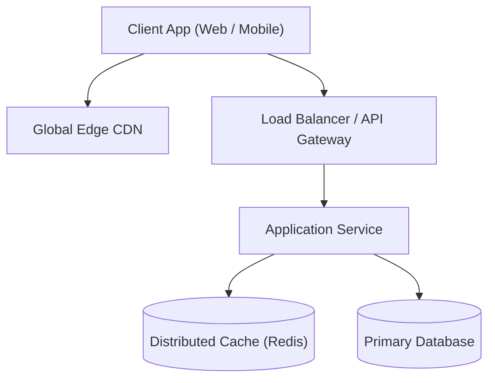
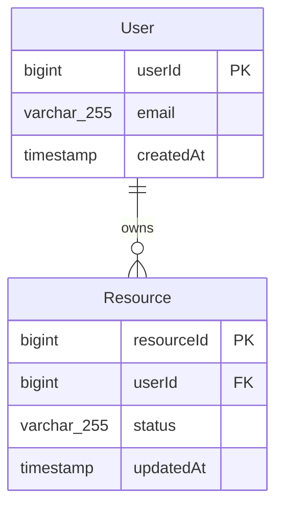
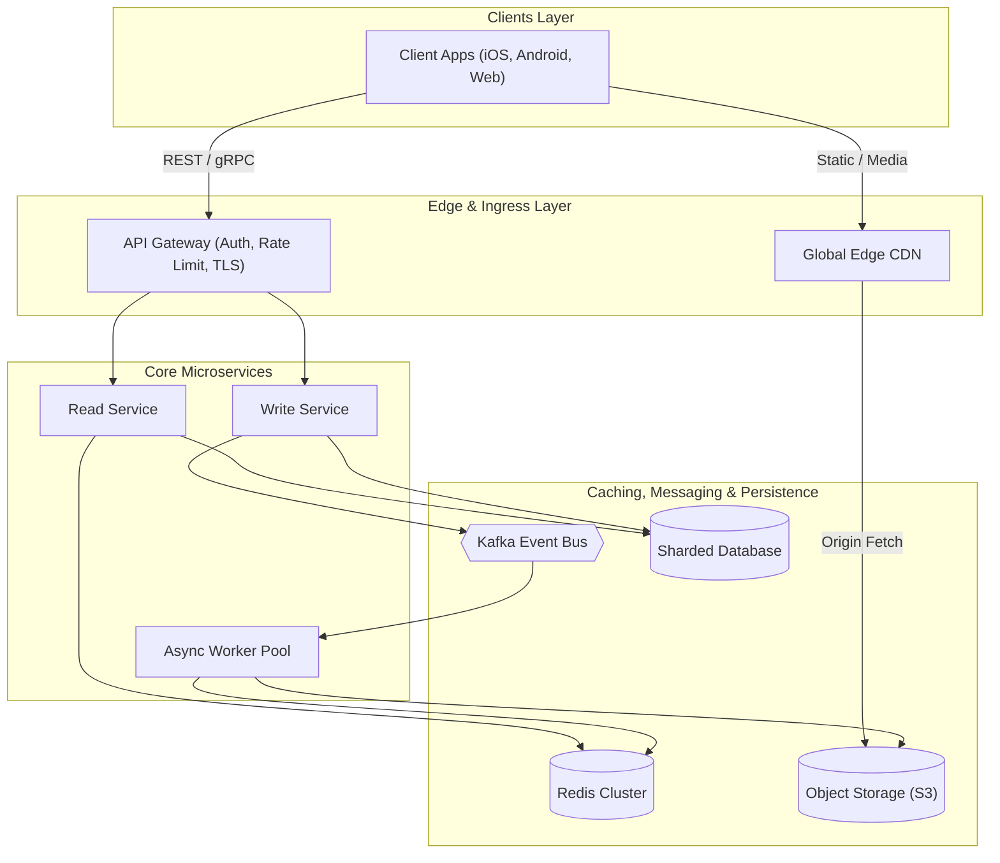

# Template System Design

[← Back to System Design](system-design.md)

## Overview

## Functional Requirements

## Non-Functional Requirements

## Back of the Envelope Estimations

## High-Level System Architecture

## Core Components & Data Flows

## API Endpoints

## Object Model & Database Schema

## System Design Diagram

## Deep Dive & Key Technical Challenges

## Additional Notes

### Video References
