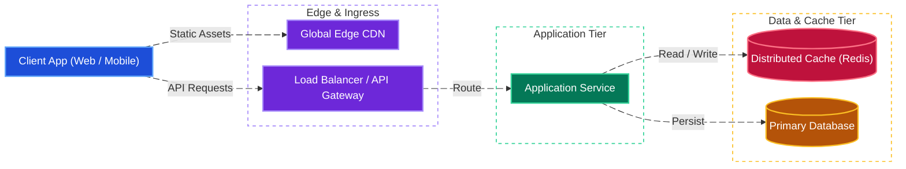
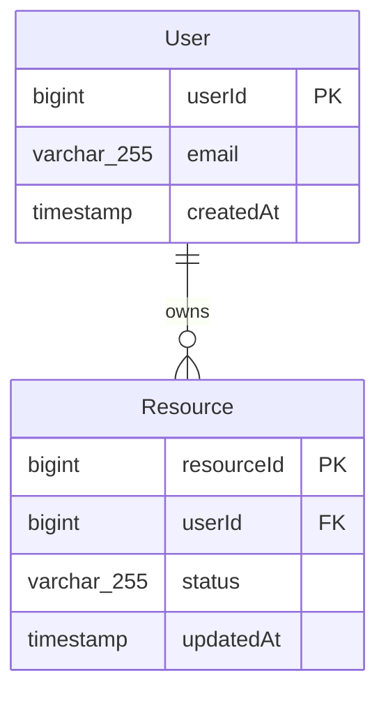
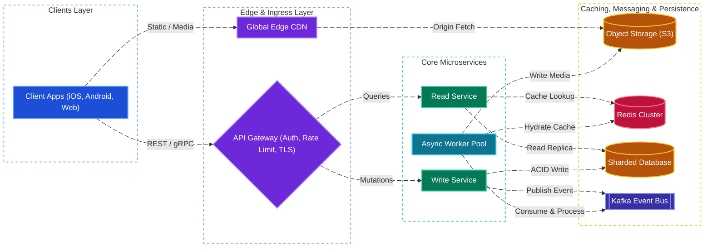

# Template System Design

[← Back to System Design](system-design.md)

## Overview

## Functional Requirements

## Non-Functional Requirements

## Back of the Envelope Estimations

## High-Level System Architecture

## Core Components & Data Flows

## API Endpoints

## Object Model & Database Schema

### Database Selection & Rationale

| Workload / Domain | Database Choice | Data Model & CAP Profile | Why This Database? (Justification & Trade-offs) |
| :--- | :--- | :--- | :--- |
| **Core Transactional Data** | **PostgreSQL / Amazon Aurora** | Relational (ACID, **CP / PC-EC**) | Enforces strict referential integrity, multi-row ACID transactions, and strong consistency for core entity mutations. Sharded by `userId` or `resourceId` as volume scales. |
| **High-Throughput / Time-Series Logs** | **Apache Cassandra / DynamoDB** | Wide-Column / Key-Value (**AP / PA-EL**) | Optimized for high-velocity append-only writes and predictable single-digit millisecond reads by partition key, trading cross-partition joins for linear horizontal scalability. |
| **Hot Lookups & Distributed Locks** | **Redis Cluster** | In-Memory Key-Value (**AP / Sub-ms**) | Absorbs $80\text{--}90\%$ of read traffic in front of the primary database and supports atomic operations (`SETNX`, Lua scripts, Sorted Sets) for rate limiting and ephemeral state. |
| **Full-Text & Faceted Search** | **Elasticsearch / OpenSearch** | Inverted Index (**AP / Near Real-Time**) | Enables fuzzy full-text search, multi-attribute filtering, and relevance scoring that would cause expensive full-table scans (`LIKE '%...%'`) in a relational database. |
| **Unstructured Media & Blobs** | **Amazon S3 + Edge CDN** | Object Storage (**11 9s Durability**) | Keeps multi-megabyte binary payloads out of transactional database pages, reducing DB buffer pool pressure and delivering static assets globally from edge PoPs. |

## System Design Diagram

## Deep Dive & Key Technical Challenges

## Additional Notes

### Video References
