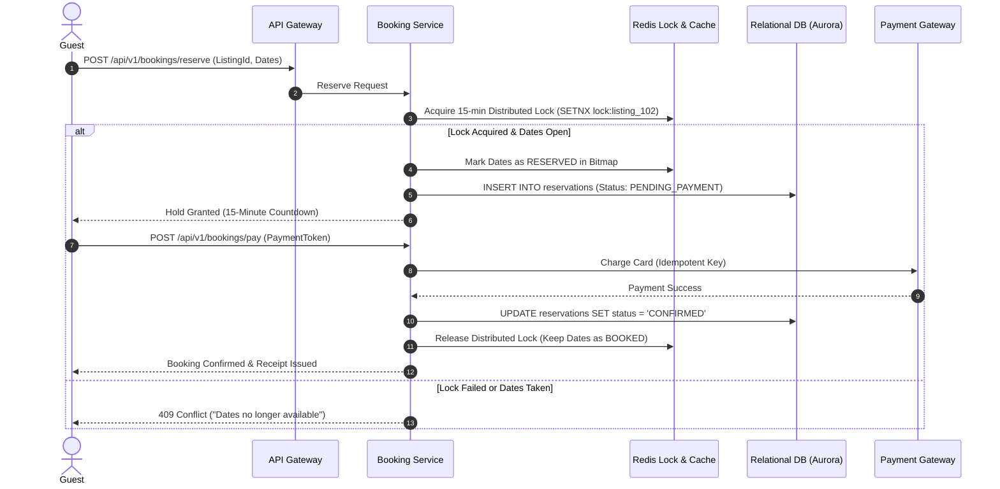
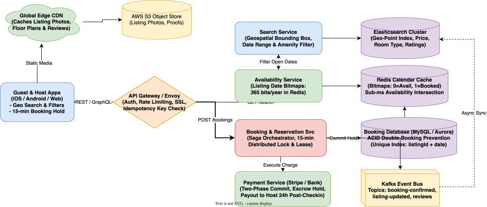

# Airbnb System Design

[← Back to System Design](../system-design.md)

## Overview

Airbnb is a global two-sided online marketplace connecting guests looking for accommodations (vacation rentals, boutique stays, experiences) with hosts looking to monetize their properties. The platform serves over 150 million users and 7+ million active listings across 220+ countries.

A comprehensive system design for Airbnb centers around three core distributed systems challenges:

1. **Low-Latency Geospatial & Availability Search**: Filtering millions of listings by location, price, amenities, and real-time open date intervals within $< 200\text{ ms}$.
2. **Zero Double-Booking Guarantee (ACID)**: Ensuring two guests never successfully book overlapping dates for the same listing, even during concurrent checkout races.
3. **Availability Calendar Modeling**: High-performance representation and querying of 365-day availability vectors per listing.

---

## Functional Requirements

* **Search & Discovery**: Guests can search properties by destination (city, coordinates, radius), dates (check-in / check-out), guest count, price bounds, and amenities (WiFi, pool, pets).
* **Listing Management**: Hosts can create and manage property listings, upload high-resolution photos, configure house rules, and set base/seasonal pricing.
* **Availability Calendar**: Hosts manage an interactive calendar blocking dates or adjusting daily rates; guests can view real-time open dates.
* **Reservation & 15-Minute Hold**: Guests can initiate a reservation, placing a temporary 15-minute distributed lock on the requested dates to complete payment without losing the room.
* **Payment Processing**: Process payments securely (credit cards, PayPal, Apple Pay) with split fees; hold funds in escrow and release payout to the host 24 hours after successful guest check-in.
* **Reviews & Trust**: Mutual double-blind reviews (neither party sees the other's review until both submit or 14 days expire).

---

## Non-Functional Requirements

* **Ultra-Low Search Latency**: P95 search query response time must be **$< 200\text{ ms}$**.
* **Zero Double-Bookings (Strict Consistency)**: Under no circumstances should two distinct users successfully reserve the same property on overlapping dates.
* **High Availability for Search (99.99%)**: Searching and browsing listings must remain available even if backend booking or payment services experience transient degradation.
* **Idempotent Payment Transactions**: Network retries during checkout must never double-charge the guest.
* **High Durability**: Financial ledger records, booking confirmations, and host contracts must have 100% durability across multi-region backups.

---

## Back of the Envelope Estimations

### Scale & Traffic

* **Total Registered Users**: $150\text{ Million}$.
* **Active Property Listings**: $7\text{ Million listings globally}$.
* **Daily Active Users (DAU)**: $25\text{ Million}$.
* **Search Queries per Day**:
  $$25,000,000\text{ users} \times 4\text{ searches/day} = 100,000,000\text{ searches/day}$$
* **Average Search QPS**:
  $$\text{Search QPS} = \frac{100,000,000}{86,400} \approx 1,160\text{ QPS} \quad (\text{Peak: } \approx 4,000\text{ QPS})$$
* **Bookings per Day**: $\approx 1,000,000\text{ bookings/day}$.
* **Booking Creation QPS**:
  $$\text{Booking QPS} = \frac{1,000,000}{86,400} \approx 12\text{ writes/sec} \quad (\text{Peak: } \approx 50\text{ QPS})$$

### Storage Requirements

* **Listing Metadata**: $\approx 2\text{ KB}$ per listing.
  $$7,000,000 \times 2\text{ KB} \approx 14\text{ GB (easily cached in RAM)}$$
* **Listing Photos**:
  * Average 20 photos per listing @ $1.5\text{ MB}$ compressed $= 30\text{ MB per listing}$.
  * Total Media Storage:
    $$7,000,000 \times 30\text{ MB} \approx 210\text{ Terabytes}$$ (stored in AWS S3 and cached via edge CDN).
* **Availability Calendar Cache (Redis Bitmaps)**:
  * 365 days represented as a 365-bit bitfield per listing ($46\text{ bytes per listing per year}$).
  * Total Calendar RAM in Redis:
    $$7,000,000 \times 46\text{ bytes} \approx 322\text{ Megabytes!}$$
    *(Enables blazing fast, microsecond bitwise AND intersection operations).*

---

## High-Level System Architecture

```text
                                  ┌────────────────────────┐
                                  │      Client Apps       │
                                  │ (iOS / Android / Web)  │
                                  └────┬──────────────┬────┘
                                       │              │
                    1. Fetch Media     │              │ 2. Dynamic APIs
                       (Edge CDN)      │              │    (REST / GraphQL)
                                       ▼              ▼
┌─────────────────────────────────────────────┐    ┌─────────────────────────────────┐
│              MEDIA PIPELINE & CDN           │    │       APPLICATION BACKEND       │
│                                             │    │                                 │
│  ┌──────────────────┐ ┌──────────────────┐  │    │  ┌───────────────────────────┐  │
│  │ Global Edge CDN  │ │ AWS S3           │  │    │  │    API Gateway / Envoy    │  │
│  │ (Photos/Reviews) │◀┼─(Master Photos)  │  │    │  └─────────────┬─────────────┘  │
│  └──────────────────┘ └──────────────────┘  │    │                │                │
└─────────────────────────────────────────────┘    │  ┌─────────────┼─────────────┐  │
                                                   │  ▼             ▼             ▼  │
                                                   │┌────────┐ ┌────────┐ ┌────────┐ │
                                                   ││ Search │ │ Avail. │ │Booking │ │
                                                   ││Service │ │Service │ │Service │ │
                                                   │└───┬────┘ └───┬────┘ └───┬────┘ │
                                                   └────┼──────────┼──────────┼──────┘
                                                        │          │          │
                                                        ▼          ▼          ▼
                                                   ┌─────────┐┌─────────┐┌─────────┐
                                                   │ Elastic-││ Redis   ││ MySQL / │
                                                   │ search  ││ Calendar││ Aurora  │
                                                   │ Cluster ││ Bitmaps ││ (ACID)  │
                                                   └─────────┘└─────────┘└─────────┘
```

---

## Core Components & Workflows

### 1. High-Performance Availability Calendar (Redis Bitmaps)

Checking whether a listing is available for an 8-day check-in range via standard SQL `BETWEEN` joins across 7 million rows causes catastrophic latency.

* **The Bitmap Solution**:
  * For every listing, maintain a 365-bit bitfield in Redis for the upcoming year:
    * `0` = Date is available.
    * `1` = Date is booked or blocked by host.
  * Day 0 = Jan 1st, Day 1 = Jan 2nd, etc.
* **Checking Availability**:
  * A guest searches for dates Day 10 to Day 15 (a 6-day stay).
  * The service executes a single Redis `BITFIELD GET` or masks the byte range. If any bit in the range is `1`, the property is unavailable.
  * **Bitwise Search Intersections**: To filter available listings in a city, the Search Service intersects the city's listing candidates against the calendar bitmap in sub-milliseconds.

### 2. Concurrency Control & Double-Booking Prevention

When a guest initiates checkout, the requested dates must be protected against race conditions.



* **Relational Hard Constraint (Final Defense)**:
  * Even if Redis crashes, the relational database guarantees zero double-bookings via a database constraint table:

  ```sql
  CREATE TABLE listing_booked_dates (
      listing_id BIGINT NOT NULL,
      stay_date DATE NOT NULL,
      reservation_id VARCHAR(64) NOT NULL,
      PRIMARY KEY (listing_id, stay_date)
  );
  ```

  * During final checkout commit, the transaction attempts to insert each day of the stay. If another user committed the same day micro-seconds earlier, the `PRIMARY KEY` violation triggers a clean rollback with zero financial discrepancy.

---

## API Specifications

### 1. Search Listings

```http
GET /api/v1/listings/search?lat=37.7749&lon=-122.4194&radiusKm=20&checkIn=2026-11-01&checkOut=2026-11-06&guests=2
Authorization: Bearer <token>
```

```json
// Response: 200 OK
{
  "listings": [
    {
      "listingId": "lst_9918231",
      "title": "Sunlit Modern Loft near Union Square",
      "pricePerNight": 195.00,
      "currency": "USD",
      "rating": 4.94,
      "reviewCount": 128,
      "thumbnailUrl": "https://cdn.airbnb.com/pictures/lst_9918231_thumb.webp",
      "location": {"lat": 37.7891, "lon": -122.4014}
    }
  ],
  "totalResults": 412,
  "nextPageCursor": "cur_8812a"
}
```

### 2. Reserve Listing (Initiate 15-Minute Hold)

```http
POST /api/v1/bookings/reserve
Authorization: Bearer <guest_token>
Content-Type: application/json
```

```json
// Request
{
  "listingId": "lst_9918231",
  "checkInDate": "2026-11-01",
  "checkOutDate": "2026-11-06",
  "numberOfGuests": 2,
  "idempotencyKey": "idem_8910248102a"
}

// Response: 201 Created
{
  "reservationId": "resv_449012a",
  "holdExpiresAt": 1730006100,
  "totalPrice": 975.00,
  "cleaningFee": 80.00,
  "serviceFee": 120.00,
  "status": "HOLD_PENDING_PAYMENT"
}
```

---

## Object Model & Database Schema

```text
┌───────────────────────┐          ┌───────────────────────┐
│         User          │1        *│        Listing        │
├───────────────────────┤──────────├───────────────────────┤
│ userId: PK (BigInt)   │          │ listingId: PK (BigInt)│
│ email: Varchar(255)   │          │ hostId: FK (BigInt)   │
│ isHost: Boolean       │          │ title: Varchar(255)   │
│ rating: Decimal(3,2)  │          │ pricePerNight: Decimal│
│ createdAt: Timestamp  │          │ latitude, longitude   │
└──────────┬────────────┘          │ roomType: Enum        │
           │1                      │ maxGuests: Int        │
           │*                      └───────────┬───────────┘
┌──────────▼────────────┐                      │1
│      Reservation      │*                     │*
├───────────────────────┤          ┌───────────▼───────────┐
│ resvId: PK (UUID)     │          │      ListingDate      │
│ guestId: FK (User)    │          ├───────────────────────┤
│ listingId: FK (List.) │          │ listingId: PK, FK     │
│ checkInDate: Date     │          │ stayDate: PK (Date)   │
│ checkOutDate: Date    │          │ reservationId: FK     │
│ status: Enum(HOLD,PD) │          │ price: Decimal        │
│ totalPrice: Decimal   │          │ isBlocked: Boolean    │
└───────────────────────┘          └───────────────────────┘
```

---

## System Design Diagram



[Download Draw.io File](airbnb.drawio)

---

## Deep Dive & Key Technical Challenges

### 1. Geospatial Indexing & Search Ranking

* **Elasticsearch with Geo-Distance Filters**: Properties are indexed using Elasticsearch `geo_point` fields. The primary search query matches bounding boxes or radial distances from the target center.
* **Multi-Factor Ranking Model**:
  * Listing quality score (photo count, resolution, verified status).
  * Host response rate and Superhost status.
  * Historic conversion rate and competitive pricing against neighborhood medians.

### 2. Handling Host Cancellation & Escrow Payouts

* **Escrow Hold**: Guests are charged upon booking, but funds are not sent to the host immediately. Funds sit in an escrow clearing account to safeguard against host scams or last-minute property destruction.
* **Automated Payout Trigger**: 24 hours after verified guest check-in (providing the guest has not opened a dispute via Customer Support), a background Kafka consumer triggers an automated ACH / wire payout to the host via Stripe Connect.

### 3. Dynamic Smart Pricing Engine

* **Offline Model Training**: XGBoost / Deep Neural Net trained on historical bookings, seasonal demand, local event calendars (concerts, conferences), lead times, and competitor market supply.
* **Online Pricing Hydration**: Daily prices per listing are updated every night and written to Redis cache. Real-time adjustments occur when local neighborhood supply dips below 15% occupancy.

### 4. Cross-Platform Calendar Synchronization (iCal / RFC 5545)

* Hosts frequently list properties on multiple platforms (Airbnb, VRBO, Booking.com).
* **Two-Way iCal Polling**:
  * A worker pool periodically fetches external `.ics` feeds every 15–30 minutes, parses `VEVENT` blocks, and atomically blocks conflicting dates in the local Redis availability bitmap and SQL ledger.
  * Airbnb exposes unique host iCal endpoints with cryptographic token verification (`/calendar/ical/<listing_id>.ics?token=...`) so external OTAs can pull Airbnb bookings.
* **Race Condition Mitigation**: If a direct Airbnb guest and an external VRBO sync attempt to claim the same night simultaneously, the atomic DB constraint on `listing_booked_dates` rejects the later write and sends an immediate alert to the host.

### 5. Instant Book vs Request-to-Book Workflow

```text
[ Guest Initiates ]
         │
         ├─── Instant Book? ────► [ Acquire 15-min Hold ] ──► [ Payment ] ──► [ Confirmed ]
         │
         └─── Request to Book ──► [ Hold Notification ] ──► [ Host 24-hr Decision ]
                                                                   │
                                           ┌───────────────────────┴───────────────────────┐
                                           ▼                                               ▼
                                    [ Host Accepts ]                                [ Host Rejects ]
                                           │                                               │
                                 [ Trigger Payment Auth ]                           [ Release Hold ]
```

---

## Additional Notes

### Video References

* [](https://www.youtube.com/watch?v=m67Mjbx6DMY)
