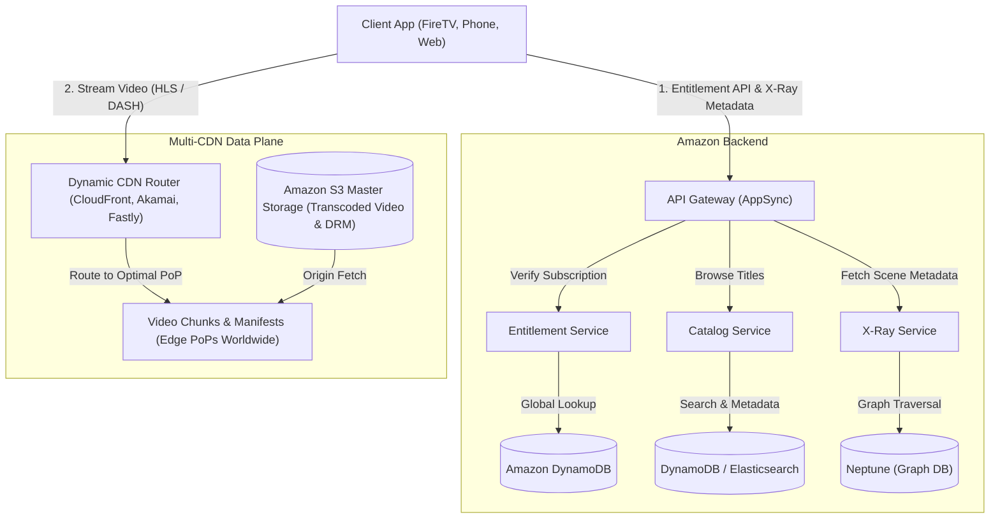
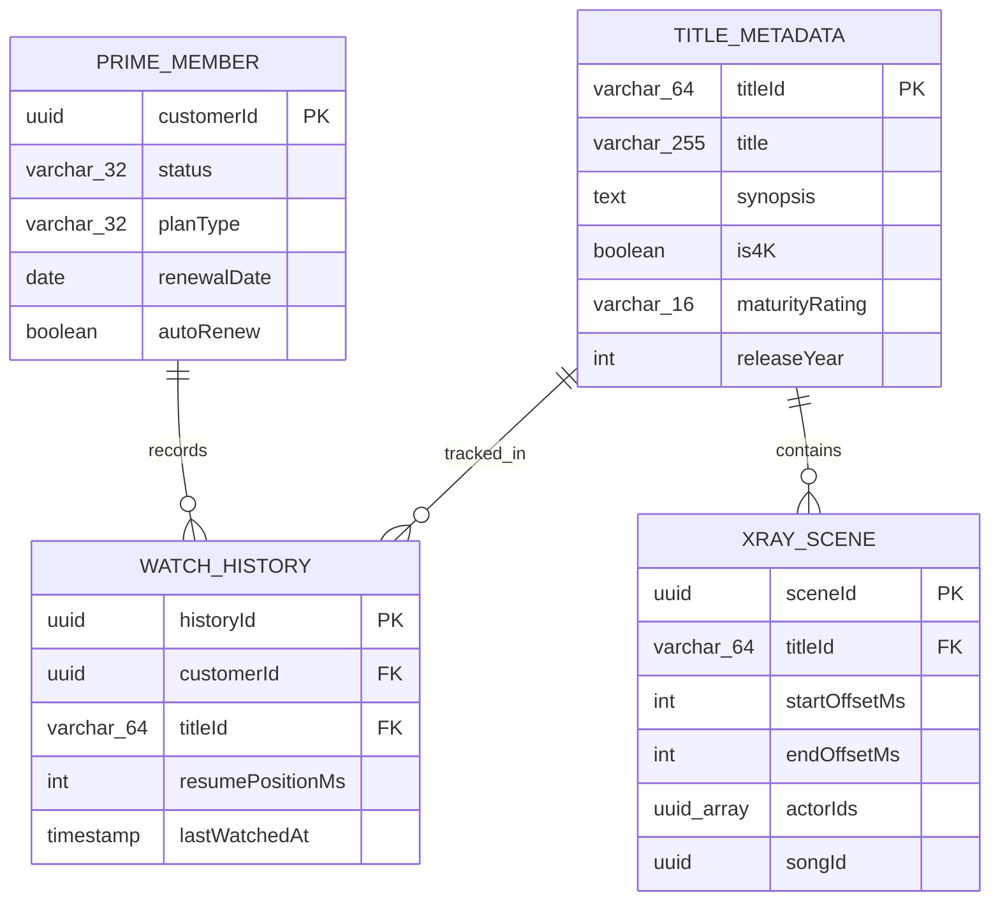
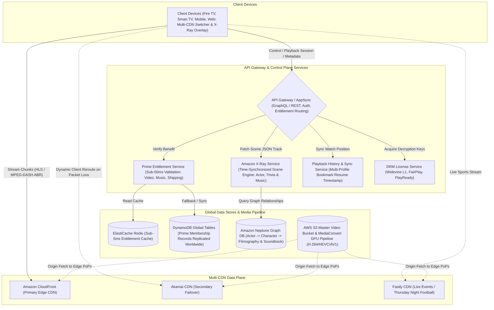

# Amazon Prime System Design

[← Back to System Design](system-design.md)

## Overview

Amazon Prime is a global multi-benefit subscription platform encompassing Prime Video on-demand streaming, Prime Music, e-commerce fast delivery benefits, Twitch gaming, and cloud photo storage.

In a system design interview, Amazon Prime is typically explored through the lens of **Prime Video** and its integration with the centralized **Prime Entitlement Service**, featuring real-time scene metadata synchronization (**Amazon X-Ray**), dynamic multi-CDN switching, digital rights management (DRM), and offline media synchronization.

---

## Functional Requirements

* **Unified Entitlement & Access Control**: Validate active Prime subscription status across multiple product verticals (Video, Music, Fast Shipping) with microsecond latency.
* **Prime Video Adaptive Streaming**: Stream high-definition, 4K HDR, and live sports (e.g., Thursday Night Football) using HLS and MPEG-DASH.
* **Amazon X-Ray Synchronization**: Real-time display of on-screen actors, character trivia, and background soundtrack music synchronized with the exact video playback timestamp.
* **Offline Media Downloads**: Encrypted, time-limited video downloads on iOS, Android, and Fire devices.
* **Multi-Profile & Watchlist Sync**: Support up to 6 household profiles with synchronized watch history and bookmark positions.

---

## Non-Functional Requirements

* **Ultra-Low Entitlement Check Latency**: Subscription validation must complete in **$< 50\text{ ms}$** to avoid delaying page or stream loads.
* **Streaming Availability (99.99%)**: Video streaming must remain resilient even during massive concurrent live events.
* **Adaptive Bitrate & Zero Buffering**: Smooth playback across fluctuating cellular and home broadband connections.
* **Multi-CDN Redundancy**: Avoid single-point-of-failure CDN outages by dynamically load-balancing between Amazon CloudFront, Akamai, and Fastly.
* **Strict Content Protection**: Hardware-backed DRM (Widevine Level 1, Apple FairPlay, Microsoft PlayReady).

---

## Back of the Envelope Estimations

### Scale & Concurrency

* **Total Global Prime Subscribers**: $200\text{ Million}$.
* **Prime Video Daily Active Users (DAU)**: $60\text{ Million}$.
* **Average Video Stream Time**: $1.5\text{ hours/day}$ per active user.
* **Daily Video Hours Streamed**:
  $$60,000,000 \times 1.5 = 90,000,000\text{ hours/day}$$
* **Peak Streaming Bandwidth**:
  * Average bitrate of $4\text{ Mbps}$, evening peak 4-hour window delivering $40\%$ of volume:
  $$\text{Peak Bandwidth} = \frac{0.40 \times (90\text{M} \times 3,600\text{ s} \times 4\text{ Mbps})}{4 \times 3,600\text{ seconds}} \approx 36\text{ Terabits per second (Tbps)}$$
* **Live Sports Peak (Thursday Night Football)**:
  * Up to $15\text{ Million concurrent live streams} \times 6\text{ Mbps (1080p60)} \approx 90\text{ Tbps concurrent delivery}$!

---

## High-Level System Architecture



---

## Core Components & Deep Dives

### 1. Unified Entitlement Service

* Prime subscription status is authoritative in Amazon's Core Customer Account database.
* To avoid hitting the core database on every video play or e-commerce checkout, the **Entitlement Service** publishes updates to **Amazon DynamoDB Global Tables** replicated worldwide.
* In-memory caches (ElastiCache Redis) provide sub-5ms entitlement checks (`hasActiveBenefit(userId, 'PRIME_VIDEO')`).

### 2. Amazon X-Ray: Time-Synchronized Metadata Engine

* **How it works**:
  * During studio ingestion, computer vision facial recognition and audio fingerprinting scan each video frame to detect actors, characters, and background music tracks.
  * Graph relationships (Actor $\to$ Character $\to$ Filmography) are stored in **Amazon Neptune** (Graph Database).
  * The client receives a lightweight JSON metadata track aligned with video timestamps:

  ```json
  {
    "sceneStartMs": 142000,
    "sceneEndMs": 185000,
    "actors": [
      {"name": "Karl Urban", "character": "Billy Butcher", "photoUrl": "..."}
    ],
    "music": {
      "trackTitle": "London Calling",
      "artist": "The Clash",
      "amazonMusicUrl": "..."
    }
  }
  ```

  * As the video player timeline advances, the client UI updates on-screen actor overlays seamlessly without backend network calls.

### 3. Dynamic Multi-CDN Switching

* Relying on a single CDN for high-profile events (e.g., Premier League or NFL live games) presents catastrophic outage risk.
* **Client-Side Real-Time CDN Rerouting**:
  * The video player continuously measures chunk download latency, TCP connection errors, and throughput across multiple CDNs (CloudFront, Akamai, Fastly).
  * If CloudFront experiences packet loss or throttling in a specific ISP region, the player dynamically switches to requesting subsequent chunks from Akamai without stuttering or video restart.

---

## API Endpoints

### 1. Verify Entitlement & Fetch Stream Manifest

```http
POST /api/v1/video/playback/session
Authorization: Bearer <auth_token>
Content-Type: application/json
```

```json
// Request
{
  "titleId": "amzn1.dv.gti.89b1248a",
  "profileId": "prof_1028",
  "clientInfo": {
    "deviceType": "FIRE_TV_4K",
    "drmScheme": "PLAYREADY"
  }
}

// Response: 200 OK
{
  "playbackUrl": "https://d12345.cloudfront.net/manifests/89b1248a.mpd",
  "backupUrl": "https://akamai.primevideo.com/manifests/89b1248a.mpd",
  "xrayMetadataUrl": "https://xray.amazon.com/scenes/89b1248a.json",
  "drmLicenseUrl": "https://drm.amazon.com/license",
  "resumePositionMs": 420100
}
```

---

## Object Model & Database Schema



---

## System Design Diagram



---

## Additional Notes

### Video References

* [](https://www.youtube.com/watch?v=v6qvrIY5Tgs)
* [](https://www.youtube.com/watch?v=7hZXBrI2TjY)
