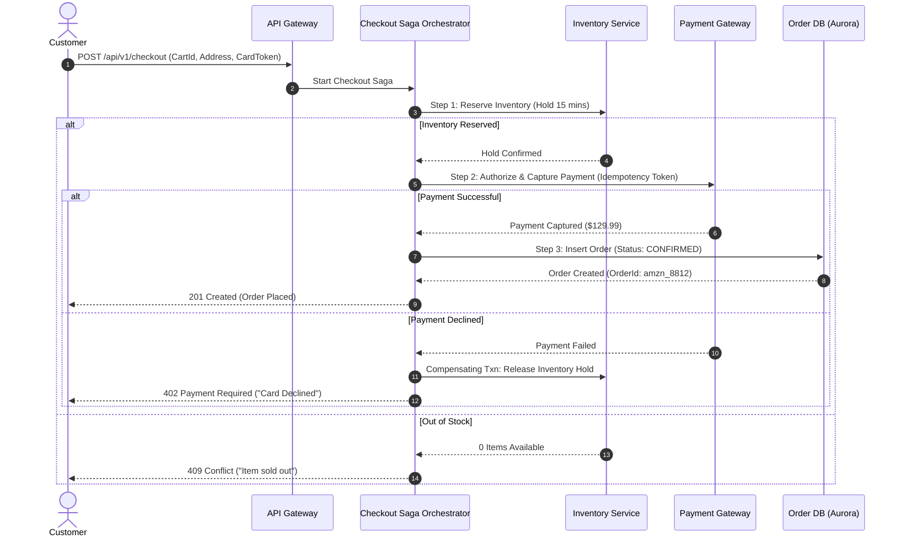
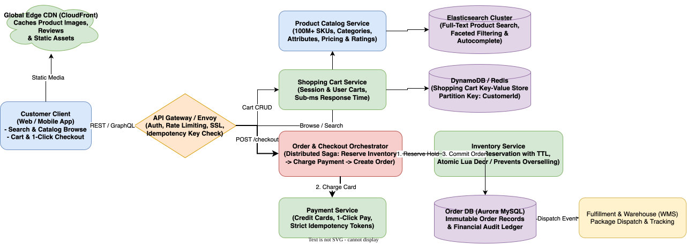

# Amazon E-Commerce System Design

[← Back to System Design](../system-design.md)

## Overview

Amazon is the world's largest online retail e-commerce platform, serving over 300 million active customer accounts and listing hundreds of millions of unique products (SKUs). The system operates globally, handling everything from product browsing and personalized recommendations to multi-item shopping carts, high-throughput flash-sale checkout, payment settlement, inventory tracking, and warehouse fulfillment.

In a system design interview, designing Amazon focuses on:

1. **Catalog & Search**: High-volume, faceted search over hundreds of millions of items with dynamic pricing.
2. **Shopping Cart Persistence**: Highly available cart state that survives cross-device logins.
3. **Inventory Reservation & Flash Sales**: Strict ACID inventory reservation preventing overselling when hundreds of thousands of users attempt to purchase limited stock simultaneously (e.g., Prime Day).
4. **Checkout Saga Orchestration**: Distributed coordination across inventory holds, payment authorization, order creation, and fulfillment.

---

## Functional Requirements

* **Product Catalog & Search**: Browse hierarchical product categories; search products by keywords with faceted filters (brand, price, ratings, Prime shipping).
* **Shopping Cart**: Add, update, remove items; save for later; persist cart across user devices.
* **Checkout & 1-Click Buy**: Select delivery address, choose shipping speed, and complete payment.
* **Inventory Reservation**: Temporarily reserve items during checkout to prevent overselling; auto-release stock if the user abandons checkout.
* **Order Tracking & History**: View past orders, real-time shipment status, and return requests.
* **Reviews & Q&A**: Verified-purchase customer reviews and ratings.

---

## Non-Functional Requirements

* **Ultra-Low Browse Latency**: Catalog and search results must load in **$< 150\text{ ms}$** (P95).
* **High Availability for Browsing (99.999%)**: Browsing and adding items to cart must never fail.
* **Strict Consistency for Inventory & Billing**: Zero overselling of stock; payments must be strictly idempotent (never double-charge a customer).
* **Massive Peak Scale**: Handle **$10\times$ to $50\times$ traffic surges** during Prime Day flash sales.
* **Durability**: Placed orders and financial audit records must have 100% durability.

---

## Back of the Envelope Estimations

### Scale & Concurrency

* **Registered Customers**: $300\text{ Million}$.
* **Active Product Catalog**: $100\text{ Million unique SKUs}$.
* **Daily Active Users (DAU)**: $50\text{ Million}$.
* **Daily Product Views**:
  $$50,000,000\text{ users} \times 10\text{ views/day} = 500,000,000\text{ views/day}$$
* **Average Catalog Read QPS**:
  $$\text{Read QPS} = \frac{500,000,000}{86,400} \approx 5,800\text{ QPS} \quad (\text{Peak: } \approx 25,000\text{ QPS})$$
* **Daily Orders Placed**: $\approx 10,000,000\text{ orders/day}$.
* **Average Order Write QPS**:
  $$\text{Order QPS} = \frac{10,000,000}{86,400} \approx 115\text{ orders/sec} \quad (\text{Peak / Flash Sales: } \approx 5,000\text{ orders/sec})$$

### Storage Requirements

* **Product Catalog Size**:
  * Average $5\text{ KB}$ per SKU (title, description, specs, category, pricing, variations):
  $$100,000,000 \times 5\text{ KB} \approx 500\text{ Gigabytes}$$
  *(Product metadata fits entirely within a distributed cache / DynamoDB table).*
* **Order Records Storage**:
  * Average order payload $\approx 2\text{ KB}$:
  $$10,000,000\text{ orders/day} \times 2\text{ KB} = 20\text{ GB/day} \implies \approx 7.3\text{ TB/year}$$

---

## High-Level System Architecture

```text
                                  ┌────────────────────────┐
                                  │      Client Apps       │
                                  │   (Web / Mobile App)   │
                                  └────┬──────────────┬────┘
                                       │              │
                    1. Fetch Media     │              │ 2. Dynamic APIs
                       (CloudFront)    │              │    (REST / GraphQL)
                                       ▼              ▼
┌─────────────────────────────────────────────┐    ┌─────────────────────────────────┐
│              MEDIA PIPELINE & CDN           │    │       APPLICATION BACKEND       │
│                                             │    │                                 │
│  ┌──────────────────┐ ┌──────────────────┐  │    │  ┌───────────────────────────┐  │
│  │ CloudFront CDN   │ │ AWS S3           │  │    │  │    API Gateway / Envoy    │  │
│  │ (Product Images) │◀┼─(Asset Masters)  │  │    │  └─────────────┬─────────────┘  │
│  └──────────────────┘ └──────────────────┘  │    │                │                │
└─────────────────────────────────────────────┘    │  ┌─────────────┼─────────────┐  │
                                                   │  ▼             ▼             ▼  │
                                                   │┌────────┐ ┌────────┐ ┌────────┐ │
                                                   ││Catalog │ │  Cart  │ │Checkout│ │
                                                   ││Service │ │Service │ │  Saga  │ │
                                                   │└───┬────┘ └───┬────┘ └───┬────┘ │
                                                   └────┼──────────┼──────────┼──────┘
                                                        │          │          │
                                                        ▼          ▼          ▼
                                                   ┌─────────┐┌─────────┐┌─────────┐
                                                   │ Elastic-││ DynamoDB││Inventory│
                                                   │ search  ││ (Carts) ││ Service │
                                                   │ Cluster ││         ││ (Locks) │
                                                   └─────────┘└─────────┘└─────────┘
```

---

## Core Workflows & Deep Dives

### 1. Flash Sale Inventory Reservation (Zero Overselling)

When a flash sale launches (e.g., 1,000 discounted PlayStation consoles with 50,000 concurrent checkout clicks), hitting a relational database row with `UPDATE inventory SET stock = stock - 1` results in catastrophic row lock contention and database timeouts.

* **Two-Phase Inventory Reservation**:
  1. **Phase 1: Temporary Reservation (Hold)**:
     * When user enters checkout, the Inventory Service decrements stock using an **atomic Redis Lua script**:

     ```lua
     local stock = redis.call('GET', KEYS[1])
     if stock and tonumber(stock) >= tonumber(ARGV[1]) then
         redis.call('DECRBY', KEYS[1], ARGV[1])
         redis.call('SETEX', KEYS[2], 900, ARGV[1]) -- 15-min lease hold
         return 1
     else
         return 0
     end
     ```

     * If return is `1`, a 15-minute lease hold is granted.
  2. **Phase 2: Final Commit or Rollback**:
     * If payment succeeds: Inventory Service updates the relational inventory ledger asynchronously and permanently clears the hold.
     * If payment fails or times out: A scheduled cleanup job or TTL expiry automatically restores the reserved quantity (`INCRBY`).

### 2. Distributed Checkout Saga Orchestrator

Checkout is an asynchronous multi-service transaction:



---

## API Specifications

### 1. Search Catalog

```http
GET /api/v1/products/search?q=mechanical+keyboard&category=electronics&priceMax=150&primeOnly=true
```

```json
// Response: 200 OK
{
  "products": [
    {
      "skuId": "B089K891AZ",
      "title": "Wireless RGB Mechanical Gaming Keyboard",
      "price": 89.99,
      "rating": 4.7,
      "reviewCount": 18400,
      "isPrimeEligible": true,
      "inStock": true,
      "thumbnailUrl": "https://m.media-amazon.com/images/I/71xyz.jpg"
    }
  ],
  "totalResults": 1420
}
```

### 2. Place Order (Checkout)

```http
POST /api/v1/checkout
Authorization: Bearer <customer_token>
Content-Type: application/json
```

```json
// Request
{
  "cartId": "cart_99182a",
  "shippingAddressId": "addr_10284",
  "paymentMethodId": "pm_visa_8812",
  "idempotencyKey": "idem_tok_9918231024"
}

// Response: 201 Created
{
  "orderId": "114-8829104-9918231",
  "totalAmount": 97.41,
  "status": "ORDER_CONFIRMED",
  "estimatedDeliveryDate": "2026-10-29"
}
```

---

## Object Model & Database Schema

```text
┌───────────────────────┐          ┌───────────────────────┐
│       Customer        │1        *│         Order         │
├───────────────────────┤──────────├───────────────────────┤
│ customerId: PK (UUID) │          │ orderId: PK (Varchar) │
│ email: Varchar(255)   │          │ customerId: FK        │
│ isPrime: Boolean      │          │ totalAmount: Decimal  │
│ defaultAddressId: UUID│          │ status: Enum          │
│ createdAt: Timestamp  │          │ shippingAddress: JSON │
└──────────┬────────────┘          │ createdAt: Timestamp  │
           │1                      └───────────┬───────────┘
           │*                                  │1
┌──────────▼────────────┐                      │*
│        CartItem       │          ┌───────────▼───────────┐
├───────────────────────┤          │       OrderItem       │
│ cartId: PK (UUID)     │          ├───────────────────────┤
│ skuId: PK (Varchar)   │          │ orderId: PK, FK       │
│ quantity: Int         │          │ skuId: PK, FK         │
│ addedAt: Timestamp    │          │ unitPrice: Decimal    │
└───────────────────────┘          │ quantity: Int         │
                                   └───────────────────────┘
```

---

## System Design Diagram



[Download Draw.io File](amazon.drawio)

---

## Deep Dive & Key Technical Challenges

### 1. Dynamic Pricing & Buy Box Algorithm

* Multiple third-party sellers frequently offer the exact same product SKU.
* **The Buy Box Machine Learning Model**: Factors seller rating, fulfillment method (Fulfilled by Amazon / FBA vs. Merchant), shipping speed, price, and defect rate to award the "Add to Cart" button to the optimal seller.

### 2. Idempotency in Payment Processing

* If network times out between Amazon and the card processor, retrying with the same `idempotencyKey` returns the cached authorization token without charging the customer twice.

---

## Additional Notes

### Video References

* [](https://www.youtube.com/watch?v=EpASu_1dUdE)
