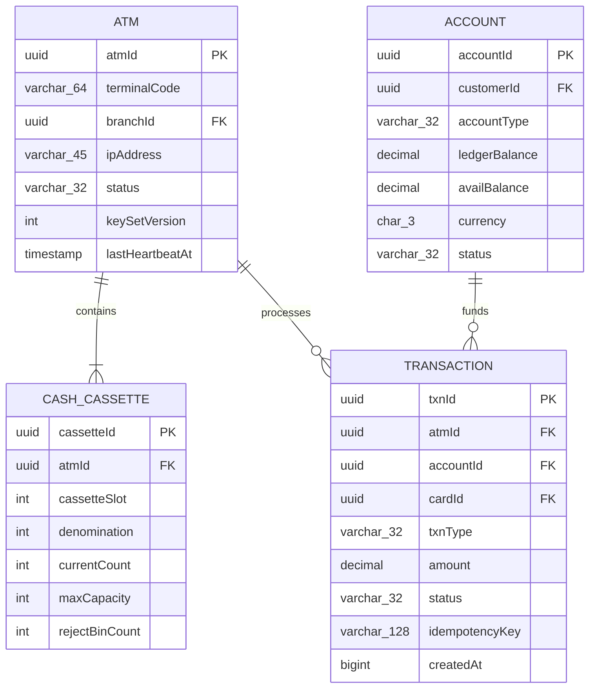
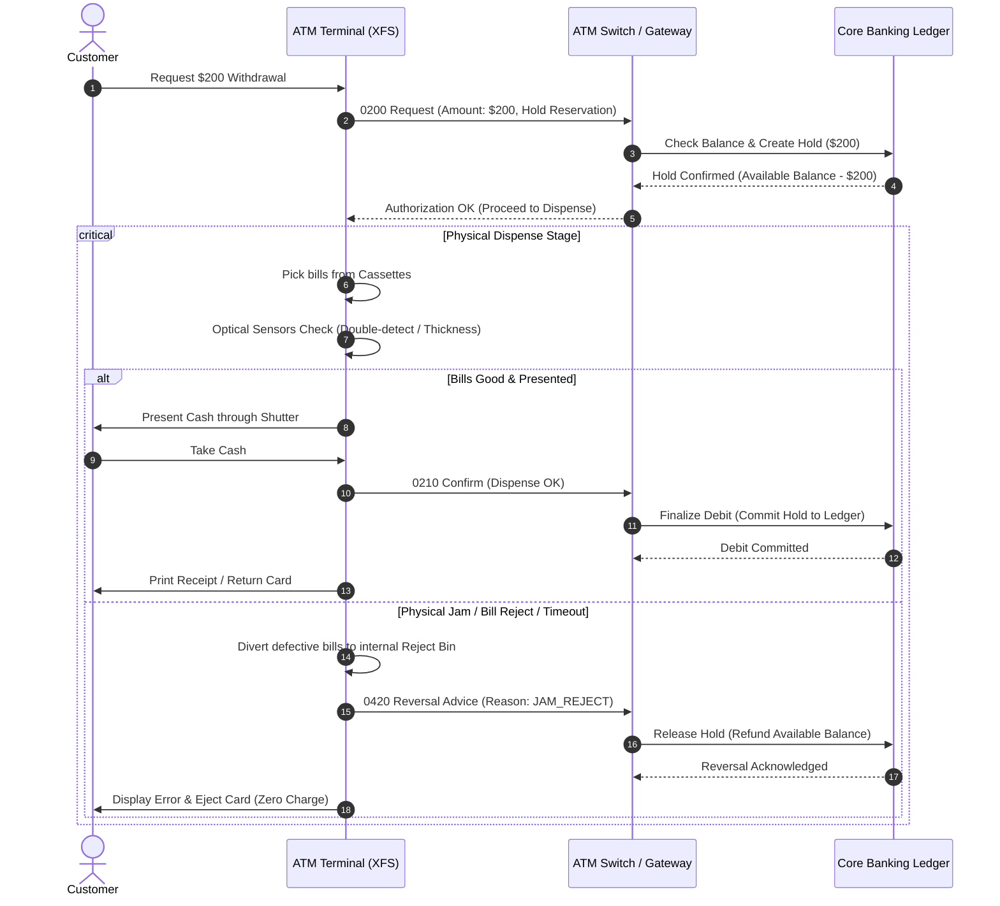

# ATM System Design

[← Back to System Design](system-design.md)

## Overview

An Automated Teller Machine (ATM) is a mission-critical, distributed banking terminal that allows bank customers to perform self-service financial transactions—including cash withdrawals, cash/check deposits, account balance inquiries, and funds transfers. The ATM system encompasses both specialized embedded hardware peripherals (card reader, encrypted PIN pad, cash dispenser with optical sensors, depository) and a highly secure, fault-tolerant backend infrastructure (ATM Controller / Switch, Hardware Security Modules, Core Banking Systems, and Interbank Payment Networks).

Because real money is physically dispensed, the system demands **zero-loss financial consistency (ACID)**, end-to-end hardware encryption, strict idempotency, and robust distributed transaction management to prevent money loss during network partitions or mechanical hardware jams.

---

## Functional Requirements

* **Card Authentication & PIN Verification**: Read chip (EMV), contactless (NFC), or magnetic stripe cards; authenticate user via Encrypted PIN Pad (EPP) using hardware security modules.
* **Cash Withdrawal**: Validate available balance and daily limits; count and dispense exact bills across multiple denomination cassettes; detect double-bills or dispenser jams.
* **Cash & Check Deposit**: Accept, validate, count, and store deposited bills/checks with optical recognition; credit customer account.
* **Balance Inquiry & Mini-Statement**: Retrieve real-time available and ledger balance, along with the last $N$ transactions.
* **Fund Transfers**: Transfer funds between linked accounts or to third-party accounts within the bank or across interbank networks.
* **Receipt Printing & Digital Slips**: Print physical receipt via thermal printer or send SMS/email confirmation.
* **ATM Inventory & Telemetry Management**: Real-time monitoring of cash cassette levels, receipt paper status, mechanical health, and physical security tamper sensors.
* **Card Retention & Confiscation**: Retain expired, stolen, or invalid cards after 3 consecutive failed PIN attempts or timeout.

---

## Non-Functional Requirements

* **Zero Financial Discrepancy (Strict ACID)**: Under no circumstances should cash be dispensed without an account debit, nor should an account be debited without cash being successfully dispensed or refunded.
* **High Availability (99.99%)**: The ATM switch and backend services must provide near-continuous availability. Individual ATMs must fail gracefully and enter an out-of-service state upon hardware faults.
* **Low Latency**: User interactions and backend validation round-trips must complete within **< 1.5 to 2.0 seconds**.
* **Hardware-Grade Security (PCI-DSS & EMV Level 2)**:
  * PINs must be encrypted immediately at the physical keypad (EPP) using Triple-DES (3DES) or AES with DUKPT (Derived Unique Key Per Transaction).
  * Plaintext PINs must **never** exist in application memory, logs, or network payloads.
* **Idempotency & Fault Tolerance**: Robust handling of network dropped connections, power cuts, and bill jams via compensating transactions (reversals).
* **Auditability & Non-Repudiation**: Immutable, cryptographically signed audit logs of every mechanical sensor event and transaction state transition.

---

## Back of the Envelope Estimations

### Scale & Traffic

* **Total ATMs in Network**: 100,000 ATMs across multiple geographic regions.
* **Average Daily Usage per ATM**: 250 transactions per day.
* **Total Daily Transactions**:
  $$\text{Daily Transactions} = 100,000 \times 250 = 25,000,000 \text{ transactions/day}$$
* **Average Queries / Transactions Per Second (TPS)**:
  $$\text{Average TPS} = \frac{25,000,000}{86,400} \approx 290 \text{ TPS}$$
* **Peak TPS** (Paydays, holidays, rush hours $\approx 5\times$ peak multiplier):
  $$\text{Peak TPS} \approx 1,500 \text{ TPS}$$

### Storage & Audit Logs

* **Transaction Record Size**: $\approx 1.5\text{ KB}$ (card metadata hash, ATM ID, amounts, dispenser sensor telemetry, ISO 8583 trace audit data).
* **Daily Database Storage**:
  $$25,000,000 \times 1.5\text{ KB} \approx 37.5\text{ GB/day}$$
* **Yearly Database Storage**:
  $$37.5\text{ GB} \times 365 \approx 13.7\text{ TB/year}$$
* **7-Year Regulatory Retention Archive**:
  $$13.7\text{ TB} \times 7 \approx 96\text{ TB}$$ (stored in immutable, write-once cold object storage e.g., AWS S3 Glacier with object lock).

### Cash Cassette Capacity

* Standard ATM holds **4 cash cassettes**, each holding **2,000 to 2,500 banknotes**.
* Typical configuration:
  * Cassette 1: \$100 bills ($2,000 \times \$100 = \$200,000$)
  * Cassette 2: \$50 bills ($2,000 \times \$50 = \$100,000$)
  * Cassette 3: \$20 bills ($2,500 \times \$20 = \$50,000$)
  * Cassette 4: \$10 bills ($2,000 \times \$10 = \$20,000$)
* Total max physical cash capacity per ATM $\approx \$370,000$.
* Cassette low-level threshold triggers automated armored carrier dispatch (cash-in-transit / CIT) when below 20% capacity.

---

## System Architecture

```mermaid
%%{init: {'flowchart': {'nodeSpacing': 25, 'rankSpacing': 45, 'padding': 10}}}%%
flowchart LR
    subgraph Peripherals["ATM Hardware Peripherals"]
        CardReader["Card Reader (EMV / NFC)"]
        EPP["Encrypted PIN Pad (EPP)"]
        Dispenser["Cash Dispenser & Sensors"]
    end
    subgraph ControllerTier["Terminal & Switch"]
        XFS["CEN / XFS Local State Machine"]
        Switch["ATM Gateway / Switch (ISO 8583)"]
    end
    subgraph CoreServices["Security & Coordinator"]
        HSM["Hardware Security Module (HSM)"]
        Telemetry["ATM Telemetry Service"]
        Coordinator["Transaction Coordinator (Saga)"]
    end
    subgraph LedgerTier["Core Banking & Networks"]
        CBS[("Core Banking Ledger (CBS)")]
        Interbank["Interbank Network (Visa / Plus)"]
    end
    CardReader e1@-->|"EMV Event"| XFS
    EPP e2@-->|"PIN Block"| XFS
    Dispenser e3@-->|"Sensor Data"| XFS
    XFS e4@-->|"TLS / ISO 8583"| Switch
    Switch e5@-->|"Verify PIN"| HSM
    Switch e6@-->|"Health Sync"| Telemetry
    Switch e7@-->|"Orchestrate"| Coordinator
    Coordinator e8@-->|"On-Us Card"| CBS
    Coordinator e9@-->|"Off-Us Card"| Interbank

    e1@{ animate: true }
    e2@{ animate: true }
    e3@{ animate: true }
    e4@{ animate: true }
    e5@{ animate: true }
    e6@{ animate: true }
    e7@{ animate: true }
    e8@{ animate: true }
    e9@{ animate: true }

    classDef client fill:#1d4ed8,stroke:#60a5fa,stroke-width:2px,color:#ffffff
    classDef edge fill:#6d28d9,stroke:#a78bfa,stroke-width:2px,color:#ffffff
    classDef service fill:#047857,stroke:#34d399,stroke-width:2px,color:#ffffff
    classDef worker fill:#0e7490,stroke:#22d3ee,stroke-width:2px,color:#ffffff
    classDef storage fill:#b45309,stroke:#fbbf24,stroke-width:2px,color:#ffffff
    classDef queue fill:#3730a3,stroke:#818cf8,stroke-width:2px,color:#ffffff

    class CardReader,EPP,Dispenser client
    class XFS,Switch edge
    class Coordinator,Telemetry service
    class HSM worker
    class CBS storage
    class Interbank queue

    style Peripherals fill:transparent,stroke:#60a5fa,stroke-width:1.5px,stroke-dasharray: 5 5
    style ControllerTier fill:transparent,stroke:#a78bfa,stroke-width:1.5px,stroke-dasharray: 5 5
    style CoreServices fill:transparent,stroke:#34d399,stroke-width:1.5px,stroke-dasharray: 5 5
    style LedgerTier fill:transparent,stroke:#fbbf24,stroke-width:1.5px,stroke-dasharray: 5 5
```



### Key Architectural Layers

1. **ATM Client Hardware & CEN/XFS**:
   * Runs an embedded operating system (Windows 10 IoT Enterprise or hardened Linux).
   * **CEN/XFS (eXtensions for Financial Services)** provides a standardized device driver API for controlling peripheral hardware (bill dispensers, motorized card readers, sensors).
   * Maintains a deterministic finite state machine (Idle $\to$ Card Inserted $\to$ PIN Verified $\to$ Selecting Transaction $\to$ Dispensing $\to$ Ejecting Card $\to$ Idle).

2. **ATM Gateway / Switch**:
   * Terminates persistent secure connections (TLS over TCP) from all ATMs.
   * Parses legacy financial protocol frames (**ISO 8583** / **AS 2805**) and routes them to modern microservices via gRPC.
   * Implements session authentication, sequence number tracking, and anti-replay protection.

3. **Hardware Security Module (HSM)**:
   * Dedicated cryptographic hardware appliance (FIPS 140-2 Level 3/4).
   * Translates PIN blocks encrypted with the ATM's terminal master key into zone keys for transport to the Core Banking System without exposing plaintext PINs.
   * Manages DUKPT key generation and CVV/EMV cryptogram validation.

4. **Transaction Coordinator (Saga Orchestrator)**:
   * Coordinates the multi-step distributed transaction between the remote ATM terminal and the Core Banking ledger.
   * Manages timeouts, reversals, and two-phase commit actions.

5. **Core Banking System (CBS)**:
   * High-consistency relational database (e.g., CockroachDB, Spanner, or Mainframe DB2) maintaining the authoritative double-entry balance ledger.
   * Processes balance deductions, daily velocity limits, holds, and settlement.

---

## API & Protocol Specifications

ATMs historically communicate via **ISO 8583** bit-mapped financial messages, which map to internal backend service APIs:

### 1. ISO 8583 Message Types

| MTI (Message Type Identifier) | Purpose | Direction |
| :--- | :--- | :--- |
| **0100 / 0110** | Authorization Request / Response | ATM $\to$ Switch $\to$ ATM |
| **0200 / 0210** | Financial Transaction Request / Response (Withdrawal/Transfer) | ATM $\to$ Switch $\to$ ATM |
| **0420 / 0430** | Reversal Advice / Response (Hardware jam, timeout refund) | ATM $\to$ Switch $\to$ ATM |
| **0800 / 0810** | Network Management (Heartbeat, Key Exchange) | ATM $\to$ Switch $\to$ ATM |

### 2. Internal Microservice APIs

#### `POST /api/v1/atm/sessions/authenticate`

Authenticates the card and encrypted PIN block.

```json
// Request
{
  "atmId": "ATM-NYC-0421",
  "cardToken": "tok_emv_98af7210e4a7b",
  "encryptedPinBlock": "A4F82B919D404BC1",
  "keySerialNumber": "FFFF9876543210E00021",
  "emvData": {
    "applicationTransactionCounter": 142,
    "cryptogram": "7F89B4C02E9A110D"
  }
}

// Response: 200 OK
{
  "sessionId": "sess_99a8c7b6",
  "tokenExpiresAt": 1730005000,
  "accountAliases": [
    {"accountId": "acc_chk_10029", "accountType": "CHECKING", "currency": "USD"},
    {"accountId": "acc_sav_30091", "accountType": "SAVINGS", "currency": "USD"}
  ]
}
```

#### `POST /api/v1/atm/transactions/withdraw/reserve`

Places a temporary hold on the account prior to mechanical bill dispensing.

```json
// Request
{
  "sessionId": "sess_99a8c7b6",
  "transactionId": "txn_883018e4-1",
  "atmId": "ATM-NYC-0421",
  "accountId": "acc_chk_10029",
  "amount": 200.00,
  "currency": "USD"
}

// Response: 200 OK
{
  "reservationId": "resv_77218a",
  "status": "FUNDS_RESERVED",
  "authorizedAmount": 200.00
}
```

#### `POST /api/v1/atm/transactions/withdraw/confirm`

Notifies the backend that bills have cleared physical sensors and been presented to the user.

```json
// Request
{
  "transactionId": "txn_883018e4-1",
  "reservationId": "resv_77218a",
  "status": "DISPENSED_SUCCESS",
  "dispenseBreakdown": [
    {"denomination": 100, "count": 1},
    {"denomination": 50, "count": 2}
  ],
  "sensorVerificationToken": "sens_chk_hash_89712a"
}

// Response: 200 OK
{
  "status": "SETTLED",
  "remainingBalance": 1420.50,
  "receiptPayload": "TRANSACTION SUCCESSFUL\nAUTH: 88291..."
}
```

#### `POST /api/v1/atm/transactions/withdraw/reverse`

Compensating transaction triggered if cash is trapped, rejected, or mechanical error occurs.

```json
// Request
{
  "transactionId": "txn_883018e4-1",
  "reservationId": "resv_77218a",
  "reversalReason": "MECHANICAL_JAM_REJECT_BIN_DEPOSITED",
  "billsDispensed": 0,
  "billsDivertedToRejectBin": 3
}

// Response: 200 OK
{
  "status": "REVERSED",
  "refundHoldReleased": true
}
```

---

## Object Model & Data Entities

### Database Selection & Rationale

| Workload / Subsystem | Database Choice | Data Model & CAP Profile | Why This Database? (Justification & Trade-offs) |
| :--- | :--- | :--- | :--- |
| **Core Banking Double-Entry Ledger** | **CockroachDB / Google Spanner (or IBM DB2 Mainframe)** | Distributed SQL (Serializable ACID, **CP / PC-EC**) | **Why:** Cash withdrawals and transfers (`ACCOUNT`, `TRANSACTION`) require strict linearizability and `SERIALIZABLE` ACID isolation. Eventual consistency (AP NoSQL) is unacceptable because concurrent withdrawals at two ATMs could double-spend the same balance. Distributed SQL provides multi-region Raft/Paxos consensus with zero RPO (Recovery Point Objective) and strong row-level locking on `accountId`. |
| **ATM Inventory & Cassette Telemetry** | **PostgreSQL / Amazon Aurora** | Relational (ACID, **CP**) | **Why:** Tracks `ATM` status, heartbeats, and physical banknote counts across `CASH_CASSETTE` slots (\$10, \$20, \$50, \$100) and reject bins. Relational constraints and transactional updates keep physical cassette counts synchronized with each confirmed dispense or armored-car replenishment. |
| **Local Terminal Power-Cut Journal** | **Embedded SQLite / LevelDB (on NVRAM)** | Local Embedded WAL (**Strict Local Durability**) | **Why:** Every ATM runs a local CEN/XFS state machine that must survive sudden power loss or WAN cable cuts mid-dispense. Writing each mechanical step (bills picked $\to$ sensor verified $\to$ shutter opened $\to$ cash taken) to a synchronous `fsync` Write-Ahead Log on tamper-resistant NVRAM enables deterministic reconciliation or automated ISO 8583 `0420` reversal upon reboot. |
| **7-Year Regulatory Audit Vault** | **AWS S3 Glacier (Object Lock WORM)** | Immutable Object Storage (**11 9s Durability**) | **Why:** Banking regulations require retaining cryptographically signed ISO 8583 transaction traces and dispenser sensor logs ($\sim 96\text{ TB}$ over 7 years) in Write-Once-Read-Many (WORM) storage where records cannot be altered or deleted even by database administrators. |



### Entity Fields Definition

1. **ATM**:
   * `atmId` (UUID, Primary Key)
   * `model`, `serialNumber`, `locationCoordinates` (Point)
   * `status` (Enum: `ONLINE`, `OFFLINE`, `MAINTENANCE`, `TAMPER_LOCKED`)
   * `lastHeartbeatAt` (Timestamp)

2. **CashCassette**:
   * `cassetteId` (UUID, Primary Key), `atmId` (FK)
   * `cassetteSlot` (Int: 1–4)
   * `denomination` (Int: 10, 20, 50, 100)
   * `currentBillCount` (Int), `lowThresholdAlert` (Int)
   * `rejectBinCount` (Int: bills identified as defective/counterfeit)

3. **Transaction**:
   * `txnId` (UUID, Primary Key)
   * `atmId` (FK), `accountId` (FK), `cardId` (FK)
   * `type` (Enum: `WITHDRAWAL`, `DEPOSIT`, `TRANSFER`, `BALANCE_INQUIRY`)
   * `amount` (Decimal), `status` (Enum: `PENDING_DISPENSE`, `COMPLETED`, `REVERSED`, `FAILED`)
   * `idempotencyKey` (Unique Index: `atmId + localSequenceNum + date`)

---

## System Design Diagram

```mermaid
%%{init: {'flowchart': {'nodeSpacing': 20, 'rankSpacing': 40, 'padding': 10}}}%%
flowchart LR
    subgraph HardwareTier["ATM Peripherals & Cassettes"]
        CardReader["Motorized Card Reader (EMV / NFC)"]
        EPP["Encrypted PIN Pad (3DES / DUKPT)"]
        Dispenser["Cash Dispenser & Optical Sensors"]
        Cassettes[("Cash Cassettes 1-4 ($10-$100)")]
        RejectBin[("Reject / Retract Bin")]
        LocalWAL[("Local NVRAM WAL (Power-Cut Log)")]
    end
    subgraph SwitchTier["Controller & Network Switch"]
        XFS["CEN / XFS Local State Machine"]
        SwitchGW{"ATM Gateway / Switch (ISO 8583)"}
    end
    subgraph CoreServices["Security, Telemetry & Saga"]
        HSM["Hardware Security Module (FIPS L3)"]
        Monitoring["ATM Telemetry Svc (CIT & Tamper)"]
        SagaOrch["Transaction Coordinator (3-Step Saga)"]
    end
    subgraph LedgerAndAudit["Core Banking, Network & Audit"]
        CBS[("Core Banking System (ACID Ledger)")]
        Interbank[["Interbank Network (Visa / Cirrus)"]]
        AuditDB[("Immutable Audit Vault (S3 WORM)")]
    end
    CardReader e1@-->|"EMV Cryptogram"| XFS
    EPP e2@-->|"DUKPT PIN Block"| XFS
    Cassettes e3@-->|"Pull Notes"| Dispenser
    Dispenser e4@-->|"Jammed Notes"| RejectBin
    Dispenser e5@-->|"Sensor Status"| XFS
    XFS e6@-->|"Persist State"| LocalWAL
    XFS e7@-->|"ISO 8583 (0100/0200/0420)"| SwitchGW
    SwitchGW e8@-->|"Translate PIN"| HSM
    SwitchGW e9@-->|"Heartbeats"| Monitoring
    SwitchGW e10@-->|"Execute Tx"| SagaOrch
    SagaOrch e11@-->|"Hold / Settle"| CBS
    SagaOrch e12@-->|"Off-Us Auth"| Interbank
    SagaOrch e13@-->|"Signed Log"| AuditDB

    e1@{ animate: true }
    e2@{ animate: true }
    e3@{ animate: true }
    e4@{ animate: true }
    e5@{ animate: true }
    e6@{ animate: true }
    e7@{ animate: true }
    e8@{ animate: true }
    e9@{ animate: true }
    e10@{ animate: true }
    e11@{ animate: true }
    e12@{ animate: true }
    e13@{ animate: true }

    classDef client fill:#1d4ed8,stroke:#60a5fa,stroke-width:2px,color:#ffffff
    classDef edge fill:#6d28d9,stroke:#a78bfa,stroke-width:2px,color:#ffffff
    classDef service fill:#047857,stroke:#34d399,stroke-width:2px,color:#ffffff
    classDef worker fill:#0e7490,stroke:#22d3ee,stroke-width:2px,color:#ffffff
    classDef cache fill:#be123c,stroke:#fb7185,stroke-width:2px,color:#ffffff
    classDef storage fill:#b45309,stroke:#fbbf24,stroke-width:2px,color:#ffffff
    classDef queue fill:#3730a3,stroke:#818cf8,stroke-width:2px,color:#ffffff

    class CardReader,EPP,Dispenser client
    class XFS,SwitchGW edge
    class SagaOrch,Monitoring service
    class HSM worker
    class LocalWAL,RejectBin cache
    class Cassettes,CBS,AuditDB storage
    class Interbank queue

    style HardwareTier fill:transparent,stroke:#60a5fa,stroke-width:1.5px,stroke-dasharray: 5 5
    style SwitchTier fill:transparent,stroke:#a78bfa,stroke-width:1.5px,stroke-dasharray: 5 5
    style CoreServices fill:transparent,stroke:#34d399,stroke-width:1.5px,stroke-dasharray: 5 5
    style LedgerAndAudit fill:transparent,stroke:#fbbf24,stroke-width:1.5px,stroke-dasharray: 5 5
```



---

## Deep Dive & Key Technical Challenges

### 1. The 3-Step Cash Dispense Saga (Preventing Double-Loss)

The biggest challenge in designing an ATM is the physical nature of cash: **software execution can be rolled back instantly, but physical cash once pushed into a customer's hands cannot be un-dispensed**.



### 2. Physical Sensor Telemetry & Retract Mechanism

* **Double-Bill Sensor**: An ultra-precise optical thickness sensor verifies that each dispensed note is exactly 1 sheet thick. If two bills stick together, the feeder immediately diverts both into the internal **Reject Bin** (never charged to customer) and re-pulls from the cassette.
* **Shutter Grab Timeout**: When the cash door opens, an optical break-beam sensor monitors the bills. If the customer does not take the bills within 30 seconds (e.g., medical emergency, forgetfulness), the shutter closes, retracts the bills into a locked **Purge/Retract Bin**, and the ATM automatically sends an ISO 8583 **0420 Reversal Advice** to refund the user's account.

### 3. End-to-End Security Architecture & HSM / DUKPT

* **Encrypted PIN Pad (EPP)**: Keypad hardware is potted in tamper-reactive resin with fine wire meshes. If physical penetration or drilling is detected, the cryptographic keys are instantly zeroized in microseconds.
* **DUKPT (Derived Unique Key Per Transaction)**:
  * Every PIN entry uses a unique ephemeral key calculated from a base derivation key.
  * Even if an attacker records the encrypted payload over the wire or breaks the current session key, **past and future transactions cannot be decrypted**.
  * The ATM switch never decrypts the PIN; it forwards the PIN block directly to the backend **HSM**, which translates it into the bank's internal master key.

### 4. Handling Network Partitions & Power Outages

* **Local Transaction Journal**: The ATM local controller writes every state change to an encrypted local SQLite/LevelDB write-ahead log (WAL) on tamper-resistant NVRAM.
* **Power Cut Recovery**: Upon power restoration, the ATM reboots into diagnostic mode, checks cassette sensor status, reconciles the last unconfirmed transaction in its WAL, checks if the shutter is open or closed, and issues an automated reconciliation advice message to the switch before accepting new cards.
* **Network Partition during Active Dispense**: If the connection drops *after* cash has already been dispensed to the customer, the ATM stores the confirmation offline and continuously retries transmission to the Switch upon reconnection. The Core Banking hold remains locked until the confirmation is received.

---

## Additional Notes

### Monitoring & Operations

* **Predictive Cash Replenishment**: Machine learning forecasting models analyze historic withdrawal patterns (e.g., weekend spikes, nearby stadium events) to optimize armored car replenishment schedules and minimize idle cash capital.
* **Anti-Skimming Protections**:
  * Jitter motion card readers (cards move forward/backward in micro-pulses so magnetic skimming heads cannot capture smooth flux transitions).
  * Jamming signal emitters around the bezel to scramble unauthorized wireless transmitters.

### Video References

* [](https://www.youtube.com/watch?v=-niG_rMWynw)
* [](https://www.youtube.com/watch?v=GSuaqBR0Wpc)
