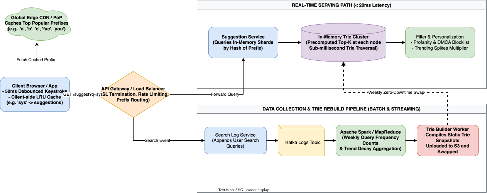

# Autocomplete Search (Typeahead) System Design

[← Back to System Design](../system-design.md)

## Overview

An Autocomplete (Typeahead) search system predicts and suggests the top $K$ most relevant, high-frequency search queries in real time as a user types characters into a search bar. The system is a core feature of search engines (Google), e-commerce platforms (Amazon), streaming apps (YouTube, Netflix), and social media platforms (Twitter/X).

The fundamental architectural challenge is delivering responses with **ultra-low latency ($< 20\text{–}30\text{ ms}$)** across hundreds of millions of concurrent users, using specialized prefix data structures (**Trie / Prefix Trees**) with precomputed top-$K$ rankings, memory sharding, and decoupled offline analytics pipelines.

---

## Functional Requirements

* **Real-Time Prefix Suggestions**: Return the top 5 to 10 most relevant search suggestions matching the typed prefix string.
* **Frequency & Trending Ranking**: Rank suggestions by historical query frequency, recency, and real-time trending velocity.
* **Personalization & Context**: Optionally personalize suggestions based on the user's past search history and geographic location.
* **Spam & Content Moderation**: Filter out profanity, hate speech, sensitive personal data, and copyright-infringing terms via dynamic blocklists.

---

## Non-Functional Requirements

* **Ultra-Low Latency**: End-to-end response time must be strictly **$< 20\text{–}30\text{ ms}$** from keypress to UI render.
* **High Availability (99.999%)**: Autocomplete failures must fail gracefully without blocking the main search functionality.
* **Massive Query Throughput**: Handle over **$100,000\text{ queries/second (QPS)}$** at peak globally.
* **Scalable Storage**: Store millions of unique query prefixes in memory with sub-millisecond retrieval.

---

## Back of the Envelope Estimations

### Scale & Traffic

* **Daily Active Users (DAU)**: $100\text{ Million}$.
* **Searches per User per Day**: 10 searches/day $= 1\text{ Billion searches/day}$.
* **Keystrokes per Search**:
  * An average search query has 20 characters (4 words).
  * Assume client debounces keystrokes ($50\text{ ms}$ window), resulting in $\approx 5\text{ autocomplete requests per search}$.
* **Total Autocomplete Requests per Day**:
  $$1,000,000,000\text{ searches} \times 5\text{ requests} = 5,000,000,000\text{ requests/day}$$
* **Average Autocomplete QPS**:
  $$\text{Average QPS} = \frac{5,000,000,000}{86,400} \approx 58,000\text{ QPS} \quad (\text{Peak: } \approx 120,000\text{ QPS})$$

### Memory Sizing for Trie

* **Unique Search Queries Tracked**: $\approx 20\text{ Million queries}$ (after filtering low-frequency queries).
* **Average Query Length**: 20 characters (20 bytes).
* **Precomputed Top-K Cache per Node**:
  * Store top 5 query IDs (each 8 bytes) at each prefix node:
    $$5 \times 8\text{ bytes} = 40\text{ bytes per node}$$
* **Trie Node Overhead**:
  * Pointer map to children + frequency integer $\approx 64\text{ bytes}$.
* **Total Memory for 20M Queries in Trie**:
  $$\approx 20,000,000 \times 100\text{ bytes} \approx 2\text{ Gigabytes}$$
* Even with $10\times$ redundancy, indexes, and sharding overhead, the entire Trie index fits in **$< 25\text{ GB of RAM}$**, enabling 100% in-memory serving!

---

## High-Level System Architecture

```text
┌────────────────────────────────────────────────────────────────────────┐
│                              CLIENT APPS                               │
│       (50ms Debounced Keystroke, Local Browser In-Memory Cache)        │
└───────────────────────────────────┬────────────────────────────────────┘
                                    │
                 ┌──────────────────┴──────────────────┐
                 │ 1. GET /suggest?q=sys               │ 2. Submit Search
                 ▼                                     ▼
┌─────────────────────────────────┐   ┌─────────────────────────────────┐
│     REAL-TIME QUERY PATH        │   │    DATA COLLECTION PIPELINE     │
│                                 │   │                                 │
│  ┌───────────────────────────┐  │   │  ┌───────────────────────────┐  │
│  │    API Gateway / Envoy    │  │   │  │   Search Log Collector    │  │
│  └─────────────┬─────────────┘  │   │  └─────────────┬─────────────┘  │
│                │                │   │                │                │
│                ▼                │   │                ▼                │
│  ┌───────────────────────────┐  │   │  ┌───────────────────────────┐  │
│  │    Suggestion Service     │  │   │  │     Apache Kafka Logs     │  │
│  └─────────────┬─────────────┘  │   │  └─────────────┬─────────────┘  │
│                │                │   │                │                │
│                ▼                │   │                ▼                │
│  ┌───────────────────────────┐  │   │  ┌───────────────────────────┐  │
│  │ In-Memory Trie Cluster    │  │   │  │ Apache Spark Aggregation  │  │
│  │ (Precomputed Top-5 Nodes) │  │   │  │ (Weekly Frequency Counts) │  │
│  └───────────────────────────┘  │   │  └─────────────┬─────────────┘  │
└─────────────────────────────────┘   │                │                │
                                      │                ▼                │
                                      │  ┌───────────────────────────┐  │
                                      │  │ Trie Builder Worker Fleet │  │
                                      │  │ (Serializes Snapshot)     │  │
                                      │  └───────────────────────────┘  │
                                      └─────────────────────────────────┘
```

---

## Core Components & Data Structures

### 1. The Trie Data Structure & Optimization

A naive Trie traverses from the root down to the last character of the prefix, then performs a Depth-First Search (DFS) over all descendant nodes to find the top $K$ queries.

* **Why naive DFS fails**: In the worst case, traversing millions of sub-trees on every keystroke takes $O(V + E)$ time, blowing through the 20ms latency budget.
* **Optimization: Precompute Top-$K$ at Every Node**:
  * Each Trie node stores a list of the top 5 most popular full queries passing through that node.
  * Finding the top suggestions becomes an $O(L)$ operation, where $L$ is the prefix length (e.g., $L \le 20$ operations), completely independent of the total number of words in the dictionary!

```text
               (Root)
              /      \
            't'      's' [Top-5: "system design", "sql", "spotify"...]
            /          \
          'e'          'y' [Top-5: "system design", "systemctl", "sysadmin"...]
          /              \
        'c'              's' -> Node contains ["system design", "sysadmin", "systemctl"]
```

### 2. Trie Sharding Strategy

To support 120K QPS and horizontal scalability, the Trie is sharded across multiple machines:

* **First-Character Sharding**: Shard by first letter (e.g., Shard 1: `a–c`, Shard 2: `d–f`...).
  * *Flaw*: Causes severe hotspots (`s` and `t` receive $10\times$ more queries than `x` or `z`).
* **Hash-Based Sharding (Consistent Hashing)**:
  * Route by `hash(prefix) % num_shards`.
  * Suggestion Service routes to the corresponding Trie shard node.
  * Read replicas allow linear scaling of read throughput.

### 3. Decoupled Offline Trie Rebuilding

The Trie is **not** updated synchronously when users search. Search queries are logged asynchronously to Kafka:

1. **Analytics Aggregator (Spark)**: Aggregates query frequencies across rolling 7-day windows, applying exponential time decay to older queries.
2. **Weekly Offline Build**: A dedicated worker builds a fresh immutable Trie snapshot and stores it in S3.
3. **Zero-Downtime Swap**: Trie serving servers download the new snapshot into secondary memory and atomically swap pointers.

---

## API Specifications

### 1. Get Suggestions

```http
GET /api/v1/search/suggest?q=sys&limit=5
```

```json
// Response: 200 OK
{
  "prefix": "sys",
  "suggestions": [
    {"query": "system design interview", "score": 982000},
    {"query": "system design primer", "score": 640000},
    {"query": "systemctl commands", "score": 412000},
    {"query": "sysadmin resume", "score": 215000},
    {"query": "systolic blood pressure", "score": 189000}
  ],
  "latencyMs": 8
}
```

---

## Object Model & Database Schema

```text
┌───────────────────────┐          ┌───────────────────────┐
│       TrieNode        │1        *│      TopKRecord       │
├───────────────────────┤──────────├───────────────────────┤
│ charKey: Char         │          │ queryText: Varchar    │
│ isEndOfWord: Boolean  │          │ frequencyScore: BigInt│
│ children: Map[Char,N] │          │ category: Enum        │
│ topKQueries: Array[..]│          └───────────────────────┘
└───────────────────────┘
```

---

## System Design Diagram



[Download Draw.io File](autocomplete-search.drawio)

---

## Deep Dive & Key Technical Challenges

### 1. Client-Side Optimization (Debouncing & Caching)

* **Debouncing**: The client waits $50\text{ ms}$ after a keypress before sending a request. If the user rapidly types "s-y-s-t-e-m", only 1 or 2 network calls are made instead of 6.
* **Browser LRU Cache**: If a user types "sys", deletes "s" to get "sy", and re-types "sys", the client serves results immediately from local JavaScript memory without network round-trips.

### 2. Fast-Trending Spikes (Breaking News)

* Batch Spark processing takes hours to reflect new queries. If an earthquake or celebrity news occurs, users expect instant autocomplete suggestions within minutes.
* **Real-Time Trending Overlay**: An Apache Flink stream processor monitors high-velocity query spikes over 5-minute sliding windows and injects trending terms directly into an auxiliary Redis cache, which merges with the static Trie results.

---

## Additional Notes

### Video References

* [](https://www.youtube.com/watch?v=us0qySiUsGU)
