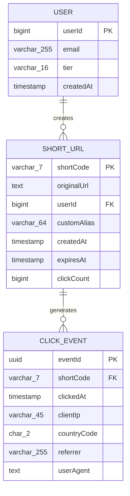
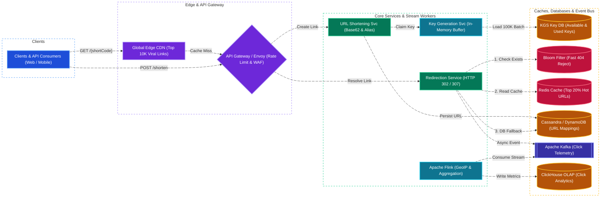

# Bitly System Design

[← Back to System Design](system-design.md)

## Overview

Bitly is an enterprise URL shortening, custom branding, and link analytics platform that transforms long, unwieldy web addresses into short, memorable links (e.g. `https://bit.ly/3gH7xKp`). The service handles tens of billions of redirects monthly while providing real-time click tracking, geolocation analytics, and device telemetry.

Designing Bitly involves solving foundational web-scale distributed systems challenges:

1. **Short Unique Key Generation**: Generating 7-character Base62 keys ($62^7 \approx 3.52\text{ Trillion}$ combinations) with zero database collision overhead.
2. **Ultra-Low Redirection Latency**: Returning HTTP redirects in $< 20\text{ ms}$ globally across high-volume read traffic (100:1 read-to-write ratio).
3. **HTTP 301 vs. 302/307 Redirect Semantics**: Balancing browser-side caching against real-time click analytics collection.
4. **Real-Time Click Stream Analytics**: Ingesting and aggregating hundreds of thousands of redirect click events per second (referrer, user agent, IP geolocation) without delaying the user's redirect.

---

## Functional Requirements

* **URL Shortening**: Users input a long URL and receive a unique 7-character short URL (`https://bit.ly/xxxxxxx`).
* **URL Redirection**: Visiting the short URL redirects the user immediately to the original destination URL.
* **Custom Vanity Aliases**: Users can supply a custom slug (e.g. `https://bit.ly/black-friday-deals`).
* **Configurable Expiration**: Optional expiration dates (e.g., 24 hours, 30 days, or permanent).
* **Click Analytics**: Real-time tracking of total clicks, referring domains, user geolocations, and device/browser breakdowns.

---

## Non-Functional Requirements

* **Ultra-Low Redirect Latency**: P99 redirection latency must be **$< 25\text{ ms}$** via distributed edge caching.
* **High Read Availability (99.999%)**: Redirection must never fail; a broken short link damages customer trust.
* **Read-Heavy Asymmetry**: Engineered for a **$100:1\text{ Read-to-Write}$** traffic distribution.
* **Unpredictable Keys**: URL keys should not be sequential integers to prevent malicious bots from scraping customer links.

---

## Back of the Envelope Estimations

### Scale & Traffic

* **New URLs Shortened per Month**: $100\text{ Million new links/month}$.
* **Write Ingestion QPS**:
  $$\text{Write QPS} = \frac{100,000,000}{30 \times 86,400} \approx 38.6\text{ writes/sec} \quad (\text{Peak: } \approx 200\text{ QPS})$$
* **Redirection Requests (100:1 Ratio)**:
  $$100 \times 100,000,000 = 10\text{ Billion redirects/month}$$
* **Redirect / Read QPS**:
  $$\text{Read QPS} = \frac{10,000,000,000}{30 \times 86,400} \approx 3,860\text{ reads/sec} \quad (\text{Peak: } \approx 15,000\text{ QPS})$$

### Storage Calculations (5-Year Horizon)

* **Total Stored Links**: $100\text{M/month} \times 12 \times 5 = 6\text{ Billion links}$.
* **Average Record Size**:
  * `short_code`: 7 bytes
  * `original_url`: 500 bytes
  * `created_at`: 8 bytes
  * `user_id`: 8 bytes
  * `expiration`: 8 bytes
  * Total per record $\approx 550\text{ bytes}$.
* **Total Database Storage**:
  $$6,000,000,000 \times 550\text{ bytes} \approx 3.3\text{ Terabytes}$$
  *(Modest dataset that easily fits in distributed NoSQL such as DynamoDB or Cassandra)*.

### Memory & Cache Footprint (80-20 Rule)

* $20\%$ of links generate $80\%$ of daily redirects.
* Daily Active Redirects $= \frac{10\text{ Billion}}{30} \approx 333\text{ Million redirects/day}$.
* Daily Hot Set $= 333\text{M} \times 0.20 = 66.6\text{ Million hot links}$.
* **RAM Required for Redis Cache**:
  $$66,600,000 \times 550\text{ bytes} \approx 36.6\text{ Gigabytes RAM}$$
  *(Easily cached in a 2-node Redis cluster with 32 GB RAM each)*.

---

## High-Level System Architecture

```mermaid
%%{init: {'flowchart': {'nodeSpacing': 25, 'rankSpacing': 45, 'padding': 10}}}%%
flowchart LR
    Client["Client Apps (Browser / Mobile)"]
    subgraph EdgeTier["Edge & Ingress"]
        CDN["Global Edge CDN (Cloudflare)"]
        GW["API Gateway / Load Balancer"]
    end
    subgraph AppServices["Read, Write & Stream Services"]
        RedirSvc["Redirection Service (HTTP 302)"]
        ShortenSvc["URL Shortening Service"]
        Flink["Apache Flink (Aggregator)"]
    end
    subgraph DataLayer["Key Gen, Storage & Analytics"]
        Redis[("Redis & NoSQL DB")]
        KGS[("Key Generation Service (KGS)")]
        Kafka[["Apache Kafka (Click Logs)"]]
        ClickHouse[("ClickHouse (OLAP)")]
    end
    Client e1@-->|"1. GET /{code}"| CDN
    CDN e2@-->|"Cache Miss"| GW
    Client e3@-->|"2. POST /shorten"| GW
    GW e4@-->|"Read Path"| RedirSvc
    GW e5@-->|"Write Path"| ShortenSvc
    RedirSvc e6@-->|"Lookup URL"| Redis
    RedirSvc e7@-->|"Click Event"| Kafka
    ShortenSvc e8@-->|"Fetch Key"| KGS
    ShortenSvc e9@-->|"Save Mapping"| Redis
    Flink e10@-->|"Consume Logs"| Kafka
    Flink e11@-->|"Store Metrics"| ClickHouse

    e1@{ animate: true }
    e2@{ animate: true }
    e3@{ animate: true }
    e4@{ animate: true }
    e5@{ animate: true }
    e6@{ animate: true }
    e7@{ animate: true }
    e8@{ animate: true }
    e9@{ animate: true }
    e10@{ animate: true }
    e11@{ animate: true }

    classDef client fill:#1d4ed8,stroke:#60a5fa,stroke-width:2px,color:#ffffff
    classDef edge fill:#6d28d9,stroke:#a78bfa,stroke-width:2px,color:#ffffff
    classDef service fill:#047857,stroke:#34d399,stroke-width:2px,color:#ffffff
    classDef worker fill:#0e7490,stroke:#22d3ee,stroke-width:2px,color:#ffffff
    classDef cache fill:#be123c,stroke:#fb7185,stroke-width:2px,color:#ffffff
    classDef storage fill:#b45309,stroke:#fbbf24,stroke-width:2px,color:#ffffff
    classDef queue fill:#3730a3,stroke:#818cf8,stroke-width:2px,color:#ffffff

    class Client client
    class CDN,GW edge
    class RedirSvc,ShortenSvc service
    class Flink worker
    class Redis cache
    class KGS,ClickHouse storage
    class Kafka queue

    style EdgeTier fill:transparent,stroke:#a78bfa,stroke-width:1.5px,stroke-dasharray: 5 5
    style AppServices fill:transparent,stroke:#34d399,stroke-width:1.5px,stroke-dasharray: 5 5
    style DataLayer fill:transparent,stroke:#fbbf24,stroke-width:1.5px,stroke-dasharray: 5 5
```



---

## Key Generation Mechanics: Base62 & KGS

### 1. Base62 Encoding Capacity

Using characters `[a-z, A-Z, 0-9]` gives 62 alphanumeric characters.

* 6 characters: $62^6 \approx 56.8\text{ Billion}$ combinations.
* 7 characters: $62^7 \approx 3.52\text{ Trillion}$ combinations.
* At 100M new links per month, 7 characters provides sufficient address space for over **2,900 years**.

### 2. Standalone Key Generation Service (KGS)

Calculating $\text{MD5}(URL)$ and taking the first 7 characters causes hash collisions that require database lookup loops.

* **Architecture of KGS**:
  * An offline worker pre-generates random 7-character Base62 keys and persists them in two database tables: `available_keys` and `used_keys`.
  * The KGS service loads batches of 100,000 keys into memory.
  * When the URL Shortening Service needs a key, KGS returns one from memory in sub-microseconds without database locking.
  * Multiple KGS nodes maintain separate non-overlapping memory ranges to prevent duplication.

---

## HTTP 301 vs. 302 / 307 Redirect Strategy

| Redirect Code | Name | Browser Caching Behavior | Impact on Analytics | Recommendation |
| :--- | :--- | :--- | :--- | :--- |
| **HTTP 301** | Moved Permanently | Browser caches redirect indefinitely; subsequent clicks never hit the Bitly servers. | **Breaks Analytics**: Clicks are never counted after the first visit. Saves server bandwidth. | Use only if analytics are not required. |
| **HTTP 302 / 307** | Found / Temporary Redirect | Browser issues a request to Bitly on every click before redirecting. | **Accurate Analytics**: Every single click hits the server, recording IP, timestamp, and referrer. | **Standard for Bitly / Marketing Platforms**. |

---

## API Specifications

### 1. Shorten URL

```http
POST /api/v1/shorten
Authorization: Bearer <user_token>
Content-Type: application/json
```

```json
// Request
{
  "longUrl": "https://www.nytimes.com/2026/10/27/technology/ai-breakthroughs.html?utm_source=twitter&utm_medium=social",
  "customAlias": "ny-times-ai-2026",
  "expirationTtlSeconds": 2592000
}

// Response: 201 Created
{
  "shortCode": "ny-times-ai-2026",
  "shortUrl": "https://bit.ly/ny-times-ai-2026",
  "longUrl": "https://www.nytimes.com/2026/10/27/technology/ai-breakthroughs.html?...",
  "createdAt": "2026-10-27T19:55:00Z",
  "expiresAt": "2026-11-26T19:55:00Z"
}
```

### 2. Redirect to Original URL

```http
GET /ny-times-ai-2026
Host: bit.ly
```

```http
// Response: 302 Found
Location: https://www.nytimes.com/2026/10/27/technology/ai-breakthroughs.html?...
Cache-Control: private, max-age=90
```

---

## Object Model & Database Schema



---

## System Design Diagram



---

## Deep Dive & Key Technical Challenges

### 1. Fast 404 Rejection with Bloom Filters

* Attackers or bots often generate random 7-character URLs, resulting in cache misses that hit the primary database.
* **Bloom Filter Guard**:
  * An in-memory Bloom Filter stores the hashes of all valid shortened keys.
  * If the Bloom Filter indicates a key does not exist, the Redirection Service immediately returns `HTTP 404 Not Found` in $< 1\text{ ms}$ without querying Redis or the database.

### 2. High-Throughput Analytics Ingestion (ClickHouse)

* Emitting database writes during the redirect path would introduce intolerable latency.
* **Decoupled Architecture**:
  * The Redirection Service publishes a non-blocking asynchronous event to Apache Kafka (`click_events` topic) and immediately returns the `302 Found` header to the user.
  * Apache Flink consumes the Kafka stream, enriches the IP with MaxMind GeoIP coordinates, and streams the records into **ClickHouse** (columnar OLAP database) for sub-second analytical aggregations.

---

## Additional Notes

### Video References

* [](https://www.youtube.com/watch?v=iUU4O1sWtJA)
* [](https://www.youtube.com/watch?v=16d35un5a9Q)
