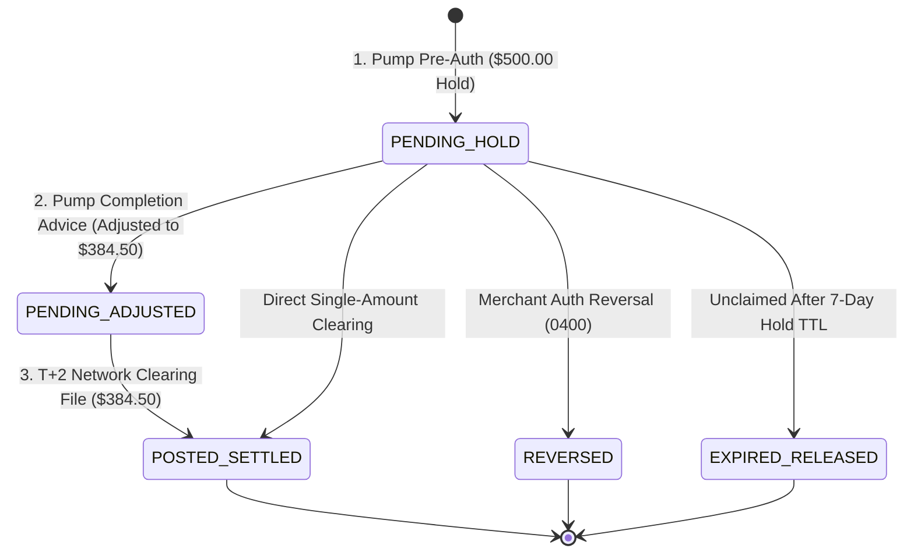
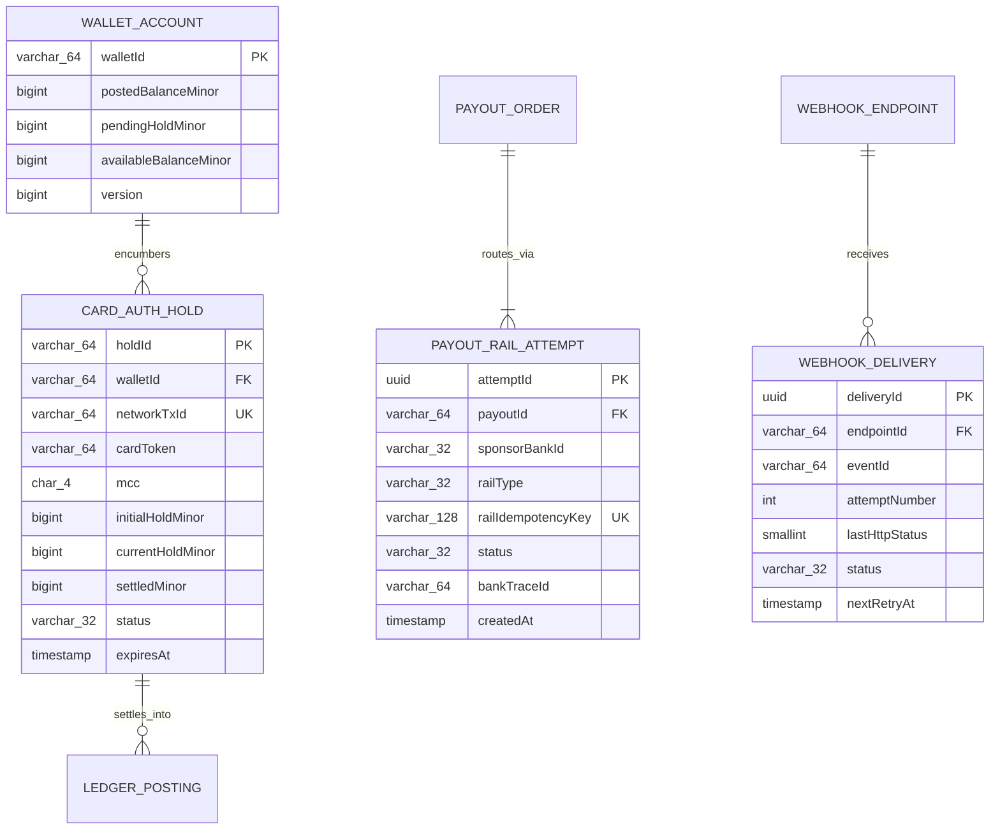

# Commercial Card Issuing, Multi-Rail Payment Router & Webhook Gateway System Design

[← Back to System Design](system-design.md)

> **Core Building Blocks Used**: [Chapter 4 — Pessimistic Row Locking & Two-Phase Pending/Posted Ledger](fundamentals/04-databases-sql-vs-nosql.md#database-isolation-levels--concurrency-control-ddia-deep-dive) · [Chapter 5 — Transactional Outbox, Idempotency & Out-of-Order Event Handling](fundamentals/05-distributed-systems-and-messaging.md#5-idempotency-keys-safe-retries-over-unreliable-networks) · [Chapter 6 — Sub-150ms Tail Latency Budgets, Circuit Breakers & Exponential Backoff + Jitter](fundamentals/06-resiliency-observability-and-metrics.md#2-resiliency-fault-tolerance--reliability-patterns) · [Chapter 8 — HMAC-SHA256 Signatures & SSRF Egress Proxies](fundamentals/08-security-multi-region-and-deployments.md)

## Overview

Modern commercial fintech platforms provide businesses, fleet operators, and suppliers with **instant spendable working capital** alongside **intelligent multi-rail payouts**. The moment a customer's invoice advance or payout is approved into their digital wallet, they can either swipe a **Commercial Debit / Fleet Fuel Card** at a point-of-sale terminal (requiring a synchronous **Just-in-Time (JIT) funding authorization in $< 150\text{ ms}$**) or withdraw funds to an external bank account via a **Smart Multi-Rail Payment Router** that dynamically selects between **RTP (The Clearing House), FedNow, Push-to-Card (Visa Direct / Mastercard Send), Same-Day ACH, Standard ACH, and Fedwire**.

Because money movement relies heavily on asynchronous callbacks from sponsor banks and card processors—while enterprise customers and ERP/TMS integrations rely on real-time status notifications—the platform also requires a **High-Throughput Bi-Directional Webhook Gateway**.

Designing this three-part money-movement and card-issuing engine centers on three critical engineering challenges:

1. **Sub-150ms Commercial Card JIT Authorization & Dual-Message Lifecycle**: Approving or declining a $\$900$ commercial fuel pump swipe within a strict $< 150\text{ ms}$ P99 webhook budget while handling the **dual-message card flow** (initial $\$1$ or $\$500$ pump pre-authorization hold $\to$ incremental/advice update $\to$ T+2 clearing settlement).
2. **Smart Multi-Rail Payment Routing & Safe Failover**: Abstracting synchronous REST rails (RTP/FedNow/Card) and asynchronous batch SFTP/NACHA rails (ACH) behind a unified Strategy/Adapter interface with sliding-window health scoring—while enforcing the cardinal rule of payment routing: **never automatically failover a `TIMEOUT` or `UNKNOWN` transaction to a backup sponsor bank without first confirming the primary bank did not process it**.
3. **Bi-Directional Webhook Ingestion & Delivery**: Acknowledging inbound partner webhooks in $< 50\text{ ms}$ with `HMAC-SHA256` verification and out-of-order state reconciliation, while dispatching outbound customer webhooks with exponential backoff, per-tenant circuit breaking, Dead-Letter Queues (DLQ), replay tooling, and SSRF egress protection.

---

## Functional Requirements

* **Commercial Debit & Fleet Card JIT Authorization**:
  * Handle synchronous authorization webhooks from processor networks (Marqeta, Lithic, Stripe Issuing, or direct Visa/Mastercard ISO 8583 switches).
  * Enforce Merchant Category Code (MCC) controls (e.g., restrict fuel cards strictly to MCC `5541`/`5542` truck stops and diesel stations), per-swipe/daily velocity limits, and real-time wallet balance checks.
  * Manage the complete **Dual-Message Card Lifecycle**: Pre-Authorization Hold (`PENDING`), Incremental Auth / Advice completion (pump shut-off actual amount), Clearing & Settlement (`POSTED`), Reversals, and Expired Hold release.
* **Smart Multi-Rail Payment Router**:
  * Route outbound disbursements across **FedNow, RTP, Push-to-Debit, Same-Day ACH, Standard ACH, and Wire** based on recipient bank capability, speed tier, transaction size limits, unit cost, bank cut-off windows, and real-time sponsor bank health.
  * Automatically failover new transactions from Sponsor Bank A to Sponsor Bank B when Bank A's error rate or latency crosses circuit-breaker thresholds.
* **Bi-Directional Webhook Engine**:
  * **Inbound**: Ingest banking, KYC/KYB, and card-network webhooks with signature verification, raw payload durability, deduplication, and out-of-order event sequencing.
  * **Outbound**: Deliver signed status events (`payout.settled`, `card.auth.declined`, `invoice.funded`) to partner platforms and enterprise customer endpoints with configurable retries, DLQ, and self-service replay.

---

## Non-Functional Requirements

* **Strict JIT Card Auth Latency**: **$< 100\text{ ms}$ P95** and **$< 150\text{ ms}$ P99** internal processing time (card networks enforce a hard timeout of $500\text{--}1000\text{ ms}$ including wide-area network transit and automatically decline or trigger stand-in processing on timeout).
* **Zero Double-Disbursement on Rail Failover (CP)**: A network timeout during an RTP or Wire call must never result in the router blindly re-sending the payout through a secondary sponsor bank until the first transaction's terminal status is deterministically resolved.
* **Inbound Webhook Availability**: **$99.999\%$** ingestion availability with **$< 50\text{ ms}$** ACK latency.
* **Outbound Webhook Isolation**: Dead or slow customer servers ($30\text{ s}$ timeouts) must never block healthy tenants; egress traffic must prevent Server-Side Request Forgery (SSRF) against internal cloud metadata (`169.254.169.254`) or private VPC subnets.

---

## Back of the Envelope Estimations

### Traffic & Latency Budgets

* **Commercial Card Swipes**: $2\text{ Million authorizations/day}$ ($\approx 23\text{ avg QPS}$, morning refueling rush peak $\approx \mathbf{500\text{ QPS}}$).
  * **150ms P99 JIT Budget Breakdown**:
    * TLS Termination & HMAC Signature Verification: $5\text{ ms}$
    * Card Controls, MCC & Velocity Check (Redis / Local Cache): $5\text{ ms}$
    * Wallet Balance Lock & `PENDING` Hold Insert (Indexed Aurora PostgreSQL): $25\text{ ms}$
    * Serialization & Network Margin: $15\text{ ms}$ (**Total P99: $\sim 50\text{ ms}$**, leaving $100\text{ ms}$ safety margin).
* **Multi-Rail Outbound Payouts**: $1\text{ Million payouts/day}$ ($\approx 12\text{ avg QPS}$, peak batch/instant burst $\approx \mathbf{400\text{ QPS}}$).
* **Webhook Traffic**:
  * **Inbound Partner Webhooks**: $10\text{ Million events/day}$ ($\approx 115\text{ avg QPS}$, peak $\approx \mathbf{2,500\text{ QPS}}$).
  * **Outbound Customer Webhooks**: $25\text{ Million deliveries/day}$ including retries ($\approx 290\text{ avg QPS}$, peak $\approx \mathbf{5,000\text{ QPS}}$).

---

## High-Level System Architecture

```mermaid
%%{init: {'flowchart': {'nodeSpacing': 25, 'rankSpacing': 45, 'padding': 10}}}%%
flowchart LR
    subgraph ExternalPartners["Card Networks, Sponsor Banks & Customers"]
        CardNet["Card Processor (Marqeta / Lithic)"]
        BankA["Sponsor Bank A (RTP / FedNow / ACH)"]
        BankB["Sponsor Bank B (Backup Rail)"]
        CustERP["Customer ERP / Partner Endpoints"]
    end
    subgraph EdgeGateways["Edge & Webhook Gateways"]
        JITGW["Card JIT Auth Handler (<150ms)"]
        InWH["Inbound Webhook Gate (<50ms ACK)"]
        EgressProxy["Hardened SSRF Egress Proxy"]
    end
    subgraph CoreFintech["Card Auth, Ledger & Payment Router"]
        SpendCtrl[("Redis Spend Controls & Rail Health")]
        WalletLedger["Double-Entry Wallet & Hold Engine"]
        PayRouter["Smart Multi-Rail Payment Router"]
        OutWH["Outbound Webhook Dispatcher"]
    end
    subgraph StorageAndStreams["Durable Persistence & Queues"]
        Aurora[("Aurora PostgreSQL (Serializable ACID)")]
        Kafka[["Kafka Event Bus & Retry Topics"]]
        S3Raw[("S3 Raw Webhook Archive & DLQ")]
    end

    CardNet e1@<-->|"1. Sync JIT Auth (<150ms)"| JITGW
    JITGW e2@<-->|"Check MCC & Velocity"| SpendCtrl
    JITGW e3@-->|"Place PENDING Hold"| WalletLedger
    WalletLedger e4@-->|"ACID Row Lock"| Aurora
    PayRouter e5@<-->|"Read Health & Cutoffs"| SpendCtrl
    PayRouter e6@-->|"Adapter: RTP / ACH"| BankA
    PayRouter e7@-.->|"Safe Failover"| BankB
    BankA e8@-->|"2. Async Settlement Webhook"| InWH
    InWH e9@-->|"Persist Raw (<50ms)"| S3Raw
    InWH e10@-->|"Enqueue Verified Event"| Kafka
    Kafka e11@-->|"Reconcile Hold -> POSTED"| WalletLedger
    Kafka e12@-->|"Fanout Outbound Event"| OutWH
    OutWH e13@-->|"Deliver via SSRF Proxy"| EgressProxy
    EgressProxy e14@-->|"Signed Webhook"| CustERP

    e1@{ animate: true }
    e2@{ animate: true }
    e3@{ animate: true }
    e4@{ animate: true }
    e5@{ animate: true }
    e6@{ animate: true }
    e7@{ animate: true }
    e8@{ animate: true }
    e9@{ animate: true }
    e10@{ animate: true }
    e11@{ animate: true }
    e12@{ animate: true }
    e13@{ animate: true }
    e14@{ animate: true }

    classDef client fill:#1d4ed8,stroke:#60a5fa,stroke-width:2px,color:#ffffff
    classDef edge fill:#6d28d9,stroke:#a78bfa,stroke-width:2px,color:#ffffff
    classDef service fill:#047857,stroke:#34d399,stroke-width:2px,color:#ffffff
    classDef worker fill:#0e7490,stroke:#22d3ee,stroke-width:2px,color:#ffffff
    classDef cache fill:#be123c,stroke:#fb7185,stroke-width:2px,color:#ffffff
    classDef storage fill:#b45309,stroke:#fbbf24,stroke-width:2px,color:#ffffff
    classDef queue fill:#3730a3,stroke:#818cf8,stroke-width:2px,color:#ffffff

    class CardNet,BankA,BankB,CustERP client
    class JITGW,InWH,EgressProxy edge
    class WalletLedger,PayRouter service
    class OutWH worker
    class SpendCtrl cache
    class Aurora,S3Raw storage
    class Kafka queue

    style ExternalPartners fill:transparent,stroke:#60a5fa,stroke-width:1.5px,stroke-dasharray: 5 5
    style EdgeGateways fill:transparent,stroke:#a78bfa,stroke-width:1.5px,stroke-dasharray: 5 5
    style CoreFintech fill:transparent,stroke:#34d399,stroke-width:1.5px,stroke-dasharray: 5 5
    style StorageAndStreams fill:transparent,stroke:#fbbf24,stroke-width:1.5px,stroke-dasharray: 5 5
```



---

## Core Components & Deep Dives

### 1. Commercial Card JIT Authorization & The Dual-Message Fuel Flow

Commercial fleet and fuel cards operate on a **Dual-Message Card Flow** (Authorization is separate from Clearing/Settlement), with a unique twist at automated fuel dispensers (MCC `5542`):

1. **Step 1 — Pre-Authorization Hold (At Pump Before Fueling)**:
   * When a driver taps their card at a truck-stop diesel pump, the pump does not yet know how many gallons the driver will pump. It sends a pre-authorization request for either `$1.00` (status check) or a maximum hold (e.g., `$500.00` / `50000` cents).
   * The JIT Webhook Handler verifies the card is `ACTIVE`, checks that MCC `5542` is allowed by the card's spend policy, locks the wallet row in Aurora (`SELECT available_balance_minor FROM wallets WHERE wallet_id = $1 FOR UPDATE`), and creates a two-phase **`PENDING` Hold Entry** for `50000` cents, reducing `available_balance_minor` immediately while leaving `posted_balance_minor` unchanged.
2. **Step 2 — Advice / Completion Message (Nozzle Replaced)**:
   * Ten minutes later, the driver hangs up the pump after pumping `$384.50` (`38450` cents) of diesel.
   * The card network sends an **Authorization Advice (`0120` / `authorization.advice`)** referencing the original `network_transaction_id`.
   * The ledger atomically adjusts the `PENDING` hold from `50000` cents down to `38450` cents, immediately freeing `$115.50` (`11550` cents) of spendable balance back to the carrier's wallet.
3. **Step 3 — Clearing & Settlement (T+1 to T+2 Days Later)**:
   * When the merchant's acquiring bank submits the batch clearing file (`0220` / `transaction.clearing`), the platform transitions the `PENDING` hold to **`POSTED`** (moving `38450` cents from `Wallet_Pending_Hold` to `Card_Settlement_Clearing`) and handles any penny discrepancy (e.g., if clearing arrives for a slightly different amount or if a pre-auth hold expires unclaimed after 7 days, transitioning to `ARCHIVED / EXPIRED`).



---

### 2. Smart Multi-Rail Payment Router & Safe Failover Architecture

When disbursing funds to a customer's external bank account, the **Payment Router** evaluates candidate rails using the **Strategy + Adapter Pattern**:

| Payment Rail | Settlement Speed | Max Limit | Cut-Off Window | Cost / Tx | Protocol & Adapter Type |
| :--- | :--- | :--- | :--- | :--- | :--- |
| **RTP (The Clearing House)** | Instant ($< 15\text{ s}$) | $\$1,000,000$ | $24/7/365$ | $\$0.45$ | Synchronous REST / ISO 20022 `pacs.008` |
| **FedNow** | Instant ($< 15\text{ s}$) | $\$500,000+$ | $24/7/365$ | $\$0.45$ | Synchronous REST / ISO 20022 `pacs.008` |
| **Push-to-Card (Visa Direct / MC Send)** | Instant ($< 30\text{ s}$) | $\$50,000$ | $24/7/365$ | $0.5\%\text{--}1.0\%$ | Synchronous REST API |
| **Same-Day ACH** | Same Business Day | $\$1,000,000$ | 3 Windows (10:30a, 2:45p, 4:45p ET) | $\$0.15$ | Asynchronous NACHA Batch / SFTP / API |
| **Standard ACH** | $T+1 \text{ to } T+2$ Days | Unlimited | Daily 8:00p ET | $\$0.02$ | Asynchronous NACHA Batch / SFTP / API |
| **Fedwire** | Same Day ($< 2\text{ hrs}$) | Unlimited | Business Days 6:30p ET | $\$8.00$ | Semi-Synchronous ISO 20022 / Bank API |

#### Routing Algorithm & Circuit Breaker Failover

```mermaid
%%{init: {'flowchart': {'nodeSpacing': 20, 'rankSpacing': 40, 'padding': 10}}}%%
flowchart LR
    Req["Payout Request ($4,500, Instant)"]
    Filter["1. Filter Eligible Rails (ABA Routing Lookup & Cutoffs)"]
    Score["2. Score Sponsor Banks (Cost + Sliding-Window Health)"]
    Primary["Sponsor Bank A Adapter (RTP)"]
    StatusCheck["Async Status Query Poller"]
    Backup["Sponsor Bank B Adapter (FedNow / RTP)"]

    Req e1@--> Filter
    Filter e2@--> Score
    Score e3@-->|"Healthy (Err < 1%)"| Primary
    Score e4@-->|"Circuit OPEN on Bank A"| Backup
    Primary e5@-->|"HTTP 503 / Conn Refused (Definite Pre-Exec Fail)"| Backup
    Primary e6@-.->|"HTTP 504 Timeout / UNKNOWN State"| StatusCheck
    StatusCheck e7@-.->|"Confirmed NOT_FOUND at Bank A"| Backup

    e1@{ animate: true }
    e2@{ animate: true }
    e3@{ animate: true }
    e4@{ animate: true }
    e5@{ animate: true }
    e6@{ animate: true }
    e7@{ animate: true }

    classDef service fill:#047857,stroke:#34d399,stroke-width:2px,color:#ffffff
    classDef worker fill:#0e7490,stroke:#22d3ee,stroke-width:2px,color:#ffffff
    classDef cache fill:#be123c,stroke:#fb7185,stroke-width:2px,color:#ffffff

    class Req,Filter,Score service
    class Primary,Backup worker
    class StatusCheck cache
```



> [!CAUTION]
> **The Golden Rule of Payment Failover (Handling `TIMEOUT` / `UNKNOWN`):**
> If the Payment Router sends a `$4,500` RTP payout to **Sponsor Bank A** and receives a **TCP Connection Refused** or **`429 Too Many Requests`**, the request never executed—it can safely fail over immediately to **Sponsor Bank B**.
>
> However, if Sponsor Bank A times out after 10 seconds (**`504 Gateway Timeout` / Socket Read Timeout**), the money may *already* have left Bank A! **Never fail over an `UNKNOWN` transaction to Bank B immediately**, or you will pay the recipient `$9,000` ($2\times$). Instead:
>
> 1. Mark the payout attempt as `PENDING_RECONCILIATION`.
> 2. Trip the sliding-window circuit breaker in Redis so *subsequent new* payouts route directly to Sponsor Bank B.
> 3. Poll Sponsor Bank A's `GET /v1/transfers?idempotency_key=...` endpoint with exponential backoff. Only after Bank A explicitly returns `404 Not Found` or `FAILED` does the router mint a new attempt on Sponsor Bank B.

---

### 3. Bi-Directional High-Throughput Webhook Architecture

#### A. Inbound Webhook Ingestion Gate (Fast ACK + Out-of-Order Handling)

Banking and card partners retry aggressively and disable webhook endpoints that take longer than $1\text{--}2\text{ seconds}$ to respond:

1. **Sub-50ms Edge Ingestion**:
   * Verify the partner's `X-Webhook-Signature` (`HMAC-SHA256(timestamp + "." + raw_body, secret)`) and reject replay attacks where `abs(now - timestamp) > 300s`.
   * Write the raw payload to an **S3 Archive + Kafka `inbound-webhooks` topic** and immediately return `200 OK` in $< 50\text{ ms}$—before touching any relational database.
2. **Idempotent Deduplication & Out-of-Order Event Resolution**:
   * Distributed webhook networks frequently deliver events out of chronological order (e.g., `payment.settled` arrives 200ms *before* `payment.processing`, or `card.clearing` arrives before `card.auth.advice`).
   * **State Rank Ordering & Optimistic Parking**: Each lifecycle state has a monotonic rank (`CREATED (10) < PROCESSING (20) < SETTLED (30)`).
   * If a worker receives `payment.processing (rank 20)` when the database row is already at `SETTLED (rank 30)`, it logs the event to the audit history and safely **no-ops** the state regression.
   * If a webhook arrives for an entity ID that hasn't finished committing locally (`404 Not Found`), the consumer parks the event in a **Delayed Retry Queue** (5s $\to$ 15s $\to$ 60s) rather than dropping it.

#### B. Outbound Webhook Dispatcher (Backoff, Circuit Breaking & SSRF Protection)

When the platform notifies thousands of customer TMS/ERP endpoints about invoice or payout updates:

1. **Exponential Backoff with Full Jitter**: Failed deliveries (`5xx`, `429`, timeout) are scheduled across tiered retry delays:
   $$\text{Delay}_n = \text{random}\left(0, \min\left(T_{\max}, T_{\text{base}} \times 2^n\right)\right)$$
   (e.g., $15\text{s} \to 1\text{m} \to 5\text{m} \to 30\text{m} \to 2\text{h} \to 6\text{h} \to 24\text{h}$ up to 72 hours, then routed to the customer's **Dead-Letter Queue**).
2. **Per-Endpoint Circuit Breaker & Fair Queuing**: If Customer X's server is down and timing out after $10\text{ seconds}$ on every call, a Redis-backed circuit breaker trips `OPEN` for `endpoint_id` after 50 consecutive failures, routing subsequent events straight to `DEGRADED_RETRY` so worker threads are never starved for healthy customers.
3. **SSRF Protection via Dedicated Egress Proxy (Smokescreen / Envoy)**:
   * Because customers configure arbitrary webhook URLs (`https://customer-domain.com/webhook`), a malicious user could register `http://169.254.169.254/latest/meta-data/iam/security-credentials/` or `http://10.0.1.45:8080/admin` (including via **DNS Rebinding**).
   * All outbound webhook workers route HTTP requests through an isolated **Egress Proxy** sitting in a DMZ subnet with zero internal VPC routes, using a custom DNS resolver and socket dialer that blocks RFC 1918 (`10.0.0.0/8`, `172.16.0.0/12`, `192.168.0.0/16`), loopback (`127.0.0.0/8`), and link-local cloud metadata (`169.254.0.0/16`) IP addresses *after* DNS resolution right before opening the TCP connection.

---

## API Specifications

### 1. Inbound Commercial Card JIT Authorization Webhook (Sub-150ms)

```http
POST /webhooks/v1/card-processor/jit-authorize
X-Processor-Signature: t=1730584800,v1=9f86d081884c7d659a2feaa0c55ad015a3bf4f1b2b0b822cd15d6c15b0f00a08
Content-Type: application/json
```

```json
// Request from Card Processor (Marqeta / Lithic style)
{
  "token": "auth_jit_991823104",
  "networkTransactionId": "visa_net_88492011",
  "messageType": "AUTHORIZATION_PRE_AUTH",
  "cardToken": "crd_fleet_771829",
  "walletAccountId": "acc_wal_881920",
  "amountMinor": 50000,
  "currency": "USD",
  "merchant": {
    "mcc": "5542",
    "name": "LOVES TRAVEL STOP #412",
    "city": "BOISE",
    "state": "ID"
  }
}

// Response: 200 OK (Returned in 38ms)
{
  "approved": true,
  "responseCode": "00",
  "approvedAmountMinor": 50000,
  "ledgerHoldId": "hld_01JBM9W4Z8N2M5K7P9R1S3T5",
  "availableBalanceAfterMinor": 192500
}
```

### 2. Customer Self-Service Webhook Replay API

```http
POST /api/v1/webhook-endpoints/{endpointId}/replay
Authorization: Bearer <customer_api_key>
Content-Type: application/json
```

```json
// Request
{
  "statusFilter": "DEAD_LETTERED",
  "startTime": "2026-11-01T00:00:00Z",
  "endTime": "2026-11-02T12:00:00Z"
}

// Response: 202 Accepted
{
  "replayBatchId": "rpl_8819204",
  "enqueuedEventCount": 142,
  "status": "REPLAYING"
}
```

---

## Object Model & Database Schema

### Database Selection & Rationale

| Workload / Subsystem | Database Choice | Data Model & CAP Profile | Why This Database? (Justification & Trade-offs) |
| :--- | :--- | :--- | :--- |
| **Wallet Balances, Two-Phase Card Holds & Payout Attempts (`WALLET`, `CARD_AUTH_HOLD`, `PAYOUT_ATTEMPT`)** | **Amazon Aurora PostgreSQL / CockroachDB** | Relational ACID (**CP**) | **Why:** Card JIT authorization must atomically verify `available_balance_minor >= auth_amount_minor` and insert a `PENDING` hold in $< 25\text{ ms}$ with zero race conditions across concurrent card swipes and ACH withdrawals. |
| **Card Spend Controls, MCC Allowlists & Rail Circuit-Breaker Metrics** | **Redis Enterprise Cluster** | In-Memory Key-Value (**Sub-2ms Read**) | **Why:** Keeps per-card MCC rules, daily spend counters, and 60-second sliding-window sponsor bank error rates hot in memory for $< 2\text{ ms}$ lookup during JIT auth and payment routing. |
| **Inbound Raw Webhooks & Outbound Delivery Attempt Logs** | **AWS S3 + Apache Cassandra / DynamoDB** | Object Store + Wide-Column Key-Value (**AP / High Write Throughput**) | **Why:** Logging $35\text{ Million+}$ inbound and outbound webhook attempts/day with payload bodies and HTTP response headers requires high-throughput append storage partitioned by `endpoint_id` + `timestamp` with 30-day TTL. |



---

## References & Further Study

* [Svix Enterprise Webhook Architecture Best Practices](https://www.svix.com/resources/webhook-best-practices/sending/)
* [Stripe Engineering: Ledger — System for Tracking and Validating Money Movement](https://stripe.dev/blog/ledger-stripe-system-for-tracking-and-validating-money-movement)
* [Payment System & Double-Entry Ledger Design](payment-system.md)
* [B2B Invoice Factoring, AI Underwriting & Credit Exposure Platform](invoice-factoring-platform.md)
* [ATM & ISO 8583 Card Switch Design](atm.md)
