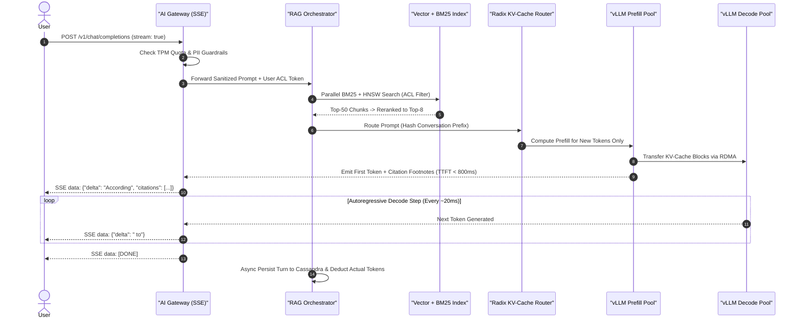
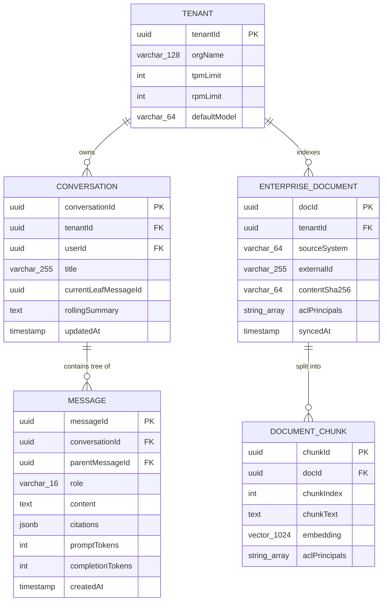

# ChatGPT & Enterprise RAG Copilot System Design

[← Back to System Design](system-design.md)

> **Core Building Blocks Used**: [Chapter 1 — Server-Sent Events (SSE)](fundamentals/01-networking-and-api-paradigms.md#server-sent-events-sse) · [Chapter 3 — KEDA Auto-Scaling & Caching](fundamentals/03-caching-and-scaling.md#3-auto-scaling-nodes-in-production) · [Chapter 4 — Vector Databases & Inverted Index](fundamentals/04-databases-sql-vs-nosql.md#7-vector-databases-milvus-pinecone-qdrant-pgvector) · [Chapter 8 — ReBAC Document ACLs (Google Zanzibar)](fundamentals/08-security-multi-region-and-deployments.md#authorization-models-rbac-vs-abac-vs-rebac-google-zanzibar) · [Chapter 9 — Production RAG, vLLM PagedAttention & AI Gateway](fundamentals/09-genai-llm-and-ml-system-design.md)

## Overview

A **Conversational AI & Enterprise RAG Copilot Platform** (such as ChatGPT Enterprise, Microsoft 365 Copilot, or Glean) combines multi-turn conversational Large Language Model (LLM) inference with real-time **Retrieval-Augmented Generation (RAG)** over private enterprise knowledge bases (Slack, Confluence, Google Drive, GitHub, Jira, PDFs).

Designing a production-grade LLM & RAG platform at scale centers on five core distributed systems challenges:

1. **Two-Phase Inference Asymmetry (Prefill vs. Decode)**: LLM serving consists of a compute-bound **Prefill** phase (processing prompt + retrieved context tokens in parallel, measured by **Time-To-First-Token / TTFT**) and a memory-bandwidth-bound **Decode** phase (generating output tokens autoregressively one by one, measured by **Inter-Token Latency / ITL**).
2. **GPU KV-Cache Memory Management & Continuous Batching**: Without optimization, reserving contiguous GPU VRAM (`HBM3`) for maximum sequence lengths ($32\text{K–}128\text{K}$ tokens) wastes $60\text{--}80\%$ of GPU memory due to internal fragmentation. Using **PagedAttention (vLLM / TensorRT-LLM)** and **iteration-level continuous batching** increases GPU throughput by $5\text{--}10\times$.
3. **Permission-Aware Hybrid Retrieval (RAG)**: Enterprise users must *never* retrieve or synthesize chunks from documents they lack permission to view. The system must enforce **pre-retrieval ACL filtering** alongside **Two-Stage Hybrid Search (BM25 lexical + HNSW vector ANN)**, **Reciprocal Rank Fusion (RRF)**, and **Cross-Encoder Reranking**.
4. **AI Gateway, Semantic Caching & Token Rate Limiting**: Standard HTTP request-count rate limiters fail because a single $100\text{K}$-token prompt costs $1,000\times$ more GPU compute than a $100$-token prompt. The gateway enforces **Tokens-Per-Minute (TPM)** limits, **Vector Semantic Caching**, and **Input/Output Guardrails** (PII redaction, prompt injection defense).
5. **Real-Time SSE Token Streaming & Multi-Turn Context Tree Persistence**: Streaming generated tokens over **Server-Sent Events (SSE)** while persisting branching conversation trees (supporting message edits and regeneration) and sliding-window memory summaries.

---

## Functional Requirements

* **Multi-Turn Streaming Chat**: Users submit prompts and receive real-time token-by-token responses via Server-Sent Events (`text/event-stream`), with support for conversation branching (editing a prior turn or regenerating a response).
* **Enterprise RAG Grounding & Inline Citations**: Automatically retrieve relevant chunks from connected enterprise data sources (Confluence, Drive, Slack, PDFs) and ground LLM responses with verifiable source citations (`[Doc 1, Page 4]`).
* **Strict Document-Level Access Control (ACL)**: Enforce user/group permissions during retrieval so the LLM only sees context chunks the authenticated user is authorized to read.
* **Multi-Modal Document Ingestion & Sync**: Continuously ingest, OCR, chunk, embed, and sync enterprise documents and ACL permissions via webhooks and change-data-capture (CDC) connectors.
* **AI Gateway Controls**: Semantic caching for repeated queries, dual RPM/TPM rate limiting per tenant/user tier, PII scrubbing, and prompt-injection / toxicity guardrails.
* **Model Routing & Fallbacks**: Dynamically route queries between fast/small models (`GPT-4o-mini` / `Llama-3-8B`) and frontier reasoning models (`GPT-4o` / `Claude 3.5 Sonnet` / `Llama-3-70B`) with automatic cross-region failover.

---

## Non-Functional Requirements

* **Low Time-To-First-Token (TTFT)**:
  * **Standard Chat (No RAG)**: P95 TTFT **$< 400\text{ ms}$**.
  * **Enterprise RAG Chat**: P95 TTFT **$< 1.2\text{ seconds}$** (including query embedding, hybrid retrieval, reranking, and prompt prefill).
* **Smooth Inter-Token Latency (ITL)**: P95 ITL **$< 30\text{ ms/token}$** ($\ge 35\text{ tokens/sec}$ streaming speed, exceeding human reading speed of $\sim 5\text{ tokens/sec}$).
* **Zero Permission Leakage (Strict Security)**: ACL revocation in upstream systems (e.g., removing a user from a Google Drive folder) must propagate to the retrieval index within **$< 60\text{ seconds}$**.
* **High Availability ($99.99\%$)**: Multi-provider / multi-cluster GPU fallback when primary GPU pools experience saturation or hardware faults.
* **Cost Efficiency**: Maximize GPU utilization ($> 75\%$ compute/VRAM efficiency) via prefix caching, semantic caching ($20\text{--}35\%$ hit rate), and quantized serving (`FP8` / `AWQ`).

---

## Back of the Envelope Estimations

### Scale & Token Traffic

* **Daily Active Users (DAU)**: $50\text{ Million DAU}$ ($5\text{M}$ Enterprise RAG seats + $45\text{M}$ general chat users).
* **Prompts per User per Day**: $20\text{ prompts/day} \implies \mathbf{1\text{ Billion prompts/day}}$.
* **Query QPS**:
  $$\text{Average QPS} = \frac{1,000,000,000}{86,400} \approx 11,575\text{ req/sec} \quad (\text{Peak QPS: } \approx 35,000\text{ req/sec})$$
* **Token Volume per Request**:
  * Average Input (System Prompt + Chat History + 5 RAG Chunks): $2,500\text{ input tokens}$.
  * Average Output: $500\text{ output tokens}$.
  * **Peak Token Throughput**:
    $$35,000\text{ req/sec} \times 3,000\text{ tokens/req} \approx \mathbf{105\text{ Million tokens/sec}}$$

### GPU Cluster & KV-Cache Sizing (70B Parameter Model in FP8)

* **Model Weights VRAM**: A 70-billion parameter model in `FP8` ($1\text{ byte/param}$) requires:
  $$70 \times 10^9 \times 1\text{ byte} \approx 70\text{ GB VRAM}$$
  *Deployed across **2x NVIDIA H100 GPUs** ($2 \times 80\text{ GB} = 160\text{ GB HBM3}$) using Tensor Parallelism ($\text{TP}=2$), leaving $\sim 80\text{ GB}$ for the PagedAttention KV-Cache and activations.*
* **KV-Cache Memory per Token** (70B model with Grouped-Query Attention / GQA, 80 layers, 8 KV heads, 128 head dim, `FP8`):
  $$\text{KV per token} = 2\ (\text{K,V}) \times 80\text{ layers} \times 8\text{ heads} \times 128\text{ dim} \times 1\text{ byte} \approx \mathbf{163.8\text{ KB/token}}$$
* **Concurrent Requests per 2x H100 Replica**:
  * At $3,000\text{ tokens/request}$, one active sequence consumes $3,000 \times 163.8\text{ KB} \approx 491\text{ MB}$ of KV-Cache.
  * With $80\text{ GB}$ available KV-Cache VRAM, each 2x H100 replica holds $\frac{80\text{ GB}}{0.491\text{ GB}} \approx \mathbf{160\text{ concurrent sequences}}$ via Continuous Batching.

### Vector Index & Chat Storage Sizing

* **Enterprise Document Corpus**: $1\text{ Billion documents} \times 10\text{ chunks/doc} = \mathbf{10\text{ Billion chunks}}$.
* **Vector Embedding Storage** ($1024\text{-dim}$ `int8` scalar-quantized embeddings + HNSW graph overhead + ACL metadata $\approx 2\text{ KB/chunk}$):
  $$10^{10}\text{ chunks} \times 2\text{ KB} = \mathbf{20\text{ Terabytes}} \quad (\text{Sharded across Milvus / Qdrant / OpenSearch nodes})$$
* **Chat History Storage**:
  $$1\text{B prompts/day} \times 4\text{ KB text/metadata} = \mathbf{4\text{ TB/day}} \implies \approx 1.46\text{ PB/year}$$

---

## High-Level System Architecture

```mermaid
%%{init: {'flowchart': {'nodeSpacing': 25, 'rankSpacing': 45, 'padding': 10}}}%%
flowchart LR
    Client["Web / Mobile / IDE Client"]
    subgraph GatewayTier["AI Gateway & Guardrails"]
        AIGW["AI Gateway (SSE, TPM Rate Limit)"]
        Guard["Guardrails (PII Scrub & Injection Check)"]
        SemCache[("Semantic Cache (Redis Vector)")]
    end
    subgraph Orchestration["RAG & Chat Orchestrator"]
        ChatOrch["Chat & Prompt Orchestrator"]
        EmbedSvc["Query Rewriter & Embedding Svc"]
        Reranker["Cross-Encoder Reranker (ONNX)"]
    end
    subgraph RetrievalAndStorage["Retrieval & Persistence Tier"]
        HybridIdx[("Hybrid Index (Vector HNSW + BM25 + ACLs)")]
        ChatDB[("Cassandra / DynamoDB (Chat Trees)")]
    end
    subgraph GPUCluster["vLLM GPU Inference Cluster"]
        Router["Prefix-Aware KV Router"]
        vLLM["vLLM Workers (Disaggregated Prefill/Decode)"]
    end

    Client e1@-->|"POST /v1/chat/completions (SSE)"| AIGW
    AIGW e2@-->|"1. Validate & Scrub"| Guard
    Guard e3@-->|"2. Cosine > 0.96?"| SemCache
    Guard e4@-->|"3. Cache Miss"| ChatOrch
    ChatOrch e5@-->|"4. Fetch History"| ChatDB
    ChatOrch e6@-->|"5. Rewrite & Embed"| EmbedSvc
    EmbedSvc e7@-->|"6. Hybrid Search + ACL Filter"| HybridIdx
    HybridIdx e8@-->|"Top 100 Chunks"| Reranker
    Reranker e9@-->|"Top 8 Grounded Chunks"| ChatOrch
    ChatOrch e10@-->|"7. Assemble Prompt"| Router
    Router e11@-->|"8. Stream Tokens"| vLLM
    vLLM e12@-.->|"SSE Token Stream"| Client

    e1@{ animate: true }
    e2@{ animate: true }
    e3@{ animate: true }
    e4@{ animate: true }
    e5@{ animate: true }
    e6@{ animate: true }
    e7@{ animate: true }
    e8@{ animate: true }
    e9@{ animate: true }
    e10@{ animate: true }
    e11@{ animate: true }
    e12@{ animate: true }

    classDef client fill:#1d4ed8,stroke:#60a5fa,stroke-width:2px,color:#ffffff
    classDef edge fill:#6d28d9,stroke:#a78bfa,stroke-width:2px,color:#ffffff
    classDef service fill:#047857,stroke:#34d399,stroke-width:2px,color:#ffffff
    classDef worker fill:#0e7490,stroke:#22d3ee,stroke-width:2px,color:#ffffff
    classDef cache fill:#be123c,stroke:#fb7185,stroke-width:2px,color:#ffffff
    classDef storage fill:#b45309,stroke:#fbbf24,stroke-width:2px,color:#ffffff

    class Client client
    class AIGW,Guard,Router edge
    class ChatOrch,EmbedSvc,Reranker service
    class vLLM worker
    class SemCache cache
    class HybridIdx,ChatDB storage

    style GatewayTier fill:transparent,stroke:#a78bfa,stroke-width:1.5px,stroke-dasharray: 5 5
    style Orchestration fill:transparent,stroke:#34d399,stroke-width:1.5px,stroke-dasharray: 5 5
    style RetrievalAndStorage fill:transparent,stroke:#fbbf24,stroke-width:1.5px,stroke-dasharray: 5 5
    style GPUCluster fill:transparent,stroke:#22d3ee,stroke-width:1.5px,stroke-dasharray: 5 5
```



---

## Core Components & Data Flows

### 1. Permission-Aware Two-Stage Hybrid RAG Pipeline

In an enterprise RAG system, naive vector search fails on exact identifiers (part numbers, error codes, Jira ticket IDs like `ENG-4921`) and risks leaking confidential executive documents if ACLs are checked too late.

```mermaid
%%{init: {'flowchart': {'nodeSpacing': 20, 'rankSpacing': 40, 'padding': 10}}}%%
flowchart LR
    Query["User Query + User Principal ACLs"]
    Rewrite["Multi-Query Expansion / HyDE"]
    subgraph Stage1["Stage 1: Pre-Filtered Hybrid Recall (< 25ms)"]
        BM25["BM25 Lexical Search + ACL Bitset Filter"]
        Vector["HNSW Vector ANN + ACL Bitset Filter"]
        RRF["Reciprocal Rank Fusion (RRF, k=60)"]
    end
    subgraph Stage2["Stage 2: Precision Reranking (< 30ms)"]
        CrossEnc["Cross-Encoder (BGE-Reranker / Cohere)"]
        Prompt["Top-8 Chunks + Citation Metadata"]
    end

    Query e1@--> Rewrite
    Rewrite e2@-->|"Sparse Terms"| BM25
    Rewrite e3@-->|"Dense Embedding"| Vector
    BM25 e4@-->|"Top 100"| RRF
    Vector e5@-->|"Top 100"| RRF
    RRF e6@-->|"Merged Top 50"| CrossEnc
    CrossEnc e7@-->|"Scored & Deduped"| Prompt

    e1@{ animate: true }
    e2@{ animate: true }
    e3@{ animate: true }
    e4@{ animate: true }
    e5@{ animate: true }
    e6@{ animate: true }
    e7@{ animate: true }

    classDef client fill:#1d4ed8,stroke:#60a5fa,stroke-width:2px,color:#ffffff
    classDef service fill:#047857,stroke:#34d399,stroke-width:2px,color:#ffffff
    classDef worker fill:#0e7490,stroke:#22d3ee,stroke-width:2px,color:#ffffff

    class Query,Prompt client
    class Rewrite,BM25,Vector,RRF service
    class CrossEnc worker

    style Stage1 fill:transparent,stroke:#34d399,stroke-width:1.5px,stroke-dasharray: 5 5
    style Stage2 fill:transparent,stroke:#22d3ee,stroke-width:1.5px,stroke-dasharray: 5 5
```



1. **Conversational Query Rewriting**: Before searching, a lightweight LLM rewrites ambiguous follow-up questions (e.g., *"What was its Q3 revenue?"* $\rightarrow$ *"What was Acme Corp's Q3 2026 revenue?"*) using the recent chat history.
2. **Pre-Retrieval ACL Bitset Filtering**: Every indexed chunk stores an `allowed_principals` inverted tag list (`user:123`, `group:eng-all`, `role:finance`). When a user queries the index, their expanded group memberships (cached from **Google Zanzibar / SpiceDB** in Redis with a 30s TTL) are passed as a mandatory pre-filter bitmask into both BM25 and HNSW graph traversal.
3. **Reciprocal Rank Fusion (RRF)**: Combines dense semantic ranks ($r_{\text{vec}}$) and sparse BM25 ranks ($r_{\text{bm25}}$) without requiring score calibration:
   $$\text{RRF\_Score}(d) = \frac{1}{60 + r_{\text{vec}}(d)} + \frac{1}{60 + r_{\text{bm25}}(d)}$$
4. **Cross-Encoder Reranking**: A cross-encoder model (`bge-reranker-large` running on ONNX/Triton) performs full cross-attention over `(Query, Chunk_i)` for the top 50 candidates, selecting the top 8 chunks with highest relevance.

### 2. LLM Serving Architecture: PagedAttention, Prefix Caching & Disaggregated Prefill/Decode

* **PagedAttention (vLLM)**: Divides the GPU KV-Cache into fixed-size virtual memory blocks (e.g., 16 tokens per block). Requests allocate blocks on demand via a block table, eliminating internal fragmentation and enabling **Copy-on-Write beam/parallel sampling**.
* **Prefix-Aware KV-Cache Routing**: In multi-turn conversations and shared enterprise system prompts, $80\%+$ of the input tokens are identical to the previous turn. A **Consistent-Hash / Radix-Tree Router (SGLang / vLLM Automatic Prefix Caching)** routes follow-up turns of a `conversationId` to the same GPU replica where the prior turn's KV-Cache blocks are already resident in VRAM or NVMe host memory, slashing TTFT by $70\%$.
* **Disaggregated Prefill & Decode Pools (DistServe / Mooncake)**:
  * Because **Prefill** saturates GPU FLOPs and interferes with the strict $30\text{ ms}$ latency of active **Decode** batches, large clusters separate GPUs into a **Prefill Pool** and a **Decode Pool**, transferring the computed KV-Cache over **RDMA / NVLink / GPUDirect RoCE** in $< 10\text{ ms}$.



### 3. Branching Chat History Tree & Context Window Compression

Users in ChatGPT frequently edit an earlier message or click *"Regenerate Response"*, creating a **directed tree of messages** rather than a flat list:

* Each message stores a `parent_message_id` pointer. Rendering a thread simply traverses the active leaf node up to the root (`parent_message_id` chain) or follows the selected child branch at each turn.
* **Sliding Window + Hierarchical Summarization**: When a conversation exceeds the token budget (e.g., $> 16\text{K}$ tokens), an asynchronous background worker summarizes older turns into a compact `rolling_summary` block while keeping the last $N$ turns verbatim.

---

## API Endpoints

### 1. Streaming Chat Completion with Enterprise RAG

```http
POST /api/v1/chat/completions
Authorization: Bearer <jwt_token>
Accept: text/event-stream
Content-Type: application/json
```

```json
// Request
{
  "conversationId": "conv_01J9X8Z2A4",
  "parentMessageId": "msg_01J9X8Z991",
  "model": "enterprise-gpt-4o",
  "stream": true,
  "ragConfig": {
    "enabled": true,
    "sources": ["confluence", "gdrive", "slack"],
    "topK": 8
  },
  "messages": [
    {
      "role": "user",
      "content": "What is our disaster recovery RPO and RTO tier for the payments ledger?"
    }
  ]
}
```

```text
// Response: 200 OK (text/event-stream)
event: citations
data: {"citations":[{"id":1,"title":"Payment Architecture Runbook","url":"https://wiki.internal/payments-dr","score":0.94}]}

event: token
data: {"id":"msg_01J9X9012B","delta":{"content":"Based on the Payment Architecture Runbook [1], "}}

event: token
data: {"id":"msg_01J9X9012B","delta":{"content":"the payments ledger operates on Tier 0 Active-Active with RPO = 0 and RTO < 5s."}}

event: usage
data: {"promptTokens":2410,"completionTokens":48,"cachedPrefixTokens":1650}

event: done
data: [DONE]
```

### 2. Document Ingestion Webhook (Enterprise Connector)

```http
POST /api/v1/ingestion/documents
X-Connector-Signature: sha256=...
Content-Type: application/json
```

```json
{
  "sourceSystem": "GOOGLE_DRIVE",
  "externalDocId": "1BxiMVs0XRA5nFMdKvBdBZjgmUUqptlbs74OgvE2upms",
  "title": "Q3 Engineering Architecture Roadmap.pdf",
  "blobUri": "s3://enterprise-rag-raw/tenant_88/doc_9912.pdf",
  "aclPrincipals": ["group:eng-leadership", "user:tarun@company.com"],
  "updatedAt": "2026-10-28T18:30:00Z"
}
```

---

## Object Model & Database Schema

### Database Selection & Rationale

| Workload / Subsystem | Database Choice | Data Model & CAP Profile | Why This Database? (Justification & Trade-offs) |
| :--- | :--- | :--- | :--- |
| **Hybrid RAG Index (Vector Embeddings + BM25 + ACL Pre-Filters)** | **Qdrant / Milvus + OpenSearch** | Vector HNSW + Inverted Index (**AP / Near Real-Time**) | **Why:** Supports scalar-quantized (`int8`) HNSW vector search combined with sparse BM25 lexical matching and roaring-bitmap payload filtering (`allowed_principals`) in a single query pass ($< 25\text{ ms}$). |
| **Multi-Turn Conversation Trees & Message History** | **Apache Cassandra / Amazon DynamoDB** | Wide-Column / Key-Value (**AP / PA-EL**) | **Why:** Chat history is an append-heavy workload ($1\text{B messages/day}$) queried almost exclusively by `(tenant_id, user_id, conversation_id)`. Partitioning by `conversation_id` and clustering by `message_id` (UUIDv7 / Snowflake) delivers $< 5\text{ ms}$ ordered thread reads. |
| **Document & Group ACL Graph (Permission Expansion)** | **SpiceDB (Google Zanzibar) + Redis Cache** | Relationship-Based Access Control Graph (**CP / Low-Latency Cache**) | **Why:** Enterprise permissions are deeply nested (User $\in$ Team $\in$ Org $\to$ Folder $\to$ Document). SpiceDB resolves transitive group memberships and caches the user's principal set in Redis with event-driven invalidation on ACL change events. |
| **Semantic Cache & Token Rate Limiter (TPM / RPM)** | **Redis Stack (RediSearch Vector + Lua)** | In-Memory Vector & Atomic Counters (**AP / Sub-ms**) | **Why:** Executes atomic Lua token-bucket reservation for TPM/RPM rate limiting in $< 1\text{ ms}$ and caches recent `(tenant_id, acl_hash, query_embedding)` responses to short-circuit identical/paraphrased queries. |
| **Tenant Billing, API Keys & Audit Logs** | **PostgreSQL + ClickHouse** | Relational (ACID) + Columnar OLAP | **Why:** PostgreSQL stores enterprise tenant subscriptions and API keys, while ClickHouse aggregates billions of prompt/completion token usage events for real-time cost attribution and chargebacks. |



---

## System Design Diagram

```mermaid
%%{init: {'flowchart': {'nodeSpacing': 20, 'rankSpacing': 40, 'padding': 10}}}%%
flowchart LR
    subgraph ClientsAndDocs["Clients & Enterprise Sources"]
        WebApp["Chat Web / Mobile / IDE"]
        SaaS["Slack / Drive / Confluence"]
    end
    subgraph EdgeAndGateway["AI Gateway & Security"]
        AIGW{"AI Gateway (SSE, Auth, TPM Lua)"}
        Guardrails["Guardrail Svc (Presidio PII + LlamaGuard)"]
        SemCache[("Redis Semantic Cache & TPM")]
    end
    subgraph RAGAndIngestion["RAG & Ingestion Services"]
        IngestKafka[["Kafka Ingestion Bus"]]
        ChunkWorker["Layout Parser & Embedding Worker"]
        SpiceDB[("SpiceDB (Zanzibar ACLs)")]
        ChatOrch["Chat & RAG Orchestrator"]
        HybridStore[("Qdrant + OpenSearch (Hybrid Index)")]
        ChatStore[("Cassandra (Chat Trees)")]
    end
    subgraph GPUInference["Disaggregated vLLM GPU Tier"]
        KVRouter["Radix Prefix KV Router"]
        PrefillPool["vLLM Prefill GPU Pool"]
        DecodePool["vLLM Decode GPU Pool"]
    end

    SaaS e1@-->|"CDC Webhooks"| IngestKafka
    IngestKafka e2@-->|"Parse & Chunk"| ChunkWorker
    ChunkWorker e3@-->|"Upsert Vectors + ACLs"| HybridStore
    ChunkWorker e4@-->|"Sync Relations"| SpiceDB

    WebApp e5@-->|"HTTPS / SSE"| AIGW
    AIGW e6@-->|"TPM Check & Cache"| SemCache
    AIGW e7@-->|"Scrub PII"| Guardrails
    Guardrails e8@-->|"Orchestrate"| ChatOrch
    ChatOrch e9@-->|"Read/Write Tree"| ChatStore
    ChatOrch e10@-->|"Lookup User Groups"| SpiceDB
    ChatOrch e11@-->|"Hybrid Search + Rerank"| HybridStore
    ChatOrch e12@-->|"Grounded Prompt"| KVRouter
    KVRouter e13@-->|"Compute KV"| PrefillPool
    PrefillPool e14@-->|"RDMA KV Transfer"| DecodePool
    DecodePool e15@-.->|"Stream Tokens (SSE)"| AIGW

    e1@{ animate: true }
    e2@{ animate: true }
    e3@{ animate: true }
    e4@{ animate: true }
    e5@{ animate: true }
    e6@{ animate: true }
    e7@{ animate: true }
    e8@{ animate: true }
    e9@{ animate: true }
    e10@{ animate: true }
    e11@{ animate: true }
    e12@{ animate: true }
    e13@{ animate: true }
    e14@{ animate: true }
    e15@{ animate: true }

    classDef client fill:#1d4ed8,stroke:#60a5fa,stroke-width:2px,color:#ffffff
    classDef edge fill:#6d28d9,stroke:#a78bfa,stroke-width:2px,color:#ffffff
    classDef service fill:#047857,stroke:#34d399,stroke-width:2px,color:#ffffff
    classDef worker fill:#0e7490,stroke:#22d3ee,stroke-width:2px,color:#ffffff
    classDef cache fill:#be123c,stroke:#fb7185,stroke-width:2px,color:#ffffff
    classDef storage fill:#b45309,stroke:#fbbf24,stroke-width:2px,color:#ffffff
    classDef queue fill:#3730a3,stroke:#818cf8,stroke-width:2px,color:#ffffff

    class WebApp,SaaS client
    class AIGW,Guardrails,KVRouter edge
    class ChatOrch service
    class ChunkWorker,PrefillPool,DecodePool worker
    class SemCache cache
    class SpiceDB,HybridStore,ChatStore storage
    class IngestKafka queue

    style ClientsAndDocs fill:transparent,stroke:#60a5fa,stroke-width:1.5px,stroke-dasharray: 5 5
    style EdgeAndGateway fill:transparent,stroke:#a78bfa,stroke-width:1.5px,stroke-dasharray: 5 5
    style RAGAndIngestion fill:transparent,stroke:#34d399,stroke-width:1.5px,stroke-dasharray: 5 5
    style GPUInference fill:transparent,stroke:#22d3ee,stroke-width:1.5px,stroke-dasharray: 5 5
```



---

## Deep Dive & Key Technical Challenges

### 1. Preventing Permission Leakage in Semantic Caching & RAG

* **The Trap**: If Employee A (an HR Director) asks *"What is the executive bonus pool for 2026?"* and the response is stored in a global Semantic Cache, Employee B (an intern) asking the same question could receive the cached confidential answer!
* **The Solution**:
  1. **Scope Semantic Cache Keys by Permission Hash**: Semantic cache lookups are partitioned by `(tenant_id, sorted_acl_groups_hash)` or restricted strictly to public/organization-wide knowledge bases.
  2. **Push-Down ACL Filtering Before ANN Search**: Never perform "post-filtering" (fetching top $K$ globally and discarding unauthorized chunks), because if a user only has access to $0.1\%$ of documents, global top-$K$ returns 0 authorized results. Instead, use **filtered HNSW traversal** (Qdrant/Milvus bitmap pre-filtering) so graph search only visits authorized nodes.

### 2. Token-Aware Rate Limiting (Pre-Reservation + Reconciliation)

Because output token length is unknown until generation finishes:

1. **Ingress Reservation**: The AI Gateway counts exact `prompt_tokens` using a fast Rust `tiktoken` tokenizer and reserves `prompt_tokens + estimated_output_tokens (e.g., 512)` from the tenant's Redis Token Bucket via an atomic Lua script.
2. **Stream Reconciliation**: When the `[DONE]` event fires (or client disconnects early), the gateway refunds `estimated_output_tokens - actual_completion_tokens` back to the Redis bucket and emits an asynchronous billing ledger event to Kafka.

### 3. GPU Auto-Scaling on Queue Depth (Not CPU/GPU Utilization)

* Standard Kubernetes HPA based on CPU or GPU utilization fails for LLM clusters because a GPU running a batch size of 4 and a batch size of 128 both report near $100\%$ GPU compute utilization during active forward passes.
* **KEDA Custom Metrics Scaling**: Scale vLLM worker replicas based on **`vllm:num_requests_waiting`** (waiting queue depth in the scheduler) and **`vllm:gpu_cache_usage_perc`** (KV-Cache VRAM saturation $> 80\%$), paired with pre-warmed container images storing model weights on local NVMe RAID-0 (`safetensors` memory-mapped loading in $< 8\text{ seconds}$).

---

## Additional Notes

### Video References

* [](https://www.youtube.com/watch?v=T-D1OfcDW1M)
