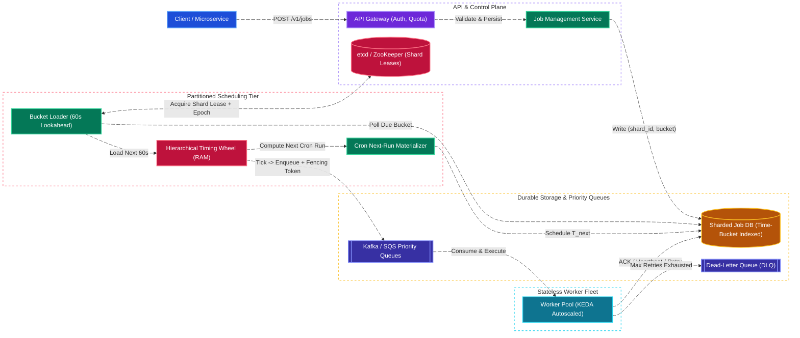
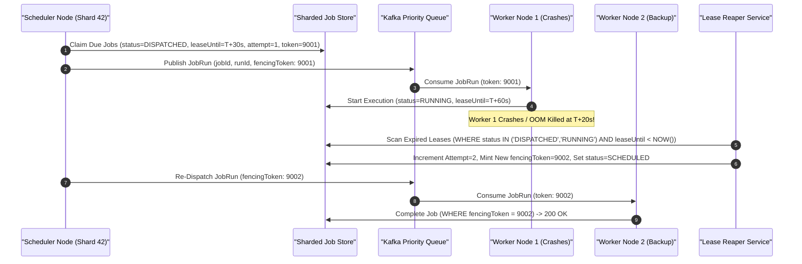
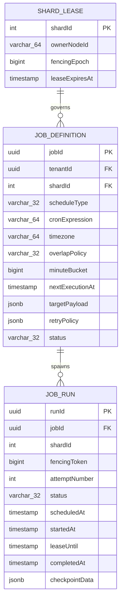

# Distributed Job Scheduler & Cron Service System Design

[← Back to System Design](system-design.md)

> **Core Building Blocks Used**: [Chapter 3 — Consistent Hashing & KEDA Worker Scaling](fundamentals/03-caching-and-scaling.md#4-consistent-hashing) · [Chapter 4 — Pessimistic `FOR UPDATE SKIP LOCKED` & Sharding](fundamentals/04-databases-sql-vs-nosql.md#3-pessimistic-vs-optimistic-concurrency-control-preventing-double-booking) · [Chapter 5 — Consensus (etcd), Distributed Leases, Fencing Tokens & Idempotency](fundamentals/05-distributed-systems-and-messaging.md#3-distributed-locks--fencing-tokens) · [Chapter 6 — Exponential Backoff with Jitter & Dead-Letter Queues](fundamentals/06-resiliency-observability-and-metrics.md#fault-isolation--cascading-failure-prevention)

## Overview

A **Distributed Job Scheduler & Cron Service** (such as AWS EventBridge Scheduler, Google Cloud Scheduler, Temporal, or Uber Cherami/Cadence) reliably schedules, persists, and executes millions of **one-time delayed tasks** (e.g., *"Cancel unpaid order in 15 minutes"*), **recurring cron jobs** (e.g., *"Generate tenant billing invoices `0 0 * * *`"*), and **multi-step DAG workflows** across a fleet of stateless workers.

Designing a planet-scale distributed task scheduler centers on five fundamental distributed systems challenges:

1. **High-Throughput Time-Indexed Polling Without DB Meltdown**: Naively running `SELECT * FROM jobs WHERE execution_time <= NOW() AND status = 'PENDING'` across billions of rows every second causes massive index lock contention unless the schedule space is partitioned by **time buckets and shard IDs** paired with an in-memory **Hierarchical Timing Wheel** or **Min-Heap**.
2. **Zombie Scheduler Prevention (Leases & Monotonic Fencing Tokens)**: If a scheduler node experiences a 10-second JVM garbage collection pause or network partition, another node takes over its shard. Without **monotonic fencing tokens**, both nodes will dispatch the same batch of jobs concurrently.
3. **At-Least-Once Dispatch + Effectively-Once Execution**: Because worker nodes can crash mid-execution after side effects occur, the scheduler guarantees **at-least-once delivery** via **Visibility Timeouts / Heartbeat Leases**, while downstream executors enforce **idempotency keys** and fencing tokens.
4. **Recurring Cron Materialization & Catch-Up Policies**: Calculating next execution timestamps across timezones/DST transitions and enforcing deterministic catch-up policies (`SKIP_OVERLAP`, `ALLOW_CONCURRENT`, `BUFFER_ALL`) when a job runs longer than its cron interval.
5. **Failure Isolation, Exponential Backoff with Jitter & Dead-Letter Queues (DLQ)**: Preventing poison-pill jobs or failing downstream webhooks from starving healthy tenants.

---

## Functional Requirements

* **One-Time Delayed Jobs**: Schedule a task to execute at a specific Unix timestamp (`executeAt`) or after a relative delay (`delaySeconds`).
* **Recurring Cron Schedules**: Register jobs using standard 5/6-field cron expressions (`*/5 * * * *`) with explicit IANA timezone support (`America/Los_Angeles`).
* **Job Lifecycle Management**: Cancel, pause, resume, update payload/schedule, or manually trigger ("Run Now") any registered job.
* **Configurable Retry & Timeout Policies**: Define per-job `maxRetries`, `executionTimeoutSeconds`, backoff multiplier, and Dead-Letter Queue (DLQ) routing.
* **Worker Lease Heartbeating**: Long-running workers can periodically extend their execution lease (`Heartbeat`) and report progress checkpoints.
* **Execution History & Audit Status**: Query real-time status (`SCHEDULED`, `DISPATCHED`, `RUNNING`, `SUCCEEDED`, `FAILED`, `DEAD_LETTERED`, `CANCELLED`) and logs for every job run.

---

## Non-Functional Requirements

* **Scheduling Precision (Trigger Lag SLO)**: P99 dispatch latency (difference between `scheduled_time` and actual queue enqueue time) must be **$< 500\text{ ms}$** (and **$< 50\text{ ms}$** for sub-second timing-wheel tier).
* **Durability & Zero Lost Jobs**: Once a `201 Created` response is returned, a scheduled job must **never** be lost (`RPO = 0`), surviving single-node or availability-zone failures.
* **At-Least-Once Execution Guarantee**: Every due job is guaranteed to run at least once; duplicate executions during worker crashes are mitigated via monotonic fencing tokens and idempotency keys.
* **Massive Scale**: Support **$100\text{ Million active recurring cron schedules}$** and **$1\text{ Billion one-time delayed executions per day}$** ($\sim 50,000\text{ peak executions/sec}$).
* **Multi-Tenant Fairness**: A tenant scheduling 5 million jobs for `00:00:00 UTC` (midnight spike) must not delay critical sub-second jobs of other tenants.

---

## Back of the Envelope Estimations

### Traffic & Execution QPS

* **Daily Job Executions**: $1\text{ Billion executions/day}$.
* **Average Execution QPS**:
  $$\text{Average QPS} = \frac{1,000,000,000}{86,400} \approx 11,575\text{ jobs/sec}$$
* **Top-of-the-Hour / Midnight Cron Spike ($5\times\text{--}10\times$)**:
  * Because human users overwhelmingly schedule cron jobs at `:00`, `:15`, `:30`, and `00:00 UTC`, peak dispatch rate reaches **$\mathbf{50,000\text{--}100,000\text{ jobs/sec}}$**.

### Storage & Memory Sizing

* **Job Metadata Record Size**: $\approx 1\text{ KB}$ (`jobId`, `tenantId`, `cronExpr`, `nextExecutionTime`, `payloadJson`, `retryPolicy`, `status`).
* **Active Scheduled Jobs Storage** ($100\text{M recurring}$ + $200\text{M pending one-time}$):
  $$300,000,000 \times 1\text{ KB} = \mathbf{300\text{ Gigabytes}} \quad (\text{Sharded across PostgreSQL / Cassandra / CockroachDB})$$
* **Execution History Log Storage** ($1\text{B runs/day} \times 512\text{ bytes}$, retained 30 days hot, 1 year cold):
  $$10^9 \times 512\text{ B} = \mathbf{512\text{ GB/day}} \implies \approx \mathbf{15.4\text{ TB/month}}$$
* **In-Memory Timing Wheel / Lookahead Buffer** (holding the next 60 seconds of due jobs across the cluster):
  $$60\text{ sec} \times 50,000\text{ peak jobs/sec} \times 256\text{ bytes} \approx \mathbf{768\text{ Megabytes RAM across all scheduler nodes}}$$

---

## High-Level System Architecture



---

## Core Components & Data Flows

### 1. Two-Tier Storage-to-Memory Scheduling: Database Time Buckets + Hierarchical Timing Wheel

Comparing the two primary in-memory scheduling data structures:

| Data Structure | Enqueue / Insert | Tick / Pop Due Jobs | Cancel Job | Best Use Case |
| :--- | :--- | :--- | :--- | :--- |
| **Min-Heap (Priority Queue)** | $O(\log N)$ | $O(\log N)$ | $O(\log N)$ (with index map) | Moderate queue sizes ($N < 100,000$) with arbitrary far-future timestamps. |
| **Hierarchical Timing Wheel (Kafka / Netty style)** | **$O(1)$** | **$O(1)$ amortized** | **$O(1)$** (doubly-linked list node) | **High-throughput schedulers ($> 100\text{K}$ timers)** where insertion and cancellation must be constant time. |


1. **Durable Time-Bucket Sharding**: Every scheduled job is persisted to the database partitioned by `(shard_id, minute_bucket)` where `shard_id = hash(job_id) % 256` and `minute_bucket = floor(execution_time / 60s)`.
2. **Lookahead Prefetch**: Each Scheduler node owns a subset of the 256 virtual shards via **etcd leases**. Every 30 seconds, the scheduler queries only its assigned `(shard_id, current_minute_bucket)` and loads upcoming jobs into its local **Hierarchical Timing Wheel**.
3. **Sub-Second $O(1)$ Tick**: As the timing wheel cursor advances every $50\text{ ms}$, all jobs in the current slot are atomically marked `DISPATCHED` (carrying the scheduler's `fencing_token`) and batch-published to Kafka.
4. **Immediate Short-Horizon Fast Path**: If a new job is created with `executeAt < NOW() + 60s`, the API service writes it to the DB *and* pushes it directly to the owning scheduler node's in-memory timing wheel via gRPC so it isn't missed by the 30-second lookahead poll.

### 2. Lease Heartbeating, Visibility Timeouts & Zombie Worker Recovery



* **Heartbeating Long Jobs**: If a job needs 10 minutes to run, the worker holds a short **60-second lease** (`lease_until`) and sends a heartbeat RPC every 20 seconds (`UPDATE job_runs SET lease_until = NOW() + 60s WHERE run_id = ? AND fencing_token = ?`). If the worker crashes, the lease expires within at most 60 seconds rather than waiting 10 minutes.
* **Fencing Zombie Workers**: If Worker 1 was merely frozen by a GC pause and wakes up after Worker 2 has taken over (`fencingToken = 9002`), any state update or downstream side-effect from Worker 1 carrying `fencingToken = 9001 < 9002` is deterministically rejected (`409 Stale Fencing Token`).

---

## API Endpoints

### 1. Create a Scheduled or Cron Job

```http
POST /api/v1/jobs
Authorization: Bearer <tenant_token>
Idempotency-Key: idem_sched_88219a
Content-Type: application/json
```

```json
// Request
{
  "name": "daily-tenant-invoice-rollup",
  "scheduleType": "CRON",
  "cronExpression": "0 2 * * *",
  "timezone": "America/New_York",
  "overlapPolicy": "SKIP_IF_RUNNING",
  "priority": "HIGH",
  "target": {
    "type": "WEBHOOK_OR_QUEUE",
    "endpoint": "https://billing.internal/v1/invoices/generate",
    "payload": {"billingCycle": "DAILY"}
  },
  "retryPolicy": {
    "maxAttempts": 5,
    "initialBackoffMs": 1000,
    "backoffMultiplier": 2.0,
    "maxBackoffMs": 60000,
    "executionTimeoutSeconds": 300
  }
}

// Response: 201 Created
{
  "jobId": "job_01J9X7B2M8",
  "status": "ACTIVE",
  "nextExecutionAt": "2026-10-29T06:00:00Z",
  "shardId": 142
}
```

### 2. Worker Lease Heartbeat & Completion Callback

```http
POST /api/v1/runs/{runId}/heartbeat
Content-Type: application/json
```

```json
// Request
{
  "workerId": "wrk_us_east_19",
  "fencingToken": 9002,
  "extendSeconds": 60,
  "checkpointData": {"processedRecords": 4500}
}

// Response: 200 OK
{
  "runId": "run_99812a",
  "leaseUntil": "2026-10-28T21:05:00Z",
  "cancelRequested": false
}
```

---

## Object Model & Database Schema

### Database Selection & Rationale

| Workload / Subsystem | Database Choice | Data Model & CAP Profile | Why This Database? (Justification & Trade-offs) |
| :--- | :--- | :--- | :--- |
| **Job Definitions & Due-Time Schedule Buckets** | **Sharded PostgreSQL / CockroachDB** | Relational / NewSQL (ACID, **CP / PC-EC**) | **Why:** Supports composite B-Tree indexing on `(shard_id, minute_bucket, next_execution_at)` and atomic `SELECT ... FOR UPDATE SKIP LOCKED` state transitions when claiming due jobs or updating cron `next_execution_at` pointers. |
| **Shard Ownership & Leader Leases** | **etcd / Apache ZooKeeper** | Raft Consensus Coordination Store (**Strict CP**) | **Why:** Assigns the 256 virtual schedule shards across active Scheduler nodes using TTL leases and generates strictly monotonic `epoch / fencing_token` integers on shard failover. |
| **Execution History & Audit Logs ($1\text{B runs/day}$)** | **Apache Cassandra / ScyllaDB** | Wide-Column LSM-Tree (**AP / High Write Throughput**) | **Why:** Absorbs $50\text{K–}100\text{K}$ status transitions per second (`DISPATCHED` $\to$ `RUNNING` $\to$ `SUCCEEDED`) with automatic TTL expiration (e.g., 30-day hot retention) without bloating the transactional schedule table. |



---

## System Design Diagram

```mermaid
%%{init: {'flowchart': {'nodeSpacing': 20, 'rankSpacing': 40, 'padding': 10}}}%%
flowchart LR
    subgraph Clients["Tenant Clients"]
        SDK["Service SDK / CLI / Console"]
    end
    subgraph ControlPlane["API & Coordination Tier"]
        Gateway{"API Gateway (Rate Limit, Auth)"}
        JobSvc["Job CRUD Service"]
        Etcd[("etcd Cluster (256 Shard Leases)")]
    end
    subgraph SchedulerCluster["Stateful Timing-Wheel Schedulers"]
        SchedNode["Scheduler Nodes (Timing Wheel + Prefetch)"]
        Reaper["Expired Lease Reaper & Retry Engine"]
    end
    subgraph QueueAndStorage["Storage & Priority Queues"]
        Postgres[("Sharded PostgreSQL (job_definitions)")]
        Cassandra[("Cassandra (job_runs Audit Log)")]
        HighQ[["Kafka High-Priority Topic"]]
        StdQ[["Kafka Standard / Bulk Topic"]]
        DLQ[["Kafka Dead-Letter Queue"]]
    end
    subgraph WorkerPool["Autoscaled Execution Tier"]
        FastWorkers["Fast Workers (KEDA Scaled)"]
        BulkWorkers["Bulk / Batch Workers"]
    end

    SDK e1@-->|"REST / gRPC"| Gateway
    Gateway e2@-->|"Create / Cancel"| JobSvc
    JobSvc e3@-->|"Persist Bucket"| Postgres
    JobSvc e4@-.->|"If <60s: Push Direct"| SchedNode
    SchedNode e5@<-->|"Lease + Epoch"| Etcd
    SchedNode e6@-->|"Prefetch Due Bucket"| Postgres
    SchedNode e7@-->|"Dispatch High"| HighQ
    SchedNode e8@-->|"Dispatch Standard"| StdQ
    HighQ e9@-->|"Execute"| FastWorkers
    StdQ e10@-->|"Execute"| BulkWorkers
    FastWorkers e11@-->|"Heartbeat / Complete"| Postgres
    FastWorkers e12@-->|"Append Run Log"| Cassandra
    Reaper e13@-->|"Scan Expired Leases"| Postgres
    Reaper e14@-.->|"Max Attempts Exceeded"| DLQ

    e1@{ animate: true }
    e2@{ animate: true }
    e3@{ animate: true }
    e4@{ animate: true }
    e5@{ animate: true }
    e6@{ animate: true }
    e7@{ animate: true }
    e8@{ animate: true }
    e9@{ animate: true }
    e10@{ animate: true }
    e11@{ animate: true }
    e12@{ animate: true }
    e13@{ animate: true }
    e14@{ animate: true }

    classDef client fill:#1d4ed8,stroke:#60a5fa,stroke-width:2px,color:#ffffff
    classDef edge fill:#6d28d9,stroke:#a78bfa,stroke-width:2px,color:#ffffff
    classDef service fill:#047857,stroke:#34d399,stroke-width:2px,color:#ffffff
    classDef worker fill:#0e7490,stroke:#22d3ee,stroke-width:2px,color:#ffffff
    classDef cache fill:#be123c,stroke:#fb7185,stroke-width:2px,color:#ffffff
    classDef storage fill:#b45309,stroke:#fbbf24,stroke-width:2px,color:#ffffff
    classDef queue fill:#3730a3,stroke:#818cf8,stroke-width:2px,color:#ffffff

    class SDK client
    class Gateway edge
    class JobSvc,SchedNode,Reaper service
    class FastWorkers,BulkWorkers worker
    class Etcd cache
    class Postgres,Cassandra storage
    class HighQ,StdQ,DLQ queue

    style Clients fill:transparent,stroke:#60a5fa,stroke-width:1.5px,stroke-dasharray: 5 5
    style ControlPlane fill:transparent,stroke:#a78bfa,stroke-width:1.5px,stroke-dasharray: 5 5
    style SchedulerCluster fill:transparent,stroke:#34d399,stroke-width:1.5px,stroke-dasharray: 5 5
    style QueueAndStorage fill:transparent,stroke:#fbbf24,stroke-width:1.5px,stroke-dasharray: 5 5
    style WorkerPool fill:transparent,stroke:#22d3ee,stroke-width:1.5px,stroke-dasharray: 5 5
```



---

## Deep Dive & Key Technical Challenges

### 1. Taming the Midnight (`00:00:00`) Cron Herd

Millions of users configure daily cron jobs for `0 0 * * *` (midnight), creating a $10\times$ traffic spike on the exact second:

* **Deterministic Hash Jitter (Flexible Time Windows)**: For recurring jobs marked with a tolerance window (e.g., `flexibleWindowMinutes: 5`), the scheduler adds a deterministic offset `hash(jobId) % 300 seconds` to smooth the midnight spike flat across a 5-minute window.
* **Priority Queue Isolation (Bulkhead Pattern)**: Sub-second latency-sensitive operational jobs (e.g., `HIGH` priority order-timeout cancellations) flow through dedicated Kafka topics and isolated worker pools, completely decoupled from `LOW` / `STANDARD` priority nightly batch reports.

### 2. SQL Alternative: `FOR UPDATE SKIP LOCKED` Queue Pattern

When building a smaller-scale scheduler ($< 5,000\text{ jobs/sec}$) directly on PostgreSQL without etcd shard leases:

```sql
WITH due_jobs AS (
    SELECT job_id, run_id
    FROM job_runs
    WHERE status = 'SCHEDULED'
      AND scheduled_at <= NOW()
    ORDER BY priority DESC, scheduled_at ASC
    LIMIT 100
    FOR UPDATE SKIP LOCKED
)
UPDATE job_runs jr
SET status = 'DISPATCHED',
    lease_until = NOW() + INTERVAL '60 seconds',
    fencing_token = nextval('fencing_token_seq')
FROM due_jobs dj
WHERE jr.run_id = dj.run_id
RETURNING jr.*;
```

* **`SKIP LOCKED`** prevents worker threads from blocking each other: if Worker A locks rows 1–100, Worker B immediately skips them and locks rows 101–200 in $< 2\text{ ms}$.

### 3. Handling Job Cancellation While In-Flight

If a user cancels a job:

1. **Before Dispatch**: Update `status = 'CANCELLED'` in PostgreSQL and send an O(1) delete RPC to the owning scheduler node's Timing Wheel doubly-linked list node.
2. **During Worker Execution**: Set `cancel_requested = true` on the `JOB_RUN` row. On the worker's next 20-second `/heartbeat` call, the response includes `"cancelRequested": true`, triggering cooperative cancellation (`CancellationTokenSource.Cancel()`) in the worker process.

---

## Additional Notes

### Video References

* [](https://www.youtube.com/watch?v=7cb70da1MK8)

