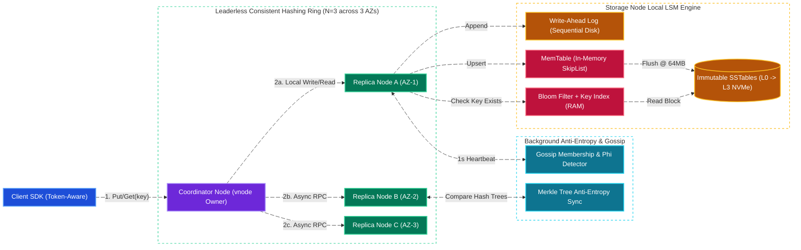
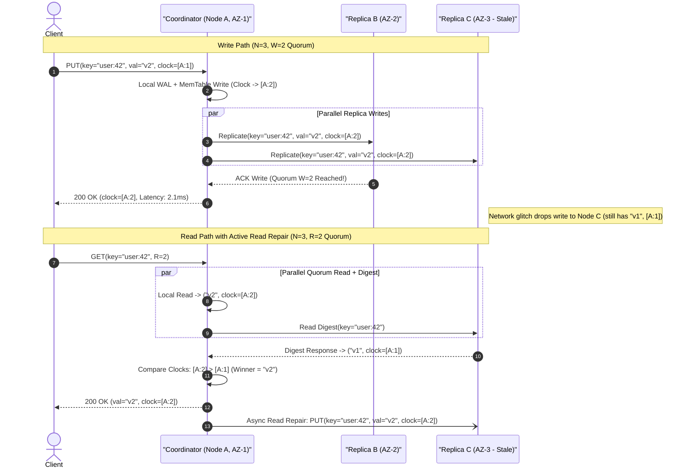
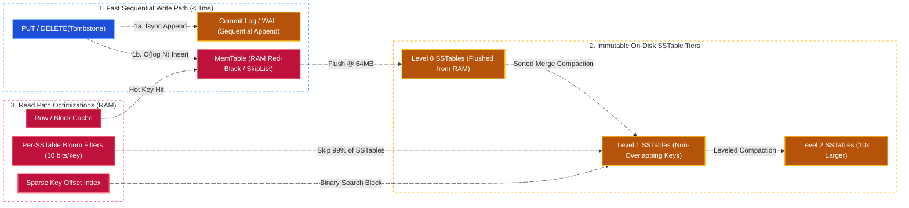
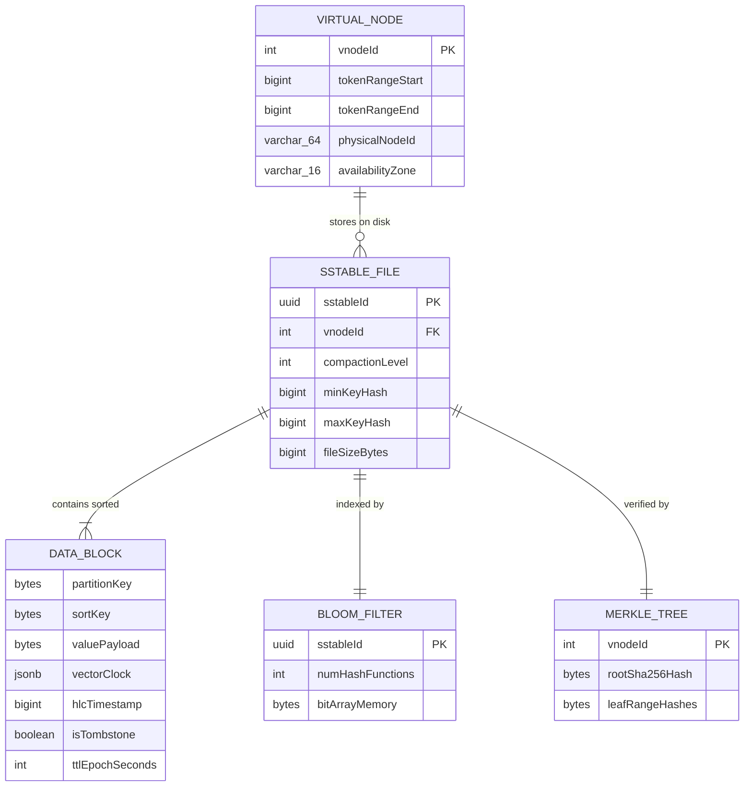
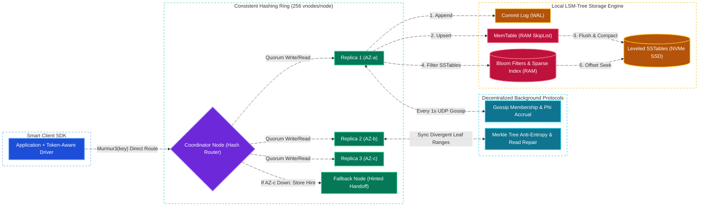

# Distributed Key-Value Store System Design (DynamoDB / Cassandra)

[← Back to System Design](system-design.md)

> **Core Building Blocks Used**: [Chapter 3 — Consistent Hashing with Virtual Nodes](fundamentals/03-caching-and-scaling.md#4-consistent-hashing) · [Chapter 4 — LSM-Tree, WAL, MemTable & SSTable Compaction](fundamentals/04-databases-sql-vs-nosql.md#btree-vs-lsm-tree-why-sql-vs-nosql-engines-differ) · [Chapter 5 — CAP/PACELC, Tunable Quorum ($R+W>N$) & Vector Clocks](fundamentals/05-distributed-systems-and-messaging.md#1-cap-theorem--pacelc-theorem) · [Chapter 7 — Bloom Filters, Gossip Protocol & Merkle Trees](fundamentals/07-probabilistic-structures-and-stream-processing.md#2-decentralized-cluster-protocols--conflict-resolution)

## Overview

A **Distributed Key-Value Store** (inspired by the seminal **Amazon Dynamo paper**, **Apache Cassandra**, **ScyllaDB**, and **Amazon DynamoDB**) is a horizontally scalable, fault-tolerant storage engine that maps arbitrary keys to values (`Get(key)`, `Put(key, value)`, `Delete(key)`) with predictable single-digit millisecond latency at petabyte scale.

Designing a distributed key-value store from scratch is the quintessential distributed systems interview question because it synthesizes almost every core primitive in distributed computing:

1. **Data Partitioning & Placement**: Distributing keys evenly across hundreds of storage nodes using **Consistent Hashing with Virtual Nodes (`vnodes`)** so adding or removing a node only moves $O(K/N)$ keys.
2. **High Availability & Tunable Replication ($N, W, R$)**: Replicating every key across $N$ physical racks/AZs and allowing clients to trade consistency vs. latency per request using **Quorum Consensus ($R + W > N$)**, **Sloppy Quorums**, and **Hinted Handoff**.
3. **Conflict Detection & Resolution**: Using **Vector Clocks** (or Hybrid Logical Clocks) to distinguish causally ordered overwrites from concurrent conflicting writes during network partitions.
4. **Decentralized Cluster Membership & Failure Detection**: Eliminating single points of failure (leaderless peer-to-peer ring) via **Gossip Protocol** and the **$\Phi$ (Phi) Accrual Failure Detector**.
5. **Replica Synchronization (Anti-Entropy)**: Healing stale replicas in the background using **Read Repair** (active) and **Merkle Tree cryptographic range comparisons** (passive).
6. **Node-Local Storage Engine Internals**: Achieving extreme write throughput and fast point reads on each node via an **LSM-Tree (`Write-Ahead Log` $\to$ `MemTable` $\to$ `Immutable SSTables` + `Bloom Filters` + `Compaction`)**.

---

## Functional Requirements

* **`Put(key, value, context)`**: Insert or update the value associated with a `key` (or composite `(partition_key, sort_key)`), returning an updated version context (vector clock / sequence number).
* **`Get(key, consistencyLevel)`**: Retrieve the value(s) associated with `key` using a caller-specified consistency mode (`ONE`, `QUORUM`, `ALL`, or `LOCAL_QUORUM`).
* **`Delete(key, context)`**: Logically delete a key by writing a distributed **Tombstone** marker that replicates across nodes before garbage collection.
* **Range Scans on Sort Key (Optional DynamoDB/Cassandra Extension)**: Query ordered items within a single partition key (`Scan(partition_key, sort_key_start, sort_key_end)`).
* **TTL (Time-To-Live) Expiration**: Automatically expire and purge keys after a configurable timestamp.

---

## Non-Functional Requirements

* **Predictable Low Latency**: P99 **Write Latency $< 5\text{ ms}$** and P99 **Read Latency $< 5\text{ ms}$** regardless of total dataset size (whether $100\text{ GB}$ or $5\text{ PB}$).
* **Linear Horizontal Scalability**: Doubling the number of storage nodes doubles both write/read QPS and storage capacity without downtime.
* **Tunable CAP / PACELC Profile**:
  * **AP Mode (`W=1, R=1`)**: Always writable and readable even during multi-node partitions.
  * **Strong Quorum Mode (`N=3, W=2, R=2`, where $R + W > N$)**: Strong read-your-writes consistency across overlapping replica sets.
* **High Durability ($99.999999999\%$)**: Zero data loss once a quorum write succeeds, surviving simultaneous disk crashes or an entire Availability Zone (AZ) outage.

---

## Back of the Envelope Estimations

### Traffic & Throughput

* **Total Stored Keys**: $100\text{ Billion keys}$ across the cluster.
* **Average Value Size**: $1\text{ KB}$ (plus $64\text{ bytes}$ key & metadata).
* **Read QPS**: $1,000,000\text{ reads/sec}$ ($1\text{M QPS}$).
* **Write QPS**: $250,000\text{ writes/sec}$ ($250\text{K QPS}$).

### Storage & Cluster Sizing

* **Raw Unique Data Size**:
  $$100 \times 10^9\text{ keys} \times 1\text{ KB} = \mathbf{100\text{ Terabytes}}$$
* **Replicated Storage ($N = 3$ Replication Factor across 3 AZs)**:
  $$100\text{ TB} \times 3 = \mathbf{300\text{ Terabytes}} \quad (\text{With } 30\% \text{ LSM compaction headroom: } \approx \mathbf{400\text{ TB NVMe SSD}})$$
* **Bloom Filter & Index Memory per Node**:
  * A 10-bits-per-key Bloom filter across $300\text{B total replica keys}$ requires:
    $$300 \times 10^9 \times 10\text{ bits} \approx 375\text{ Gigabytes RAM total across the cluster}$$
* **Cluster Node Count**:
  * Using **100 storage nodes** (each with $64\text{ GB RAM}$ and $4\text{ TB NVMe SSD}$):
  * Each node handles $\sim 7,500\text{ replica writes/sec}$ ($250\text{K} \times 3 / 100$), $\sim 10,000\text{ reads/sec}$, and holds only $3.75\text{ GB}$ of Bloom filters in RAM.

---

## High-Level System Architecture



---

## Core Components & Data Flows

### 1. Consistent Hashing with Virtual Nodes & Rack-Aware Preference Lists

* **Hash Ring ($[0, 2^{128}-1]$)**: Keys are hashed via `MurmurHash3(partition_key)` onto a circular keyspace.
* **Virtual Nodes (`vnodes`)**: Instead of assigning a physical machine to a single point on the ring (which causes severe data skew and hotspots when a node joins/leaves), each physical server owns **256 Virtual Nodes (`vnodes`)** scattered uniformly across the ring.
* **Rack / AZ-Aware Preference List ($N=3$)**: To replicate a key $K$, the coordinator walks clockwise from `hash(K)` to select $N=3$ distinct physical nodes, skipping any `vnode` belonging to an Availability Zone already selected so the 3 replicas reside in **3 separate AZs (`AZ-1`, `AZ-2`, `AZ-3`)**.

### 2. Tunable Quorum ($R + W > N$), Read Repair & Hinted Handoff



* **Sloppy Quorum & Hinted Handoff (High Availability Mode)**: If both `Node B` and `Node C` are temporarily unreachable during a network partition and the client requires high write availability, the coordinator writes a **Hinted Handoff** record to a healthy fallback node (`Node D`) tagged with `target=Node C` in a local hints table. Once Gossip detects `Node C` has recovered, `Node D` replays the hinted writes and deletes the hint.

### 3. Node-Local Storage Engine: LSM-Tree + Bloom Filter + SSTable Compaction

Why do distributed KV stores (Cassandra, RocksDB, Bigtable) use **Log-Structured Merge-Trees (LSM)** instead of **B+Trees**? Because B+Trees modify 4KB–16KB disk pages in-place (random I/O), whereas LSM-Trees turn all writes into **100% sequential disk appends**:



1. **Write Path**: Append to on-disk **Write-Ahead Log (WAL)** for crash durability + insert into in-memory **MemTable (`SkipList`)**. Return `200 OK` immediately.
2. **Flush**: When the MemTable reaches $64\text{ MB}$, freeze it and flush its sorted keys sequentially to an immutable **SSTable (Sorted String Table)** on NVMe disk, generating a **Bloom Filter** and **Sparse Index** in the process.
3. **Read Path**: Check `MemTable` first. If not found, check the `Row/Block Cache`. If still a miss, test each SSTable's **in-memory Bloom Filter**; if the Bloom filter returns `false`, skip that SSTable file with **zero disk I/O**. For matching SSTables, binary-search the in-memory `Sparse Index` and read a single $4\text{ KB}$ compressed disk block.

---

## API Endpoints & Wire Protocol

In production (Cassandra CQL Binary Protocol / DynamoDB HTTP-JSON / gRPC), requests use persistent multiplexed TCP connections:

### 1. Put Item (Write with Tunable Consistency & Conditional Version)

```http
PUT /api/v1/tables/user_sessions/items/usr_99812
X-Consistency-Level: QUORUM
Content-Type: application/json
```

```json
// Request
{
  "partitionKey": "usr_99812",
  "sortKey": "sess_2026_10_28",
  "value": {
    "cartItems": ["sku_101", "sku_204"],
    "device": "iOS-18"
  },
  "contextVectorClock": {"nodeA": 4, "nodeB": 2},
  "ttlSeconds": 86400
}

// Response: 200 OK
{
  "status": "STORED",
  "newVectorClock": {"nodeA": 5, "nodeB": 2},
  "replicasAcked": 2
}
```

### 2. Get Item (Quorum Read with Conflict Siblings)

```http
GET /api/v1/tables/user_sessions/items/usr_99812?sortKey=sess_2026_10_28
X-Consistency-Level: QUORUM
```

```json
// Response: 200 OK (Single Resolved Version or Divergent Siblings)
{
  "partitionKey": "usr_99812",
  "sortKey": "sess_2026_10_28",
  "versions": [
    {
      "value": {"cartItems": ["sku_101", "sku_204"], "device": "iOS-18"},
      "vectorClock": {"nodeA": 5, "nodeB": 2},
      "lastModifiedEpochMs": 1793246015000
    }
  ]
}
```

---

## Object Model & On-Disk Data Structures

### Subsystem Architecture & Trade-Off Matrix

| Subsystem | Design Choice | Alternative Considered | Why This Choice Wins at Scale |
| :--- | :--- | :--- | :--- |
| **Cluster Topology** | **Leaderless Peer-to-Peer Ring (Dynamo / Cassandra)** | Single-Leader per Shard (Raft / Spanner / HBase) | Eliminates leader failover stalls (typically 5–15 seconds). Any replica in the preference list can coordinate writes immediately (`AP`). |
| **Storage Engine** | **LSM-Tree (`WAL` + `MemTable` + `SSTable`)** | B+Tree (InnoDB / PostgreSQL) | Sustains $5\text{--}10\times$ higher write throughput with lower write amplification on NVMe SSDs by turning random key updates into sequential flushes. |
| **Conflict Resolution** | **LWW (HLC Timestamp) or Vector Clocks / CRDTs** | Distributed 2PC Locks | Avoids cross-node coordination locks on the hot path. Vector clocks / CRDTs preserve concurrent updates (e.g., merging two shopping carts), while LWW simplifies scalar fields. |
| **Anti-Entropy Repair** | **Merkle Trees (Cryptographic Hash Trees) per Virtual Node** | Full Key-Range Dump Comparison | Two replicas compare the root hashes of a key range in $O(1)$ bytes and traverse $O(\log K)$ tree depth to pinpoint exact out-of-sync keys without transferring gigabytes over the network. |



---

## System Design Diagram



---

## Deep Dive & Key Technical Challenges

### 1. Why Deletes Require Tombstones (& The `gc_grace_seconds` Zombie Data Bug)

Because SSTables on disk are **strictly immutable**, `Delete(key)` cannot erase a row in-place from older SSTable files:

* **How Tombstones Work**: A delete writes a new record `(key, value=null, is_tombstone=true, timestamp=T_del)` to the MemTable. During subsequent reads, the tombstone shadows older versions in lower SSTables.
* **The Zombie Resurrection Bug**: Suppose Node C is offline for 3 days. On Day 1, a key is deleted on Nodes A and B, and if Nodes A and B immediately garbage-collected the tombstone during compaction on Day 2, when Node C comes back online on Day 3 and runs Merkle-tree repair, Nodes A and B would think they *never heard of the key* and re-replicate Node C's deleted data!
* **The Solution (`gc_grace_seconds`)**: Tombstones are retained for a mandatory grace period (e.g., **10 days**) before compaction physically purges them, and any node offline longer than `gc_grace_seconds` must have its local disk wiped and re-bootstrapped from healthy replicas.

### 2. Compaction Strategies: Size-Tiered (STCS) vs. Leveled (LCS) vs. Time-Window (TWCS)

| Strategy | How It Works | Read Amplification | Write Amplification | Disk Space Overhead | Best Workload |
| :--- | :--- | :--- | :--- | :--- | :--- |
| **Size-Tiered (STCS)** | Merges 4 SSTables of similar size into 1 larger SSTable. | High (key may exist in many SSTables) | **Low** | **High ($50\%$ free disk required)** | Write-heavy append workloads. |
| **Leveled (LCS / RocksDB)** | Organizes SSTables into exponentially sized levels ($L_1 = 100\text{ MB}, L_2 = 1\text{ GB}, L_3 = 10\text{ GB}$) with disjoint key ranges per level. | **Low ($90\%$ of reads touch $\le 1$ SSTable)** | High | **Low ($\sim 10\%$ free disk)** | **Point-read latency-sensitive KV workloads**. |
| **Time-Window (TWCS)** | Groups SSTables into discrete time buckets (1 hour, 1 day) and drops expired SSTable files whole via `unlink()`. | Low for time-range queries | **Lowest** | Low | Time-series logs & expiring session keys. |

### 3. Handling Hot Keys (Celebrity / Flash-Sale Partitions)

Consistent hashing distributes *distinct keys* evenly, but if 500,000 requests/sec target the **same single key** (`product:iphone_launch`), all requests hit the same 3 replicas:

* **Client-Side / Edge L1 Read Cache**: Token-aware SDKs cache hot immutable/semi-static keys locally for 100–500ms.
* **Key Salting / Write Sharding**: For high-velocity counters or append partitions, append a deterministic shard suffix `key + "#" + (random(0..19))` to spread writes across 20 virtual nodes on the ring, aggregating the 20 sub-keys on read (scatter-gather).

---

## Additional Notes

### Seminal Papers & Video References

* [Amazon Dynamo Paper (DeCandia et al., SOSP 2007)](https://www.allthingsdistributed.com/files/amazon-dynamo-sosp2007.pdf)
* [](https://www.youtube.com/watch?v=rnZmdmlR-2M)
