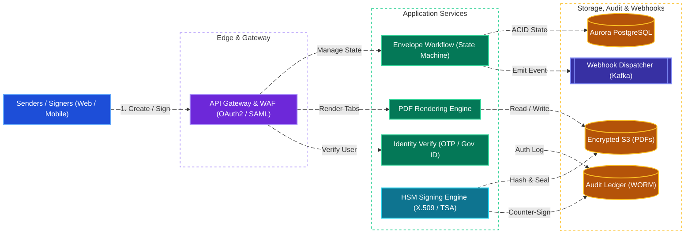
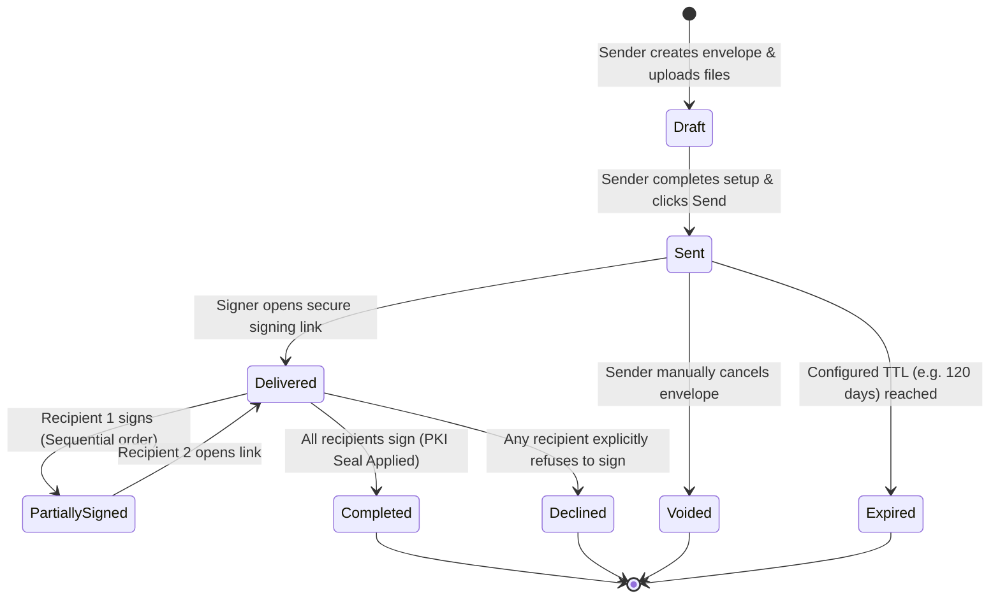
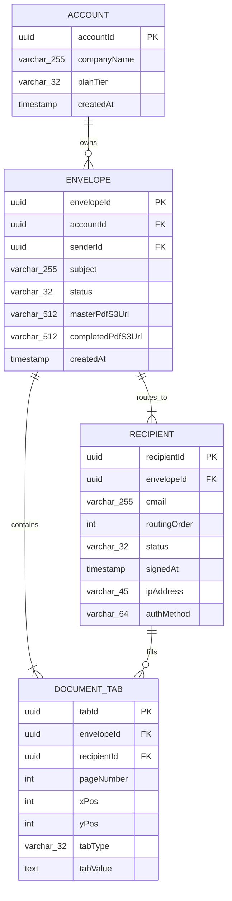
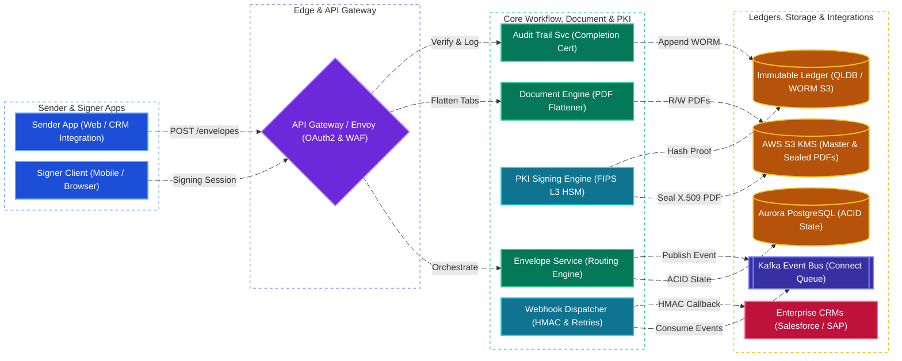

# DocuSign System Design

[← Back to System Design](system-design.md)

> **Core Building Blocks Used**: [Chapter 4 — Immutable Blob Storage (S3 WORM) & Pre-Signed URLs](fundamentals/04-databases-sql-vs-nosql.md#block-storage-vs-file-storage-vs-object-blob-storage) · [Chapter 5 — Event-Driven Workflow State Machines & Outbox Pattern](fundamentals/05-distributed-systems-and-messaging.md#4-distributed-transactions-2pc-vs-saga-vs-transactional-outbox) · [Chapter 7 — Event Sourcing & Cryptographic Hash Chains](fundamentals/07-probabilistic-structures-and-stream-processing.md#cqrs-event-sourcing--lambda-vs-kappa-architecture) · [Chapter 8 — Envelope Encryption (KEK/DEK) & PKI Digital Signatures](fundamentals/08-security-multi-region-and-deployments.md#envelope-encryption-kms-master-key--data-encryption-keys)

## Overview

DocuSign is the global enterprise standard for electronic signature and digital transaction management, executing billions of secure legal contracts across 180+ countries. The platform enables organizations to upload contracts, designate signing fields (signature, initials, date, text), specify sequential or parallel signer routing orders, verify signer identities, and produce legally binding, tamper-evident sealed PDF documents.

Designing DocuSign requires solving critical security, legal compliance, and distributed workflow challenges:

1. **Public Key Infrastructure (PKI) & Digital Signatures**: Generating tamper-evident cryptographic seals adhering to ESIGN, UETA, and European eIDAS standards.
2. **Envelope Lifecycle & State Machine**: Orchestrating complex multi-party signing workflows across sequential and parallel routing tiers.
3. **Court-Admissible Tamper-Evident Audit Trails**: Immutable event logging with RFC 3161 trusted timestamp authorities (TSA).
4. **Reliable Webhook Delivery (DocuSign Connect)**: Delivering mission-critical signed contract events to customer CRMs (Salesforce, SAP, Workday) with guaranteed at-least-once delivery.

---

## Functional Requirements

* **Envelope Creation & Preparation**: Senders can upload multiple documents (PDF, DOCX), place interactive form tabs (Signatures, Initials, Date, Text) using absolute page coordinates $(x, y, \text{page})$, and define recipient roles.
* **Flexible Recipient Routing**:
  * *Sequential Routing*: Signer 2 receives the document only after Signer 1 successfully signs.
  * *Parallel Routing*: Multiple signers receive notification simultaneously.
  * *Mixed Workflows*: E.g., Signer 1 signs $\implies$ Signers 2 & 3 sign concurrently $\implies$ Legal Reviewer approves.
* **Signer Authentication & Identity Verification**: Support email link access, SMS OTP, phone call verification, knowledge-based authentication (KBA), and government ID biometric photo verification.
* **Document Execution & Cryptographic Sealing**: Capture electronic signatures, render them onto the PDF coordinates, and seal the final PDF with an X.509 PKI certificate from an accredited Certificate Authority.
* **Certificate of Completion**: Automatically generate a tamper-proof audit trail summarizing every signer's IP, timestamp, identity verification method, and cryptographic checksum.
* **Webhook Notifications (Connect)**: Push real-time event updates to enterprise endpoints when envelopes change state.

---

## Non-Functional Requirements

* **Strict Legal Validity & Non-Repudiation**: The signer cannot plausibly dispute having signed the document; cryptographic hashes must prove the document has not been altered post-signing.
* **High Security & Compliance**: SOC 2 Type II, ISO 27001, HIPAA, FedRAMP, and GDPR compliance. AES-256 encryption at rest; TLS 1.3 in transit; Private keys guarded inside FIPS 140-2 Level 3 Hardware Security Modules (HSMs).
* **Durability (11 9s)**: $99.999999999\%$ document durability with multi-region write-once-read-many (WORM) storage.
* **High Availability**: $99.99\%$ availability for signing operations. A signer clicking an email link must experience zero downtime.
* **Webhook Reliability**: Guaranteed at-least-once delivery with exponential backoff retries and HMAC authentication.

---

## Back of the Envelope Estimations

### Scale & Volumes

* **Envelopes Created per Day**: $10\text{ Million envelopes/day}$.
* **Average Signers per Envelope**: $2.5\text{ signers} \implies 25\text{ Million signature interactions/day}$.
* **Average Envelope Creation QPS**:
  $$\text{Creation QPS} = \frac{10,000,000}{86,400} \approx 116\text{ QPS} \quad (\text{Peak: } \approx 500\text{ QPS})$$
* **Document Signing QPS**:
  $$\text{Signing QPS} = \frac{25,000,000}{86,400} \approx 290\text{ QPS} \quad (\text{Peak: } \approx 1,200\text{ QPS})$$

### Storage Calculations

* **Average PDF Document Size**: $1.5\text{ MB}$.
* **Daily Ingested Storage**:
  $$10,000,000\text{ envelopes} \times 1.5\text{ MB} = 15\text{ Terabytes/day}$$
* **Annual Storage Footprint**:
  $$15\text{ TB} \times 365 \approx 5.5\text{ Petabytes/year}$$
* **Audit Trail Metadata**:
  * 10 audit events per envelope $\times 500\text{ bytes} = 5\text{ KB per envelope}$.
  * Annual Audit Log $= 10\text{M} \times 365 \times 5\text{ KB} \approx 18.25\text{ Terabytes/year}$.

---

## High-Level System Architecture



---

## Envelope Lifecycle State Machine



---

## Cryptographic Digital Signing Deep Dive

### 1. How a Digital Signature Guarantees Tamper-Evidence

An electronic signature is more than an image of a signature; it is a mathematical cryptographic proof:

1. **Document Hashing**: When all recipients finish signing, the document flattens form field values into the PDF byte stream. The system computes the cryptographic hash of the entire file:
   $$H = \text{SHA-256}(\text{PDF bytes})$$
2. **Private Key Encryption (The Seal)**: The system transmits $H$ into an air-gapped, FIPS 140-2 Level 3 **Hardware Security Module (HSM)**. The HSM signs the hash using DocuSign’s master X.509 private key:
   $$S = \text{Sign}_{K_{\text{private}}}(H)$$
3. **PAdES (PDF Advanced Electronic Signature) Embedding**: The digital signature $S$ and the X.509 public certificate chain are embedded directly into the PDF’s metadata dictionary (`/ByteRange` array).
4. **RFC 3161 Trusted Timestamp**: An accredited external Timestamp Authority (TSA) generates a cryptographic timestamp token proving that the signature existed at that precise second.
5. **Tamper Detection in PDF Readers**: When opened in Adobe Acrobat or any standard reader, the software computes $\text{SHA-256}$ of the document and decrypts $S$ using the public key. If even a single comma or pixel in the PDF has been altered, the hashes do not match, and Adobe displays:
   > ⚠️ *"At least one signature has problems: Document has been altered after signing."*

---

## API Specifications

### 1. Create and Send Envelope

```http
POST /v2.1/accounts/{accountId}/envelopes
Authorization: Bearer <oauth_token>
Content-Type: application/json
```

```json
// Request
{
  "emailSubject": "Please sign Master Services Agreement",
  "status": "sent",
  "documents": [
    {
      "documentId": "1",
      "name": "MSA_2026.pdf",
      "fileExtension": "pdf",
      "documentBase64": "JVBERi0xLjQKJ..."
    }
  ],
  "recipients": {
    "signers": [
      {
        "recipientId": "1",
        "routingOrder": "1",
        "name": "Alice Smith",
        "email": "alice@customer.com",
        "tabs": {
          "signHereTabs": [
            {
              "documentId": "1",
              "pageNumber": "12",
              "xPosition": "150",
              "yPosition": "420"
            }
          ]
        }
      },
      {
        "recipientId": "2",
        "routingOrder": "2",
        "name": "Bob Jones (CFO)",
        "email": "bob@mycompany.com"
      }
    ]
  }
}

// Response: 201 Created
{
  "envelopeId": "env_9918231a-4bc1-49fa-92b1",
  "status": "sent",
  "statusDateTime": "2026-10-27T19:40:00Z"
}
```

### 2. Submit Signature

```http
POST /v2.1/envelopes/{envelopeId}/recipients/{recipientId}/sign
Authorization: Bearer <recipient_signing_token>
Content-Type: application/json
```

```json
// Request
{
  "tabValues": [
    {
      "tabId": "signHereTab_1",
      "signatureData": "data:image/png;base64,iVBORw0KGgoAAAANS...",
      "signatureType": "DRAWN"
    }
  ],
  "clientIp": "198.51.100.42",
  "userAgent": "Mozilla/5.0 (Macintosh; Intel Mac OS X 10_15_7)"
}

// Response: 200 OK
{
  "envelopeStatus": "completed",
  "allSignersCompleted": true,
  "downloadSignedPdfUrl": "https://api.docusign.com/v2.1/envelopes/env_9918231a.../documents/combined"
}
```

---

## Object Model & Database Schema

### Database Selection & Rationale

| Workload / Subsystem | Database Choice | Data Model & CAP Profile | Why This Database? (Justification & Trade-offs) |
| :--- | :--- | :--- | :--- |
| **Envelope Workflow State, Recipients & Tabs** | **Amazon Aurora PostgreSQL** | Relational (ACID, **CP / PC-EC**) | **Why:** Multi-party signing workflows (`ENVELOPE`, `RECIPIENT`, `DOCUMENT_TAB`) require strict ACID state machine transitions (e.g., advancing `routingOrder` from Signer 1 to Signer 2 only after all mandatory tabs are committed). Relational foreign keys and row-level locking prevent split-brain envelope states when parallel recipients sign simultaneously. Sharded by `accountId` / `envelopeId`. |
| **Tamper-Evident Court-Admissible Audit Trail** | **Amazon QLDB (Quantum Ledger DB) + S3 Object Lock (WORM)** | Cryptographic Append-Only Ledger (**CP / Immutable**) | **Why:** Legal non-repudiation (ESIGN, eIDAS) requires proving that no administrator or attacker altered the signing history (`signedAt`, `ipAddress`, `authMethod`, SHA-256 document digests). QLDB maintains a cryptographically chained SHA-256 Merkle tree journal of every state change, backed by WORM S3 archival for 11 9s durability. |
| **Master & PKI-Sealed PDF Documents** | **AWS S3 (with KMS Envelope Encryption)** | Object Storage (**11 9s Durability**) | **Why:** Storing $15\text{ TB/day}$ ($5.5\text{ PB/year}$) of $1.5\text{ MB}$ binary PDF files inside PostgreSQL `BYTEA` columns would destroy database buffer cache and replication performance. S3 stores encrypted master and X.509-sealed PDFs cheaply while PostgreSQL stores only lightweight `masterPdfS3Url` and `completedPdfS3Url` pointers. |
| **Signing Session Tokens & Rate Limiting** | **Redis Cluster** | In-Memory Key-Value (**Sub-ms Read/Write**) | **Why:** Stores short-lived OTP verification codes, ephemeral recipient signing session tokens, and idempotency keys with automatic TTL expiration. |



---

## System Design Diagram



---

## Deep Dive & Key Technical Challenges

### 1. High-Throughput PDF Rendering & Flattening

* Documents can be 1,000+ pages long. Rendering and flattening an entire PDF inside memory during an HTTP request would trigger out-of-memory errors and timeout gateways.
* **Stream-Based Chunked Transformation**:
  * Using lightweight native C++ libraries (such as Poppler / PDFium) wrapped in asynchronous worker pools.
  * Only pages containing interactive tabs are modified; unedited pages are copied directly using stream passthrough.
  * Flattening occurs asynchronously in a dedicated worker queue (backed by AWS SQS / RabbitMQ), freeing the signing gateway to respond instantly.

### 2. Reliable Webhook Delivery (DocuSign Connect)

* When a high-value contract completes, downstream CRMs (like Salesforce closing an opportunity) depend on the completion event.
* **Reliability Architecture**:
  * Completion triggers an event on an Apache Kafka topic.
  * A fleet of Webhook Dispatcher workers consumes events and issues `POST` requests to customer endpoints.
  * Payloads are signed with an `X-DocuSign-Signature-SHA256` header calculated via an HMAC secret.
  * **Exponential Backoff with Jitter**: If a customer server returns 5xx or times out, the message is retried at 5 min, 15 min, 1 hr, 6 hr, and 24 hr intervals. After 10 failures, it moves to a Dead Letter Queue (DLQ) with automated alert notifications.

---

## Additional Notes

### Real-World Case Study Retrospective

* [🌟 DocuSign Billing & Invoicing Modernization Case Study](project-retrospective.md): Real-world production engineering retrospective detailing the migration of DocuSign's legacy Quartz batch billing pipelines to an event-driven MuleSoft & Core microservices integration platform.

### Video References

* [](https://www.youtube.com/watch?v=s22eJ1eVLTU)
* [](https://www.youtube.com/watch?v=0ctat6RBrFo)
