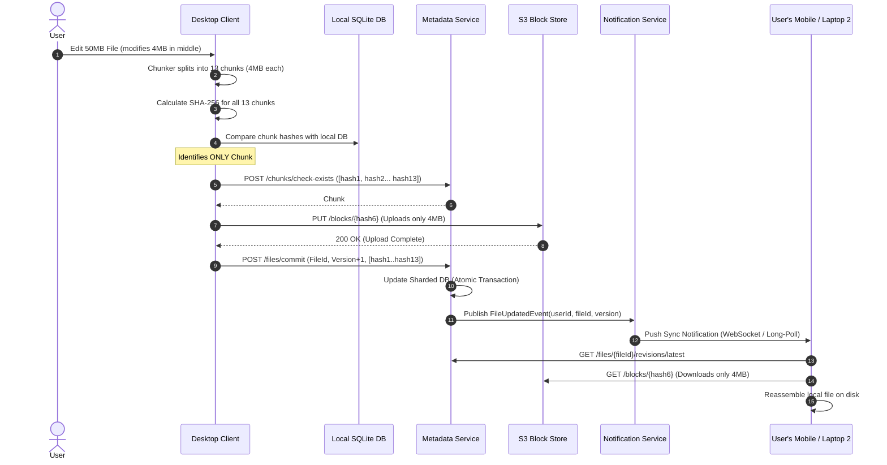
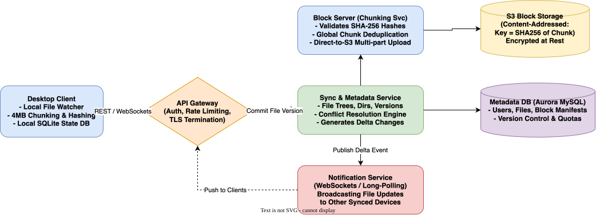

# Dropbox System Design

[← Back to System Design](../system-design.md)

## Overview

Dropbox is a premier cloud storage and file synchronization platform serving over 700 million registered users and syncing billions of files daily. The core engineering mandate of Dropbox is to provide the illusion of an instant, infinite, and globally accessible local hard drive while ensuring data durability (99.999999999% - 11 9s), low sync latency, cross-device consistency, and efficient bandwidth utilization.

Designing Dropbox involves solving critical distributed systems challenges:

1. **Block-Level Chunking & Content-Addressed Storage**: Splitting large files into 4MB immutable chunks identified by their SHA-256 hash.
2. **Bandwidth Optimization & Delta Sync**: Uploading and downloading only modified chunks, saving up to 99% bandwidth on file edits.
3. **Cross-Device Metadata Sync & Conflict Resolution**: Synchronizing file tree hierarchies and resolving simultaneous offline edits gracefully without data loss.
4. **Massive-Scale Storage Tiering**: Multi-exabyte scale storage using custom blob stores (Magic Pocket / S3) combined with sharded metadata databases.

---

## Functional Requirements

* **File Upload & Sync**: Users can upload, edit, rename, move, and delete files and directories from desktop, web, and mobile clients. Changes sync automatically across all linked devices.
* **Block-Level Delta Synchronization**: Only altered blocks (chunks) of a file are transferred over the wire when an update occurs.
* **Resumable Transfers**: Large file transfers pause and resume seamlessly across network disruptions without re-uploading completed chunks.
* **File Versioning & Revision History**: Automatic tracking of file versions up to 30 days (or 180 days for enterprise tiers), supporting full rollback and undelete.
* **File Sharing & Permissions**: Sharing files/folders via public links or direct collaborative invitations (Read-Only vs. Editor permissions).
* **Offline Access & Sync**: Users can modify files while offline; local modifications sync immediately upon reconnection.

---

## Non-Functional Requirements

* **High Data Durability (11 9s)**: $99.999999999\%$ durability for all file blocks using erasure coding and cross-region replication.
* **Fast Synchronization Latency**: Small file edits ($< 10\text{ MB}$) must notify other connected devices within **$< 1\text{ second}$** under normal network conditions.
* **High Availability**: $99.99\%$ availability for metadata reads and file downloads; $99.95\%$ for block uploads.
* **Consistency Guarantee**: **Strong Consistency** for file metadata within a user's account namespace (ACID metadata updates).
* **Bandwidth & Storage Efficiency**: Global block deduplication across files and accounts to prevent redundant storage and transmission.
* **Security & Encryption**: AES-256 encryption at rest; TLS 1.3 in transit; zero-knowledge or managed envelope encryption.

---

## Back of the Envelope Estimations

### Scale & Users

* **Total Registered Users**: $700\text{ Million}$.
* **Daily Active Users (DAU)**: $100\text{ Million}$.
* **Average Devices per User**: $3\text{ devices}$ (e.g., Laptop, Phone, Tablet) $= 300\text{ Million concurrent active sync endpoints}$.
* **Average Files Synced per User / Day**: $10\text{ files/day}$.
* **Total Files Synced per Day**:
  $$100,000,000\text{ DAU} \times 10\text{ files} = 1,000,000,000\text{ sync operations/day}$$
* **Average Sync QPS**:
  $$\text{Sync QPS} = \frac{1,000,000,000}{86,400} \approx 11,570\text{ QPS} \quad (\text{Peak: } \approx 30,000\text{ QPS})$$

### Storage Estimations

* **Average File Size**: $500\text{ KB}$ to $2\text{ MB}$.
* **Chunk Size**: $4\text{ MB}$ fixed-size or content-defined chunking (Rabin fingerprints).
* **Daily Ingested Storage**:
  $$1,000,000,000\text{ updates/day} \times 2\text{ MB} = 2,000\text{ TB} = 2\text{ Petabytes/day}$$
* **Deduplication Savings**: Block-level deduplication saves $\approx 40\%$ storage:
  $$\text{Net New Storage/Day} \approx 1.2\text{ Petabytes/day} \implies \approx 438\text{ Petabytes/year}$$
* **Total Stored Data**: Over $500\text{ Petabytes}$ to $1+\text{ Exabyte}$ total footprint.

### Metadata Footprint

* Average user stores 2,000 files $\implies 700\text{M} \times 2,000 = 1.4\text{ Trillion metadata records}$.
* Record size $\approx 500\text{ bytes}$ (file name, path, block hash list, permissions, version).
* Total Metadata Size:
  $$1.4\text{ Trillion} \times 500\text{ bytes} \approx 700\text{ Terabytes}$$ (sharded across distributed relational engines).

---

## High-Level System Architecture

```text
                               ┌───────────────────────────┐
                               │   Client Devices (App)    │
                               │  - Chunk Engine (4MB)     │
                               │  - Local SQLite DB        │
                               │  - OS Watcher (inotify)   │
                               └─────────┬───────┬─────────┘
                                         │       │
                  1. Chunk Upload/Down   │       │ 2. Metadata & Long Poll
                     (Direct to S3/CDN)  │       │    (Sync Service)
                                         ▼       ▼
┌──────────────────────────────────────────────┐ ┌───────────────────────────────────────┐
│              BLOCK STORAGE TIER              │ │            METADATA & SYNC            │
│                                              │ │                                       │
│  ┌────────────────────┐ ┌──────────────────┐ │ │ ┌───────────────────────────────────┐ │
│  │ Global Edge CDN    │ │ S3 / Magic Pocket│ │ │ │   API Gateway / Load Balancers    │ │
│  │ (Regional Caching) │ │ (Erasure Coded   │ │ │ └──────────────┬────────────────────┘ │
│  └─────────┬──────────┘ │  Block Store)    │ │ │                │                      │
│            └────────────┼──────────────────┤ │ │   ┌────────────┴────────────┐         │
│                         │ Content-Addressed│ │ │   ▼                         ▼         │
│                         │ (SHA-256 Chunks) │ │ │┌──────────────┐   ┌───────────────┐   │
│                         └──────────────────┘ │ ││Metadata Svc  │   │Notification   │   │
└──────────────────────────────────────────────┘ ││(File Tree,   │   │Service (Long  │   │
                                                 ││ Namespace)   │   │Poll/WebSocket)│   │
                                                 │└──────┬───────┘   └───────┬───────┘   │
                                                 │       │                   │           │
                                                 │       ▼                   ▼           │
                                                 │┌──────────────┐   ┌───────────────┐   │
                                                 ││ Sharded DB   │   │ Redis / Kafka │   │
                                                 ││ (Edgestore/  │   │ Sync Stream   │   │
                                                 ││  Postgres)   │   │ Hub           │   │
                                                 │└──────────────┘   └───────────────┘   │
                                                 └───────────────────────────────────────┘
```

---

## Core Components & Synchronization Workflow

### 1. Client Architecture

The local client running on macOS, Windows, or Linux consists of four collaborating threads:

* **Watcher / File Monitor**: Hooks into kernel filesystem events (`inotify` on Linux, `FSEvents` on macOS, `ReadDirectoryChangesW` on Windows) to detect file creations, modifications, moves, and deletions in the synced folder.
* **Chunker**: Splits large files into 4MB chunks. Calculates the cryptographic SHA-256 hash for every chunk.
* **Local Indexer (SQLite DB)**: Tracks local file paths, chunk hash lists, file timestamps, local version numbers, and sync status.
* **Sync Engine**: Communicates with the remote cloud servers. Queries whether chunk hashes already exist in the cloud (deduplication check), uploads missing chunks, and commits atomic metadata transactions.

### 2. Block-Level Deduplication & Delta Upload Flow



---

## API Specifications

### 1. Check Chunks Existence (Deduplication)

```http
POST /api/v2/chunks/check-exists
Authorization: Bearer <user_token>
Content-Type: application/json
```

```json
// Request
{
  "chunkHashes": [
    "e3b0c44298fc1c149afbf4c8996fb92427ae41e4649b934ca495991b7852b855",
    "f7ff9e8b7bb2e09b70935a5d785e0cc5d9d0abf0e423d2da8853b0c2688746b4"
  ]
}

// Response: 200 OK
{
  "existingHashes": [
    "e3b0c44298fc1c149afbf4c8996fb92427ae41e4649b934ca495991b7852b855"
  ],
  "uploadUrls": {
    "f7ff9e8b7bb2e09b70935a5d785e0cc5d9d0abf0e423d2da8853b0c2688746b4": "https://s3.amazonaws.com/dropbox-blocks/f7ff...?signature=..."
  }
}
```

### 2. Commit File Version

```http
POST /api/v2/files/commit
Authorization: Bearer <user_token>
Content-Type: application/json
```

```json
// Request
{
  "path": "/Documents/Quarterly_Report.pdf",
  "baseVersion": 14,
  "chunkHashes": [
    "e3b0c44298fc1c149afbf4c8996fb92427ae41e4649b934ca495991b7852b855",
    "f7ff9e8b7bb2e09b70935a5d785e0cc5d9d0abf0e423d2da8853b0c2688746b4"
  ],
  "sizeBytes": 8388608,
  "updatedAt": "2026-10-27T19:35:00Z"
}

// Response: 200 OK
{
  "fileId": "fil_991823104",
  "version": 15,
  "status": "COMMITTED"
}
```

---

## Object Model & Database Schema

```text
┌───────────────────────┐          ┌───────────────────────┐
│         User          │1        *│         File          │
├───────────────────────┤──────────├───────────────────────┤
│ userId: PK (BigInt)   │          │ fileId: PK (BigInt)   │
│ email: Varchar(255)   │          │ ownerId: FK (User)    │
│ quotaBytes: BigInt    │          │ parentDirId: FK (File)│
│ usedBytes: BigInt     │          │ name: Varchar(255)    │
│ createdAt: Timestamp  │          │ isDirectory: Boolean  │
└──────────┬────────────┘          │ isDeleted: Boolean    │
           │1                      │ latestVersion: Int    │
           │*                      └───────────┬───────────┘
┌──────────▼────────────┐                      │1
│      FileShare        │*                     │*
├───────────────────────┤          ┌───────────▼───────────┐
│ shareId: PK (BigInt)  │          │      FileVersion      │
│ fileId: FK (File)     │          ├───────────────────────┤
│ sharedWithUserId: FK  │          │ versionId: PK (BigInt)│
│ permission: (READ,WRT)│          │ fileId: FK (File)     │
│ token: Varchar(64)    │          │ versionNumber: Int    │
└───────────────────────┘          │ totalSize: BigInt     │
                                   │ createdAt: Timestamp  │
                                   └───────────┬───────────┘
                                               │1
                                               │*
                                   ┌───────────▼───────────┐
                                   │       FileBlock       │
                                   ├───────────────────────┤
                                   │ versionId: PK, FK     │
                                   │ blockIndex: PK (Int)  │
                                   │ blockHash: Varchar(64)│
                                   │ blockSize: Int        │
                                   └───────────────────────┘
```

---

## System Design Diagram



[Download Draw.io File](dropbox.drawio)

---

## Deep Dive & Key Technical Challenges

### 1. Conflict Resolution (The "Conflicted Copy" Model)

When two users (or the same user on laptop and desktop) edit the same file simultaneously while disconnected or with high latency:

* **Optimistic Concurrency Control (OCC)**:
  * When Client A commits version 15 with `baseVersion = 14`, the metadata service checks if the current version in DB equals 14.
  * If Client B commits first, the database advances to 15.
  * When Client A's request arrives, `baseVersion (14) != currentVersion (15)`. The commit is rejected with HTTP 409 Conflict.
* **Deterministic Forking**:
  * Instead of discarding Client A's changes or silently overwriting Client B's edits, the client automatically saves Client A's file as:
    `"Quarterly_Report (Alice's conflicted copy 2026-10-27).pdf"`.
  * The newly renamed file is committed as a new, independent file with its own chunk list, preserving 100% of user data.

### 2. High-Durability Erasure Coding in Magic Pocket

Storing 3 full replicas of exabyte-scale data triples storage hardware costs.

* **8+4 Reed-Solomon Erasure Coding**:
  * Chunks are divided into 8 data fragments and 4 parity fragments.
  * These 12 fragments are distributed across 12 distinct physical server racks across multiple power zones.
  * Any 4 racks can fail simultaneously without data loss.
  * Storage overhead is reduced from $200\%$ (3x replication) to only $50\%$ (1.5x parity overhead), saving hundreds of millions of dollars.

### 3. Notification Service & Connection Scale

* **300 Million Concurrent Connections**:
  * Maintaining 300 million open HTTP/TCP connections on application servers would exhaust file descriptors and memory.
  * Dedicated Notification Gateway cluster (built in Go / Erlang) terminates lightweight long-polling or HTTP/2 server-sent event (SSE) streams.
  * Uses a distributed Pub/Sub backplane (Kafka + Redis Channels partitioned by `user_id`).
  * Notifications are lightweight hints: `"User X, file tree changed"`. The client responds by issuing a pull to the Metadata Service, preventing the notification payload from creating memory bloat.

---

## Additional Notes

### Video References

* [](https://www.youtube.com/watch?v=U0xTu6_QG5E)
