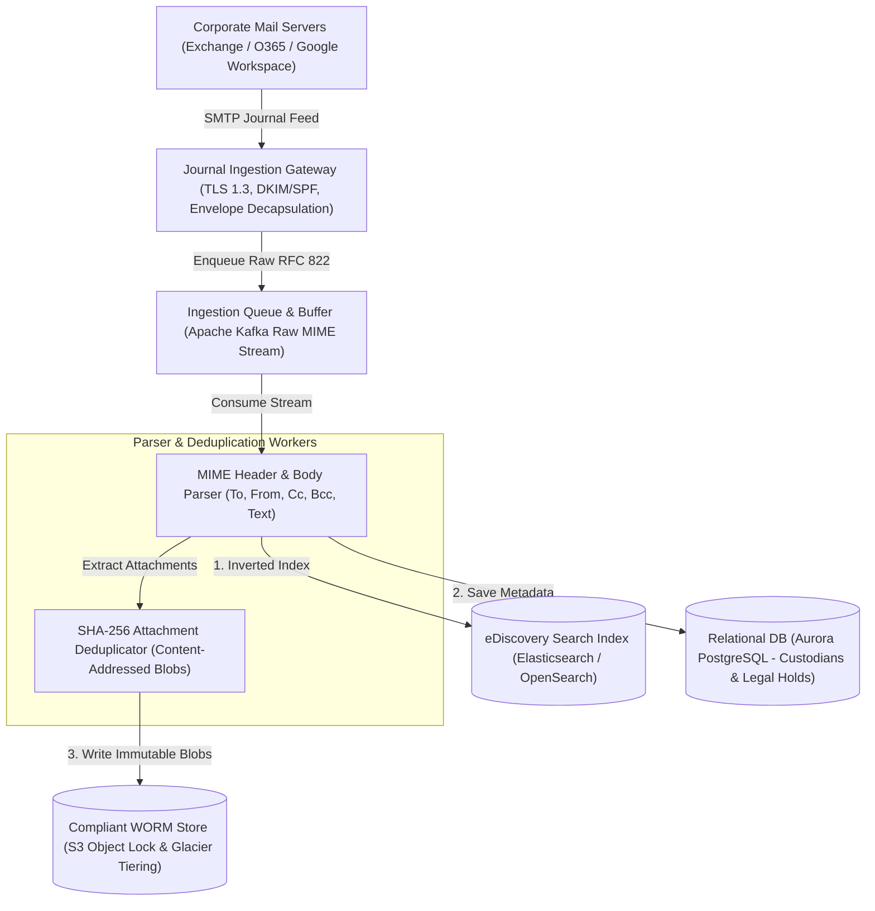
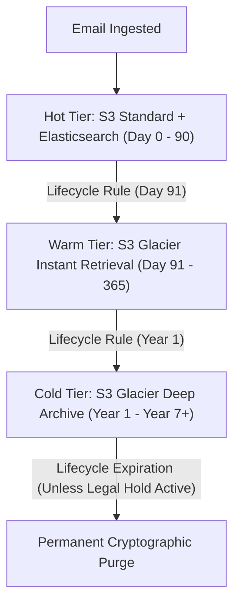
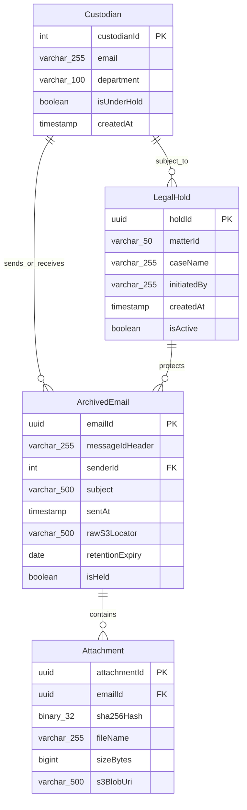
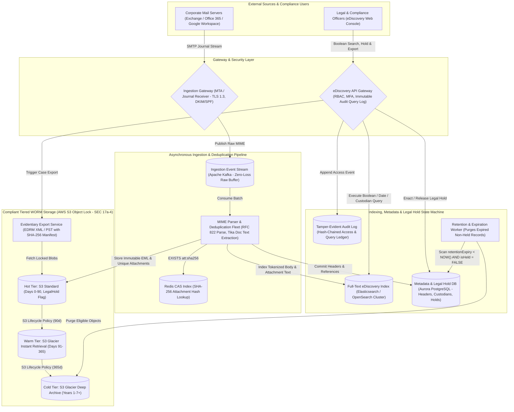

# Email Archive System Design

[← Back to System Design](system-design.md)

## Overview

An enterprise email archiving system is engineered to capture, index, preserve, and retrieve high volumes of corporate email communications for regulatory compliance (SEC Rule 17a-4, FINRA, HIPAA, GDPR) and corporate legal proceedings (eDiscovery). The system must guarantee immutability (Write Once, Read Many - WORM), protect against intentional or accidental deletion, enforce automated retention schedules, and allow legal compliance officers to execute complex boolean searches across petabytes of historical correspondence.

Designing an enterprise email archiving platform requires solving critical systems challenges:

1. **Immutable WORM Compliance**: Ensuring emails and attachments cannot be altered or deleted prior to retention expiry, even by root/administrator accounts.
2. **eDiscovery Full-Text Search Across Petabytes**: Indexing millions of raw MIME messages and document attachments (PDFs, spreadsheets, slides) with sub-second keyword search.
3. **Content-Addressed Attachment Deduplication**: Preventing storage explosion when company-wide broadcast emails are sent to 50,000 employees with a 10MB attachment.
4. **Litigation / Legal Hold State Machine**: Overriding standard retention schedules instantaneously when a legal hold is placed on specific custodians or keywords.

---

## Functional Requirements

* **Automated Ingestion (Journaling)**: Ingest all inbound, outbound, and internal emails in real time via SMTP journaling feeds from Microsoft Exchange, Office 365, and Google Workspace.
* **MIME Parsing & Attachment Extraction**: Parse RFC 822 / MIME emails, extract metadata headers (From, To, Cc, Bcc, Subject, Date, Message-ID), and isolate file attachments.
* **Global Attachment Deduplication**: Store single copies of identical attachments referenced by cryptographic hash (SHA-256).
* **eDiscovery Search**: Compliance officers can search across millions of mailboxes using boolean queries, date windows, custodians, and extracted attachment text.
* **Legal / Litigation Hold**: Place immediate, indefinite holds on specific users or topics, suspending automated deletion policies.
* **Export & Evidentiary Chain of Custody**: Export search results to EDRM XML or PST formats with cryptographic verification hashes for court presentation.

---

## Non-Functional Requirements

* **Regulatory Immutability (WORM)**: Support SEC Rule 17a-4 compliance using hardware or cloud Object Lock (compliance mode).
* **High Durability (11 9s)**: $99.999999999\%$ durability across multi-region object storage tiers.
* **High Ingestion Throughput**: Capable of ingesting over **$5,000\text{ emails/second}$** during corporate peak hours without dropping messages.
* **Audit Trail Completeness**: $100\%$ tamper-evident logging of every search query and document access made by compliance officers.
* **Storage Cost Optimization**: Automated lifecycle tiering from high-performance SSD to cold Glacier Deep Archive.

---

## Back of the Envelope Estimations

### Scale & Traffic

* **Enterprise Mailboxes**: $100,000\text{ employees}$.
* **Average Emails per Employee / Day**: $50\text{ emails/day}$.
* **Daily Ingested Emails**:
  $$100,000 \times 50 = 5,000,000\text{ emails/day}$$
* **Average Ingestion QPS**:
  $$\text{Ingestion QPS} = \frac{5,000,000}{86,400} \approx 58\text{ emails/sec} \quad (\text{Peak: } \approx 250\text{ QPS})$$

### Storage Calculations

* **Average Email Size (Headers + Body)**: $50\text{ KB}$.
* **Average Attachment Size (Weighted)**: $150\text{ KB}$ per email.
* **Daily Storage Ingestion**:
  $$5,000,000 \times 200\text{ KB} = 1,000\text{ GB} = 1\text{ Terabyte/day}$$
* **Deduplication Savings**: Deduplicating attachments saves $\approx 40\%$ storage $\implies 600\text{ GB/day net}$.
* **Annual Storage Footprint**:
  $$600\text{ GB} \times 365 \approx 219\text{ Terabytes/year}$$
* **7-Year Regulatory Retention Total**: $\approx 1.5\text{ Petabytes}$ total archive storage.

---

## High-Level System Architecture



---

## Tiered WORM Storage Strategy

To meet strict legal compliance without exploding cloud storage costs:



* **AWS S3 Object Lock in Compliance Mode**: Neither the AWS root user nor IAM administrators can delete or overwrite objects during the retention duration.
* **Legal Hold Override**: If a legal hold is applied, the S3 Object Lock `LegalHold: ON` flag is toggled, preventing deletion indefinitely regardless of retention expiration.

---

## API Specifications

### 1. Ingest Email (Internal MTA Journal Receiver)

```http
POST /api/v1/archive/ingest
Authorization: Bearer <mta_service_token>
Content-Type: message/rfc822
```

```http
// Response: 202 Accepted
{
  "messageId": "msg_9918231a-4bc1-49fa",
  "status": "QUEUED_FOR_PARSING"
}
```

### 2. Search Archived Emails (eDiscovery)

```http
POST /api/v1/ediscovery/search
Authorization: Bearer <compliance_officer_token>
Content-Type: application/json
```

```json
// Request
{
  "query": "project titan AND confidential",
  "custodians": ["ceo@company.com", "cfo@company.com"],
  "startDate": "2024-01-01T00:00:00Z",
  "endDate": "2026-10-27T00:00:00Z",
  "hasAttachments": true,
  "page": 1,
  "pageSize": 50
}

// Response: 200 OK
{
  "totalMatches": 182,
  "results": [
    {
      "archiveId": "arc_4410291",
      "subject": "RE: Project Titan Financial Forecast",
      "sender": "cfo@company.com",
      "recipients": ["ceo@company.com"],
      "sentDate": "2025-06-14T14:22:10Z",
      "hasLegalHold": true,
      "attachmentCount": 1
    }
  ]
}
```

### 3. Apply Legal Hold

```http
POST /api/v1/legal-holds
Authorization: Bearer <legal_officer_token>
Content-Type: application/json
```

```json
// Request
{
  "caseName": "SEC Investigation 2026-B",
  "matterId": "MATTER_88192",
  "custodianEmails": ["trader1@company.com", "trader2@company.com"],
  "reason": "Regulatory document subpoena",
  "targetKeywords": ["short position", "margin loan"]
}

// Response: 201 Created
{
  "holdId": "hold_99102",
  "affectedMessagesCount": 14250,
  "status": "ACTIVE_HOLD_ENFORCED"
}
```

---

## Object Model & Database Schema



---

## System Design Diagram



---

## Deep Dive & Key Technical Challenges

### 1. Global Attachment Deduplication

When the CEO emails all 100,000 employees with a 15MB video:

* A naive archiver writes $100,000 \times 15\text{ MB} = 1.5\text{ Terabytes}$.
* **Content-Addressed Storage (CAS)**:
  * Worker computes $\text{SHA-256}$ of the attachment byte stream.
  * Checks Redis: `EXISTS att:<sha256>`.
  * If the blob already exists in S3, the worker writes a lightweight pointer in the database linking the email to the existing attachment blob.
  * Only 1 copy is saved to S3, reducing storage from $1.5\text{ TB}$ to $15\text{ MB}$ ($99.999\%$ bandwidth and disk savings).

### 2. Legal Hold Priority Over Expiration Daemons

* Background lifecycle workers continuously scan for messages where `retentionExpiry < NOW()`.
* **Guard Condition**:

  ```sql
  DELETE FROM archived_emails 
  WHERE retention_expiry < NOW() 
    AND is_held = FALSE;
  ```

* Before any row or S3 object is purged, the system issues an atomic check against the `legal_holds` table. If any active case attaches to the custodian or email ID, the deletion is aborted.

---

## Additional Notes

### Client-Side User Archive Interaction Flow

For desktop/web clients supporting user-initiated email archiving (e.g. Gmail / Outlook user interface):

1. **User Action**: User clicks "Archive" on an email conversation.
2. **Client Optimistic UI Update**: The client immediately removes the email from the inbox view and places it into the local "Archive" folder for instant responsiveness.
3. **API Dispatch**: Sends `POST /api/v1/emails/{emailId}/archive` with `clientVersion` to protect against concurrent thread updates.
4. **Asynchronous Message Queue**: API Gateway enqueues an `ArchiveEmailEvent` to Kafka and returns `202 Accepted`.
5. **Worker Execution**: Worker checks version conflicts, commits `status = 'ARCHIVED'` to database, invalidates user inbox cache, and broadcasts state update via WebSockets to keep mobile and web clients synchronized.

### Video References

* [](https://www.youtube.com/watch?v=PuZvF2EyfBM)
* [](https://www.youtube.com/watch?v=ak1wTYq_opQ)
