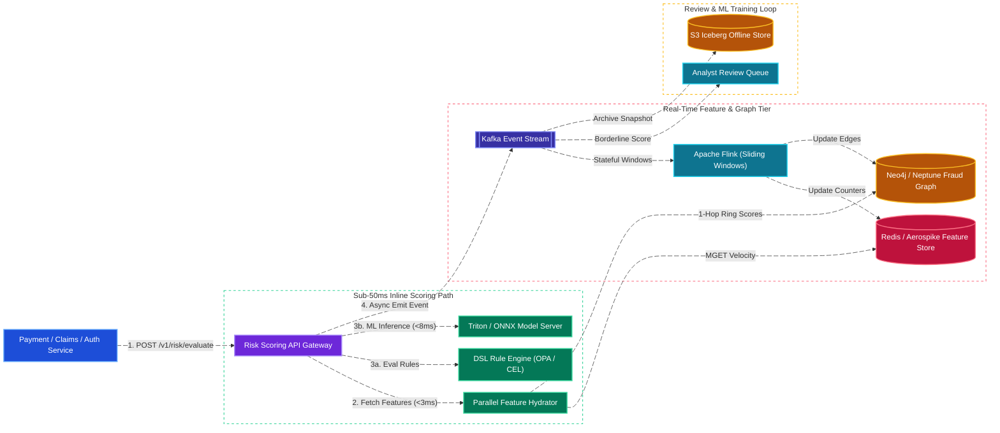
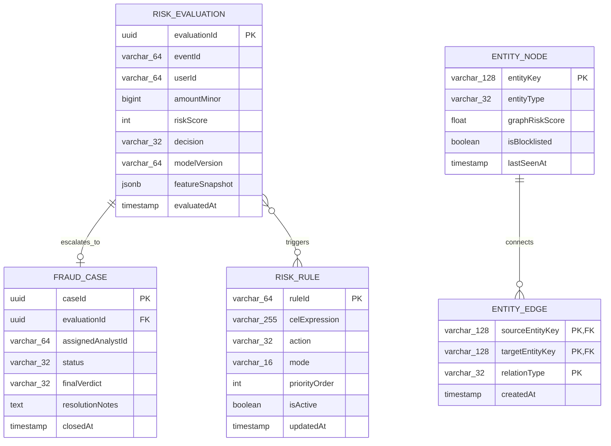

# Real-Time Fraud & Anomaly Detection System Design

[← Back to System Design](system-design.md)

> **Core Building Blocks Used**: [Chapter 4 — Graph Databases (Neo4j Fraud Rings) & In-Memory Redis/Aerospike](fundamentals/04-databases-sql-vs-nosql.md#6-graph-databases--relation-stores-neo4j-neptune-meta-tao-zanzibar) · [Chapter 6 — Sub-50ms P99 Tail Latency Budget & Fail-Open/Fail-Closed Circuit Breakers](fundamentals/06-resiliency-observability-and-metrics.md#latency-percentiles-p50-p90-p95-p99--p999-tail-latency) · [Chapter 7 — Apache Flink Sliding Windows & Event-Time Watermarks](fundamentals/07-probabilistic-structures-and-stream-processing.md#3-stream-processing--event-driven-data-architectures) · [Chapter 9 — Dual Online/Offline Feature Store (Feast/Tecton)](fundamentals/09-genai-llm-and-ml-system-design.md#dual-feature-store-architecture-online-vs-offline-feature-store)

## Overview

A **Real-Time Fraud & Anomaly Detection System** evaluates high-velocity financial transactions, insurance claims submissions, account logins, and payout requests in milliseconds to block malicious actors before funds or sensitive data leave the platform. Used by payment processors (Stripe Radar, PayPal), banks, e-commerce marketplaces, and insurance carriers, the system must balance two competing objectives: **stopping fraud loss** (High Recall) while **minimizing false positives** (High Precision) that frustrate legitimate customers.

Designing an enterprise fraud detection platform centers on four core architectural challenges:

1. **Strict Inline Latency Budget ($< 50\text{ ms}$ P99)**: Synchronous payment and checkout flows block waiting for a `PASS`, `CHALLENGE (3DS/MFA)`, or `BLOCK` verdict before authorizing a transaction.
2. **Real-Time Streaming Feature Engineering**: Computing sliding-window velocity features (e.g., *"number of distinct credit cards used from this device fingerprint in the last 10 minutes"* or *"total claim amount filed from this IP subnet in 24 hours"*) across millions of events per second using stateful stream processing (Apache Flink).
3. **Hybrid Decision Engine (Deterministic Rules + Deep ML + Graph Rings)**: Combining instant compliance/business rules with low-latency Gradient Boosted Decision Trees (XGBoost/LightGBM), Deep Neural Networks, and Graph Neural Networks (detecting coordinated fraud rings sharing addresses, devices, or bank accounts).
4. **Feedback Loop & Concept Drift Adaptation**: Fraudsters continuously adapt to static models. The architecture must ingest asynchronous chargebacks, confirmed claim investigations, and 3DS challenge outcomes to retrain and hot-swap models without downtime.

---

## Functional Requirements

* **Synchronous Inline Risk Scoring**: Evaluate incoming transactions (`Payment`, `Payout`, `ClaimSubmission`, `Login`) and return a risk score ($0\text{--}1000$), reason codes, and deterministic action (`ALLOW`, `STEP_UP_CHALLENGE`, `MANUAL_REVIEW`, `BLOCK`).
* **Real-Time Velocity & Aggregation Features**: Track and query sliding-window counters (1 min, 5 min, 1 hr, 24 hr, 30 days) grouped by User ID, Card BIN/Hash, Device Fingerprint, IP Address, Geolocation (H3 cell), and Beneficiary Bank Account.
* **Dynamic Rule Engine**: Allow risk analysts to author, simulate (shadow mode), and deploy DSL rules (e.g., `IF ip_country != card_country AND tx_amount > 5000 AND user_account_age_days < 2 THEN BLOCK`) taking effect globally in $< 5\text{ seconds}$ without code deployments.
* **Fraud Ring & Entity Graph Detection**: Detect collusive networks where multiple synthetic identities or claimants share a physical address, phone number, device ID, or payout routing number.
* **Case Management & Human-in-the-Loop Review**: Route borderline high-value transactions or suspicious insurance claims to a Fraud Analyst investigation queue with explainable SHAP feature attributions.
* **Closed-Loop Label Ingestion**: Ingest delayed ground-truth labels (issuer chargebacks 30–90 days later, manual review verdicts, MFA pass/fail) into an offline training lakehouse.

---

## Non-Functional Requirements

* **Ultra-Low Scoring Latency**: P95 inline inference + feature lookup + rule evaluation must complete in **$< 30\text{ ms}$** (P99 **$< 50\text{ ms}$**).
* **High Availability ($99.999\%$) & Configurable Fail-Safe**:
  * For low-value transactions ($< \$50$): **Fail-Open** with basic local heuristics if the ML cluster is unreachable.
  * For high-value wire payouts or claims ($> \$5,000$): **Fail-Closed / Hold for Async Queue** during dependency degradation.
* **Massive Throughput**: Sustain **$50,000\text{ synchronous scoring QPS}$** and **$250,000\text{ telemetry/feature update events/sec}$** at peak.
* **Model Explainability & Auditability**: Every `BLOCK` or claim denial must log the exact model version, feature vector snapshot, and top contributing risk factors for regulatory compliance (FCRA, GDPR Right to Explanation).

---

## Back of the Envelope Estimations

### Scale & Traffic

* **Synchronous Scoring Events (Checkouts, Payouts, Claims, Logins)**: $1.5\text{ Billion scored events/day}$.
* **Average Scoring QPS**:
  $$\text{Average QPS} = \frac{1,500,000,000}{86,400} \approx 17,360\text{ QPS} \quad (\text{Peak: } \approx 50,000\text{ QPS})$$
* **Auxiliary Behavioural Telemetry Events** (Mouse/touch dynamics, page navigation, device signals):
  $$1.5\text{B} \times 5 = 7.5\text{ Billion events/day} \implies \approx 86,800\text{ avg QPS} \quad (\text{Peak: } \approx 250,000\text{ QPS})$$

### Feature Store & Storage Sizing

* **Active Entities Tracked in Online Feature Store**: $200\text{ Million active users/devices/cards}$.
* **Online Feature Vector Size per Entity**: 150 precomputed numeric/categorical features $\approx 1\text{ KB}$ per entity.
* **Online Feature Store Memory (Redis / Aerospike)**:
  $$200,000,000 \times 1\text{ KB} = 200\text{ Gigabytes RAM}$$
  *(Easily fits in a sharded in-memory cluster for $< 2\text{ ms}$ parallel feature hydration).*
* **Offline Training Lakehouse (Feature Logs + Labels)**:
  * $1.5\text{B events/day} \times 2\text{ KB feature snapshot} = 3\text{ Terabytes/day} \implies \approx 1.1\text{ Petabytes/year}$ in Parquet/Iceberg on S3.

---

## High-Level System Architecture



---

## Core Components & Workflows

### 1. The 50ms Inline Latency Budget Breakdown

To guarantee $< 50\text{ ms}$ P99 response times, the Risk Orchestrator executes feature retrieval, rule evaluation, and ML inference in parallel rather than sequentially:

| Stage | Budget (P99) | Engineering Optimization |
| :--- | :--- | :--- |
| **1. Network Ingress & Request Parsing** | $3\text{ ms}$ | Persistent gRPC / HTTP/2 connections with Protobuf binary serialization. |
| **2. Parallel Feature Hydration** | $5\text{ ms}$ | Single pipelined `MGET` / batch read to Redis/Aerospike for user, card, IP, and device velocity counters + precomputed graph community risk scores. |
| **3. Request-Time Derived Features** | $2\text{ ms}$ | In-memory computation: Haversine distance (`impossible_travel_speed_kmh`), email-to-name Levenshtein distance, BIN-to-IP country mismatch. |
| **4. Parallel Rule Engine + ML Inference** | $12\text{ ms}$ | Pre-compiled CEL (Common Expression Language) AST rules run concurrently with C++ ONNX Runtime / NVIDIA Triton serving a quantized XGBoost + Deep Tabular ensemble. |
| **5. Verdict Aggregation & Async Log** | $3\text{ ms}$ | Combine rule overrides with ML score threshold, write non-blocking event to local Kafka producer ring buffer, and return response (**Total: $\sim 25\text{ ms}$**). |

### 2. Dual Online / Offline Feature Store (Preventing Training-Serving Skew)

A major failure mode in ML fraud systems is **training-serving skew**: data scientists train models using SQL window queries in Snowflake, while backend engineers re-implement those aggregations differently in production code.

```mermaid
%%{init: {'flowchart': {'nodeSpacing': 20, 'rankSpacing': 40, 'padding': 10}}}%%
flowchart LR
    RawStream[["Kafka Raw Transaction Stream"]]
    FeatDef["Unified Feature Registry (Feast / Tecton)"]
    FlinkJob["Apache Flink Streaming Job"]
    OnlineKV[("Online Store: Redis / Aerospike (<2ms)")]
    OfflineLake[("Offline Store: S3 Iceberg / Parquet")]
    PointInTime["Point-in-Time Join + Chargeback Labels"]
    TrainJob["XGBoost / GNN Training Pipeline"]
    ModelReg["Model Registry (Shadow -> Canary -> Prod)"]

    FeatDef e1@-->|"Compile Spec"| FlinkJob
    RawStream e2@-->|"Real-Time Events"| FlinkJob
    FlinkJob e3@-->|"Write Latest"| OnlineKV
    FlinkJob e4@-->|"Append History"| OfflineLake
    OfflineLake e5@-->|"Time-Travel Join"| PointInTime
    PointInTime e6@-->|"Train Set"| TrainJob
    TrainJob e7@-->|"Publish ONNX"| ModelReg
    ModelReg e8@-->|"Deploy"| OnlineKV

    e1@{ animate: true }
    e2@{ animate: true }
    e3@{ animate: true }
    e4@{ animate: true }
    e5@{ animate: true }
    e6@{ animate: true }
    e7@{ animate: true }
    e8@{ animate: true }

    classDef client fill:#1d4ed8,stroke:#60a5fa,stroke-width:2px,color:#ffffff
    classDef edge fill:#6d28d9,stroke:#a78bfa,stroke-width:2px,color:#ffffff
    classDef service fill:#047857,stroke:#34d399,stroke-width:2px,color:#ffffff
    classDef worker fill:#0e7490,stroke:#22d3ee,stroke-width:2px,color:#ffffff
    classDef cache fill:#be123c,stroke:#fb7185,stroke-width:2px,color:#ffffff
    classDef storage fill:#b45309,stroke:#fbbf24,stroke-width:2px,color:#ffffff
    classDef queue fill:#3730a3,stroke:#818cf8,stroke-width:2px,color:#ffffff

    class RawStream queue
    class FeatDef edge
    class FlinkJob,PointInTime,TrainJob worker
    class OnlineKV cache
    class OfflineLake storage
    class ModelReg service
```



---

## API Specifications

### 1. Evaluate Transaction / Claim Risk (Inline Synchronous)

```http
POST /api/v1/risk/evaluate
Authorization: Bearer <internal_service_token>
Content-Type: application/json
```

```json
// Request
{
  "eventId": "evt_991823104a",
  "eventType": "CLAIM_PAYOUT_REQUEST",
  "timestamp": 1730141700,
  "userId": "usr_881920",
  "amountMinor": 485000,
  "currency": "USD",
  "deviceContext": {
    "deviceId": "dev_fp_771829a",
    "ipAddress": "198.51.100.74",
    "userAgent": "Mozilla/5.0 (iPhone; CPU iPhone OS 18_0 like Mac OS X)",
    "gpsLat": 34.0522,
    "gpsLon": -118.2437
  },
  "paymentInstrument": {
    "type": "BANK_ACCOUNT",
    "routingHash": "sha256_rtn_88192",
    "accountHash": "sha256_acc_44109"
  }
}

// Response: 200 OK (Latency: 19ms)
{
  "evaluationId": "eval_01J9X9A2B3C4D5E6F7G8",
  "decision": "MANUAL_REVIEW",
  "riskScore": 842,
  "modelVersion": "xgb_fraud_v4.12.0",
  "triggeredRules": [
    "RULE_SHARED_BANK_ACCOUNT_MULTIPLE_CLAIMANTS",
    "RULE_HIGH_VELOCITY_IP_24H"
  ],
  "topShapExplanations": [
    {"feature": "distinct_users_sharing_bank_acct_30d", "value": 4, "impact": "+310"},
    {"feature": "impossible_travel_speed_kmh", "value": 920.5, "impact": "+245"}
  ],
  "latencyMs": 19
}
```

### 2. Submit Ground-Truth Fraud Label (Chargeback / Investigation Outcome)

```http
POST /api/v1/risk/labels
Authorization: Bearer <service_token>
Content-Type: application/json
```

```json
// Request
{
  "eventId": "evt_991823104a",
  "label": "CONFIRMED_FRAUD",
  "labelSource": "ANALYST_INVESTIGATION",
  "fraudCategory": "COLLUSIVE_CLAIM_RING",
  "notes": "Same bank account linked to 4 staged auto glass claims",
  "labeledAt": "2026-10-28T19:10:00Z"
}

// Response: 202 Accepted
{
  "status": "LABEL_RECORDED",
  "entityBlocklistUpdated": true
}
```

---

## Object Model & Database Schema

### Database Selection & Rationale

| Workload / Subsystem | Database Choice | Data Model & CAP Profile | Why This Database? (Justification & Trade-offs) |
| :--- | :--- | :--- | :--- |
| **Online Velocity Feature Store (`ENTITY_FEATURE_VECTOR`)** | **Redis Enterprise / Aerospike** | In-Memory / Hybrid NVMe Key-Value (**AP / Sub-2ms Read**) | **Why:** Inline risk evaluation must fetch 150+ velocity counters for 4–5 entities (`userId`, `deviceId`, `ipAddress`, `accountHash`) in $< 3\text{ ms}$ at $50,000\text{ QPS}$. Disk-based SQL or wide-column stores have $5\text{--}15\text{ ms}$ tail latencies under heavy write compaction. Redis/Aerospike serves batched `MGET` lookups in $< 2\text{ ms}$ while absorbing $250,000\text{ writes/sec}$ from Flink sliding windows. |
| **Collusive Fraud Ring Entity Graph** | **Amazon Neptune / Neo4j (+ Redis Precomputed Score Cache)** | Property Graph (**Multi-Hop Connected Components**) | **Why:** Fraud rings hide behind synthetic identities that share subtle links (Device A used by User 1 and User 2; User 2 shares a bank account with User 3). Graph databases naturally model `(User)-[:USED_DEVICE]->(Device)` and run Louvain community detection / PageRank / 2-hop queries asynchronously, pushing precomputed `graphRiskScore` attributes into the Online Feature Store so inline latency stays $< 3\text{ ms}$. |
| **Rules Configuration, Case Queue & Analyst Decisions (`RISK_RULE`, `FRAUD_CASE`)** | **Amazon Aurora PostgreSQL** | Relational (ACID, **CP / PC-EC**) | **Why:** Managing rule versions, analyst case assignments (`OPEN` $\to$ `IN_REVIEW` $\to$ `RESOLVED`), and compliance audit logs requires ACID transactions and relational querying. Rules are cached in-memory on scoring pods and hot-reloaded via Redis Pub/Sub / `etcd`. |
| **Feature Logs, Inference Audit & Offline Training Store** | **Apache Iceberg / Parquet on AWS S3 + ClickHouse** | Lakehouse + Columnar OLAP (**Analytical / 11 9s Durability**) | **Why:** Logging $1.5\text{B feature vectors/day}$ ($1.1\text{ PB/year}$) for point-in-time model training and real-time rule shadow simulation requires cheap object storage (S3 Iceberg) paired with ClickHouse for sub-second analyst ad-hoc queries over recent 30-day fraud trends. |



---

## System Design Diagram

```mermaid
%%{init: {'flowchart': {'nodeSpacing': 20, 'rankSpacing': 40, 'padding': 10}}}%%
flowchart LR
    subgraph UpstreamCallers["Transaction Sources"]
        PayCore["Payment & Checkout Service"]
        ClaimsSvc["Insurance Claims Intake"]
    end
    subgraph InlineTier["Sub-50ms Inline Scoring Tier"]
        RiskOrch["Risk Scoring Orchestrator (gRPC)"]
        RuleEng["CEL Rule Engine (Prod + Shadow)"]
        Triton["Triton Inference (XGBoost + DNN)"]
    end
    subgraph RealTimeData["Online Stores & Stream Processing"]
        FeatureKV[("Redis / Aerospike Feature Store")]
        GraphStore[("Neo4j / Neptune Fraud Graph")]
        KafkaEvents[["Kafka Bus (risk-events)"]]
        FlinkVel["Apache Flink (Hop/Sliding Windows)"]
    end
    subgraph AsyncReviewAndML["Case Review & Offline ML Loop"]
        CaseSvc["Case Management & Analyst UI"]
        AuroraDB[("Aurora Postgres (Rules & Cases)")]
        ClickHouse[("ClickHouse (Drift & Rule Sim)")]
        IcebergLake[("S3 Iceberg Lakehouse & Training")]
    end
    PayCore e1@-->|"gRPC Evaluate (<50ms)"| RiskOrch
    ClaimsSvc e2@-->|"gRPC Evaluate (<50ms)"| RiskOrch
    RiskOrch e3@-->|"1. MGET Features (<2ms)"| FeatureKV
    RiskOrch e4@-->|"2a. Eval Rules"| RuleEng
    RiskOrch e5@-->|"2b. Score Vector"| Triton
    RiskOrch e6@-.->|"3. Emit Decision"| KafkaEvents
    KafkaEvents e7@-->|"Stream Events"| FlinkVel
    FlinkVel e8@-->|"Increment Buckets"| FeatureKV
    FlinkVel e9@-->|"Upsert Links"| GraphStore
    GraphStore e10@-.->|"Sync Ring Score"| FeatureKV
    KafkaEvents e11@-->|"MANUAL_REVIEW"| CaseSvc
    CaseSvc e12@<-->|"ACID State"| AuroraDB
    AuroraDB e13@-.->|"Hot-Reload Rules"| RuleEng
    KafkaEvents e14@-->|"Real-Time Metrics"| ClickHouse
    KafkaEvents e15@-->|"Archive Vectors"| IcebergLake
    CaseSvc e16@-->|"Ground-Truth Labels"| IcebergLake

    e1@{ animate: true }
    e2@{ animate: true }
    e3@{ animate: true }
    e4@{ animate: true }
    e5@{ animate: true }
    e6@{ animate: true }
    e7@{ animate: true }
    e8@{ animate: true }
    e9@{ animate: true }
    e10@{ animate: true }
    e11@{ animate: true }
    e12@{ animate: true }
    e13@{ animate: true }
    e14@{ animate: true }
    e15@{ animate: true }
    e16@{ animate: true }

    classDef client fill:#1d4ed8,stroke:#60a5fa,stroke-width:2px,color:#ffffff
    classDef edge fill:#6d28d9,stroke:#a78bfa,stroke-width:2px,color:#ffffff
    classDef service fill:#047857,stroke:#34d399,stroke-width:2px,color:#ffffff
    classDef worker fill:#0e7490,stroke:#22d3ee,stroke-width:2px,color:#ffffff
    classDef cache fill:#be123c,stroke:#fb7185,stroke-width:2px,color:#ffffff
    classDef storage fill:#b45309,stroke:#fbbf24,stroke-width:2px,color:#ffffff
    classDef queue fill:#3730a3,stroke:#818cf8,stroke-width:2px,color:#ffffff

    class PayCore,ClaimsSvc client
    class RiskOrch edge
    class RuleEng,Triton,CaseSvc service
    class FlinkVel worker
    class FeatureKV cache
    class GraphStore,AuroraDB,ClickHouse,IcebergLake storage
    class KafkaEvents queue

    style UpstreamCallers fill:transparent,stroke:#60a5fa,stroke-width:1.5px,stroke-dasharray: 5 5
    style InlineTier fill:transparent,stroke:#34d399,stroke-width:1.5px,stroke-dasharray: 5 5
    style RealTimeData fill:transparent,stroke:#fb7185,stroke-width:1.5px,stroke-dasharray: 5 5
    style AsyncReviewAndML fill:transparent,stroke:#fbbf24,stroke-width:1.5px,stroke-dasharray: 5 5
```



---

## Deep Dive & Key Technical Challenges

### 1. Memory-Efficient Sliding Window Counters (Sub-Bucket Ring Buffers)

Storing every raw timestamp over a 24-hour window for 200M entities in a Redis Sorted Set (`ZADD`) consumes excessive RAM when an entity generates thousands of events.

* **Minute/Hour Sub-Bucket Aggregation**:
  * Instead of storing individual event timestamps, Flink/Redis hashes time into discrete granular buckets (e.g., 60 one-minute buckets for a 1-hour sliding window, or 24 one-hour buckets for a 24-hour window) inside a single compact Redis Hash (`HIncrBy user:8819:vel_1h <minute_bucket> 1`).
  * For distinct counts (e.g., *"unique cards tested by IP in 1 hour"*), use **Redis HyperLogLog (`PFADD` / `PFCOUNT`)**, which estimates cardinality up to millions of elements using a fixed **$12\text{ KB}$** register with $0.81\%$ standard error.

### 2. Shadow Mode & Canary Model Rollouts

Deploying a flawed fraud rule or miscalibrated ML model can accidentally block $20\%$ of legitimate company revenue within minutes.

* **Shadow / Dark Evaluation**:
  * Every new rule (`mode = SHADOW`) or candidate ML model (`xgb_v4.13_shadow`) runs asynchronously alongside the production model on $100\%$ of live traffic.
  * Shadow verdicts are logged to ClickHouse but **do not block** the user.
  * Analysts inspect precision/recall and false-positive impact dashboards over 48 hours before promoting a rule/model from `SHADOW` $\to$ `CANARY (5%)` $\to$ `ACTIVE (100%)`.

### 3. Handling Delayed Ground-Truth Labels (Concept Drift & Sample Selection Bias)

* **Delayed Feedback**: Credit card chargebacks arrive 30–90 days after a transaction; insurance SIU (Special Investigations Unit) fraud confirmations can take weeks.
* **Mitigation**:
  * **Short-Term Proxy Labels**: Train a fast-turnaround daily model on immediate signals (3DS MFA failures, card-testing velocity blocks, manual review rejections within 2 hours).
  * **Exploration Bandits ($0.5\%$ Random Allow)**: If the model blocks a transaction, we never observe whether that transaction would have resulted in a legitimate purchase or a chargeback (sample selection bias). For low-to-medium value transactions just above the block threshold, randomly allow a tiny capped fraction ($0.5\%$, protected by a strict daily dollar-loss circuit breaker) or trigger a 3DS step-up challenge to gather unbiased ground-truth labels.

---

## Additional Notes

### Related Case Studies in This Repository

* [Payment System & Claims Payout Ledger](payment-system.md)
* [Rate Limiter System Design](rate-limiter.md)

### Video References

* [](https://www.youtube.com/watch?v=SwN11da6fbI)
