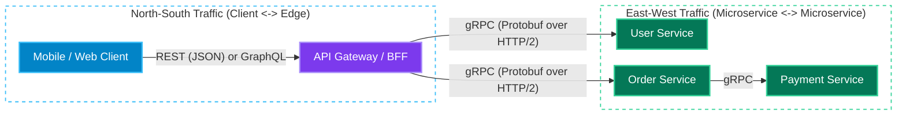
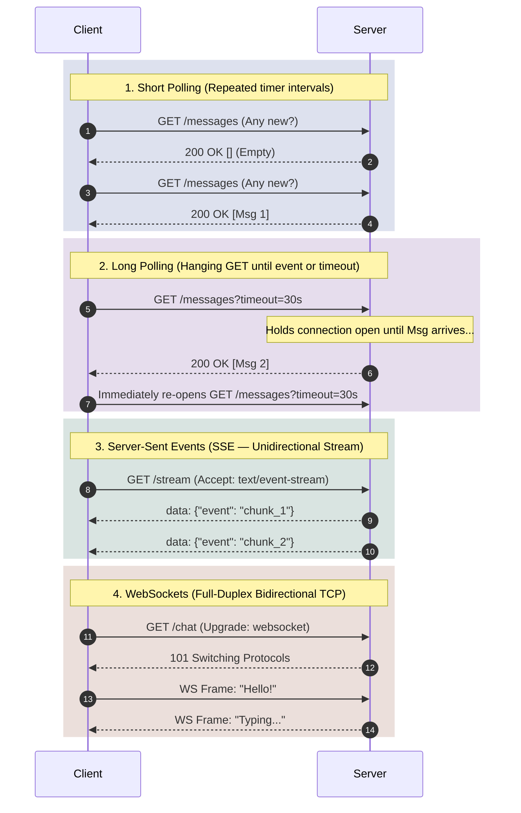
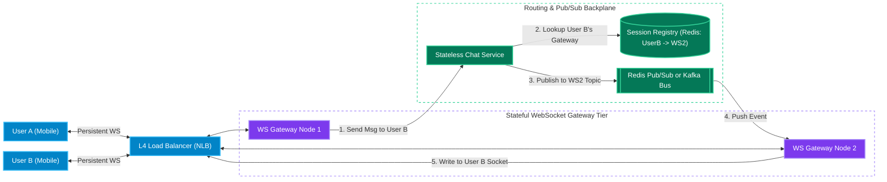

# Chapter 1: Networking, API Paradigms & Real-Time Protocols

[← Back to System Design Hub](../system-design.md) | [Next: Chapter 2 — Proxies, Load Balancers, API Gateways & CDNs →](02-edge-load-balancing-and-cdn.md)

---

## Table of Contents

- [1. Networking & OSI 7-Layer Model](#1-networking--osi-7-layer-model)
  - [OSI Model from a System Design Perspective](#osi-model-from-a-system-design-perspective)
  - [Transport Layer: TCP vs. UDP vs. QUIC](#transport-layer-tcp-vs-udp-vs-quic)
  - [HTTP Evolution: HTTP/1.1 vs. HTTP/2 vs. HTTP/3](#http-evolution-http11-vs-http2-vs-http3)
- [2. API Paradigms: REST vs. GraphQL vs. gRPC](#2-api-paradigms-rest-vs-graphql-vs-grpc)
  - [API Paradigms Comparison](#api-paradigms-comparison)
  - [REST (Representational State Transfer)](#rest-representational-state-transfer)
  - [GraphQL](#graphql)
  - [gRPC (Google Remote Procedure Call)](#grpc-google-remote-procedure-call)
  - [Interview Decision Matrix: REST vs. GraphQL vs. gRPC](#interview-decision-matrix-rest-vs-graphql-vs-grpc)
- [3. Real-Time Protocols: Polling vs. SSE vs. WebSockets vs. WebRTC](#3-real-time-protocols-polling-vs-sse-vs-websockets-vs-webrtc)
  - [Real-Time Protocols Comparison](#real-time-protocols-comparison)
  - [Short Polling vs. Long Polling](#short-polling-vs-long-polling)
  - [Server-Sent Events (SSE)](#server-sent-events-sse)
  - [WebSockets Deep Dive & Horizontal Scaling Architecture](#websockets-deep-dive--horizontal-scaling-architecture)
  - [WebRTC (Peer-to-Peer Audio/Video Streaming)](#webrtc-peer-to-peer-audiovideo-streaming)

---

## 1. Networking & OSI 7-Layer Model

### OSI Model from a System Design Perspective

In system design interviews, discussions primarily center around **Layer 3 (Network)**, **Layer 4 (Transport)**, and **Layer 7 (Application)**:

| OSI Layer | Name | Data Unit | Key Protocols | System Design Relevance & Components |
| :--- | :--- | :--- | :--- | :--- |
| **Layer 7** | **Application** | Data / Message | HTTP/1.1, HTTP/2, HTTP/3, gRPC, GraphQL, WebSockets, SSE, DNS, TLS | Content-aware routing, API Gateways, L7 Load Balancers (ALB, NGINX, Envoy), CDNs, WAF. |
| **Layer 6** | **Presentation** | Data | TLS/SSL, gzip, Brotli, Protobuf, JSON | Serialization/deserialization, encryption in transit, payload compression. |
| **Layer 5** | **Session** | Data | Sockets, RPC sessions, TLS session resumption | Connection pooling, sticky sessions, session state tokens. |
| **Layer 4** | **Transport** | Segment (TCP) / Datagram (UDP) | TCP, UDP, QUIC | L4 Load Balancers (AWS NLB, IPVS), port-level routing, congestion & flow control. |
| **Layer 3** | **Network** | Packet | IP (IPv4/IPv6), ICMP, BGP, Anycast, IPSec | IP routing, BGP Anycast for global CDNs/DNS, VPC subnetting, L3 DDoS mitigation. |
| **Layer 2** | **Data Link** | Frame | Ethernet, ARP, VLAN, MAC | Intra-datacenter switch fabric, MAC address forwarding (Direct Server Return / DSR). |
| **Layer 1** | **Physical** | Bits | Fiber optics, subsea cables, copper/NICs | Physical rack diversity, subsea cable RTT limits (speed of light in fiber $\approx 200\text{ km/ms}$). |

---

### Transport Layer: TCP vs. UDP vs. QUIC

```mermaid
%%{init: {'flowchart': {'nodeSpacing': 20, 'rankSpacing': 35, 'padding': 10}}}%%
sequenceDiagram
    participant C as Client
    participant S as Server

    rect rgb(30, 58, 138)
    Note over C,S: TCP + TLS 1.2/1.3 Handshake (2-3 RTTs before first HTTP byte)
    C->>S: 1. TCP SYN
    S-->>C: 2. TCP SYN-ACK
    C->>S: 3. TCP ACK + TLS ClientHello
    S-->>C: 4. TLS ServerHello, Cert, Finished
    C->>S: 5. HTTP GET /api/feed (First Application Data)
    end

    rect rgb(6, 78, 59)
    Note over C,S: QUIC / HTTP/3 Handshake over UDP (1-RTT, or 0-RTT on Resumption)
    C->>S: 1. QUIC Initial (UDP) + TLS 1.3 ClientHello (+ 0-RTT HTTP/3 Data)
    S-->>C: 2. QUIC Handshake + TLS 1.3 ServerHello + HTTP/3 Response
    end
```



| Feature | TCP (Transmission Control Protocol) | UDP (User Datagram Protocol) | QUIC (UDP-Based Multiplexed Transport) |
| :--- | :--- | :--- | :--- |
| **Connection Setup** | Connection-oriented: 3-way handshake (`SYN`, `SYN-ACK`, `ACK`) + TLS handshake (2–3 RTTs). | Connectionless: 0 RTT setup; fire-and-forget datagrams. | Connection-oriented over UDP: combines transport + TLS 1.3 into **1-RTT** (or **0-RTT** on resumption). |
| **Reliability & Ordering** | Guaranteed delivery, strict in-order byte stream, automatic retransmission. | Best-effort delivery; packets may be dropped, duplicated, or arrive out of order. | Reliable per-stream delivery; packet loss in one stream does **not** block other streams. |
| **Head-of-Line (HoL) Blocking** | **Yes** at TCP layer (one lost packet stalls all multiplexed HTTP/2 streams on that TCP connection). | **No** (no stream ordering enforced by transport). | **No** transport-level HoL blocking; independent multiplexed streams. |
| **Header Overhead** | 20–60 bytes (heavy stateful tracking). | 8 bytes (minimal stateless header). | Variable small header + built-in connection migration across IP/Wi-Fi changes. |
| **Primary Interview Use Cases** | REST APIs, database connections, financial transactions, email, file transfers. | Live WebRTC video/voice calls, online gaming, DNS queries, VoIP, telemetry streaming. | HTTP/3 web delivery, mobile apps moving between cellular and Wi-Fi networks, video streaming. |

---

### HTTP Evolution: HTTP/1.1 vs. HTTP/2 vs. HTTP/3

| Dimension | HTTP/1.1 | HTTP/2 | HTTP/3 |
| :--- | :--- | :--- | :--- |
| **Underlying Transport** | TCP | TCP | **QUIC (over UDP)** |
| **Multiplexing** | **No** — 1 request per TCP connection at a time (browsers open up to 6 parallel TCP connections per domain). | **Yes** — multiplexes many parallel requests/responses (streams) over a single TCP connection. | **Yes** — independent multiplexed streams over QUIC. |
| **Head-of-Line Blocking** | **Application-level HoL blocking**: slow response #1 blocks response #2 on that connection. | Solves HTTP HoL blocking, but suffers **TCP-level HoL blocking** (1 dropped TCP packet stalls *all* active streams until retransmitted). | **Completely solved** — a lost UDP packet only delays the single stream whose data was in that packet. |
| **Header Format** | Verbose plain-text ASCII headers repeated on every request. | Binary framing + **HPACK** stateful header compression. | Binary framing + **QPACK** out-of-order header compression. |
| **Connection Migration** | Bound to 4-tuple `(src IP, src port, dst IP, dst port)` — switching from Wi-Fi to 5G breaks the connection. | Same as HTTP/1.1 — breaks when client IP changes. | Uses a 64-bit **Connection ID** — switching from Wi-Fi to 5G keeps the stream alive with zero re-handshake. |

---

## 2. API Paradigms: REST vs. GraphQL vs. gRPC

Choosing the right API style between external clients (Browser/Mobile) and internal microservices is a standard discussion in Step 3 of every system design interview.



### API Paradigms Comparison

| Dimension | REST | GraphQL | gRPC |
| :--- | :--- | :--- | :--- |
| **Core Abstraction** | **Resource-Oriented** (Nouns: `/users/123`, `/orders/456`) manipulated via standard HTTP verbs (`GET`, `POST`, `PUT`, `DELETE`, `PATCH`). | **Query / Graph-Oriented** (Single endpoint `POST /graphql` where the client specifies the exact nested fields it wants). | **Action / RPC-Oriented** (Calling remote methods `OrderService.CreateOrder(req)` as if they were local functions). |
| **Payload Format** | Text-based **JSON** (human-readable, larger payload, slower CPU parsing). | Text-based **JSON** response matching the client's GraphQL query shape. | Binary **Protocol Buffers (Protobuf)** ($5\times–10\times$ smaller payload, ultra-fast zero-copy CPU serialization). |
| **Transport Protocol** | HTTP/1.1, HTTP/2, or HTTP/3. | HTTP/1.1 or HTTP/2 (almost always `POST`). | Strictly requires **HTTP/2** (or HTTP/3) for multiplexed binary framing. |
| **Contract & Typing** | Optional/loosely coupled via OpenAPI (Swagger) specs. | Strongly typed **GraphQL Schema (SDL)** with runtime introspection. | Strictly enforced **`.proto` IDL contract**; auto-generates strongly typed client/server stubs in C#, Java, Go, Python, C++. |
| **Data Fetching Efficiency** | Prone to **Over-fetching** (server returns 40 fields when mobile needs 3) and **Under-fetching** (requires multiple round-trip calls to assemble a view). | **Exact fetching** — client gets 100% of requested fields in a single network round-trip. | High efficiency via tailored request/response messages and bidirectional streaming. |
| **HTTP / CDN Caching** | **First-class native support**: `GET` URLs are effortlessly cached by browsers, CDNs, and reverse proxies using `ETag` and `Cache-Control`. | **Difficult**: Because all queries hit `POST /graphql` with different JSON bodies, standard URL-based HTTP/CDN caching does not work out of the box (requires Persisted Queries or client-side normalized caches like Apollo). | **Not applicable**: RPC calls bypass standard HTTP `GET` caching; relies on application-level Redis caching. |
| **Browser Compatibility** | **100% Native** (`fetch` / `XMLHttpRequest`). | **100% Native** (standard HTTP `POST` with JSON). | **Limited**: Browsers do not expose raw HTTP/2 trailers required by gRPC; requires a **gRPC-Web** proxy (Envoy) to translate. |

### REST (Representational State Transfer)

- **Best Practices for Interviews**:
  - Use plural nouns and hierarchical resource paths: `GET /api/v1/users/{user_id}/orders`.
  - Use **Cursor-Based Pagination** (`?cursor=eyJpZCI6MTAwfQ&limit=20`) instead of Offset Pagination (`?offset=100000&limit=20`), because `OFFSET 100000` forces the database to scan and discard 100,000 rows on every request.
  - Use proper HTTP status codes: `200 OK`, `201 Created`, `202 Accepted` (async job queued), `400 Bad Request`, `401 Unauthorized`, `403 Forbidden`, `404 Not Found`, `409 Conflict`, `429 Too Many Requests`, `500 Internal Server Error`, `503 Service Unavailable`.

### GraphQL

- **Core Components**:
  - **Queries** (Read operations), **Mutations** (Write/update operations), and **Subscriptions** (Real-time events over WebSockets).
  - **Resolvers**: Functions on the GraphQL server that fetch data for each individual field from downstream microservices or databases.
- **Critical Interview Pitfalls & Mitigations**:
  1. **The $N+1$ Query Problem**: If a client queries 50 posts and their `author` field, a naive GraphQL resolver executes `1` query to fetch 50 posts and `50` separate queries to fetch each author (`SELECT * FROM users WHERE id = ?`).
     - *Mitigation*: Use **DataLoader (Batching & Deduplication)**, which collects all author IDs requested within a single event-loop tick and executes a single batched call (`SELECT * FROM users WHERE id IN (1, 2, ..., 50)`).
  2. **Malicious Deeply Nested Queries (DoS)**: A client requests `user -> friends -> posts -> comments -> author -> friends` 20 levels deep, blowing up server CPU.
     - *Mitigation*: Enforce **Maximum Query Depth Limits** (e.g., max depth = 5), **Query Complexity Cost Analysis**, and **Persisted Queries** (whitelisting pre-registered query hashes in production).

### gRPC (Google Remote Procedure Call)

- **Four Streaming Modes over HTTP/2**:
  1. **Unary RPC**: Classic single request $\rightarrow$ single response.
  2. **Server Streaming RPC**: Client sends 1 request, server returns a continuous stream of messages (e.g., subscribing to order book price updates).
  3. **Client Streaming RPC**: Client streams chunks of data (e.g., uploading telemetry batches), server returns 1 summary ack.
  4. **Bidirectional Streaming RPC**: Both client and server send independent streams of messages over a single HTTP/2 connection without waiting for each other.

### Interview Decision Matrix: REST vs. GraphQL vs. gRPC

- **Choose REST** for public external APIs ([Shopify](../shopify.md), [Payment System](../payment-system.md)), simple CRUD workflows, and endpoints that benefit heavily from CDN / HTTP `GET` caching.
- **Choose GraphQL** at the **API Gateway / Backend-for-Frontend (BFF)** layer when serving diverse client platforms (iOS, Android, Web, Smart TV) that need rich, nested relational graphs ([Instagram](../instagram.md), [Airbnb](../airbnb.md), [Netflix](../netflix.md)) in a single mobile network round-trip.
- **Choose gRPC** for **internal East-West microservice-to-microservice communication** where low latency, high throughput, strict schema evolution (backward/forward compatibility via Protobuf field numbers), and streaming are critical.

---

## 3. Real-Time Protocols: Polling vs. SSE vs. WebSockets vs. WebRTC

When the server needs to push updates to the client (chat messages, live notifications, collaborative document edits, stock prices, driver GPS locations), standard request-response HTTP/1.1 is insufficient because a server cannot initiate a connection to a client sitting behind NAT/firewalls.



### Real-Time Protocols Comparison

| Dimension | Short Polling | Long Polling | Server-Sent Events (SSE) | WebSockets | WebRTC |
| :--- | :--- | :--- | :--- | :--- | :--- |
| **Directionality** | Client $\rightarrow$ Server (Pull) | Client $\rightarrow$ Server (Delayed Pull) | **Unidirectional** (Server $\rightarrow$ Client Push) | **Full-Duplex Bidirectional** (Client $\leftrightarrow$ Server) | **Peer-to-Peer Bidirectional** (Client $\leftrightarrow$ Client / SFU) |
| **Underlying Protocol** | Standard HTTP | Standard HTTP | Standard HTTP (`text/event-stream`) | Custom WS framing over upgraded TCP (`ws://` / `wss://`) | **UDP** (`SRTP` / `SCTP` via ICE/STUN/TURN) |
| **Latency** | High ($\frac{1}{2} \times \text{poll interval}$) | Low (near real-time on first message, 1 RTT delay on back-to-back messages) | **Real-Time** (ms) | **Real-Time** (sub-ms framing overhead) | **Ultra-Low Real-Time** (no TCP retransmission stalls) |
| **Server Overhead** | High wasted CPU/bandwidth parsing empty HTTP headers. | Moderate (holds open request contexts, re-establishes HTTP headers after every event). | Low (single persistent HTTP stream; multiplexes natively over HTTP/2). | Low per-message overhead, but requires **stateful connection management**. | Minimal server bandwidth if P2P; high if routed via TURN/SFU media server. |
| **Firewall & Load Balancer Friendliness** | **Excellent** (stateless HTTP). | **Good** (standard HTTP, though idle timeouts must be $> 30\text{s}$). | **Excellent** (standard HTTP/2; automatic browser `EventSource` reconnection with `Last-Event-ID`). | **Complex** (requires L4/L7 sticky connections, custom ping/pong heartbeats, manual reconnection logic). | Requires STUN/TURN servers to punch through symmetric corporate NATs. |
| **Primary Interview Use Cases** | Checking async batch job status, simple dashboard refresh every 30s. | Legacy chat/notification fallback ([Notification System](../notification-system.md)), async payment webhook polling. | **LLM AI token streaming**, live sports scores, stock tickers, social feed updates ([News Feed](../news-feed.md)). | Real-time 2-way chat ([WhatsApp](../whatsapp.md)), collaborative docs ([Google Docs](../google-docs.md)), live driver dispatch ([Uber](../uber.md)). | Live video/voice calls (Zoom, Discord, WhatsApp Call), low-latency cloud gaming. |

---

### Short Polling vs. Long Polling

- **Short Polling**: The client runs a timer (`setInterval` every 5 seconds) calling `GET /api/status`.
  - *Why it fails at scale*: If 10 million users poll every 5 seconds, your servers get hammered with `2,000,000 QPS` even when 99% of responses return `{ "updates": [] }`.
- **Long Polling**: The client requests `GET /api/updates?timeout=30s`. If no new data is available, the server **holds the connection open** (using non-blocking async I/O like `epoll` / Node.js / Go coroutines) until either an event arrives or 30 seconds elapse. As soon as the client receives a response, it immediately opens a new Long Poll request.
  - *Used in*: Early Facebook Messenger, Apache Kafka consumers (long-polling brokers for new message batches), and AWS SQS (`WaitTimeSeconds=20` long polling).

---

### Server-Sent Events (SSE)

- **How It Works**: The client opens a standard HTTP connection with `Accept: text/event-stream`. The server keeps the response stream open and writes newline-delimited UTF-8 blocks (`id: 42\nevent: message\ndata: {"text": "Hello"}\n\n`).
- **Why Interviewers Love SSE Over WebSockets for One-Way Push**:
  1. **Zero Custom Protocol Overhead**: Works over standard HTTP/2, meaning multiple SSE streams from the same browser tab share a single multiplexed TCP connection and pass effortlessly through corporate proxies and L7 API Gateways.
  2. **Built-In Reconnection & Catch-Up**: The browser's native `EventSource` API automatically reconnects if the connection drops and sends the `Last-Event-ID: 42` header so the server can replay missed events seamlessly.
  3. **When to Pick SSE over WebSockets**: Whenever the client only needs to *receive* real-time updates (AI chat streaming like ChatGPT, live stock tickers, notification badges, live sports commentary) and only occasionally sends actions via regular REST `POST` calls.

---

### WebSockets Deep Dive & Horizontal Scaling Architecture

When true **bidirectional, high-frequency communication** is required (e.g., [WhatsApp](../whatsapp.md) chat + typing indicators, [Google Docs](../google-docs.md) keystroke sync, [Uber](../uber.md) 4-second GPS pings + ride offers), **WebSockets** are the standard choice.

#### 1. The WebSocket Handshake & Lifecycle

1. **HTTP Upgrade Handshake**: The client starts with a standard HTTP `GET` request containing upgrade headers:

   ```http
   GET /ws/chat HTTP/1.1
   Host: chat.example.com
   Upgrade: websocket
   Connection: Upgrade
   Sec-WebSocket-Key: dGhlIHNhbXBsZSBub25jZQ==
   Sec-WebSocket-Version: 13
   ```

2. **`101 Switching Protocols`**: The server hashes the key with a magic GUID, returns `HTTP/1.1 101 Switching Protocols`, and hijacks the underlying TCP socket. From this moment on, HTTP is gone — both sides exchange lightweight binary/text **WebSocket Frames** (only 2–14 bytes of header overhead per message).
3. **Heartbeats (`PING` / `PONG`)**: Intermediate NAT routers and load balancers silently drop idle TCP connections after 60–300 seconds. The client/server must send periodic `PING` frames every 20–30 seconds to keep the NAT mapping alive and detect "half-open" dead sockets.

#### 2. How to Horizontally Scale Stateful WebSocket Servers (Crucial Interview Pattern)

Because User A may be connected via TCP to **WebSocket Gateway 1** while User B is connected to **WebSocket Gateway 2**, Gateway 1 cannot directly push a message to User B's socket!



- **Step 1 — Ephemeral Port Tuning**: A single Linux server is NOT limited to 65,535 WebSocket connections! The `65,535` limit applies only to *outbound* ports per destination IP. An inbound WebSocket server identifies sockets by the 4-tuple `(client_ip, client_port, server_ip, server_port:443)` — by tuning OS file descriptors (`fs.file-max`, `ulimit -n`), a single modern gateway node can hold **500,000 to 1,000,000 concurrent open WebSockets** (like WhatsApp's Erlang nodes).
- **Step 2 — Pub/Sub Routing Backplane**:
  - **Pattern A (Redis Pub/Sub Per-User or Per-Gateway Channel)**: Each WebSocket Gateway subscribes to its own channel (`channel:ws_node_2`). A Redis Session Registry maps `user_id -> ws_node_id`. To message User B, the Chat Service looks up User B's gateway (`ws_node_2`) and publishes to `channel:ws_node_2`.
  - **Pattern B (Consistent Hashing Ring)**: Use a ring-pop / Consistent Hashing ring (e.g., Discord's Elixir/Rust Actors or Akka Cluster) where `user_id` or `room_id` deterministically hashes to a specific stateful actor node.

---

### WebRTC (Peer-to-Peer Audio/Video Streaming)

When building live video conferencing or voice calls, even WebSockets are too slow because WebSockets run over **TCP** (where a single dropped packet stalls the entire video stream waiting for retransmission).

- **WebRTC** runs over **UDP** (`SRTP` for encrypted media, `SCTP` for data channels) and prioritizes **real-time freshness over 100% packet delivery** (dropping a video frame is better than freezing the call for 200ms).
- **NAT Traversal Components**:
  1. **Signaling Server (via WebSockets/HTTPS)**: Exchanges session descriptions (`SDP` offers/answers — codecs, resolutions) before the peer connection starts.
  2. **STUN (Session Traversal Utilities for NAT)**: Lightweight server that tells a client *"What is my public IP and port as seen from the internet?"* so peers can connect directly (`P2P`). Works ~80–85% of the time.
  3. **TURN (Traversal Using Relays around NAT)**: Relay server used as a fallback (~15% of calls) when strict corporate **Symmetric NATs** block direct P2P UDP packets.
  4. **SFU (Selective Forwarding Unit)**: Used in group video calls (e.g., 10+ participants in Zoom). Instead of every user uploading 9 separate video streams to 9 peers (mesh), each user uploads **1 stream** to the central SFU, which forwards appropriate bitrate layers (**Simulcast / SVC**) to the other participants.

---

[← Back to System Design Hub](../system-design.md) | [Next: Chapter 2 — Proxies, Load Balancers, API Gateways & CDNs →](02-edge-load-balancing-and-cdn.md)
