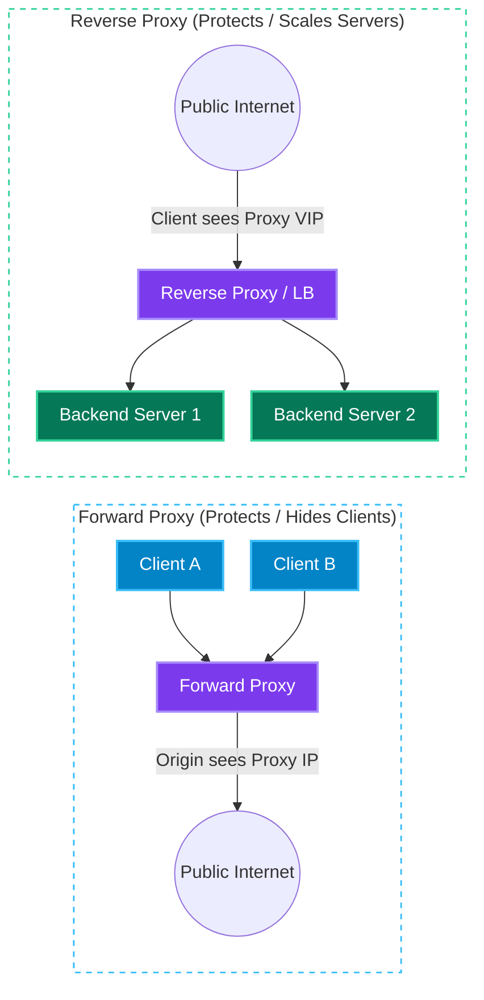
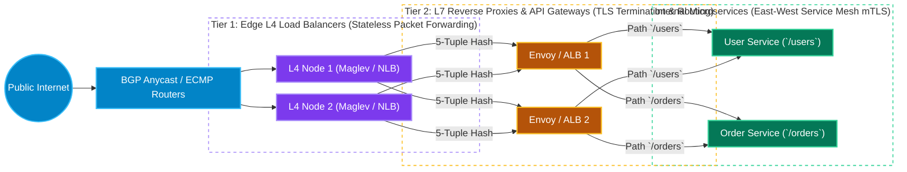
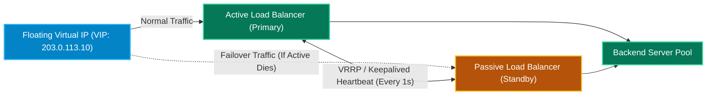

# Chapter 2: Proxies, Load Balancers, API Gateways & CDNs

[← Back to System Design Hub](../system-design.md) | [← Previous: Chapter 1 — Networking, API Paradigms & Real-Time Protocols](01-networking-and-api-paradigms.md) | [Next: Chapter 3 — Caching, Compute Scaling & Auto-Scaling →](03-caching-and-scaling.md)

---

## Table of Contents

- [1. Forward Proxy vs. Reverse Proxy](#1-forward-proxy-vs-reverse-proxy)
- [2. Load Balancers Deep Dive](#2-load-balancers-deep-dive)
  - [Layer 4 (Transport) vs. Layer 7 (Application) Load Balancing](#layer-4-transport-vs-layer-7-application-load-balancing)
  - [Load Balancing Routing Algorithms](#load-balancing-routing-algorithms)
  - [High Availability (HA) for Load Balancers](#high-availability-ha-for-load-balancers)
- [3. API Gateway](#3-api-gateway)
  - [Core Responsibilities of an API Gateway](#core-responsibilities-of-an-api-gateway)
  - [Comparison: Load Balancer vs. Reverse Proxy vs. API Gateway vs. Service Mesh](#comparison-load-balancer-vs-reverse-proxy-vs-api-gateway-vs-service-mesh)
- [4. Content Delivery Network (CDN)](#4-content-delivery-network-cdn)
  - [How a CDN Works (Anycast, Edge PoPs & Origin Shield)](#how-a-cdn-works-anycast-edge-pops--origin-shield)
  - [Push CDN vs. Pull CDN](#push-cdn-vs-pull-cdn)
  - [CDN Cache Invalidation & Freshness Strategies](#cdn-cache-invalidation--freshness-strategies)

---

## 1. Forward Proxy vs. Reverse Proxy

| Dimension | Forward Proxy | Reverse Proxy |
| :--- | :--- | :--- |
| **Sits In Front Of** | **Clients** (inside a private network or user device). | **Backend Servers** (at the edge of a service provider's infrastructure). |
| **Who Knows About It?** | Configured explicitly by the client; transparent to the destination server. | Configured by the server infrastructure; completely transparent to the client. |
| **Identity Hidden** | Hides the **client's IP** from the destination server. | Hides the **internal server topology and IPs** from the public internet. |
| **Core Responsibilities** | Outbound firewall filtering, corporate content blocking, egress IP whitelisting (e.g., partner bank webhooks), anonymization (VPN/Tor), local egress caching. | Load balancing, TLS/SSL termination, DDoS protection, gzip/Brotli compression, static response caching, canary routing (NGINX, HAProxy, Envoy, Cloudflare). |

---

## 2. Load Balancers Deep Dive

### Layer 4 (Transport) vs. Layer 7 (Application) Load Balancing

| Feature | Layer 4 (Transport Load Balancer) | Layer 7 (Application Load Balancer) |
| :--- | :--- | :--- |
| **Inspection Scope** | Inspects only network/transport headers (**Source/Dest IP + TCP/UDP Port**). Does **not** inspect payload. | Terminates the TCP/TLS connection and inspects **HTTP headers, URL path, cookies, and payload**. |
| **Connection Model** | Single logical TCP connection (via NAT packet rewriting or **Direct Server Return / DSR**) between client and backend. | Two separate TCP connections: Client $\leftrightarrow$ L7 LB (TLS terminated), and L7 LB $\leftrightarrow$ Backend Server (pooled keep-alive connections). |
| **Throughput & Latency** | Extremely high throughput (millions of concurrent connections), ultra-low CPU overhead and sub-millisecond latency. | Higher CPU/memory overhead due to TLS decryption and HTTP parsing, slightly higher latency. |
| **Routing Intelligence** | Packet/connection forwarding based on 5-tuple `(src IP, src port, dst IP, dst port, protocol)` hash. | Content-based routing (e.g., `/api/v1/users` $\rightarrow$ User Service, `/api/v1/orders` $\rightarrow$ Order Service, or routing by `X-Tenant-Tier: Enterprise`). |
| **Protocols Supported** | Any TCP/UDP protocol (HTTP, WebSockets, raw TCP, MySQL, DNS, SMTP, WebRTC). | Application-specific (HTTP/1.1, HTTP/2, HTTP/3, gRPC, WebSockets). |
| **Representative Tech** | AWS Network Load Balancer (NLB), Linux IPVS / LVS, Google Maglev, Katran (eBPF/XDP). | AWS Application Load Balancer (ALB), NGINX, Envoy, HAProxy (L7 mode), Traefik. |

> [!TIP]
> **Production Two-Tier Load Balancing Pattern:**
> Hyperscale architectures combine both layers:
>
> 1. **Tier 1 (Edge L4 Load Balancers)**: eBPF/XDP or IPVS/NLB nodes sit behind BGP Anycast routers, absorbing millions of packets/sec and distributing TCP connections evenly across a horizontally scaled fleet of L7 proxies.
> 2. **Tier 2 (L7 Load Balancers / Envoy / NGINX)**: Terminate TLS, validate headers, compress payloads, and route HTTP/gRPC requests to internal microservices.

---

### Load Balancing Routing Algorithms

| Algorithm | How It Works | Pros | Cons / Pitfalls | Best Used For |
| :--- | :--- | :--- | :--- | :--- |
| **Round Robin** | Cycles through healthy backend servers sequentially ($1 \rightarrow 2 \rightarrow 3 \rightarrow 1$). | Simple, stateless, zero overhead. | Assumes all servers have identical hardware and all requests cost the same CPU/time. | Stateless microservices with uniform, fast request execution times. |
| **Weighted Round Robin** | Assigns a capacity weight $W_i$ to each server; servers receive requests proportional to their weight. | Handles heterogeneous server hardware (e.g., `c6i.4xlarge` vs `c6i.xlarge`) and canary rollouts. | Still blind to slow/expensive individual queries piling up on one node. | Mixed-instance fleets or gradual traffic shifting ($5\% \rightarrow 25\% \rightarrow 100\%$). |
| **Least Connections** | Routes each new request to the server with the fewest active open connections. | Adapts dynamically when some requests take much longer than others. | Requires the LB to track active connection state across backends. | Long-lived connections (**WebSockets**, SSE, database connection pools). |
| **Least Response Time / Power of Two Choices (P2C)** | Picks 2 random healthy nodes and routes to the one with lower active requests $\times$ recent EWMA latency. | Avoids "herd behavior" across distributed LBs while automatically routing around degraded or GC-pausing nodes. | Slightly higher telemetry tracking overhead. | Latency-sensitive APIs where downstream slowness can affect individual pods. |
| **IP / URL Hash** | Hashes client IP or URL path (`hash(client_ip) % N`) to pick a deterministic backend. | Provides stateless session affinity without cookie inspection (works at L4). | Adding/removing a server reshuffles almost all keys unless **Consistent Hashing** is used; corporate NATs concentrate many users onto one IP. | Stateful in-memory caches or L4 sticky sessions. |

---

### High Availability (HA) for Load Balancers

A single Load Balancer is a Single Point of Failure (SPOF). To make the Load Balancer tier fault-tolerant:

1. **Active-Passive Failover (Floating VIP / VRRP)**:
   - Two load balancers share a Virtual IP (VIP) using `Keepalived` / VRRP heartbeats. If the Active LB fails to send a heartbeat within a threshold (e.g., 3 seconds), the Passive LB claims the Floating VIP via gratuitous ARP and takes over traffic.
2. **Active-Active Multi-Node (DNS Round Robin + BGP Anycast / ECMP)**:
   - Multiple active L4 LBs advertise the same Anycast VIP via BGP to upstream datacenter routers using **ECMP (Equal-Cost Multi-Path)** routing. If one LB dies, its BGP session drops and routers immediately stop sending packets to it with zero downtime.

---

## 3. API Gateway

An **API Gateway** is a specialized Layer 7 edge server that acts as the single entry point for external clients into a microservices ecosystem, decoupling client-facing API contracts from internal service decomposition.

### Core Responsibilities of an API Gateway

1. **Authentication & Authorization Offloading**: Validates OAuth2 tokens, OIDC sessions, API keys, and JWT signatures (`RS256` public key verification) at the perimeter before forwarding enriched identity headers (`X-User-Id`, `X-Tenant-Id`, `X-Scopes`) to internal services.
2. **Rate Limiting & Quota Enforcement**: Protects downstream services from abuse, credential stuffing, scraping, and DDoS bursts using Token Bucket or Sliding Window counters backed by Redis (see [Rate Limiter Design](../rate-limiter.md)).
3. **Request Routing, Versioning & Canary Releases**: Maps external paths (`/v2/checkout`) to internal services and splits traffic by percentage or header for A/B testing and canary deployments.
4. **Protocol Translation & Request Aggregation (BFF — Backend for Frontend)**: Accepts external REST/JSON or GraphQL calls from mobile/web clients, fans out parallel **gRPC** calls to multiple internal microservices, and aggregates the responses into a single payload.
5. **Cross-Cutting Observability & Security**: Injects distributed tracing correlation IDs (`traceparent`), logs access metrics, enforces CORS, validates JSON schemas, and integrates with Web Application Firewalls (WAF).

### Comparison: Load Balancer vs. Reverse Proxy vs. API Gateway vs. Service Mesh

| Component | Traffic Direction | Primary Focus | Typical Technologies |
| :--- | :--- | :--- | :--- |
| **L4/L7 Load Balancer** | **North-South** (External $\rightarrow$ Cluster) | High-throughput traffic distribution across healthy server replicas and active/passive health checking. | AWS NLB / ALB, Google Cloud LB, HAProxy |
| **Reverse Proxy** | **North-South** (Edge / Web Server) | TLS termination, static file serving, response compression, HTTP caching, hiding server topology. | NGINX, Cloudflare, Apache Traffic Server |
| **API Gateway** | **North-South** (Client $\rightarrow$ Microservices) | Business-aware API management: AuthN/AuthZ, per-tenant rate limiting, billing metering, BFF aggregation, REST $\rightarrow$ gRPC translation. | Kong, AWS API Gateway, Apigee, Envoy Gateway, MuleSoft |
| **Service Mesh** | **East-West** (Service $\leftrightarrow$ Service) | Sidecar proxies attached to every pod handling internal mTLS encryption, circuit breaking, retries, deadline propagation, and service discovery without code changes. | Istio, Linkerd, Consul Connect (with Envoy sidecars) |

---

## 4. Content Delivery Network (CDN)

A **Content Delivery Network (CDN)** is a globally distributed network of **Edge Points of Presence (PoPs)** deployed in hundreds of cities and ISP exchanges (IXPs). By serving static and cacheable dynamic content from an edge server physically close to the user, a CDN eliminates cross-continental network round-trip latency and offloads 85–99% of read bandwidth from origin servers.

### How a CDN Works (Anycast, Edge PoPs & Origin Shield)

1. **Anycast / Geo-DNS Routing**: When a user requests `cdn.example.com`, DNS or BGP **Anycast** routes the request to the nearest/lowest-latency Edge PoP (reducing network RTT from ~150ms cross-continent to **< 10–20ms**).
2. **Edge Cache Hit**: If the requested asset (`logo.png` or `segment_04.ts`) is cached in the Edge PoP's RAM/NVMe tier and its TTL has not expired, the Edge returns it immediately.
3. **Edge Cache Miss & Origin Shield**: On a cache miss, instead of all 300 global Edge PoPs hammering the Origin server simultaneously for a viral video, the Edge queries a regional **Origin Shield** (a middle-tier cache layer) which collapses concurrent misses (**Request Coalescing**) into a single fetch to Origin (e.g., AWS S3).

### Push CDN vs. Pull CDN

| Dimension | Pull CDN | Push CDN |
| :--- | :--- | :--- |
| **How Data Reaches the Edge** | **Lazy / On-Demand**: The Origin holds the assets. When the first user in a region requests an asset, the Edge PoP experiences a cache miss, pulls it from Origin, caches it, and serves subsequent requests. | **Proactive / Pre-Populated**: The application or media pipeline actively uploads/pushes content to CDN edge appliances ahead of time (often during off-peak night hours). |
| **Storage Efficiency** | High — only popular assets actually requested in a given geography consume edge storage. | Lower — requires careful predictive placement to avoid storing unpopular files everywhere. |
| **First-Request Latency** | First user in a PoP pays the **Cache Miss penalty** (Edge $\rightarrow$ Origin RTT). | Zero cold-start miss penalty; first user gets an immediate local **Cache Hit**. |
| **Maintenance Overhead** | Minimal — completely automated via standard HTTP `Cache-Control` headers. | High — application must orchestrate uploads, manifest versions, and deletions across edges. |
| **Ideal Interview Use Cases** | General web assets (JS/CSS/HTML), user-uploaded profile images, long-tail social media photos ([Instagram](../instagram.md), [Shopify](../shopify.md), [YouTube](../youtube.md) long-tail videos). | Blockbuster video releases, top-catalog streaming chunks pre-staged onto ISP appliances ([Netflix Open Connect](../netflix.md), [Amazon Prime](../amazon-prime.md), OS software updates). |

### CDN Cache Invalidation & Freshness Strategies

1. **Content-Addressable URL Versioning (Best Practice)**: Embed a file content hash or version in the filename (e.g., `app.8f3a1c.bundle.js` or `avatar_v4.jpg`) and set an immutable long TTL (`Cache-Control: public, max-age=31536000, immutable`). When the file changes, the HTML/API references the new URL — zero purge latency!
2. **Stale-While-Revalidate**: Use `Cache-Control: max-age=60, stale-while-revalidate=300` for semi-dynamic API responses (e.g., product catalog pages). The CDN serves slightly stale cached data immediately while asynchronously refreshing the cache from Origin in the background.
3. **Explicit Purge / Surrogate-Key Tagging**: Tag cached objects with `Surrogate-Key: merchant-123` (Fastly/Cloudflare) and trigger an API purge when a merchant updates a price or takes down content for legal/DMCA compliance.

---

[← Back to System Design Hub](../system-design.md) | [← Previous: Chapter 1 — Networking, API Paradigms & Real-Time Protocols](01-networking-and-api-paradigms.md) | [Next: Chapter 3 — Caching, Compute Scaling & Auto-Scaling →](03-caching-and-scaling.md)
