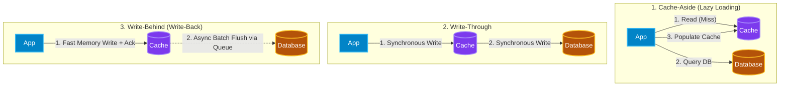
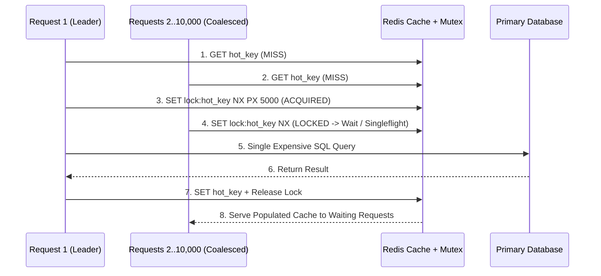
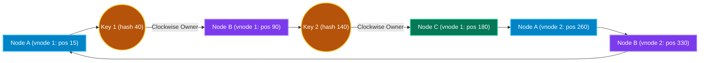

# Chapter 3: Caching Deep Dive, Compute Scaling & Auto-Scaling Nodes

[← Back to System Design Hub](../system-design.md) | [← Previous: Chapter 2 — Proxies, Load Balancers, API Gateways & CDNs](02-edge-load-balancing-and-cdn.md) | [Next: Chapter 4 — Databases: SQL vs. NoSQL, Storage Internals & Sharding →](04-databases-sql-vs-nosql.md)

---

## Table of Contents

- [1. Caching Deep Dive](#1-caching-deep-dive)
  - [Multi-Tier Caching Across the System Stack](#multi-tier-caching-across-the-system-stack)
  - [Redis vs. Memcached](#redis-vs-memcached)
  - [Caching Read & Write Strategies](#caching-read--write-strategies)
  - [Cache Eviction Policies](#cache-eviction-policies)
  - [Caching Failure Modes & Interview Mitigations](#caching-failure-modes--interview-mitigations)
- [2. Compute Scaling: Vertical vs. Horizontal Scaling](#2-compute-scaling-vertical-vs-horizontal-scaling)
  - [Scale Up vs. Scale Out Comparison](#scale-up-vs-scale-out-comparison)
  - [Stateless vs. Stateful Compute Tiers](#stateless-vs-stateful-compute-tiers)
- [3. Auto-Scaling Nodes in Production](#3-auto-scaling-nodes-in-production)
  - [Auto-Scaling Trigger Strategies](#auto-scaling-trigger-strategies)
  - [Two-Layer Kubernetes Auto-Scaling](#two-layer-kubernetes-auto-scaling)
  - [Critical Auto-Scaling Pitfalls & Interview Mitigations](#critical-auto-scaling-pitfalls--interview-mitigations)
- [4. Consistent Hashing](#4-consistent-hashing)

---

## 1. Caching Deep Dive

Caching stores copies of frequently accessed or computationally expensive data in fast storage tiers (typically RAM) to reduce read latency, increase throughput, and shield primary databases from overload.

### Multi-Tier Caching Across the System Stack

```mermaid
%%{init: {'flowchart': {'nodeSpacing': 18, 'rankSpacing': 35, 'padding': 10}}}%%
flowchart LR
    L1["L1: Browser / Client Cache (< 1ms)"]
    L2["L2: CDN Edge PoP (5-25ms)"]
    L3["L3: API Gateway Cache (1-5ms)"]
    L4["L4: App Heap L1 (Caffeine ~100ns)"]
    L5["L5: Shared Redis Cluster (0.5-2ms)"]
    L6["L6: DB Buffer Pool (0.1-1ms)"]
    Disk[("NVMe Disk (1-5ms)")]

    L1 -->|"Miss"| L2 -->|"Miss"| L3 -->|"Miss"| L4 -->|"Miss"| L5 -->|"Miss"| L6 -->|"Miss"| Disk

    classDef fast fill:#0284c7,stroke:#38bdf8,stroke-width:2px,color:#ffffff
    classDef mid fill:#7c3aed,stroke:#a78bfa,stroke-width:2px,color:#ffffff
    classDef slow fill:#b45309,stroke:#fbbf24,stroke-width:2px,color:#ffffff

    class L1,L2 fast
    class L3,L4,L5 mid
    class L6,Disk slow
```

| Cache Tier | Location | Typical Latency | What Is Cached & How |
| :--- | :--- | :--- | :--- |
| **L1: Client / Browser Cache** | User's device memory / local disk (`IndexedDB`, HTTP cache) | `< 1 ms` (0 network hops) | Static assets, user preferences, offline state controlled via `ETag`, `If-None-Match` (`304 Not Modified`), and `Cache-Control`. |
| **L2: CDN Edge Cache** | Global ISP / Edge PoPs (Cloudflare, CloudFront, Fastly) | `5 – 25 ms` | Static media (images, HLS/DASH video chunks), public HTML pages, high-read public GET API responses. |
| **L3: API Gateway / Reverse Proxy Cache** | Datacenter perimeter (NGINX, Varnish, Envoy) | `1 – 5 ms` | Short-TTL micro-caching (e.g., 1–5s TTL) for unauthenticated public endpoints during traffic spikes. |
| **L4: Application In-Process (Local L1) Cache** | Inside microservice JVM/CLR/Go heap (`Caffeine`, `MemoryCache`, `Guava`) | `~100 ns – 10 µs` (0 network hops) | Ultra-hot immutable config, feature flags, celebrity hot keys (avoids network serialization & Redis single-shard bottlenecks). |
| **L5: Distributed In-Memory Cache (Shared L2)** | Dedicated cluster (Redis Cluster, Memcached) | `0.5 – 2 ms` (intra-DC network hop) | Shared user sessions, precomputed feeds, rate-limiter counters, distributed locks, DB query/entity cache. |
| **L6: Database Internal Cache** | Inside DB engine RAM (`InnoDB Buffer Pool`, PostgreSQL `shared_buffers`) | `0.1 – 1 ms` | Frequently accessed B-Tree index pages and table data pages kept in memory by the storage engine. |

---

### Redis vs. Memcached

| Feature | Redis | Memcached |
| :--- | :--- | :--- |
| **Data Structures** | Rich native structures: Strings, Hashes, Lists, Sets, **Sorted Sets (`ZSET`)**, Bitmaps, HyperLogLog, Geospatial (`GEO`), Streams. | Simple flat **Key-Value strings** only (up to 1 MB per value). |
| **Threading Model** | Primarily single-threaded event loop for command execution (eliminates lock contention; atomic Lua scripts) with multi-threaded network I/O. | Multi-threaded architecture using per-slab locks; scales vertically across many CPU cores on a single box. |
| **Persistence & HA** | Supports RDB snapshots, AOF (Append-Only File) durability, Primary-Replica replication, and automatic Redis Sentinel / Cluster failover. | Purely volatile in-memory cache; no built-in persistence or native replication (handled by client routing or wrappers like Meta's Mcrouter / Netflix EVCache). |
| **When to Choose** | **Default choice in 95% of interviews**: whenever you need leaderboards/timelines (`ZSET`), rate limiting/locks (Lua), pub/sub, geospatial, or high availability without cold-cache wipeouts. | Simple, massive multi-core string/blob caching where memory fragmentation must be strictly bounded via slab allocation. |

---

### Caching Read & Write Strategies

| Strategy | How It Works | Pros | Cons / Risks | Best Interview Use Cases |
| :--- | :--- | :--- | :--- | :--- |
| **Cache-Aside (Lazy Loading)** | **Read**: App checks Cache; on miss, App reads from DB, writes to Cache, and returns. **Write**: App writes directly to DB and **deletes/invalidates** the cache entry. | Resilient to cache failures; only requested data is cached; avoids corrupting cache on concurrent writes when using cache invalidation rather than overwrite. | First read always incurs a **Cache Miss penalty** (3 round trips); risk of stale data if invalidation fails (mitigated by TTL + CDC). | General-purpose read-heavy workloads (User profiles, Product catalogs, [Bitly](../bitly.md) URL lookups). |
| **Read-Through** | App treats Cache as the primary datastore. On a miss, the **Cache provider/library itself** fetches data from the underlying DB, caches it, and returns it to the App. | Simplifies application code by abstracting DB fetch logic into a data-access layer or daemon (e.g., Meta TAO, DynamoDB DAX). | Same cold-start miss penalty as Cache-Aside; requires custom cache plugin or proxy support. | Read-heavy social graphs ([Social Media](../social-media.md)), managed caching proxies (DAX). |
| **Write-Through** | Every write goes through the Cache **synchronously** to the DB within the same operation; write succeeds only when both Cache and DB acknowledge. | Cache is **never stale**; subsequent reads are guaranteed fast Cache Hits without cold-start misses. | Higher **write latency** (must wait for both Cache + DB); pollutes cache if written data is rarely read back. | Systems requiring immediate read-your-writes consistency on hot objects (e.g., active user session state, banking account summary). |
| **Write-Behind (Write-Back)** | App writes **only to Cache** and receives an immediate acknowledgement. Cache asynchronously batches and flushes writes to the DB in the background. | **Ultra-low write latency** and massive write throughput; coalesces multiple rapid updates to the same key into a single DB write. | **Data loss risk** if the cache node crashes before flushing to disk/DB (mitigated via Redis AOF + Kafka WAL). | High-velocity counters: video view counts ([YouTube](../youtube.md)), post likes, gaming leaderboards, user presence heartbeats. |
| **Write-Around** | App writes **directly to the DB**, bypassing the Cache completely. Only reads (via Cache-Aside/Read-Through) populate the Cache. | Prevents write-heavy bulk operations or rarely read data from flooding the cache and evicting hot items. | Immediate read after a write will always result in a Cache Miss. | Log ingestion, audit archives ([Email Archive](../email-archive.md)), large file metadata uploads. |

> [!IMPORTANT]
> **Why Cache-Aside invalidates (deletes) the cache key on write instead of updating it:**
> If two concurrent requests update the database and then update the cache:
>
> - Request A writes `x = 1` to DB.
> - Request B writes `x = 2` to DB.
> - Request B writes `x = 2` to Cache.
> - Request A (delayed by a GC pause or network jitter) writes `x = 1` to Cache.
>
> Now the cache is permanently stale (`x = 1` while DB has `x = 2`)! **Deleting** the key from the cache after committing to the DB (or via Change Data Capture / Debezium reading the DB WAL) avoids this write-write race condition.

---

### Cache Eviction Policies

When cache memory is full, the cache must evict existing keys according to its eviction policy:

- **LRU (Least Recently Used)**: Evicts the item that has not been accessed for the longest time (implemented via a **Hash Map + Doubly Linked List** in $O(1)$ time). *Default choice for most workloads leveraging temporal locality.*
- **LFU (Least Frequently Used)**: Tracks access frequency counts and evicts the least frequently accessed item. Prevents a one-time bulk scan from flushing out genuinely popular items, though old items that accumulated high counts in the past can linger unless frequency decay (**W-TinyLFU**) is used.
- **TTL (Time-To-Live)**: Assigns an expiration timestamp to every key (e.g., `EXPIRE key 300`). Essential as a safety net against stale data even when active invalidation is used.
- **FIFO (First-In, First-Out)**: Evicts the oldest inserted item regardless of how often it is accessed. Simple ring-buffer overhead, rarely optimal for skewed workloads.

---

### Caching Failure Modes & Interview Mitigations

| Failure Scenario | What Happens | Production Mitigation Strategies |
| :--- | :--- | :--- |
| **1. Cache Stampede (Thundering Herd)** | A very popular key expires (or is invalidated), and 10,000 concurrent requests simultaneously see a Cache Miss and hammer the database with the exact same expensive query. | **Request Coalescing / Singleflight / Distributed Mutex** (only 1 worker queries DB while 9,999 wait); **Logical Expiration / Background Refresh** (refresh asynchronously before physical TTL expires). |
| **2. Cache Penetration** | Malicious or buggy clients repeatedly query keys that **do not exist** in either the Cache or the DB (e.g., `GET /users?id=-9999`), bypassing the cache on every request and overloading the DB. | **Cache Negative Results (`NULL` Sentinel)** with a short TTL (30–60s); place a space-efficient probabilistic **Bloom Filter** in front of the cache to reject non-existent keys immediately. |
| **3. Cache Avalanche** | Millions of cache keys expire at the exact same second (e.g., after a batch warm-up job) OR an entire Redis cluster node fails, shifting massive load onto the database. | **TTL Jitter** (`TTL = base_ttl + random(0, 300s)`) so keys expire smoothly over time; **Redis Cluster Multi-AZ Replicas**, consistent hashing, and DB circuit breakers / rate shedding. |
| **4. Hot Key (Celebrity Problem)** | A single key (e.g., Justin Bieber's latest tweet or a flash-sale iPhone SKU) receives 500,000 reads/sec. Even though it is a Cache Hit, all traffic hashes to **one single Redis shard**, saturating its NIC/CPU. | **Local In-Process L1 Cache** (`Caffeine` / `MemoryCache`) with a 1–5s TTL; **Key Replication (Salted Keys)** duplicating `item:123#1` .. `item:123#10` across 10 Redis shards. |

---

## 2. Compute Scaling: Vertical vs. Horizontal Scaling

### Scale Up vs. Scale Out Comparison

| Dimension | Vertical Scaling (Scale Up) | Horizontal Scaling (Scale Out) |
| :--- | :--- | :--- |
| **Definition** | Upgrading a single machine with more CPU cores, RAM, or faster NVMe disks (e.g., `m6i.large` $\rightarrow$ `m6i.24xlarge`). | Adding more independent commodity nodes/containers to a pool behind a load balancer ($1 \rightarrow 100$ nodes). |
| **Hardware Ceiling** | **Hard physical limit** — eventually hits the largest motherboard/instance size available in the cloud. | **Virtually infinite** — scales elastically to thousands of servers across Availability Zones and regions. |
| **Fault Tolerance & Availability** | **Single Point of Failure (SPOF)** — hardware failure or OS reboot causes total downtime. | **High Availability** — if one node crashes, the Load Balancer routes traffic to the remaining $N-1$ nodes with zero downtime. |
| **Application Architecture Complexity** | **Simple** — no network hops between components, in-memory locks work natively, zero distributed data consistency issues. | **Complex** — requires stateless compute tiers, distributed caching, externalized sessions, and distributed consensus/sharding for state. |
| **Cost Curve** | **Super-linear** — high-end enterprise hardware becomes disproportionately expensive per core/GB. | **Linear & Elastic** — uses cheap commodity VMs/containers that can scale down during off-peak hours to save money. |
| **Interview Rule of Thumb** | Start here for early-stage MVPs or single-primary relational databases up to ~5–10K QPS. | Mandatory for web/microservice tiers and any system requiring `99.99%+` availability or high scale. |

### Stateless vs. Stateful Compute Tiers

To scale horizontally without friction, always separate **Stateless Compute** from **Stateful Storage**:

1. **Stateless Services (Web / API Microservices)**:
   - No user session or local state is stored on the server's local disk/memory across requests.
   - Authentication state is carried in self-contained **JWTs** or stored in a shared **Redis Cluster**.
   - Any request from any user can be routed to **any** pod by the Load Balancer, allowing new pods to spin up or terminate at any moment.
2. **Stateful Services (WebSocket Gateways, Multiplayer Game Servers, Databases, Kafka Brokers)**:
   - Maintain persistent open connections or local disk state tied to specific users or partitions.
   - Require **Consistent Hashing**, **Connection Registries** (e.g., Redis mapping `user_id -> gateway_node_ip`), and **Graceful Connection Draining** before a node can be terminated.

---

## 3. Auto-Scaling Nodes in Production

Auto-scaling dynamically adjusts the number of running compute instances or containers (`pods`) to match real-time traffic demand while minimizing cloud cost.

### Auto-Scaling Trigger Strategies

| Strategy | Trigger Signal | Best Used For | Key Trade-Offs |
| :--- | :--- | :--- | :--- |
| **Target Tracking (Resource-Based)** | Average CPU Utilization (e.g., maintain `65%` CPU) or Memory Utilization. | Standard stateless REST/gRPC APIs with CPU-bound request processing. | Reactive — lags behind sudden vertical traffic spikes if instance boot time takes 30–120 seconds. |
| **Request / Custom Metric Scaling** | Requests per second per pod (ALB `RequestCountPerTarget`) or P95 latency. | I/O-bound microservices where CPU stays low even when thread pools or connections saturate. | Requires reliable high-resolution metrics pipeline (Prometheus Adapter / CloudWatch). |
| **Queue-Depth Scaling (KEDA)** | Backlog length divided by target messages per worker (e.g., `SQS ApproximateNumberOfMessagesVisible / 50` or Kafka consumer lag). | Asynchronous background workers (video transcoding in [YouTube](../youtube.md), notification dispatch in [Notification System](../notification-system.md)). | Prevents consumer starvation during burst events and scales down to `0` pods when the queue is empty. |
| **Scheduled & Predictive Scaling** | Cron schedules or ML time-series forecasting based on historical daily/weekly traffic curves. | Predictable traffic surges (8:00 AM commuter spike in [Uber](../uber.md), prime-time streaming in [Netflix](../netflix.md), Black Friday flash sales). | Pre-warms capacity **before** the spike hits, completely avoiding cold-start latency. |

### Two-Layer Kubernetes Auto-Scaling

- **Pod-Level Scaling**:
  - **HPA (Horizontal Pod Autoscaler)**: Adjusts replica count (`replicas: 5 -> 50`) based on CPU/memory/custom metrics.
  - **KEDA (Kubernetes Event-Driven Autoscaling)**: Scales pods based on external event sources (Kafka lag, SQS length, Redis streams), including **scale-to-zero**.
  - **VPA (Vertical Pod Autoscaler)**: Adjusts CPU/memory requests & limits per pod for workloads that cannot easily shard horizontally.
- **Node-Level Scaling**:
  - **Cluster Autoscaler / Karpenter**: Watches for `Pending` pods that cannot be scheduled due to insufficient cluster CPU/RAM, and provisions new underlying cloud VMs (EC2 instances) in seconds, consolidating and terminating underutilized VMs when traffic drops.

### Critical Auto-Scaling Pitfalls & Interview Mitigations

- **Flapping / Thrashing**: Rapidly scaling out and immediately scaling back in due to brief traffic oscillations.
  - *Mitigation*: Configure asymmetric **Stabilization / Cooldown Windows** — scale out aggressively (e.g., within 30–60s of spike), but scale in conservatively (e.g., wait 5–10 minutes of sustained low load before terminating nodes).
- **Cold-Start & Cache/JIT Warm-Up**: Newly launched nodes have cold local L1 caches, uncompiled JVM/CLR JIT code, and empty DB connection pools, causing them to time out if hit with full traffic immediately.
  - *Mitigation*: Use pre-baked container/AMI images, run a warm-up script inside the **Readiness Probe** before registering with the Load Balancer, and use **Slow-Start / Warm-Up Mode** on the Load Balancer to linearly ramp traffic to new nodes over 30–60 seconds.
- **Dropped In-Flight Requests on Scale-In**: Killing a node abruptly drops active HTTP requests or WebSocket connections.
  - *Mitigation*: Enforce **Connection Draining / Graceful Shutdown**:
    1. Load Balancer deregisters the pod and stops sending *new* requests.
    2. Pod executes a `preStop` sleep hook (e.g., 5–10s) to allow endpoint removal to propagate across Envoy/kube-proxy nodes.
    3. App handles `SIGTERM` by finishing in-flight requests and committing Kafka offsets within `terminationGracePeriodSeconds` (e.g., 30–60s) before exiting.
- **Downstream Database Connection Exhaustion**: Auto-scaling a microservice from 20 pods to 500 pods (where each pod opens 20 DB connections) suddenly opens `10,000` connections and crashes PostgreSQL/MySQL!
  - *Mitigation*: Always place a **Connection Pooler / Proxy** (`PgBouncer`, `ProxySQL`, `AWS RDS Proxy`) between auto-scaling compute pods and relational databases, and enforce strict max-replica caps (`maxReplicas`).

---

## 4. Consistent Hashing

With naive modular hashing (`server = hash(key) % N`), adding or removing a single node changes $N$, causing **nearly 100% of keys** ($\frac{N-1}{N}$) to remap to different servers and triggering a catastrophic cache avalanche.

**Consistent Hashing** maps both **Servers** and **Keys** onto a circular **Hash Ring** ($0$ to $2^{32}-1$):

1. A key is assigned to the first server encountered moving **clockwise** on the ring from `hash(key)`.
2. When a node is added or removed, only **$O(K / N)$ keys** (the fraction of keys on that single segment) are reassigned; all other keys remain undisturbed.
3. **Virtual Nodes (vnodes)**: Because placing only a few physical servers on the ring leads to uneven key distribution and "hot spots", each physical server is assigned 100–200 **virtual nodes** distributed across the ring. Virtual nodes ensure uniform load balance and allow powerful servers to own proportionally more vnodes.

*Used in: Amazon DynamoDB, Apache Cassandra, Discord/WhatsApp chat routing, Akamai CDN, and distributed Memcached/Redis clusters.*

---

[← Back to System Design Hub](../system-design.md) | [← Previous: Chapter 2 — Proxies, Load Balancers, API Gateways & CDNs](02-edge-load-balancing-and-cdn.md) | [Next: Chapter 4 — Databases: SQL vs. NoSQL, Storage Internals & Sharding →](04-databases-sql-vs-nosql.md)
