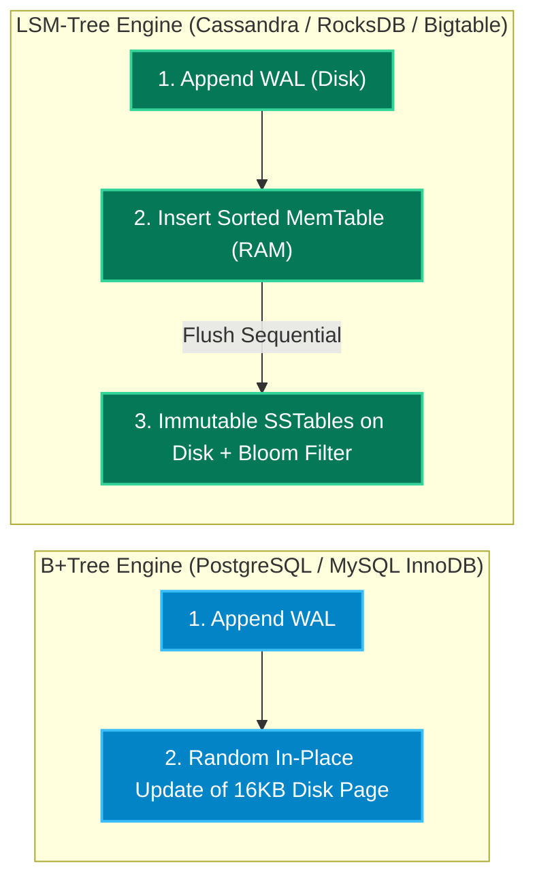

# Chapter 4: Databases Deep Dive — Relational (SQL) vs. NoSQL, Storage Internals, All DB Types & Sharding

[← Back to System Design Hub](../system-design.md) | [← Previous: Chapter 3 — Caching, Compute Scaling & Auto-Scaling](03-caching-and-scaling.md) | [Next: Chapter 5 — Distributed Systems, Consensus, Transactions & Messaging →](05-distributed-systems-and-messaging.md)

---

## Table of Contents

- [1. Relational (SQL) vs. Non-Relational (NoSQL) Deep Dive](#1-relational-sql-vs-non-relational-nosql-deep-dive)
  - [Head-to-Head Comparison](#head-to-head-comparison)
  - [ACID vs. BASE Consistency Models](#acid-vs-base-consistency-models)
  - [Database Isolation Levels & Concurrency Control (DDIA Deep Dive)](#database-isolation-levels--concurrency-control-ddia-deep-dive)
  - [Normalization (SQL) vs. Access-Pattern Denormalization (NoSQL)](#normalization-sql-vs-access-pattern-denormalization-nosql)
  - [Interview Decision Guide: When to Pick SQL vs. NoSQL](#interview-decision-guide-when-to-pick-sql-vs-nosql)
- [2. Storage Engine Internals & Cloud Storage Tiers](#2-storage-engine-internals--cloud-storage-tiers)
  - [B+Tree vs. LSM-Tree (Why SQL vs. NoSQL Engines Differ)](#btree-vs-lsm-tree-why-sql-vs-nosql-engines-differ)
  - [Row-Oriented (OLTP) vs. Column-Oriented (OLAP) Storage](#row-oriented-oltp-vs-column-oriented-olap-storage)
  - [Block Storage vs. File Storage vs. Object (Blob) Storage](#block-storage-vs-file-storage-vs-object-blob-storage)
- [3. The 10 Database Categories (Complete Interview Taxonomy)](#3-the-10-database-categories-complete-interview-taxonomy)
  - [Master Database Selection Cheat Sheet](#master-database-selection-cheat-sheet)
  - [Deep Dive Into Each Database Type](#deep-dive-into-each-database-type)
- [4. Database Scaling: Replication & Sharding](#4-database-scaling-replication--sharding)
  - [Replication Topologies (Scaling Reads & High Availability)](#replication-topologies-scaling-reads--high-availability)
  - [Sharding / Horizontal Partitioning (Scaling Writes & Storage)](#sharding--horizontal-partitioning-scaling-writes--storage)
- [5. Specialized Indexing: B-Tree, Inverted Index & Geospatial](#5-specialized-indexing-b-tree-inverted-index--geospatial)
  - [Full-Text Search & Inverted Index (Elasticsearch / Lucene)](#full-text-search--inverted-index-elasticsearch--lucene)
  - [Geospatial Indexing (Geohash vs. QuadTree vs. Uber H3)](#geospatial-indexing-geohash-vs-quadtree-vs-uber-h3)

---

## 1. Relational (SQL) vs. Non-Relational (NoSQL) Deep Dive

Choosing between a **Relational Database (RDBMS)** and a **NoSQL Database** — and explaining *why* — is one of the highest-signal parts of a system design interview.

### Head-to-Head Comparison

| Dimension | Relational Databases (SQL / RDBMS) | Non-Relational Databases (NoSQL) |
| :--- | :--- | :--- |
| **Core Data Model** | Structured **Tables** with fixed rows and typed columns linked via Foreign Keys. | Specialized models: **Key-Value**, **Document (JSON/BSON)**, **Wide-Column**, **Graph**, or **Vector**. |
| **Schema Enforcement** | **Schema-on-Write (Rigid)**: Schema must be defined upfront (`CREATE TABLE`); altering a 1-billion-row table requires careful online DDL migrations. | **Schema-on-Read (Flexible)**: Dynamic attributes can be added per item/document at any time without downtime. |
| **Data Modeling Philosophy** | **Normalized (3NF)**: Data is split into separate entity tables (`users`, `orders`, `order_items`) to eliminate duplication, then reassembled at read time via `JOIN`s. | **Denormalized (Query-First)**: Data is duplicated and pre-joined into aggregates designed specifically around the application's exact read queries. |
| **Joins & Ad-Hoc Queries** | **Rich declarative SQL**: Supports arbitrary multi-table `JOIN`s, `GROUP BY` aggregations, subqueries, and window functions. | **No cross-table `JOIN`s**: Queries must hit a known Partition Key (+ optional Sort Key). Ad-hoc queries across non-indexed fields require full scans. |
| **Transaction Guarantees** | **Strict ACID** across multiple rows and tables (`READ COMMITTED`, `REPEATABLE READ`, `SERIALIZABLE`). | **BASE** (Single-item/partition atomicity by default; multi-item ACID available in select engines like DynamoDB/MongoDB with performance cost). |
| **Scaling Trajectory** | Scales **vertically** first + **Read Replicas**. Horizontal write scaling requires manual application sharding (or Vitess / NewSQL). | Built from day one for **automatic horizontal sharding** and multi-datacenter replication across commodity nodes. |
| **Underlying Storage Engine** | Predominantly **B+Trees** (optimized for low-latency point/range reads and in-place row updates). | Predominantly **LSM-Trees** (Cassandra, RocksDB, Bigtable) or distributed B-Trees/hash indexes. |
| **Representative Engines** | PostgreSQL, MySQL, MariaDB, Amazon Aurora, SQL Server, Oracle, CockroachDB, Google Cloud Spanner. | Amazon DynamoDB, Apache Cassandra, ScyllaDB, MongoDB, Redis, Neo4j, Elasticsearch, ClickHouse. |

---

### ACID vs. BASE Consistency Models

| Model | Acronym Breakdown | How It Works |
| :--- | :--- | :--- |
| **ACID (Relational / NewSQL)** | **Atomicity** (all statements succeed or roll back via Undo Log); **Consistency** (foreign keys & constraints enforced); **Isolation** (concurrent transactions isolated via `MVCC` + locks); **Durability** (flushed to **WAL** on disk before returning `COMMIT OK`). | Prioritizes **correctness over raw write velocity**. Essential when an invalid intermediate state (like deducting money from Account A without crediting Account B) is unacceptable. |
| **BASE (NoSQL / AP Distributed)** | **Basically Available** (returns non-error responses during partial node failures); **Soft state** (replica state updates in background via anti-entropy); **Eventually consistent** (all replicas converge once writes stop). | Prioritizes **massive write throughput, low latency, and 100% uptime** over immediate global read-after-write agreement. |

---

### Database Isolation Levels & Concurrency Control (DDIA Deep Dive)

In interviews for payment systems ([Payment System](../payment-system.md)), hotel booking ([Airbnb](../airbnb.md)), or concert ticketing ([TicketMaster](../ticketmaster.md)), simply saying *"We use an ACID database"* is not enough — most SQL databases default to **`READ COMMITTED`**, which still allows lost updates and double-booking!

#### 1. Concurrency Anomalies Explained

- **Dirty Read**: Transaction $T_1$ reads data written by Transaction $T_2$ before $T_2$ has committed (if $T_2$ rolls back, $T_1$ acted on phantom state).
- **Non-Repeatable Read (Read Skew)**: $T_1$ reads the same row twice within one transaction and sees two different values because $T_2$ committed an update in between.
- **Lost Update**: $T_1$ and $T_2$ both read `balance = $100`, both add `$50` in application memory, and both write back `balance = $150` (one `$50` deposit is silently lost).
- **Phantom Read**: $T_1$ runs a `WHERE` range query twice and sees new "phantom" rows inserted by $T_2$ in between.
- **Write Skew (The Classic Senior Interview Question)**: Two transactions read the same overlapping dataset (`SELECT COUNT(*) FROM on_call_doctors WHERE shift = 1` $\rightarrow$ returns `2`), verify a business invariant (*"At least 1 doctor must remain on call"*), and **update two different rows** ($T_1$ removes Alice; $T_2$ removes Bob). Neither updated the same row, yet the committed result (`0` doctors on call, or two bookings for overlapping calendar dates) violates the business invariant!

#### 2. SQL Isolation Levels Comparison

| Isolation Level | Dirty Read | Non-Repeatable Read | Lost Update | Write Skew / Phantoms | How Storage Engines Implement It |
| :--- | :--- | :--- | :--- | :--- | :--- |
| **Read Uncommitted** | Possible | Possible | Possible | Possible | No read locks; reads dirty in-memory pages. |
| **Read Committed** *(PostgreSQL / Oracle / SQL Server Default)* | **Prevented** | Possible | Possible | Possible | Uses **MVCC (Multi-Version Concurrency Control)**: each SQL statement sees a snapshot of rows committed prior to that statement. |
| **Repeatable Read / Snapshot Isolation** *(MySQL InnoDB Default)* | **Prevented** | **Prevented** | Prevented in PG (aborts on conflict); Possible in MySQL without `FOR UPDATE` | Possible (**Write Skew** still happens under Snapshot Isolation!) | **MVCC Transaction Snapshot**: the entire transaction sees a consistent snapshot frozen at `BEGIN` (`txid`). Readers never block writers; writers never block readers. |
| **Serializable** | **Prevented** | **Prevented** | **Prevented** | **Prevented** | **Two-Phase Locking (2PL)** with predicate/next-key gap locks, OR **SSI (Serializable Snapshot Isolation)** in PostgreSQL/CockroachDB which tracks read-write dependency cycles and aborts conflicting transactions. |

#### 3. Pessimistic vs. Optimistic Concurrency Control (Preventing Double-Booking)

| Approach | SQL Mechanism | How It Works | When to Use in Interviews |
| :--- | :--- | :--- | :--- |
| **Pessimistic Locking** | `BEGIN; SELECT * FROM seats WHERE id = 42 AND status = 'FREE' FOR UPDATE; ... COMMIT;` | Acquires an **exclusive row lock** (`X-lock`) before reading. Any concurrent transaction trying to read `FOR UPDATE` or modify seat 42 blocks in a queue until the first transaction commits. | **High contention** or high cost of retry (e.g., financial ledger transfers, ATM withdrawals). *Downside*: Holding row locks across slow external HTTP calls exhausts DB connections and risks deadlocks. |
| **Optimistic Concurrency Control (OCC)** | `UPDATE seats SET status = 'BOOKED', version = version + 1 WHERE id = 42 AND version = 7;` | No locks held during read! App reads `version = 7`, computes changes, and performs an atomic **Compare-And-Swap (CAS)** write. If `affected_rows == 0`, another user modified the row first — retry or return `409 Conflict`. | **Low-to-moderate contention** or when user think-time is involved ([Airbnb](../airbnb.md) checkout, wiki edits, shopping cart updates). Zero lock contention on the DB. |

---

### Normalization (SQL) vs. Access-Pattern Denormalization (NoSQL)

- **In Relational (SQL) Design**: You model **the domain entities** first. You store a User's name only once in the `users` table and reference `user_id` in `posts` and `comments`.
- **In NoSQL Design**: You must list **every access pattern (query)** *before* designing the table!
  - Because NoSQL does not support `JOIN`s at scale, you embed the author's `username` and `avatar_url` directly inside every `comment` document/row so fetching 100 comments requires **1 single partition read** instead of 101 lookups.

---

### Interview Decision Guide: When to Pick SQL vs. NoSQL

1. **Choose Relational (SQL / NewSQL) When**:
   - You are handling **money, wallets, billing, double-entry ledgers, or inventory reservations** ([Payment System](../payment-system.md), [Airbnb](../airbnb.md), [TicketMaster](../ticketmaster.md), [ATM](../atm.md)) where ACID `SERIALIZABLE` / `SELECT ... FOR UPDATE` row locking prevents double-spending or double-booking.
   - Your data has complex many-to-many relationships requiring multi-table `JOIN`s and evolving business reporting queries.
   - Your write volume is moderate (`< 10,000 writes/sec` fits comfortably on a single modern PostgreSQL/Aurora instance with NVMe SSDs; beyond that, use **CockroachDB / Spanner** or shard via **Vitess**).
2. **Choose NoSQL When**:
   - You need **massive write ingestion** (`50,000 – 5,000,000+ writes/sec`) such as chat messages ([WhatsApp](../whatsapp.md)), user clickstreams, IoT telemetry, or time-series logs ([Metrics Monitoring](../metrics-monitoring.md)).
   - Your access patterns are simple, well-known **Key-Value point lookups** (`GET / PUT` by ID in `< 3ms` at any scale, e.g., [Bitly](../bitly.md), shopping carts in [Amazon](../amazon.md)).
   - Your data is polymorphic or hierarchical JSON without a uniform schema (e.g., diverse product attributes across 10,000 product categories).
3. **Use Polyglot Persistence (The Production Reality)**:
   - Almost every large system uses **both**! For example, in [Amazon](../amazon.md): **DynamoDB** stores active shopping carts (AP — never block a user from adding to cart), **PostgreSQL/Aurora** processes checkout orders and inventory reservations (CP — never oversell), and **Elasticsearch** powers the product search bar.

---

## 2. Storage Engine Internals & Cloud Storage Tiers

### B+Tree vs. LSM-Tree (Why SQL vs. NoSQL Engines Differ)

Understanding the underlying disk storage structure explains *why* PostgreSQL/MySQL excel at low-latency reads and transactions while Cassandra/RocksDB/ScyllaDB excel at massive write ingestion:

| Dimension | B+Tree Storage Engine | LSM-Tree (Log-Structured Merge-Tree) |
| :--- | :--- | :--- |
| **Representative Databases** | **PostgreSQL, MySQL (InnoDB), Oracle, SQLite** | **Apache Cassandra, ScyllaDB, RocksDB, Bigtable, LevelDB** |
| **Write Path Mechanics** | Appends to Write-Ahead Log (WAL) and performs **random in-place page updates** (4–16 KB pages) on disk; splits pages when full. | Appends sequentially to **WAL** and inserts into an in-memory sorted tree (**MemTable**). When full, flushes sequentially to disk as an immutable **SSTable** (Sorted String Table). |
| **Read Path Mechanics** | **Fast & Predictable ($O(\log N)$)**: Traverses a single balanced tree with high fanout (3–4 levels deep); at most 1 disk page read for a point lookup. | **Slower on Cold Reads**: Must check the `MemTable` and potentially multiple immutable `SSTables` from newest to oldest. Relies on in-memory **Bloom Filters** and sparse indexes to skip SSTables that do not contain the key. |
| **Write Throughput** | Lower — bottlenecked by random disk I/O and page-level locking/latching. | **Extremely High** — converts all random writes into fast sequential disk appends. |
| **Space & Write Amplification** | Fragmented pages waste ~20–30% disk space; each logical write modifies an entire 16 KB page. | Background **Compaction** merges SSTables and purges deleted tombstones, offering superior compression ($2\times–4\times$ smaller on disk) but causing temporary CPU/I/O spikes during compaction. |
| **When to Choose in Interviews** | Read-heavy workloads (`80%+` reads), complex secondary index lookups, strict ACID row/page locking. | Write-heavy workloads (`100K+` writes/sec): chat messages ([WhatsApp](../whatsapp.md)), IoT/metrics ingestion ([Metrics Monitoring](../metrics-monitoring.md)), user activity logs. |

---

### Row-Oriented (OLTP) vs. Column-Oriented (OLAP) Storage

| Feature | Row-Oriented Databases (OLTP) | Column-Oriented Databases (OLAP) |
| :--- | :--- | :--- |
| **How Data Is Stored on Disk** | Stores all columns of Row 1 contiguously, then all columns of Row 2 (`[id1, name1, price1, date1], [id2, name2, price2, date2]`). | Stores all values of Column `price` contiguously in one file, and all values of `date` in another (`[price1, price2, ...], [date1, date2, ...]`). |
| **Optimal Query Pattern** | `SELECT * FROM orders WHERE order_id = 99` or inserting/updating a single customer's order. | `SELECT AVG(price), SUM(tax) FROM orders WHERE date >= '2026-01-01'` across **10 billion rows**. |
| **Compression Efficiency** | Moderate (adjacent values in a row have different data types). | **Massive ($10\times–20\times$)** — contiguous identical data types compress extraordinarily well via **Run-Length Encoding (RLE)**, Delta encoding, and Gorilla XOR compression; enables **SIMD vectorized CPU execution**. |
| **Examples** | PostgreSQL, MySQL, DynamoDB, Cassandra. | **ClickHouse, Apache Pinot, Apache Druid, Google BigQuery, Snowflake, Parquet**. |

---

### Block Storage vs. File Storage vs. Object (Blob) Storage

| Storage Type | Abstraction | Latency & Throughput | Mutability | Cloud Examples & Interview Use Cases |
| :--- | :--- | :--- | :--- | :--- |
| **Block Storage** | Raw fixed-size disk blocks (`LBA`) mounted as a local volume to a single VM. | `< 1 ms` latency, high random IOPS. | In-place block mutation. | **AWS EBS, GCP Persistent Disk**: Backing volumes for relational/NoSQL databases (PostgreSQL, Cassandra, Kafka brokers). |
| **File Storage** | Hierarchical POSIX directory tree (`/dir/sub/file.txt`) shared across multiple VMs over network locks. | `1 – 5 ms` latency. | In-place file reads/writes with file locking. | **AWS EFS, NFS, SMB**: Legacy shared configuration, shared ML training checkpoints, enterprise CMS mounts. |
| **Object (Blob) Storage** | Flat namespace (`bucket + key + metadata + binary blob`) accessed via REST HTTP API (`GET`/`PUT`). | `10 – 50 ms` first-byte latency, virtually infinite aggregate throughput & capacity (`99.999999999%` durability). | **Immutable** — objects are written or overwritten whole (or via multipart upload), never modified in-place. | **AWS S3, GCS, Azure Blob**: User photos, raw & transcoded video chunks ([YouTube](../youtube.md), [Netflix](../netflix.md)), backups, Parquet data lakes, WARC archives ([Web Crawler](../webcrawler.md)). |

> [!TIP]
> **The Pre-Signed URL Upload Pattern:**
> Never stream large binary files (photos, videos, PDFs) *through* your stateless API microservices — it ties up worker threads and doubles network egress costs. Instead:
>
> 1. Client calls `POST /api/v1/media/upload-url` on your API Service.
> 2. API Service authenticates the user and returns a short-lived cryptographic **S3 Pre-Signed URL** (valid for 5–15 minutes).
> 3. Client uploads the binary file **directly to S3** (`PUT <presigned-url>`) using multipart upload.
> 4. S3 fires an event notification (via SQS/EventBridge) to trigger async post-processing (thumbnailing, transcoding, virus scanning).

---

## 3. The 10 Database Categories (Complete Interview Taxonomy)

### Master Database Selection Cheat Sheet

| Database Category | Representative Engines | CAP / PACELC | Ideal Access Patterns & Why to Choose | Systems Using It |
| :--- | :--- | :--- | :--- | :--- |
| **1. Relational (RDBMS / Sharded SQL)** | PostgreSQL, MySQL, Amazon Aurora, Vitess | **CP** (`PC / EC`) | Structured schemas, multi-row ACID transactions, foreign-key integrity, and financial/inventory ledgers where double-spending or double-booking is unacceptable. | [Airbnb](../airbnb.md), [Amazon](../amazon.md), [DocuSign](../docusign.md), [Fraud Detection](../fraud-detection.md), [Instagram](../instagram.md), [Metrics Monitoring](../metrics-monitoring.md), [Payment System](../payment-system.md), [Shopify](../shopify.md), [YouTube](../youtube.md) |
| **2. Distributed SQL (NewSQL)** | Google Cloud Spanner, CockroachDB, TiDB, YugabyteDB | **CP** (`PC / EC`) | Global multi-region active-active writes requiring external consistency / `SERIALIZABLE` ACID isolation without manual application-level sharding. | [ATM](../atm.md), [Google Docs](../google-docs.md), [Google Drive](../google-drive.md), [Payment System](../payment-system.md), [TicketMaster](../ticketmaster.md), [Uber](../uber.md) |
| **3. Key-Value NoSQL** | Amazon DynamoDB, RocksDB, Aerospike, Riak | **AP** (`PA / EL`) | Predictable single-digit millisecond point lookups (`GET/PUT` by primary key) and native item TTL expiration at any scale. | [Amazon Prime](../amazon-prime.md), [Amazon](../amazon.md), [Bitly](../bitly.md), [Fraud Detection](../fraud-detection.md), [PasteBin](../pastebin.md), [Payment System](../payment-system.md), [Web Crawler](../webcrawler.md) |
| **4. Document NoSQL** | MongoDB, Couchbase, Google Firestore, AWS DocumentDB | **AP / CP-Tunable** | Hierarchical, self-contained JSON/BSON documents with evolving schemas and secondary indexing on nested fields (e.g., product catalogs, CMS articles). | [Amazon](../amazon.md), [Shopify](../shopify.md), [Social Media](../social-media.md) |
| **5. Wide-Column / LSM-Tree NoSQL** | Apache Cassandra, ScyllaDB, Google Bigtable, Apache HBase | **AP** (`PA / EL`) | Massive append-heavy write velocity (millions of writes/sec), time-series/ordered range scans by `(partition_key, clustering_key)`, and zero single point of failure. | [Fraud Detection](../fraud-detection.md), [Google Docs](../google-docs.md), [Netflix](../netflix.md), [Notification System](../notification-system.md), [Social Media](../social-media.md), [TikTok](../tiktok.md), [Twitter](../twitter.md), [Web Crawler](../webcrawler.md), [WhatsApp](../whatsapp.md), [YouTube](../youtube.md) |
| **6. In-Memory Cache & Data Structures** | Redis Cluster, Memcached (EVCache), Dragonfly | **AP / CP-Primary** | Sub-millisecond hot reads, sorted-set timelines (`ZSET`), availability bitmaps, geospatial indexes (`H3`/`GEOADD`), and atomic Lua distributed locks/rate-limiters. | All 31 Systems ([Rate Limiter](../rate-limiter.md), [Fraud Detection](../fraud-detection.md), [Metrics Monitoring](../metrics-monitoring.md), [News Feed](../news-feed.md), [Uber](../uber.md), etc.) |
| **7. Search & Inverted Index** | Elasticsearch, OpenSearch, Apache Lucene (Earlybird), Meilisearch | **AP** (`PA / EL`) | Full-text keyword search, typo tolerance, faceted filtering, boolean Roaring Bitmap intersections, and `geo_point` bounding-box queries. | [Airbnb](../airbnb.md), [Amazon](../amazon.md), [Email Archive](../email-archive.md), [Google Drive](../google-drive.md), [Payment System](../payment-system.md), [Tag Service](../tag-service.md), [Twitter](../twitter.md), [Web Crawler](../webcrawler.md) |
| **8. Graph & Relation Tuple Stores** | Neo4j, Amazon Neptune, Meta TAO, Google Zanzibar / SpiceDB | **AP / CP** | Highly connected many-to-many relationships, social follower adjacency lists, fraud ring detection, and transitive hierarchical ACL checks. | [Amazon Prime](../amazon-prime.md), [Fraud Detection](../fraud-detection.md), [Google Drive](../google-drive.md), [Instagram](../instagram.md), [News Feed](../news-feed.md), [Social Media](../social-media.md) |
| **9. Vector Databases** | Milvus, FAISS, Pinecone, Qdrant, `pgvector` | **AP** (`PA / EL`) | High-dimensional Approximate Nearest Neighbor (ANN / HNSW) embedding similarity search for real-time ML candidate retrieval and RAG document chunks. | [TikTok](../tiktok.md), [Web Crawler](../webcrawler.md) |
| **10. Columnar OLAP & Time-Series** | ClickHouse, Prometheus/Mimir TSDB, Apache Pinot, BigQuery, Snowflake | **AP** (Analytical) | Gorilla XOR/delta-of-delta time-series compression and sub-second SIMD `GROUP BY` aggregations over billions of metrics, logs, click, or billing rows. | [Bitly](../bitly.md), [Fraud Detection](../fraud-detection.md), [Metrics Monitoring](../metrics-monitoring.md), [Parking Garage](../parking-garage.md), [Payment System](../payment-system.md), [Rate Limiter](../rate-limiter.md), [Shopify](../shopify.md) |

---

### Deep Dive Into Each Database Type

#### 1. Relational Databases (PostgreSQL, MySQL, Aurora)

- **Strengths**: Mature SQL optimizer, `MVCC` non-blocking reads, foreign key constraints, rich indexing (`B-Tree`, `GIN`, `GiST`, partial indexes).
- **When NOT to use**: Unstructured blobs, multi-region active-active writes without sharding, or sustained `> 50K writes/sec` on a single primary node.

#### 2. Distributed SQL / NewSQL (Google Spanner, CockroachDB)

- **How It Works**: Shards tables automatically into 64 MB ranges across nodes, replicates each range using **Raft/Paxos consensus**, and uses synchronized hardware clocks (**Google TrueTime** atomic + GPS clocks in Spanner, or Hybrid Logical Clocks in CockroachDB) to provide global `SERIALIZABLE` external consistency without a single primary bottleneck.
- **When to use**: Global financial ledgers ([Payment System](../payment-system.md)), global inventory/ticketing ([TicketMaster](../ticketmaster.md)), or metadata stores ([Google Drive](../google-drive.md)) that outgrow a single PostgreSQL primary but cannot sacrifice ACID transactions.

#### 3. Key-Value Stores (DynamoDB, RocksDB, Aerospike)

- **How It Works**: Distributed hash table partitioning items by `Partition Key` (and optional `Sort Key` for 1-to-many range queries within a partition).
- **When to use**: Ultra-predictable `O(1)` latency (`1–3 ms`) regardless of whether the table is 1 GB or 500 TB (e.g., session stores, user preferences, URL shorteners).

#### 4. Document Databases (MongoDB, Couchbase, Firestore)

- **How It Works**: Stores self-contained JSON/BSON documents (`{"_id": "prod_1", "title": "Shoe", "variants": [...]}`). Supports indexing inside nested arrays and sub-documents.
- **When to use**: E-commerce product catalogs where electronics, clothing, and books have completely different attribute schemas, or rapid prototyping where all data for an entity is fetched together.
- **Pitfall**: Unbounded array growth inside a single document (e.g., embedding all comments inside a `Post` document) hits the 16 MB BSON limit and causes expensive document relocation on disk.

#### 5. Wide-Column / Column-Family Stores (Cassandra, ScyllaDB, Bigtable)

- **How It Works**: Best thought of as a **two-dimensional sorted map**: `Map<PartitionKey, SortedMap<ClusteringKey, Columns>>`.
  - The **Partition Key** determines which node ring owns the data (via Consistent Hashing).
  - The **Clustering Key** physically sorts rows on disk inside that partition (in an LSM-Tree SSTable).
- **Ideal Query Pattern**: `SELECT * FROM messages WHERE channel_id = 'ch_99' AND message_id < 5000 ORDER BY message_id DESC LIMIT 50`. Because messages are physically pre-sorted on disk by `message_id` inside `channel_id`, fetching the latest 50 messages is a single sequential disk read!
- **Cassandra/ScyllaDB vs. HBase/Bigtable**:
  - **Cassandra / ScyllaDB**: Leaderless master-to-master ring (`AP`, tunable quorum) — zero failover downtime, higher availability, eventual consistency unless $R + W > N$.
  - **HBase / Google Bigtable**: Single-leader per tablet range (`CP`) backed by distributed filesystem (HDFS / Colossus) — strong consistency, brief unavailability during tablet server leader re-election.

#### 6. Graph Databases & Relation Stores (Neo4j, Neptune, Meta TAO, Zanzibar)

- **How It Works**: Stores **Nodes** (entities) and **Edges** (relationships) using **Index-Free Adjacency** — each node maintains direct physical memory pointers to its adjacent neighbors, making multi-hop traversals ($O(k)$ hops) fast without expensive SQL `JOIN`s.
- **When to use**: Fraud ring detection ([Fraud Detection](../fraud-detection.md) — finding accounts sharing credit cards, device IDs, and IP addresses 3 hops away), knowledge graphs, and hierarchical permission checks (Google Zanzibar in [Google Drive](../google-drive.md)).
- *Note*: For simple 1-hop social graphs (*"Get all followers of User X"*), a sharded relational/KV store (like **Meta TAO** or DynamoDB adjacency list) is often preferred at massive scale because partitioning a general graph across shards (minimum edge-cut problem) is NP-hard and causes cross-network hops.

#### 7. Vector Databases (Milvus, Pinecone, Qdrant, `pgvector`)

- **How It Works**: Stores high-dimensional float embeddings (e.g., 768- or 1536-dimensional vectors from BERT/CLIP/OpenAI models) and indexes them using **HNSW (Hierarchical Navigable Small World)** graphs or **IVF-PQ (Inverted File with Product Quantization)** to compute Cosine Similarity / Dot Product in milliseconds.
- **When to use**: Semantic search, RAG (Retrieval-Augmented Generation) chunk lookup ([Web Crawler](../webcrawler.md)), and two-tower recommendation candidate generation ([TikTok](../tiktok.md)).

---

## 4. Database Scaling: Replication & Sharding

When a single database node hits CPU, memory, disk I/O, or network limits, systems scale along two axes:

### Replication Topologies (Scaling Reads & High Availability)

| Topology | How It Works | Trade-Offs & Consistency Anomalies |
| :--- | :--- | :--- |
| **Single-Leader (Primary–Replica)** | All **writes** go to a single Primary node. The Primary streams its Write-Ahead Log (WAL / binlog) to one or more **Read Replicas** which serve read queries. | **Synchronous Replication**: Strong consistency, but higher write latency. **Asynchronous Replication**: Fast writes, but replicas suffer **Replication Lag** (ms to seconds); mitigate via **Read-Your-Writes** routing to Primary and **Monotonic Reads** session pinning. |
| **Multi-Leader (Active–Active)** | Multiple nodes across different regions accept writes concurrently and replicate changes asynchronously to each other. | Low local write latency for global users, but introduces **Write Conflicts** that must be resolved via Last-Write-Wins (LWW), custom merge logic, or **CRDTs**. |
| **Leaderless (Dynamo-Style)** | Any node accepts reads and writes. Client or coordinator sends writes to $N$ replicas in parallel and waits for $W$ acks; reads query $R$ replicas in parallel. | High availability (no leader failover delay). Enforces tunable quorum consistency when **$R + W > N$** (e.g., $N=3, W=2, R=2$). Stale replicas are healed via **Read Repair** and background **Merkle Tree Anti-Entropy**. |

---

### Sharding / Horizontal Partitioning (Scaling Writes & Storage)

Splitting a massive dataset across multiple independent database shards so each shard holds a subset of rows:

| Sharding Strategy | Mechanism | Pros | Cons & Mitigation |
| :--- | :--- | :--- | :--- |
| **Range-Based Sharding** | Partitions rows by contiguous key ranges (e.g., `user_id 1..1M` $\rightarrow$ Shard 1, or timestamps by month). | Efficient range scans (`BETWEEN`, time-series queries). | Prone to **Write Hot Spots** (e.g., sharding by timestamp sends 100% of current writes to today's shard). *Mitigate by prefixing key with a hash/tenant ID.* |
| **Hash-Based Sharding** | Applies a hash function to a shard key (`ConsistentHash(user_id)`) to assign rows evenly across shards. | Uniform distribution of data and write load across shards. | Destroys range queries (range scans must scatter-gather across all shards). **Celebrity Hot Shard** still possible if one `user_id` dominates traffic (mitigate via compound shard key `user_id + bucket`). |
| **Directory / Lookup-Based** | A dedicated Lookup Service (cached in Redis/ZooKeeper) maps each entity/tenant ID to its physical shard. | Maximum flexibility — can migrate individual heavy tenants to dedicated shards without changing hash formulas. | Lookup table becomes a critical dependency and extra hop if not cached locally; metadata must stay strictly consistent. |

---

## 5. Specialized Indexing: B-Tree, Inverted Index & Geospatial

### Full-Text Search & Inverted Index (Elasticsearch / Lucene)

Relational `LIKE '%keyword%'` queries trigger full table scans ($O(N)$) and cannot rank results by relevance. Full-text search engines (**Elasticsearch, OpenSearch, Apache Lucene**) use an **Inverted Index**:

1. **Document Analysis Pipeline**: Raw text is tokenized into terms, lowercased, stripped of stop words (`"the"`, `"is"`), and reduced to root stems (`"running"` $\rightarrow$ `"run"`).
2. **Posting Lists**: Maps each unique term to a sorted list of `[DocumentID, TermFrequency, Positions]` (compressed via **Roaring Bitmaps** and frame-of-reference delta encoding).
3. **Relevance Ranking (BM25)**: Scores matching documents using Term Frequency (TF), Inverse Document Frequency (IDF — rare words carry higher weight), and field length normalization.

### Geospatial Indexing (Geohash vs. QuadTree vs. Uber H3)

When designing location-based systems ([Uber](../uber.md), [Airbnb](../airbnb.md), Yelp/DoorDash), querying `WHERE lat BETWEEN x1 AND x2 AND lon BETWEEN y1 AND y2` on two separate B-Tree columns is inefficient because a single B-Tree can only narrow down one 1D range effectively. Instead, convert 2D `(latitude, longitude)` into a 1D indexable key:

| Geospatial Index | How It Works | Pros | Cons | Best Interview Use Case |
| :--- | :--- | :--- | :--- | :--- |
| **Geohash** | Interleaves binary bits of latitude and longitude (Z-order space-filling curve) and encodes them into a Base32 string (e.g., `"9q8yyk"` = ~1.2 km $\times$ 0.6 km cell). Shared string prefixes mean physical proximity. | Trivial to store and query in Redis (`GEORADIUS`) or any SQL/NoSQL database using prefix queries (`LIKE '9q8yy%'`). | Fixed grid sizes independent of density; boundary edge cases require always querying the target cell **plus its 8 surrounding neighbor cells**. | Store locators, nearby restaurants (Yelp), simple proximity filters ([Airbnb](../airbnb.md)). |
| **QuadTree** | Recursively subdivides 2D space into 4 quadrants whenever a cell exceeds $K$ points (e.g., max 500 places per leaf node). | **Adaptive resolution**: tiny cells in dense Manhattan, huge cells in the Pacific Ocean or desert. | Tree rebalancing overhead on rapid mutations; must be maintained in memory or custom storage. | Static or semi-static POI (Points of Interest) maps with highly skewed urban vs. rural density. |
| **Uber H3 (Hexagonal Index)** | Partitions the globe into a hierarchical grid of **hexagons** across 16 resolutions. | **Uniform distance to all 6 neighbors** (unlike squares which have 4 edge neighbors and 4 further diagonal neighbors). Ideal for smooth radius rings and surge pricing smoothing. | Slightly higher math/library dependency (`h3` library) than simple Geohash strings. | High-frequency real-time dispatch, ride-sharing matching, and dynamic surge pricing ([Uber](../uber.md)). |

---

[← Back to System Design Hub](../system-design.md) | [← Previous: Chapter 3 — Caching, Compute Scaling & Auto-Scaling](03-caching-and-scaling.md) | [Next: Chapter 5 — Distributed Systems, Consensus, Transactions & Messaging →](05-distributed-systems-and-messaging.md)
