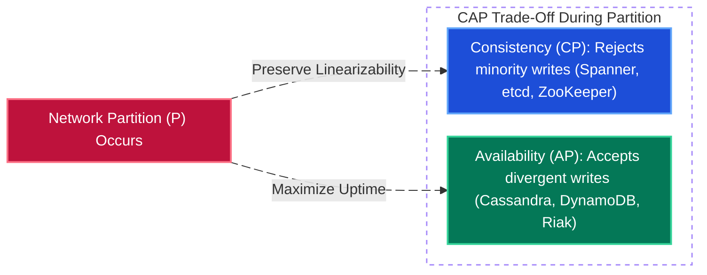
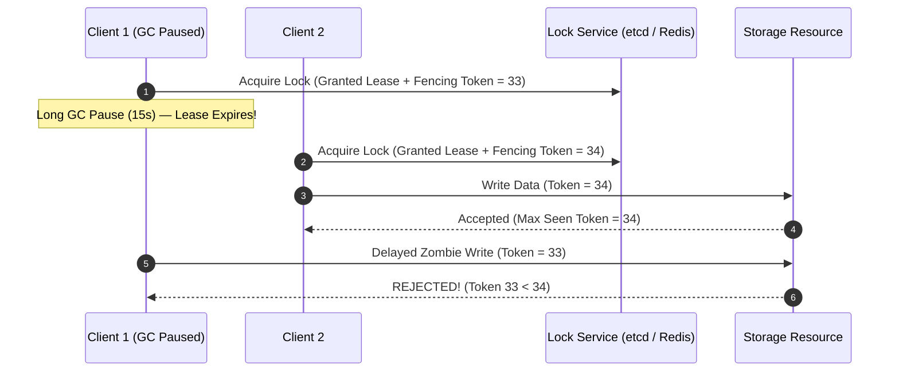

# Chapter 5: Distributed Systems — CAP/PACELC, Consensus, Locks, Transactions & Messaging

[← Back to System Design Hub](../system-design.md) | [← Previous: Chapter 4 — Databases: SQL vs. NoSQL, Storage Internals & Sharding](04-databases-sql-vs-nosql.md) | [Next: Chapter 6 — Performance Metrics, Resiliency & Observability →](06-resiliency-observability-and-metrics.md)

---

## Table of Contents

- [1. CAP Theorem & PACELC Theorem](#1-cap-theorem--pacelc-theorem)
  - [CAP Theorem Overview](#cap-theorem-overview)
  - [CP vs. AP Systems Comparison](#cp-vs-ap-systems-comparison)
  - [The PACELC Theorem (Modern Extension)](#the-pacelc-theorem-modern-extension)
  - [Interview Cheatsheet: Making the Right Trade-Off](#interview-cheatsheet-making-the-right-trade-off)
- [2. Consensus & Leader Election (Raft, Paxos, etcd, ZooKeeper)](#2-consensus--leader-election-raft-paxos-etcd-zookeeper)
- [3. Distributed Locks & Fencing Tokens](#3-distributed-locks--fencing-tokens)
- [4. Distributed Transactions: 2PC vs. Saga vs. Transactional Outbox](#4-distributed-transactions-2pc-vs-saga-vs-transactional-outbox)
- [5. Idempotency Keys (Safe Retries Over Unreliable Networks)](#5-idempotency-keys-safe-retries-over-unreliable-networks)
- [6. Asynchronous Messaging: Message Queues vs. Pub/Sub Event Streams](#6-asynchronous-messaging-message-queues-vs-pubsub-event-streams)

---

## 1. CAP Theorem & PACELC Theorem

In distributed systems, trade-offs between consistency, availability, and latency are inevitable. Understanding these models is essential during system design interviews when choosing databases, replication strategies, and caching layers.

### CAP Theorem Overview

Formulated by Eric Brewer and proved by Gilbert & Lynch, the CAP theorem states that a distributed data store can guarantee at most **two out of three** properties:

| Property | Definition | Interview Reality |
| :--- | :--- | :--- |
| **Consistency (C)** | **Linearizability / Single-Copy Consistency**: Every read receives the most recent write or an error. All nodes see identical data simultaneously. | Note: This refers to *linearizability* in distributed systems, not ACID's "C" (database schema invariants/integrity). |
| **Availability (A)** | Every non-failing node returns a non-error response for every received request (without guaranteeing it contains the most recent write). | Does not mean high uptime percentage (e.g., 99.99%); it means non-blocking responses without explicit error. |
| **Partition Tolerance (P)** | The system continues to operate despite arbitrary dropped, delayed, or duplicated messages across network partitions. | **Non-negotiable** in distributed systems; networks will experience partitions, packet drops, or hardware links going down. |

> [!IMPORTANT]
> **Why "CA" is not a valid choice in distributed systems:**
> Network partitions ($P$) cannot be avoided across distributed networks. Therefore, when a network partition occurs, a system must choose between:
>
> 1. **Cancel the operation / return an error** to preserve consistency $\rightarrow$ **CP**
> 2. **Proceed with the operation** accepting stale or divergent reads/writes $\rightarrow$ **AP**
>
> "CA" only exists in single-node systems (e.g., traditional single-instance RDBMS) where network partitions between data replicas cannot happen.

---

### CP vs. AP Systems Comparison

| Dimension | CP (Consistency + Partition Tolerance) | AP (Availability + Partition Tolerance) |
| :--- | :--- | :--- |
| **Primary Goal** | Data correctness and linearizability. | Maximum availability and minimal downtime. |
| **Partition Behavior** | Nodes on minority partitions refuse writes/reads to prevent stale/split-brain states. | All partitions accept reads/writes; data diverges and syncs later. |
| **Consistency Model** | Strong Consistency (Sequential / Linearizable). | Eventual Consistency / Causal Consistency / Read-Your-Writes. |
| **Conflict Handling** | Prevented up-front using distributed consensus (Raft, Paxos, 2PC). | Resolved asynchronously (CRDTs, Last-Write-Wins, Vector Clocks). |
| **Typical Use Cases** | Banking, payment gateways, ledger balances, distributed locks, inventory reservation. | Social feeds, comments/likes, product catalogs, shopping carts, metrics collection. |

---

### The PACELC Theorem (Modern Extension)

The CAP theorem only describes behavior **during network partitions** ($P$). However, distributed systems run under normal operating conditions most of the time. Daniel Abadi created **PACELC** to describe trade-offs under both states:

$$\text{If } \mathbf{P} \text{ (Partition) } \rightarrow \text{choose between } \mathbf{A} \text{ and } \mathbf{C}; \quad \mathbf{E} \text{lse (Normal Operation) } \rightarrow \text{choose between } \mathbf{L} \text{ (Latency) and } \mathbf{C} \text{ (Consistency)}$$

| Classification | Meaning | Database Examples |
| :--- | :--- | :--- |
| **PA / EL** | During partition: choose **Availability**; Else (normal): choose **Latency** (async replication). | Cassandra, DynamoDB, CouchDB |
| **PC / EC** | During partition: choose **Consistency**; Else (normal): choose **Consistency** (sync replication / consensus). | Google Spanner, Bigtable, HBase, etcd |
| **PA / EC** | During partition: choose **Availability**; Else (normal): choose **Consistency**. | MongoDB (configured with primary writes and replica sync) |
| **PC / EL** | During partition: choose **Consistency**; Else (normal): choose **Latency**. | Megastore, VoltDB / H-Store |

---

### Interview Cheatsheet: Making the Right Trade-Off

When designing a system in an interview:

1. **Clarify Business Requirements First**:
   - *"Does a user need to see their own updates immediately?"* $\rightarrow$ Read-Your-Writes consistency.
   - *"Is double-spending or overselling acceptable?"* $\rightarrow$ Strong Consistency (CP).
   - *"Can users tolerate seeing 10-second-old comments or views?"* $\rightarrow$ Eventual Consistency (AP).
2. **Hybrid Architectural Patterns**:
   - **Dual-path architecture**: Use CP datastores for transactions/checkout/orders and AP datastores for product search, recommendations, and analytics.
   - **Tunable consistency**: Many modern distributed databases (e.g., Cassandra, DynamoDB) allow tuning consistency per operation using quorum read/write levels:
     $$R + W > N$$
     *(Where $N$ = replication factor, $W$ = write ack count, $R$ = read replica count. If $R + W > N$, you guarantee strong consistency; otherwise eventual consistency).*

---

## 2. Consensus & Leader Election (Raft, Paxos, etcd, ZooKeeper)

In a distributed cluster, nodes must agree on a single source of truth (e.g., *"Which node is the current Primary for Shard 4?"* or *"Which configuration version is active?"*) even if nodes crash or network packets are delayed:

- **Quorum Consensus (`Raft` / `Paxos`)**: Requires a strict majority of nodes ($\lfloor \frac{N}{2} \rfloor + 1$, e.g., 3 out of 5 nodes) to acknowledge every state transition. If a network partition splits a 5-node cluster into 3 nodes and 2 nodes, only the 3-node majority partition can elect a leader and commit writes — preventing **Split-Brain**.
- **Coordination Services (`etcd`, `Apache ZooKeeper`, `Consul`)**: Strongly consistent (`CP`) key-value stores built on Raft/ZAB used for **Leader Election**, **Service Discovery**, **Distributed Configuration**, and **Ephemeral Leases / Heartbeats** (not for storing high-volume application data).

---

## 3. Distributed Locks & Fencing Tokens

When two processes try to modify a shared resource (e.g., booking the same concert seat in [TicketMaster](../ticketmaster.md) or executing a scheduled cron job once), a **Distributed Lock** (via Redis or etcd) ensures mutual exclusion:

> [!WARNING]
> **Why TTL Locks Alone Are Unsafe Without Fencing Tokens:**
> If Client 1 acquires a Redis lock with a 10-second TTL, then experiences a 15-second JVM Garbage Collection pause, its lock expires. Client 2 acquires the lock and writes to the storage system. When Client 1 wakes up from GC, it doesn't know its lock expired and overwrites Client 2's data!
>
> **Solution**: The Lock Service returns a monotonically increasing **Fencing Token** (`33`, then `34`) with every lock grant. The downstream database/storage rejects any write carrying a token smaller than the highest token it has already processed (`WHERE fencing_token >= current_token`).

---

## 4. Distributed Transactions: 2PC vs. Saga vs. Transactional Outbox

When a business workflow spans multiple microservices or database shards (e.g., *Create Order $\rightarrow$ Charge Credit Card $\rightarrow$ Reserve Inventory*), single-node SQL `BEGIN / COMMIT` cannot span network boundaries:

| Pattern | Mechanism | Pros | Cons | Best Interview Use Case |
| :--- | :--- | :--- | :--- | :--- |
| **Two-Phase Commit (2PC)** | A central Coordinator asks all participants to **Phase 1: Prepare** (lock rows & vote Yes/No), then **Phase 2: Commit or Abort** globally. | Strong atomic all-or-nothing semantics across heterogeneous nodes. | **Blocking protocol & SPOF**: holds database row locks across network RTTs; if the Coordinator crashes mid-commit, participants remain blocked holding locks. Poor throughput. | Internal cross-shard commits inside distributed SQL engines (Spanner) or low-QPS legacy banking transfers. |
| **Saga Pattern (Orchestration or Choreography)** | Breaks a distributed transaction into a sequence of **local ACID transactions** ($T_1 \rightarrow T_2 \rightarrow T_3$). If $T_3$ fails, executes backward **Compensating Transactions** ($C_2 \rightarrow C_1$, e.g., *Refund Payment*) to undo prior steps. | Non-blocking (no cross-service locks held), high throughput, works across independent microservices and third-party APIs. | **Eventual Consistency** (no isolation between steps — users may briefly see a "Pending" state); every step and compensating action must be **idempotent**. | E-commerce checkout ([Amazon](../amazon.md)), ride payment & payout workflows ([Payment System](../payment-system.md), [Uber](../uber.md)), travel booking. |
| **Transactional Outbox + CDC** | Service writes the business entity **and** an outgoing event row into an `outbox_events` table within the **same local SQL transaction**. A background **Change Data Capture (CDC)** process (Debezium) tails the DB WAL and publishes the event to Kafka. | Completely eliminates the **Dual-Write Bug** (where the DB commit succeeds but publishing to Kafka fails due to a crash/network blip). | At-least-once delivery means downstream Kafka consumers must deduplicate events by `event_id`. | Reliable event publishing across all event-driven microservices ([DocuSign Retrospective](../project-retrospective.md)). |

---

## 5. Idempotency Keys (Safe Retries Over Unreliable Networks)

An operation is **idempotent** if performing it multiple times produces the exact same side effect as performing it once ($f(f(x)) = f(x)$):

- `GET`, `PUT`, and `DELETE` are naturally idempotent; `POST` (e.g., `POST /v1/payments/charge`) is **not**.
- If a client calls `POST /v1/payments/charge` and the network connection drops *after* the server charges the card but *before* the client receives the `200 OK` response, the client will retry.
- **How to Prevent Double Charging**:
  1. Client generates a unique `Idempotency-Key: <UUIDv4>` header per logical user action (e.g., clicking "Pay Now") and reuses that exact UUID on all retries.
  2. Server checks an `idempotency_keys` table (with a unique constraint in DB/Redis):
     - If **not found**: inserts key with status `IN_PROGRESS`, executes the charge, and atomically saves the final HTTP response payload (`COMPLETED`) alongside the key.
     - If **already `COMPLETED`**: returns the cached HTTP response immediately without executing the charge again.
     - If **currently `IN_PROGRESS`** (concurrent retry in flight): returns `409 Conflict` / `429 Retry-After`.

---

## 6. Asynchronous Messaging: Message Queues vs. Pub/Sub Event Streams

Decoupling synchronous producers from consumers smooths out traffic spikes (load leveling), enables independent failure isolation, and supports event-driven architectures.

| Dimension | Traditional Message Queue (Point-to-Point) | Distributed Append-Only Event Log (Pub/Sub Stream) |
| :--- | :--- | :--- |
| **Representative Tech** | **RabbitMQ, AWS SQS, ActiveMQ** | **Apache Kafka, AWS Kinesis, Apache Pulsar** |
| **Storage & Retention** | Messages are deleted from the queue as soon as a consumer acknowledges (`ACK`) processing. | Immutable append-only disk log; events are retained for a configured window (e.g., 7–30 days or forever) regardless of consumption. |
| **Consumption Model** | **Push or Pull Competing Consumers**: Broker tracks per-message ACK state and routes each task to one available worker. | **Pull with Consumer Offsets**: Consumers track their own offset pointer inside a **Consumer Group**; multiple independent Consumer Groups can read the exact same stream simultaneously. |
| **Message Replayability** | **No** — once acknowledged, the message is gone. | **Yes** — consumers can rewind their offset to reprocess historical events (e.g., backfilling a new ML model or fixing a bug). |
| **Ordering Guarantee** | Best-effort or strict FIFO only at low throughput (SQS FIFO). | **Strict ordering guaranteed within a Partition** (keyed by `partition_key`, e.g., `user_id` or `order_id`). |
| **Routing & Dead-Letter Queues** | Rich exchange routing (topic, fanout, header routing) and native per-message retry + **Dead-Letter Queue (DLQ)** support. | Partition-based routing; requires explicit retry topics / DLQ topics managed by the consumer application. |
| **When to Choose** | Task queues, background job execution (sending emails/SMS, image resizing, PDF generation), complex per-message retry workflows. | High-throughput event streaming (millions of events/sec), CDC pipelines, real-time analytics/Flink, event sourcing, multi-consumer fanout ([Fraud Detection](../fraud-detection.md), [Metrics Monitoring](../metrics-monitoring.md)). |

---

[← Back to System Design Hub](../system-design.md) | [← Previous: Chapter 4 — Databases: SQL vs. NoSQL, Storage Internals & Sharding](04-databases-sql-vs-nosql.md) | [Next: Chapter 6 — Performance Metrics, Resiliency & Observability →](06-resiliency-observability-and-metrics.md)

