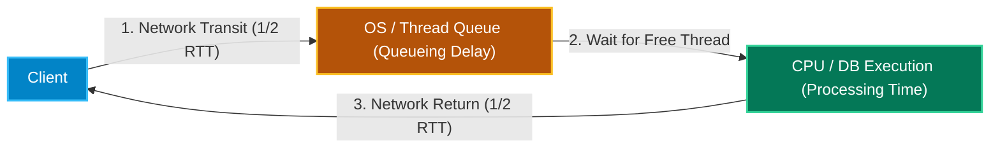
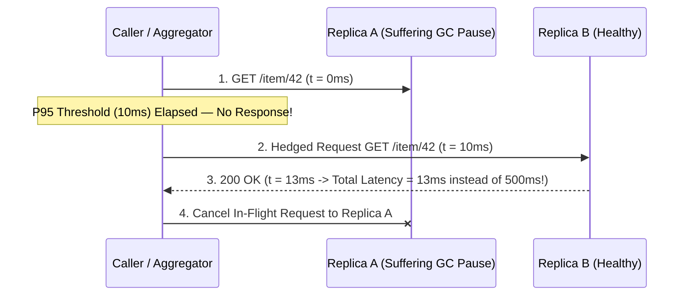
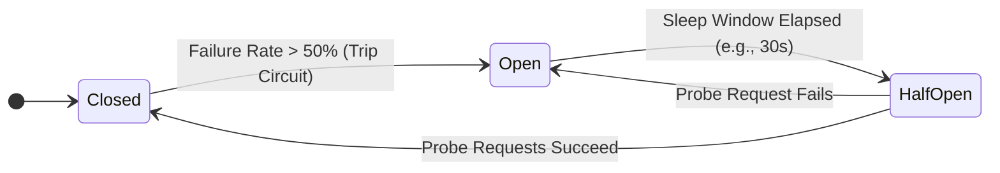
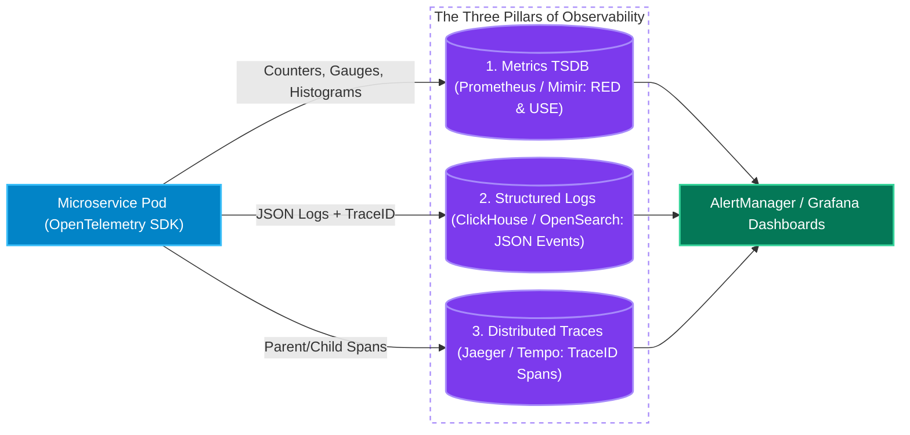

# Chapter 6: Performance Metrics (Latency, Throughput, P95/P99, Timeouts), Resiliency & Observability

[← Back to System Design Hub](../system-design.md) | [← Previous: Chapter 5 — Distributed Systems, Consensus, Transactions & Messaging](05-distributed-systems-and-messaging.md) | [Next: Chapter 7 — Probabilistic Data Structures & Stream Processing →](07-probabilistic-structures-and-stream-processing.md)

---

## Table of Contents

- [1. Performance Metrics: Latency, Response Time, Throughput, P95/P99 & Timeouts](#1-performance-metrics-latency-response-time-throughput-p95p99--timeouts)
  - [Latency vs. Response Time vs. Service (Processing) Time](#latency-vs-response-time-vs-service-processing-time)
  - [Throughput vs. Bandwidth vs. Concurrency (Little's Law)](#throughput-vs-bandwidth-vs-concurrency-littles-law)
  - [Latency Percentiles: P50, P90, P95, P99 & P99.9 (Tail Latency)](#latency-percentiles-p50-p90-p95-p99--p999-tail-latency)
  - [Timeouts, Deadlines & Backpressure](#timeouts-deadlines--backpressure)
- [2. Resiliency, Fault Tolerance & Reliability Patterns](#2-resiliency-fault-tolerance--reliability-patterns)
  - [Availability Tiers ("The Nines") & SLA / SLO / SLI](#availability-tiers-the-nines--sla--slo--sli)
  - [Rate Limiting Algorithms Comparison](#rate-limiting-algorithms-comparison)
  - [Fault Isolation & Cascading Failure Prevention](#fault-isolation--cascading-failure-prevention)
- [3. Observability: Metrics, Logs & Distributed Tracing](#3-observability-metrics-logs--distributed-tracing)

---

## 1. Performance Metrics: Latency, Response Time, Throughput, P95/P99 & Timeouts

Candidates often use *latency*, *response time*, *throughput*, and *bandwidth* interchangeably. Distinguishing them accurately — and knowing how percentiles and timeouts interact — is a strong senior signal in interviews.

### Latency vs. Response Time vs. Service (Processing) Time

$$\text{Response Time} = \text{Network Latency (RTT)} + \text{Queueing Delay} + \text{Service (Processing) Time}$$

| Term | Exact Definition | Example |
| :--- | :--- | :--- |
| **Network Latency** | The time a packet spends traveling across the wire between client and server (measured as one-way transit or **Round-Trip Time / RTT**), excluding server processing. | `25 ms` RTT from Seattle to Virginia over fiber. |
| **Queueing Delay** | The time a request sits waiting in an OS socket buffer, load balancer queue, or thread pool queue before a worker thread even starts executing it. | `80 ms` waiting because all 64 worker threads are busy. |
| **Service (Processing) Time** | The time the server actively spends executing business logic, querying caches/DBs, and serializing the response. | `15 ms` of CPU + Redis/DB execution. |
| **Response Time** | The **total end-to-end wall-clock time** perceived by the client from sending the first byte of the request to receiving the last byte of the response. | `25 ms + 80 ms + 15 ms = 120 ms` total response time. |

---

### Throughput vs. Bandwidth vs. Concurrency (Little's Law)

| Metric | Definition | Units | Highway Analogy |
| :--- | :--- | :--- | :--- |
| **Bandwidth** | Maximum theoretical capacity of a communication link. | `Gbps`, `MB/sec` | Number of lanes on the highway. |
| **Throughput** | Actual volume of requests or data successfully processed per unit of time. | `QPS` (Queries/sec), `RPS` (Requests/sec), `TPS` (Transactions/sec) | Number of cars actually passing a toll booth per minute. |
| **Concurrency ($L$)** | Number of requests simultaneously in-flight inside the system at a given instant. | Active connections / threads | Number of cars currently on a 1-mile stretch of highway. |

- **Little's Law (Sizing Thread Pools & Connection Pools)**:
  $$L = \lambda \times W$$
  *(Where $L$ = average concurrent in-flight requests, $\lambda$ = throughput in requests/sec, and $W$ = average response time in seconds).*
  - *Interview Calculation Example*: If a Payment Service must handle $\lambda = 2,000\text{ RPS}$ and each call to Stripe takes $W = 0.25\text{ seconds}$ (`250 ms`), the system will have $L = 2,000 \times 0.25 = \mathbf{500}\text{ concurrent requests}$ in flight at all times. If your thread pool or DB connection pool is capped at `100`, requests will immediately queue up and time out!
- **The Queueing Delay "Hockey-Stick" Curve**:
  From queueing theory ($M/M/1$), average queue wait time is proportional to $\frac{\rho}{1 - \rho}$, where $\rho$ is server utilization ($0 \le \rho < 1$).
  - At $\rho = 50\%$ CPU utilization, queueing delay is $1\times$ service time.
  - At $\rho = 80\%$ CPU utilization, queueing delay jumps to $4\times$ service time.
  - At $\rho = 95\%$ CPU utilization, queueing delay explodes to **$19\times$ service time**!
  - *Rule of Thumb*: Always auto-scale compute pools at **`60%–70%` utilization** to leave headroom for micro-bursts and keep queueing delay near zero.

---

### Latency Percentiles: P50, P90, P95, P99 & P99.9 (Tail Latency)

> [!WARNING]
> **Why "Average Latency" Is a Trap in Interviews:**
> Suppose 99 requests complete in `1 ms` (Cache Hit) and 1 request takes `2,000 ms` (DB lock contention). The **average** latency is `21 ms` — which looks completely healthy on a dashboard while 1 in 100 requests is taking 2 full seconds! Always specify **percentiles** (`P50`, `P95`, `P99`) when defining non-functional requirements.

| Percentile | Meaning | What It Represents & Why It Matters |
| :--- | :--- | :--- |
| **P50 (Median)** | `50%` of requests are faster than this value; `50%` are slower. | Typical "happy-path" user experience (usually a warm L1/Redis cache hit). |
| **P90 / P95** | `90%` / `95%` of requests are faster; `10%` / `5%` are slower. | Captures cache misses hitting the primary database. Standard target for general web page loads (`P95 < 200 ms`). |
| **P99 (Tail Latency)** | `99%` of requests are faster; the slowest **`1%`** exceed this threshold. | **The gold standard for microservice SLOs**. The slowest 1% of requests often belong to your **most valuable users** (customers with the largest shopping carts, most followers, or deepest order histories). |
| **P99.9 ("Three Nines Tail")** | Only 1 in 1,000 requests is slower. | Critical for high-frequency internal infrastructure (Redis, auth, feature stores, fraud scoring) caused by JVM/Go GC pauses, LSM compaction, or noisy-neighbor CPU throttling. |

#### Tail Latency Amplification (The Microservice Fan-Out Penalty)

When an API Gateway or aggregator fans out a single user request to **$k$ backend services in parallel**, the overall response time is dictated by the **slowest** of the $k$ calls ($\max(T_1, T_2, \dots, T_k)$):

$$P(\text{at least one call exceeds P99}) = 1 - (0.99)^k$$

- If $k = 1$ service: **`1%`** chance the user experiences `> P99` latency.
- If $k = 10$ parallel services: $1 - (0.99)^{10} \approx \mathbf{9.6\%}$ of user requests suffer `> P99` latency!
- If $k = 50$ parallel services: $1 - (0.99)^{50} \approx \mathbf{39.5\%}$ of user requests suffer `> P99` latency!
- **Mitigation — Hedged Requests (Tail-At-Scale)**: If a read request to Replica A hasn't responded by the `P95` duration (e.g., `10 ms`), immediately send a duplicate **hedged request** to Replica B and take whichever response arrives first, cancelling the other.

---

### Timeouts, Deadlines & Backpressure

Every network call over TCP/HTTP can hang indefinitely due to dropped packets, half-open sockets, or a deadlocked downstream server. **Never make a network call without an explicit timeout.**

| Timeout Type | What It Bounds | Typical Value | What Happens If Omitted |
| :--- | :--- | :--- | :--- |
| **Connection Timeout** | Max time allowed to complete the TCP 3-way handshake (`SYN` $\rightarrow$ `SYN-ACK`). | `100 ms – 1,000 ms` | Caller hangs for OS default (`60–120 seconds`) when trying to connect to a dead/blackholed IP. |
| **Read / Socket Timeout** | Max time to wait for data packets after the TCP connection is established. | Slightly above downstream `P99.9` (e.g., `200 ms – 2,000 ms`) | Worker threads hang forever if the downstream server accepts the socket but freezes mid-query. |
| **End-to-End Deadline (Budget)** | Absolute wall-clock timestamp by which the entire multi-hop request must finish. | User-facing SLA ceiling (e.g., `1,500 ms` total) | Downstream Services C and D waste CPU executing queries for a request that the API Gateway already timed out and aborted 2 seconds ago! |

1. **Deadline Propagation (Context Budget)**:
   - Propagate the remaining time budget across every RPC hop (e.g., gRPC `grpc-timeout` header or OpenTelemetry context).
   - If the API Gateway starts with a `1,000 ms` budget and Service A spends `400 ms`, Service A passes a `600 ms` deadline to Service B. If the budget hits `0 ms`, downstream nodes immediately abort (`HTTP 499 Client Closed Request` / `DEADLINE_EXCEEDED`) before touching the database.
2. **How to Set the Right Timeout**:
   - Measure the dependency's **`P99.9` latency** under normal peak load and add a safety margin (e.g., if `P99.9 = 80 ms`, set timeout to `150–200 ms`).
   - *Too tight* (`< P99`): Causes false-positive timeouts and triggers retry storms during minor traffic bumps.
   - *Too loose* (`30+ seconds`): Exhausts caller thread pools within seconds when the dependency degrades.
3. **Backpressure**:
   - When a producer sends requests faster than a consumer can process them, unbounded in-memory queues will grow until the server crashes with an `OutOfMemoryError (OOM)`.
   - Enforce **bounded queues**: when the queue is full, immediately exert **backpressure** by blocking the producer, dropping low-priority items, or returning `429 Too Many Requests` / `503 Service Unavailable` with a `Retry-After` header.

---

## 2. Resiliency, Fault Tolerance & Reliability Patterns

### Availability Tiers ("The Nines") & SLA / SLO / SLI

- **SLI (Service Level Indicator)**: The quantitative metric being measured (e.g., *P99 latency = 42ms*, *HTTP 5xx error rate = 0.01%*).
- **SLO (Service Level Objective)**: The internal engineering target for an SLI (e.g., *99.95% of requests succeed in < 100ms over a rolling 30-day window*).
- **SLA (Service Level Agreement)**: The external legal/financial contract with customers (usually slightly looser than the internal SLO, e.g., *99.9% uptime*, with financial credits if breached).

| Availability Tier | Allowed Downtime / Year | Allowed Downtime / Month | Allowed Downtime / Day | Typical System Classification |
| :--- | :--- | :--- | :--- | :--- |
| **99% ("Two Nines")** | `3.65 days` | `7.31 hours` | `14.40 mins` | Internal batch tools, non-critical back-office portals. |
| **99.9% ("Three Nines")** | `8.77 hours` | `43.83 mins` | `1.44 mins` | Standard commercial SaaS APIs, internal microservices. |
| **99.95% ("Three and a Half Nines")** | `4.38 hours` | `21.92 mins` | `43.20 secs` | High-priority customer-facing e-commerce & media services. |
| **99.99% ("Four Nines")** | `52.60 mins` | `4.38 mins` | `8.64 secs` | Tier-1 cloud infrastructure, ride-dispatch, social feeds, enterprise e-signature ([DocuSign](../docusign.md)). |
| **99.999% ("Five Nines")** | `5.26 mins` | `26.30 secs` | `0.86 secs` | Core payment rails ([Payment System](../payment-system.md)), ATM switches ([ATM](../atm.md)), global DNS/edge routing. |

---

### Rate Limiting Algorithms Comparison

See the full [Rate Limiter Design](../rate-limiter.md) case study for implementation details.

| Algorithm | How It Works | Pros | Cons |
| :--- | :--- | :--- | :--- |
| **Token Bucket** | Bucket holds up to $B$ tokens and refills at rate $R$ tokens/sec. Each request consumes 1 token; rejected (`429 Too Many Requests`) if empty. | Memory efficient (2 numbers per key); naturally allows controlled **short traffic bursts** up to bucket capacity $B$. | Requires atomic read-modify-write (Redis Lua script) in distributed environments. |
| **Leaky Bucket** | Requests enter a bounded FIFO queue and are processed at a strictly constant outflow rate. | Smooths out bursty traffic into a predictable steady stream for fragile downstream systems. | Bursts sit waiting in the queue (increasing latency) rather than being served immediately when capacity exists. |
| **Fixed Window Counter** | Increments an integer counter for the current time bucket (e.g., `user_123:12:01`). | Simplest to implement (`INCR` + `EXPIRE`). | **Boundary Burst Bug**: A user can send $N$ requests at `12:00:59` and another $N$ requests at `12:01:01` ($2\times$ the limit in 2 seconds). |
| **Sliding Window Log** | Stores the exact timestamp of every request in a Redis Sorted Set (`ZSET`), removing timestamps older than $T - \text{window}$. | **100% accurate** rolling window enforcement; zero boundary burst issue. | **High memory footprint** — storing millions of timestamps for high-limit users is expensive. |
| **Sliding Window Counter** | Approximates the rolling count using a weighted average of the previous fixed window and the current fixed window. | $O(1)$ memory footprint (only 2 counters) while solving 99%+ of the fixed-window boundary burst bug. | Slight mathematical approximation assuming uniform distribution within the previous window. |

---

### Fault Isolation & Cascading Failure Prevention

When one downstream service becomes slow, calling services can exhaust all their threads waiting for timeouts, triggering a **Cascading Failure** across the entire company. Prevent this with four defensive patterns:

1. **Circuit Breaker (`Closed` $\rightarrow$ `Open` $\rightarrow$ `Half-Open`)**:
   - **Closed (Normal)**: Requests pass through to the downstream service; failure rate is tracked over a rolling window.
   - **Open (Tripped)**: If the failure/timeout rate exceeds a threshold (e.g., `50%` failures over 10 seconds), the circuit trips **Open** and fails fast locally (or returns a cached fallback) for a sleep window (e.g., 30s) without making any network calls to the struggling service.
   - **Half-Open (Recovery Probe)**: After the sleep window, allows a small number of probe requests through. If they succeed, transitions back to **Closed**; if they fail, trips back to **Open**.
2. **Retries with Exponential Backoff & Full Jitter**:
   - Never retry failed requests immediately in a tight loop — when a service recovers from a brief blip, simultaneous retries from 100,000 clients create a **Retry Storm** that knocks it right back down.
   - Wait exponentially longer between retries with random jitter:
     $$\text{sleep} = \text{random}\left(0, \min\left(\text{cap}, \text{base} \times 2^{\text{attempt}}\right)\right)$$
3. **Bulkhead Pattern**:
   - Partition thread pools or connection pools per downstream dependency (just like watertight compartments in a ship's hull). If the *Recommendation Service* hangs, it can only exhaust its dedicated 10-thread pool, leaving the *Checkout Service* thread pool untouched.
4. **Load Shedding & Graceful Degradation**:
   - When a server's CPU or queue latency approaches saturation, proactively drop low-priority requests (e.g., analytics pings, unauthenticated crawlers) at the perimeter so high-priority requests (checkout, payments) continue to meet their P99 latency SLO.
   - Degrade non-essential UI features gracefully (e.g., serve a static popular-items list if the personalized ML recommendation engine times out).

---

## 3. Observability: Metrics, Logs & Distributed Tracing

You cannot operate or debug a distributed system at scale without the **Three Pillars of Observability** (see [Metrics Monitoring Design](../metrics-monitoring.md) for a deep dive):

| Pillar | What It Answers | Storage & Query Characteristics | Standard Tooling |
| :--- | :--- | :--- | :--- |
| **1. Metrics** | *"Is there a problem right now, and what is the trend?"* (Aggregated numerical time-series: QPS, P99 latency, CPU %, error rate). | Ultra-compact Gorilla XOR/delta-of-delta compression; constant memory/disk cost regardless of traffic volume (unless label **high cardinality** explodes). | Prometheus, Cortex/Mimir, VictoriaMetrics, Datadog, Grafana. |
| **2. Structured Logs** | *"What exact error message and payload occurred on this node?"* (Discrete immutable JSON event records). | High ingestion volume (TB/day); indexed via inverted index or columnar stores with tiered hot-to-cold S3 retention. | OpenSearch / ELK, ClickHouse, Grafana Loki, FluentBit / Vector. |
| **3. Distributed Tracing** | *"Where did this specific slow request spend its 800ms across 12 microservices?"* (DAG of parent/child **Spans** sharing a `TraceID`). | Propagates `traceparent` headers across HTTP/gRPC/Kafka hops; uses **Head-Based Sampling** (e.g., 1% of all requests) + **Tail-Based Sampling** (keep 100% of traces that resulted in an error or P99 slowness). | OpenTelemetry, Jaeger, Grafana Tempo, AWS X-Ray. |

- **RED Method (For Request-Driven Microservices)**: Monitor **R**ate (requests/sec), **E**rrors (failed requests/sec), and **D**uration (P50 / P95 / P99 latency histogram) on every service endpoint.
- **USE Method (For Hardware & Infrastructure Resources)**: Monitor **U**tilization (% time busy), **S**aturation (queue length / wait time), and **E**rrors (hardware/network drops) for every CPU, disk, memory, and network interface.

---

[← Back to System Design Hub](../system-design.md) | [← Previous: Chapter 5 — Distributed Systems, Consensus, Transactions & Messaging](05-distributed-systems-and-messaging.md) | [Next: Chapter 7 — Probabilistic Data Structures & Stream Processing →](07-probabilistic-structures-and-stream-processing.md)
