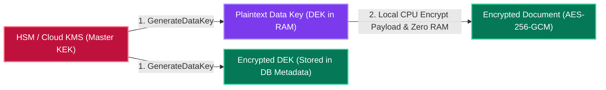

# Chapter 8: Security, Multi-Region DR & Zero-Downtime Deployment Patterns

[← Back to System Design Hub](../system-design.md) | [← Previous: Chapter 7 — Probabilistic Data Structures & Stream Processing](07-probabilistic-structures-and-stream-processing.md) | [Next: Chapter 9 — GenAI, LLM & ML System Design Building Blocks →](09-genai-llm-and-ml-system-design.md)

---

## Table of Contents

- [1. Authentication, Authorization & Identity Architecture](#1-authentication-authorization--identity-architecture)
  - [Session Cookies vs. Stateless JWTs (& Solving JWT Revocation)](#session-cookies-vs-stateless-jwts--solving-jwt-revocation)
  - [OAuth 2.0 & OpenID Connect (OIDC)](#oauth-20--openid-connect-oidc)
  - [Zero-Trust Internal Security: mTLS & SPIFFE](#zero-trust-internal-security-mtls--spiffe)
  - [Authorization Models: RBAC vs. ABAC vs. ReBAC (Google Zanzibar)](#authorization-models-rbac-vs-abac-vs-rebac-google-zanzibar)
- [2. Data Security, Encryption & Perimeter Defense](#2-data-security-encryption--perimeter-defense)
  - [Envelope Encryption (KMS Master Key + Data Encryption Keys)](#envelope-encryption-kms-master-key--data-encryption-keys)
  - [PII Tokenization & PCI-DSS Vaulting](#pii-tokenization--pci-dss-vaulting)
  - [Multi-Layer DDoS Mitigation (L3/L4 Anycast + L7 WAF)](#multi-layer-ddos-mitigation-l3l4-anycast--l7-waf)
- [3. Multi-Region High Availability, Disaster Recovery & Blast-Radius Isolation](#3-multi-region-high-availability-disaster-recovery--blast-radius-isolation)
  - [RPO (Recovery Point Objective) vs. RTO (Recovery Time Objective)](#rpo-recovery-point-objective-vs-rto-recovery-time-objective)
  - [Disaster Recovery Tiers Comparison](#disaster-recovery-tiers-comparison)
  - [Cell-Based Architecture & Shuffle Sharding (Blast-Radius Isolation)](#cell-based-architecture--shuffle-sharding-blast-radius-isolation)
- [4. Zero-Downtime Deployment & Database Migration Patterns](#4-zero-downtime-deployment--database-migration-patterns)
  - [Deployment Strategies: Rolling vs. Blue-Green vs. Canary vs. Shadow](#deployment-strategies-rolling-vs-blue-green-vs-canary-vs-shadow)
  - [Zero-Downtime Database Schema Migrations (Expand-and-Contract Pattern)](#zero-downtime-database-schema-migrations-expand-and-contract-pattern)

---

## 1. Authentication, Authorization & Identity Architecture

### Session Cookies vs. Stateless JWTs (& Solving JWT Revocation)

| Dimension | Stateful Session Token (Redis-Backed) | Stateless JWT (JSON Web Token — `Header.Payload.Signature`) |
| :--- | :--- | :--- |
| **Where State Lives** | Server stores `{session_id -> user_id, roles, expiry}` in a shared **Redis Cluster**; client holds an opaque `HttpOnly, Secure, SameSite` cookie. | Self-contained JSON claims (`sub`, `roles`, `exp`) cryptographically signed by the Auth Service's private key (`RS256` / `ES256`). |
| **Verification Cost** | Requires **1 Redis network hop** (`~0.5–1 ms`) at the API Gateway on every request. | **Zero network hops** — API Gateway or any microservice verifies the signature locally in CPU using the cached public key (`JWKS`). |
| **Instant Revocation** | **Trivial**: Delete `session_id` from Redis when a user logs out, changes their password, or gets banned. | **Hard**: Because JWTs are verified statelessly without calling a DB, a stolen or logged-out JWT remains valid until its `exp` timestamp! |

> [!IMPORTANT]
> **How Production Systems Solve the JWT Revocation Problem (Hybrid Pattern):**
>
> 1. **Short-Lived Access JWT (`5–15 minutes` TTL)** + **Long-Lived Opaque Refresh Token (`7–30 days` TTL)** stored in Redis/DB.
> 2. Normal API calls verify the short-lived Access JWT statelessly in CPU.
> 3. Every 10 minutes, the client silently exchanges its Refresh Token for a new Access JWT (**Refresh Token Rotation**). If a user is banned or logs out, the Refresh Token is deleted from Redis.
> 4. For immediate emergency revocation (e.g., compromised enterprise account), push just the revoked token ID (`jti`) with a 15-minute TTL to a tiny **Redis Revocation Blocklist** replicated to API Gateways.

---

### OAuth 2.0 & OpenID Connect (OIDC)

- **OAuth 2.0 is for Authorization (Delegated Access)**: Grants an application a scoped **Access Token** to act on a user's behalf (e.g., allowing a calendar app to read your Google Calendar without giving it your password).
- **OIDC (OpenID Connect) is for Authentication (Identity)**: A thin identity layer on top of OAuth 2.0 that issues an **`id_token` (JWT)** proving *who* the user is ("Sign in with Google / Okta / SAML").
- **Standard Flows**:
  - **Authorization Code Flow + PKCE**: Standard secure flow for web and mobile apps (user authenticates with Identity Provider $\rightarrow$ redirects back with one-time `code` $\rightarrow$ backend exchanges `code + code_verifier` for tokens).
  - **Client Credentials Flow**: Machine-to-machine (`M2M`) service authentication where no human user is involved.

---

### Zero-Trust Internal Security: mTLS & SPIFFE

Never assume traffic inside your internal VPC/Kubernetes network is safe ("perimeter-only security").

- **mTLS (Mutual TLS)**: In standard TLS, only the client verifies the server's certificate. In **mTLS**, *both* the calling microservice and the receiving microservice present X.509 cryptographic certificates (automatically rotated every 24 hours via a Service Mesh like Istio/Envoy and **SPIFFE/SPIRE** identities `spiffe://prod.cluster/ns/payments/sa/ledger-svc`), guaranteeing both encryption in transit and cryptographic service identity.

---

### Authorization Models: RBAC vs. ABAC vs. ReBAC (Google Zanzibar)

| Model | How Permissions Are Defined | Best Interview Use Case |
| :--- | :--- | :--- |
| **RBAC (Role-Based Access Control)** | Users are assigned coarse **Roles** (`Admin`, `Editor`, `BillingViewer`), and roles map to permissions. | Internal enterprise SaaS dashboards ([Shopify](../shopify.md) merchant staff roles, [Metrics Monitoring](../metrics-monitoring.md)). |
| **ABAC (Attribute-Based Access Control)** | Fine-grained boolean policies evaluated dynamically against user, resource, and environment attributes (e.g., via **Open Policy Agent / OPA**: *`allow if user.region == resource.region AND time < 17:00`*). | Cloud IAM (AWS IAM policies), compliance-restricted financial/healthcare systems. |
| **ReBAC (Relationship-Based Access Control / Google Zanzibar)** | Models permissions as a directed graph of **Relation Tuples** (`object#relation@user`, e.g., `folder:eng#member@group:backend` and `doc:spec#parent@folder:eng`). | Fine-grained document/resource sharing with nested folder inheritance across billions of files ([Google Drive](../google-drive.md), [Google Docs](../google-docs.md), [Dropbox](../dropbox.md)). |

---

## 2. Data Security, Encryption & Perimeter Defense

### Envelope Encryption (KMS Master Key + Data Encryption Keys)

When encrypting terabytes of documents ([DocuSign](../docusign.md)), files ([Dropbox](../dropbox.md)), or payment records ([Payment System](../payment-system.md)), you cannot send a 50 MB file over the network to AWS KMS (KMS has a strict `4 KB` payload limit!). Instead, use **Envelope Encryption**:



1. **Encryption Path**: The service asks Cloud KMS / Hardware Security Module (HSM) to generate a unique 256-bit **Data Encryption Key (DEK)**. KMS returns both the `Plaintext DEK` and the `Encrypted DEK` (encrypted under the KMS **Key Encryption Key / KEK**, which never leaves the HSM).
2. The application encrypts the document locally in CPU using `Plaintext DEK` (`AES-256-GCM`), immediately zeroes the `Plaintext DEK` from RAM, and stores the `Encrypted DEK` alongside the ciphertext in S3/DB.
3. **Decryption & Crypto-Shredding**: To read the file, the app sends the tiny `Encrypted DEK` to KMS to decrypt, then decrypts the payload in memory. If a tenant demands **GDPR Right-to-Erasure**, revoking/deleting their tenant KEK renders all their data and backups permanently undecipherable (**Crypto-Shredding**)!

---

### PII Tokenization & PCI-DSS Vaulting

- In financial systems ([Payment System](../payment-system.md), [ATM](../atm.md)), storing raw 16-digit Primary Account Numbers (PAN / Credit Card numbers) puts your entire microservice fleet into **PCI-DSS Scope**.
- **Solution (Tokenization Vault)**: At the edge ingestion point, an isolated PCI Vault replaces the raw card number with an irreversible random token (`tok_9f8a7b6c`) and stores the mapping in an HSM-encrypted database. All downstream Order, Billing, and Analytics microservices only ever see `tok_9f8a7b6c`.

---

### Multi-Layer DDoS Mitigation (L3/L4 Anycast + L7 WAF)

- **Layer 3 / Layer 4 Volumetric Attacks (UDP Floods, SYN Floods)**: Mitigated via **BGP Anycast Scrubbing Centers** (Cloudflare / AWS Shield Advanced) that absorb terabits/sec of traffic across hundreds of global PoPs, combined with **SYN Cookies** (stateless cryptographic sequence numbers that avoid allocating kernel TCP socket memory until the client completes the 3-way handshake).
- **Layer 7 Application Attacks (HTTP Floods, Credential Stuffing)**: Mitigated at the Edge Reverse Proxy / **WAF (Web Application Firewall)** using IP reputation lists, TLS JA3/JA4 client fingerprinting, JavaScript/Turnstile challenges, and per-user/IP **Token Bucket Rate Limiting**.

---

## 3. Multi-Region High Availability, Disaster Recovery & Blast-Radius Isolation

### RPO (Recovery Point Objective) vs. RTO (Recovery Time Objective)

```text
           ◄───────── RPO ─────────►│◄───────── RTO ─────────►
───────────●────────────────────────⚡────────────────────────●───────────► Time
     Last Replicated          Disaster Occurs           System Restored
      Backup / Write           (Region Down)             & Serving Users
     (Data Loss Window)                                (Downtime Window)
```

- **RPO (Recovery Point Objective — Data Loss Tolerance)**: *"How much committed data can the business afford to lose?"*
  - Controlled by your **replication/backup frequency** (`RPO = 0` requires synchronous cross-AZ/region quorum writes; `RPO < 5s` uses async WAL streaming).
- **RTO (Recovery Time Objective — Downtime Tolerance)**: *"How quickly must the system recover and serve traffic after an outage?"*
  - Controlled by your **failover automation and standby compute capacity** (`RTO ≈ 0` requires Active-Active multi-region routing).

---

### Disaster Recovery Tiers Comparison

| DR Strategy | RPO (Data Loss) | RTO (Recovery Time) | Infrastructure Cost | How It Works |
| :--- | :--- | :--- | :--- | :--- |
| **1. Backup & Restore** | `Hours` | `Hours to Days` | `$` (Lowest) | Periodic S3 snapshots; provision infrastructure from scratch via Terraform only after disaster strikes. |
| **2. Pilot Light** | `Seconds to Minutes` | `15 – 60 Minutes` | `$$` | Secondary region keeps **databases actively replicating** (`Read Replicas`), while compute/application servers are turned off (scaled to `0`) until needed. |
| **3. Warm Standby** | `Seconds` | `1 – 5 Minutes` | `$$$` | Secondary region runs a scaled-down but fully functional copy of both DBs and compute pods at all times; DNS flips and auto-scales up on failover. |
| **4. Multi-Region Active-Active** | **`~0 (ms)`** | **`~0 (Seconds)`** | `$$$$` (Highest) | Multiple regions serve live user traffic simultaneously via Geo-DNS/Anycast and Distributed SQL (Spanner/CockroachDB) or DynamoDB Global Tables. |

---

### Cell-Based Architecture & Shuffle Sharding (Blast-Radius Isolation)

Even in a horizontally scaled cluster, a single "poison pill" request, bad config push, or noisy-neighbor tenant can trigger a retry storm that takes down **100% of the cluster**.

- **Cell-Based Architecture**: Instead of one giant shared cluster serving 100 million users, partition the infrastructure into 20 completely independent, self-contained **Cells** (each with its own API Gateway, Microservices, Redis, and DB shard serving 5% of users). A catastrophic failure in Cell 4 impacts at most **5% of users**, never 100%.
- **Shuffle Sharding (AWS Route 53 /Lambda Pattern)**:
  - Suppose you have 8 worker nodes and assign each customer to a random pair of 2 nodes ($\binom{8}{2} = 28$ unique virtual shards).
  - If Customer A sends a poison-pill flood that crashes both of their assigned nodes (2 out of 8 nodes), any other customer has only a $\frac{1}{28} \approx \mathbf{3.5\%}$ chance of sharing *both* affected nodes — reducing the multi-tenant blast radius exponentially without paying for dedicated single-tenant hardware!

---

## 4. Zero-Downtime Deployment & Database Migration Patterns

### Deployment Strategies: Rolling vs. Blue-Green vs. Canary vs. Shadow

| Strategy | Mechanism | Rollback Speed | Best Used For |
| :--- | :--- | :--- | :--- |
| **Rolling Update** | Replaces old pods `v1` with new pods `v2` in batches (e.g., 20% at a time). | Moderate (requires re-rolling `v1` pods). | Standard day-to-day stateless microservice deployments. |
| **Blue-Green Deployment** | Provisions a full parallel `Green (v2)` environment alongside `Blue (v1)`. Once health checks pass, flips Load Balancer traffic `100%` from Blue to Green. | **Instant (< 1s)** — simply flip LB router back to Blue. | Major framework/runtime upgrades where instant atomic cutover and rollback are needed. |
| **Canary Release** | Routes `1%` of live traffic (or internal employees) to `v2`, automatically monitoring error rates & P99 latency before ramping `1% -> 10% -> 50% -> 100%`. | **Instant** — drop canary weight back to `0%`. | High-risk production releases; catches subtle bugs under real user load with minimal blast radius. |
| **Shadow / Dark Traffic Mirroring** | Load balancer asynchronously clones a copy of live production requests to `v2` in the background, comparing `v2` vs. `v1` responses while discarding `v2`'s output. | Zero user impact (`v2` never serves responses to users). | Re-architecting critical payment/billing engines ([DocuSign Project Retrospective](../project-retrospective.md)) or testing new ML/search ranking models. |

---

### Zero-Downtime Database Schema Migrations (Expand-and-Contract Pattern)

During a Rolling or Canary deployment, **`v1` pods and `v2` pods run simultaneously against the same database**. If `v2` runs `ALTER TABLE users RENAME COLUMN full_name TO first_name`, every running `v1` pod immediately crashes with `Column 'full_name' does not exist`!

Always use the **3-Phase Expand-and-Contract (Parallel Change) Pattern**:

1. **Phase 1 — Expand (Backwards-Compatible Schema Addition)**:
   - Add the new nullable column `first_name` alongside `full_name` (without dropping `full_name`).
   - Deploy code that **Dual-Writes** to both `full_name` and `first_name`, while still reading from `full_name`.
2. **Phase 2 — Migrate & Switch Reads**:
   - Run a throttled background batch job to backfill historical rows where `first_name IS NULL`.
   - Deploy code that **Reads from `first_name`** (while still dual-writing or once all `v1` pods are gone, writing only to `first_name`).
3. **Phase 3 — Contract (Cleanup)**:
   - Once 100% of running pods only reference `first_name`, safely drop the legacy `full_name` column (`ALTER TABLE users DROP COLUMN full_name`).

---

[← Back to System Design Hub](../system-design.md) | [← Previous: Chapter 7 — Probabilistic Data Structures & Stream Processing](07-probabilistic-structures-and-stream-processing.md) | [Next: Chapter 9 — GenAI, LLM & ML System Design Building Blocks →](09-genai-llm-and-ml-system-design.md)

