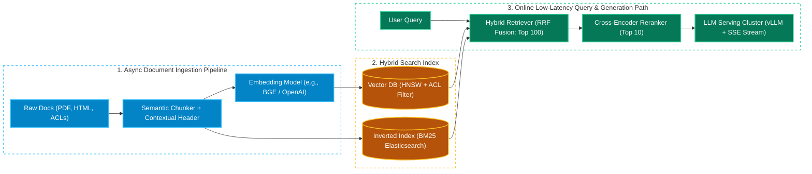
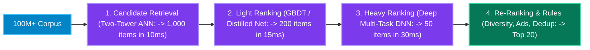

# Chapter 9: Modern GenAI, LLM & Real-Time ML System Design Building Blocks

[← Back to System Design Hub](../system-design.md) | [← Previous: Chapter 8 — Security, Multi-Region DR & Deployment Patterns](08-security-multi-region-and-deployments.md)

---

## Table of Contents

- [1. Production RAG (Retrieval-Augmented Generation) Architecture](#1-production-rag-retrieval-augmented-generation-architecture)
  - [End-to-End Ingestion & Query Pipeline](#end-to-end-ingestion--query-pipeline)
  - [Document Chunking Strategies](#document-chunking-strategies)
  - [Two-Stage Hybrid Search (BM25 + Vector ANN + Cross-Encoder Reranking)](#two-stage-hybrid-search-bm25--vector-ann--cross-encoder-reranking)
- [2. LLM Inference Serving & Performance Optimization](#2-llm-inference-serving--performance-optimization)
  - [Prefill vs. Decode Phases & Key LLM Latency Metrics](#prefill-vs-decode-phases--key-llm-latency-metrics)
  - [Core Inference Optimizations: KV-Cache, PagedAttention, Continuous Batching & Speculative Decoding](#core-inference-optimizations-kv-cache-pagedattention-continuous-batching--speculative-decoding)
- [3. AI Gateway: Semantic Caching, Token Rate Limiting & Guardrails](#3-ai-gateway-semantic-caching-token-rate-limiting--guardrails)
- [4. Classic Real-Time ML System Design Building Blocks](#4-classic-real-time-ml-system-design-building-blocks)
  - [Multi-Stage Recommendation & Ranking Funnel](#multi-stage-recommendation--ranking-funnel)
  - [Dual Feature Store Architecture (Online vs. Offline Feature Store)](#dual-feature-store-architecture-online-vs-offline-feature-store)

---

## 1. Production RAG (Retrieval-Augmented Generation) Architecture

Modern system design interviews frequently ask how to design enterprise AI assistants, semantic search engines ([Web Crawler](../webcrawler.md)), or customer support copilots grounded on private, rapidly changing data without hallucinating.

### End-to-End Ingestion & Query Pipeline

---

### Document Chunking Strategies

Splitting a 100-page PDF into chunks before generating vector embeddings directly determines retrieval accuracy:

| Strategy | How It Works | Pros & Cons |
| :--- | :--- | :--- |
| **Fixed-Token Chunking with Overlap** | Splits text every $N$ tokens (e.g., `512 tokens`) with a `10–20%` sliding overlap (`50–100 tokens`) so sentences cut at boundaries remain intact in adjacent chunks. | Simple and fast, but blind to document structure (can split tables or code blocks in half). |
| **Structure-Aware / Recursive Semantic Chunking** | Splits hierarchically by Markdown/HTML headers (`#`, `##`), paragraphs, and AST code blocks, keeping tables intact. | Preserves logical cohesion and section boundaries. |
| **Contextual Retrieval / Parent-Child Chunking** | Prepends document title and section breadcrumb (`[Doc: Q3 Report > Sec: Revenue]`) to every chunk before embedding; indexes small `256-token` child chunks for precise vector matching but retrieves the surrounding `1,024-token` parent window for the LLM prompt. | Prevents pronouns (*"It increased by 20%"*) from losing meaning when isolated from their parent heading. |

---

### Two-Stage Hybrid Search (BM25 + Vector ANN + Cross-Encoder Reranking)

Pure Vector Search struggles with exact product SKUs, error codes (`ERR_4092`), and proper nouns, while pure Keyword Search (`BM25`) misses synonyms (*"car"* vs. *"automobile"*). Production RAG always combines both:

1. **Stage 1 — Parallel Hybrid Retrieval (`Top 100` in `< 20 ms`)**:
   - **Lexical Retrieval (BM25)**: Queries Elasticsearch/OpenSearch for exact keyword matches.
   - **Dense Vector Retrieval (HNSW ANN)**: Embeds the user query into a vector and queries the Vector DB (with **Pre-Filtering** on `tenant_id` and ACL permissions so users never retrieve unauthorized chunks!).
   - **Reciprocal Rank Fusion (RRF)**: Merges the two ranked lists without needing score calibration:
     $$\text{RRF\_Score}(d) = \frac{1}{60 + \text{rank}_{\text{BM25}}(d)} + \frac{1}{60 + \text{rank}_{\text{Vector}}(d)}$$
2. **Stage 2 — Cross-Encoder Reranking (`Top 100 -> Top 10` in `~30–50 ms`)**:
   - Bi-encoder vector embeddings compress an entire paragraph into a single vector, losing fine-grained token interactions.
   - A lightweight **Cross-Encoder Reranker** (e.g., Cohere Rerank / BGE-Reranker) takes the `[Query, Candidate_Chunk]` pair together through full self-attention to score the top 100 candidates and pass only the highest-precision **Top 5–10 chunks** into the expensive LLM prompt context.

---

## 2. LLM Inference Serving & Performance Optimization

### Prefill vs. Decode Phases & Key LLM Latency Metrics

Autoregressive LLM generation happens in two distinct hardware phases:

1. **Prefill Phase (Compute-Bound)**: Processes all input prompt tokens in parallel to compute the initial attention states. Bottlenecked by **GPU Tensor Core FLOPs**.
2. **Decode Phase (Memory-Bandwidth-Bound)**: Generates output tokens **one by one sequentially** ($t_1 \rightarrow t_2 \rightarrow t_3$), loading all model weights and past attention states from GPU HBM memory onto SRAM for every single token! Bottlenecked by **GPU HBM Memory Bandwidth**.

| Metric | Definition | Target Production SLO |
| :--- | :--- | :--- |
| **TTFT (Time To First Token)** | Latency from user submitting the prompt until the first streamed output token appears (governed by queueing + **Prefill**). | `< 300 – 800 ms` (Interactive chat) |
| **ITL / TPOT (Inter-Token Latency)** | Time between consecutive output tokens during the **Decode** stream. | `< 20 – 40 ms/token` (`25–50 tokens/sec`, faster than human reading speed) |
| **E2E Generation Latency** | $\text{TTFT} + (\text{Output Tokens} \times \text{ITL})$. Streamed progressively to the client via **Server-Sent Events (SSE)**. | `2 – 10 seconds` total |

---

### Core Inference Optimizations: KV-Cache, PagedAttention, Continuous Batching & Speculative Decoding

| Optimization | Problem It Solves | How It Works |
| :--- | :--- | :--- |
| **KV-Cache & Prefix Caching** | Recomputing Key ($K$) and Value ($V$) attention matrices for all previous tokens at every new decode step makes generation $O(N^2)$ slow. | Caches past $K$ and $V$ tensors in GPU HBM RAM (reducing decode complexity to $O(N)$). **Prefix Caching** shares the KV-Cache of common system prompts/RAG documents across requests. |
| **PagedAttention (`vLLM`)** | Pre-allocating contiguous GPU memory for `max_seq_len` (e.g., 32K tokens) wastes `60–80%` of GPU VRAM due to fragmentation. | Inspired by OS virtual memory paging: partitions the KV-Cache into non-contiguous fixed-size **KV Blocks**, increasing GPU batch size and throughput by **$2\times–4\times$**. |
| **Continuous (In-Flight) Batching** | In static batching, if Request A finishes at 20 tokens while Request B generates 500 tokens, the GPU slot for Request A sits idle waiting for B. | Evicts completed sequences from the batch at the end of *every token iteration* and immediately injects waiting requests from the queue. |
| **Speculative Decoding** | Loading 70B+ parameter weights from GPU HBM for every single token is slow. | A tiny, ultra-fast **Draft Model** (e.g., 1B parameters) guesses the next 5 tokens rapidly; the large **Target Model** (70B) verifies all 5 tokens in **1 single parallel forward pass**, achieving $2\times–3\times$ faster decoding with zero loss in output quality. |

---

## 3. AI Gateway: Semantic Caching, Token Rate Limiting & Guardrails

In front of LLM clusters (or third-party OpenAI/Anthropic/Gemini APIs), place a specialized **AI Gateway**:

1. **Semantic Caching**:
   - Standard Redis caches only match exact string keys (`"What is refund policy?"` $\ne$ `"How do I get a refund?"`).
   - A **Semantic Cache** embeds the incoming query into a vector and checks Redis/Vector DB for a cached query with **Cosine Similarity $> 0.95$**. On a hit, it returns the cached answer in `10 ms` at `$0` GPU cost (typically offloads `30–50%` of repetitive queries).
2. **Token-Aware Rate Limiting (`TPM` & `RPM`)**:
   - Unlike normal REST calls that cost roughly equal CPU, a single LLM request with a 50,000-token prompt costs $500\times$ more GPU compute than a 100-token prompt.
   - Enforce dual **Token Bucket Rate Limiters** per tenant: **RPM (Requests Per Minute)** and **TPM (Tokens Per Minute)**.
3. **Input / Output Guardrails**:
   - Runs fast, lightweight classifiers (`< 15 ms`) in parallel to detect **Prompt Injection / Jailbreaks**, redact **PII / Secrets** before sending to external models, and verify output citations against retrieved RAG chunks.

---

## 4. Classic Real-Time ML System Design Building Blocks

### Multi-Stage Recommendation & Ranking Funnel

When designing personalized feeds ([TikTok](../tiktok.md), [Instagram](../instagram.md), [YouTube](../youtube.md), [News Feed](../news-feed.md)) across **100 Million+ items**, you cannot run a heavy Deep Neural Network on 100 million videos in 100ms. Instead, use a **4-Stage Funnel**:

---

### Dual Feature Store Architecture (Online vs. Offline Feature Store)

ML models in fraud detection ([Fraud Detection](../fraud-detection.md)), dynamic pricing ([Uber](../uber.md)), and recommendations require both historical batch features (*"User's 90-day average transaction amount"*) and real-time streaming features (*"Number of failed card swipes in the last 60 seconds"*).

- **Why a Dual Feature Store Is Mandatory**:
  - **Training-Serving Skew**: If Data Scientists write Python/Spark code to compute features for training, and Backend Engineers rewrite that logic in Java/Go for production inference, subtle bugs destroy model accuracy.
  - **Unified Feature Definition (Feast / Tecton)**: Features are defined once and materialized into two storage tiers:
    1. **Offline Feature Store (Snowflake / BigQuery / S3 Parquet)**: Stores petabytes of point-in-time historical feature values for model training and batch scoring.
    2. **Online Feature Store (Redis Cluster / DynamoDB / Cassandra)**: Stores only the **latest feature vector per entity** (`user_id` or `card_id`), updated in real time by **Apache Flink** consumers reading Kafka, serving features to the inference service in **`< 2–5 ms`**.

---

[← Back to System Design Hub](../system-design.md) | [← Previous: Chapter 8 — Security, Multi-Region DR & Deployment Patterns](08-security-multi-region-and-deployments.md)

