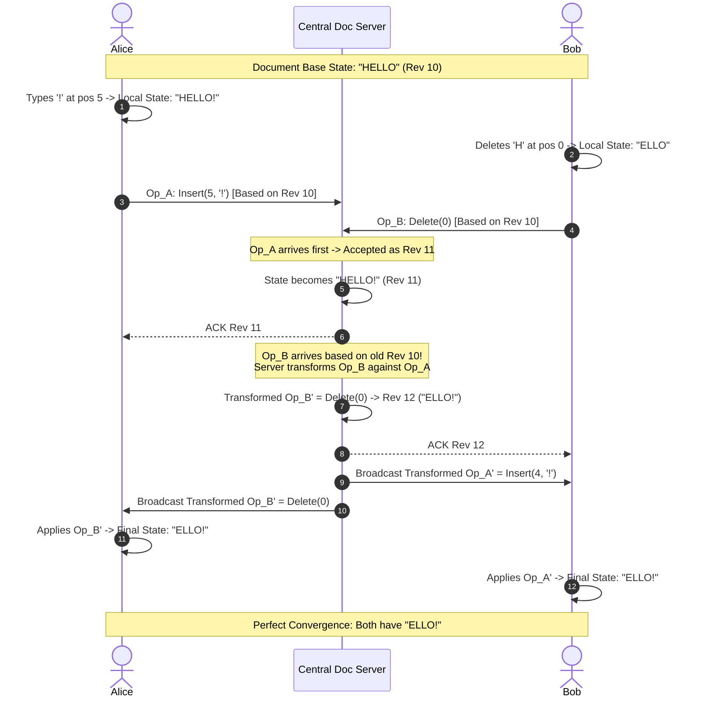
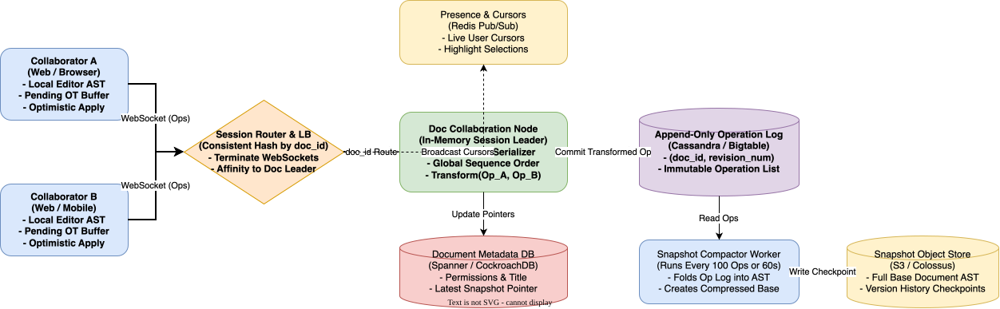

# Google Docs System Design

[← Back to System Design](../system-design.md)

## Overview

Google Docs is a real-time collaborative document processing service used by hundreds of millions of users daily. The system allows multiple users across different continents to type, delete, format, comment, and see each other's live cursor positions inside the same document with latency under 100 milliseconds.

Building Google Docs requires solving foundational distributed systems and concurrency challenges:

1. **Real-Time Concurrent Text Editing**: Ensuring that when multiple users edit the same line simultaneously, their changes do not overwrite each other and all users converge to the exact same document state (Eventual Consistency / Strong Convergence).
2. **Operational Transformation (OT) vs. CRDTs**: Balancing memory overhead, network bandwidth, and transformation complexity.
3. **Session Sticky Routing & Actor Concurrency**: Routing all active collaborators on a given document to an in-memory document authority server.
4. **Operation Log Compaction & Snapshotting**: Persisting an append-only log of every keystroke transformation and folding it into snapshots.
5. **Collaborative Undo / Redo**: Undoing only an individual user's prior edits without reverting subsequent edits made by co-authors.

---

## Functional Requirements

* **Real-Time Collaborative Editing**: Multiple users can edit the same document concurrently with changes visible to all participants in $< 100\text{ ms}$.
* **Cursor & Selection Presence**: Show live cursor positions, user names, and selected text ranges with distinct color identifiers.
* **Document Version History & Rollback**: Track every revision; allow users to browse historical checkpoints, compare diffs, and restore prior versions.
* **Comments & Suggestions Mode**: Add inline comments, resolve discussion threads, and offer track-changes suggestions that require author approval.
* **Offline Editing & Catch-Up**: Users can continue typing while offline. Upon reconnection, offline changes automatically merge with remote edits.
* **Export & Print**: Render documents accurately to PDF, DOCX, Markdown, and HTML formats.

---

## Non-Functional Requirements

* **Ultra-Low Keystroke Latency**: Local input latency must be **$0\text{ ms}$** (optimistic local execution). Remote update propagation must be **$< 100\text{ ms}$** P95 globally.
* **Strong Convergence**: All clients must converge to the identical character sequence regardless of network jitter, packet reordering, or temporary disconnection.
* **High Availability**: $99.99\%$ uptime for document viewing and editing.
* **Fault Tolerance & Durability**: Zero keystroke loss. Every acknowledged operation must be committed to durable storage before acknowledgment.
* **Scalability**: Support up to 100 concurrent active typers and thousands of concurrent viewers on a single document.

---

## Back of the Envelope Estimations

### Scale & Concurrency

* **Daily Active Users (DAU)**: $150\text{ Million}$.
* **Active Documents Edited per Day**: $50\text{ Million}$.
* **Peak Concurrent Active Documents**: $5\text{ Million documents}$.
* **Average Concurrent Editors per Document**: $2$ (with 99th percentile spike to 100).
* **Average Keystrokes per Active Editor**: $3\text{ keystrokes/second}$.
* **Global Operation QPS**:
  $$\text{Keystroke Ingestion QPS} = 5,000,000\text{ docs} \times 2\text{ users} \times 3\text{ ops/sec} = 30,000,000\text{ Ops/sec}$$
  *(Optimized by client-side operation batching/debouncing to $\approx 3,000,000\text{ batched packets/sec}$)*.

### Storage & Operation Log

* **Operation Payload Size**: $\approx 100\text{ bytes}$ (Revision number, operation type `INSERT`/`DELETE`, position index, character string, client ID).
* **Daily Operation Log Volume**:
  $$30,000,000\text{ ops/sec} \times 86,400\text{ sec} \times 100\text{ bytes} \approx 259\text{ Terabytes/day}$$
* **Snapshot Compaction**:
  * Compacting into a full document snapshot every 100 operations or 1 minute.
  * Average compressed document size: $100\text{ KB}$.
  * Snapshot storage for 50M edited docs $= 50\text{M} \times 100\text{ KB} = 5\text{ Terabytes/day}$.

---

## High-Level System Architecture

```text
       Collaborator A (Web)                       Collaborator B (Mobile)
  ┌─────────────────────────────┐            ┌─────────────────────────────┐
  │ - Editor AST & Local Buffer │            │ - Editor AST & Local Buffer │
  │ - Optimistic Local Apply    │            │ - Optimistic Local Apply    │
  └──────────────┬──────────────┘            └──────────────┬──────────────┘
                 │ WebSocket                                │ WebSocket
                 ▼                                          ▼
  ┌────────────────────────────────────────────────────────────────────────┐
  │                      SESSION ROUTER & GATEWAY                          │
  │  - Terminates TLS & WebSocket Connections                              │
  │  - Consistent Hashing on doc_id to route to dedicated Document Node     │
  └──────────────────────────────────┬─────────────────────────────────────┘
                                     │
                                     ▼
  ┌────────────────────────────────────────────────────────────────────────┐
  │                 DOCUMENT SESSION SERVER (Actor Node)                   │
  │                                                                        │
  │  ┌───────────────────────┐  Transform()  ┌──────────────────────────┐  │
  │  │ OT Transformation     │◀─────────────▶│ In-Memory Document State │  │
  │  │ Serializer Engine     │               │ (Master Revision Clock)  │  │
  │  └───────────┬───────────┘               └──────────────────────────┘  │
  └──────────────┼──────────────────────────────────────────┬──────────────┘
                 │ Commit Op                                │ Broadcast Cursor
                 ▼                                          ▼
  ┌─────────────────────────────┐            ┌─────────────────────────────┐
  │  Append-Only Operation Log  │            │ Ephemeral Presence Service  │
  │  (Cassandra / Bigtable)     │            │ (Redis Pub/Sub)             │
  │  Key: (doc_id, revision)    │            │ Live Cursors & Selection    │
  └──────────────┬──────────────┘            └─────────────────────────────┘
                 │ Background Read
                 ▼
  ┌─────────────────────────────┐            ┌─────────────────────────────┐
  │  Snapshot Compactor Worker  │───────────▶│ Snapshot Store (S3/Colossus)│
  │  (Folds 100 Ops into AST)   │            │ Base Document Snapshots     │
  └─────────────────────────────┘            └─────────────────────────────┘
```

---

## Real-Time Collaboration Mechanics

### 1. Operational Transformation (OT) Deep Dive

Operational Transformation (OT) allows multiple editors to modify text at different offsets concurrently while maintaining document integrity.

#### The Core Operation Model

Every text manipulation is decomposed into two elementary operations:

* $\text{Insert}(pos, char)$
* $\text{Delete}(pos)$

#### The Concurrency Anomaly (Without OT)

Suppose document state is `"CAT"`.

* **User A** types `'H'` at index 0 (intending `"CHAT"`... wait, User A inserts `'S'` at index 0 to make `"SCAT"`).
* **User B** deletes `'T'` at index 2 (to make `"CA"`).
* If User B receives User A's un-transformed operation $\text{Insert}(0, 'S')$, User B executes it on `"CA"` and gets `"SCA"` (correct).
* But when User A receives User B's un-transformed operation $\text{Delete}(2)$, User A deletes the character at index 2 of `"SCAT"` (which is `'A'`), resulting in `"SCT"`!
* **Divergence!** User A has `"SCT"`, User B has `"SCA"`.

#### The OT Transformation Matrix

The transformation function $T(Op_A, Op_B)$ yields $(Op_A', Op_B')$ such that:
$$\text{State} \circ Op_A \circ Op_B' = \text{State} \circ Op_B \circ Op_A'$$

```text
If Op_A = Insert(posA, charA) and Op_B = Insert(posB, charB):
  If posA < posB:
    Op_B' = Insert(posB + 1, charB)
    Op_A' = Op_A
  Else If posA > posB:
    Op_A' = Insert(posA + 1, charA)
    Op_B' = Op_B
  Else (posA == posB):
    Tie-break deterministically using unique client_id
```



### 2. OT vs. CRDT Comparison

| Dimension | Operational Transformation (OT) | Conflict-Free Replicated Data Types (CRDT) |
| :--- | :--- | :--- |
| **Central Authority** | Requires central sequencer (Doc Server) | Fully decentralized / peer-to-peer capable |
| **Memory Overhead** | **Very Low** (plain string buffer + small op log) | **High** (each character requires UUID + lamport timestamp) |
| **Bandwidth** | **Extremely Low** ($\approx 20\text{ bytes}$ per keystroke) | Higher ($100-300\text{ bytes}$ per character metadata) |
| **Adoption** | Google Docs, Apache Wave, Microsoft Office 365 | Figma, Apple Notes, Yjs, Automerge |
| **Implementation Complexity** | Complex edge cases in transformation matrix | Complex garbage collection of tombstones |

---

## API Specifications

### 1. Initiate Real-Time Editing Session

```http
POST /api/v2/documents/{documentId}/session
Authorization: Bearer <user_token>
```

```json
// Response: 200 OK
{
  "websocketUrl": "wss://docs-collab-useast1.google.com/ws/session/doc_88192a",
  "baseRevision": 1420,
  "snapshotUrl": "https://storage.googleapis.com/docs-snapshots/doc_88192a_rev1400.json.gz",
  "pendingOps": [
    {"rev": 1401, "op": "INS", "pos": 12, "text": "The "},
    {"rev": 1402, "op": "DEL", "pos": 28, "len": 1}
  ]
}
```

### 2. WebSocket Protocol Frame (Send Operation)

```json
// Client -> Server
{
  "type": "OPERATION",
  "docId": "doc_88192a",
  "clientRevision": 1420,
  "operation": {
    "type": "INSERT",
    "position": 45,
    "text": " distributed"
  },
  "clientId": "client_alice_macbook"
}

// Server -> Client (Broadcast)
{
  "type": "OPERATION_BROADCAST",
  "serverRevision": 1421,
  "transformedOp": {
    "type": "INSERT",
    "position": 45,
    "text": " distributed"
  },
  "clientId": "client_alice_macbook"
}
```

### 3. Ephemeral Presence Broadcast (Cursor Movement)

```json
// Client -> Server (WebSockets)
{
  "type": "PRESENCE",
  "cursorIndex": 57,
  "selectionRange": [57, 68],
  "userColor": "#FF5722",
  "userName": "Alice"
}
```

---

## Object Model & Database Schema

```text
┌───────────────────────┐          ┌───────────────────────┐
│       Document        │1        *│      DocumentOp       │
├───────────────────────┤──────────├───────────────────────┤
│ docId: PK (String)    │          │ docId: PK, FK         │
│ ownerId: FK (User)    │          │ revision: PK (BigInt) │
│ title: Varchar(255)   │          │ authorId: FK (User)   │
│ currentRevision: BigInt          │ opType: (INS, DEL, FMT│
│ latestSnapshotRev: Big│          │ position: Int         │
│ createdAt: Timestamp  │          │ payload: JSON / Text  │
└──────────┬────────────┘          │ clientTimestamp: BigInt
           │1                      └───────────────────────┘
           │*
┌──────────▼────────────┐          ┌───────────────────────┐
│   DocumentSnapshot    │          │     DocumentComment   │
├───────────────────────┤          ├───────────────────────┤
│ snapshotId: PK (Str)  │          │ commentId: PK (String)│
│ docId: FK (Document)  │          │ docId: FK (Document)  │
│ revision: BigInt      │          │ anchorPosition: Int   │
│ astContentBlobUrl: Str│          │ authorId: FK (User)   │
│ createdAt: Timestamp  │          │ text: Text            │
└───────────────────────┘          │ isResolved: Boolean   │
                                   └───────────────────────┘
```

---

## System Design Diagram



[Download Draw.io File](google-docs.drawio)

---

## Deep Dive & Key Technical Challenges

### 1. Sticky Session Routing & Actor Pod Architecture

Because the OT server must maintain strict linear execution order of operations for a document:

* **Doc Affinity**: All WebSocket connections for `document_102` must terminate at the same active in-memory Session Server actor node.
* **Consistent Hashing**: The API Gateway uses Rendezvous or Consistent Hashing on `document_id`.
* **Server Failover**: If a Session Server pod crashes:
  1. The cluster coordinator (ZooKeeper / Kubernetes Lease) detects node failure.
  2. A new node is elected for that document partition.
  3. The new node loads the latest base snapshot and replays outstanding un-compacted operations from Cassandra, recovering document state in $< 500\text{ ms}$.

### 2. Multi-User Collaborative Undo / Redo

In single-user software, Undo pops the top action from a history stack. In collaborative editing, popping User A's last action could undo User B's intervening edits!

* **Selective Inversion**:
  * User A's undo produces an inverse operation $Op^{-1}$ (e.g., if User A inserted `"cat"` at index 10, the inverse is $\text{Delete}(10, 3)$).
  * However, between User A typing `"cat"` and pressing Ctrl+Z, User B inserted 20 characters before index 10.
  * The inverse operation $Op^{-1}$ must itself be transformed through all intervening operations executed since $Op$ was created!
  * The transformed $Op^{-1\prime}$ is then broadcast as a brand new forward operation at the head of the revision timeline.

---

## Additional Notes

### Video References

* [](https://www.youtube.com/watch?v=9JKBlkwg0yM)
