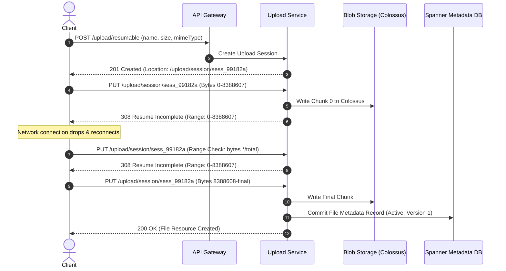
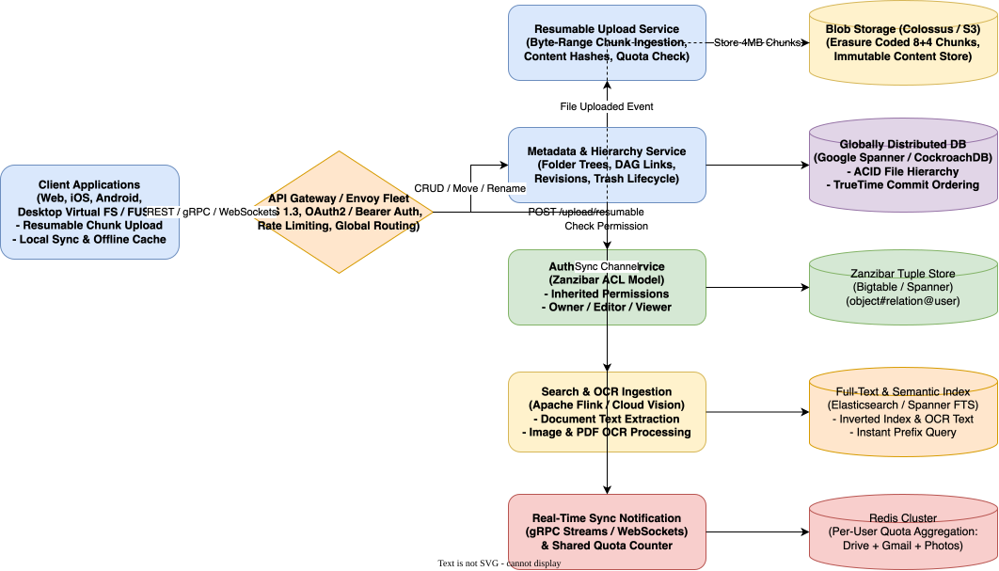

# Google Drive System Design

[← Back to System Design](../system-design.md)

## Overview

Google Drive is a planetary-scale cloud storage, synchronization, and content collaboration platform serving over 1 billion monthly active users. Users store documents, photos, videos, and binary assets, while teams collaborate in real time across shared organization drives.

Designing Google Drive requires solving distinct architectural challenges beyond standard file syncing:

1. **Hierarchical Graph / DAG File Model**: Unlike a flat bucket store, Drive supports folders, nested sub-folders, shortcuts (symlinks), and multi-parent hierarchies where a file can belong to multiple folders or Shared Drives.
2. **Fine-Grained Authorization at Planetary Scale**: Implementing Google Zanzibar-style relation tuples (`document#viewer@alice`) for instant inherited permission checks across millions of nested directories.
3. **Resumable Multi-Gigabyte Chunk Uploads**: Ingesting massive files across unreliable mobile networks using byte-range chunk verification.
4. **Full-Text Document Parsing & OCR Pipeline**: Extracting searchable text from PDFs, DOCX, and images (OCR via Cloud Vision) for sub-second keyword search.
5. **Cross-Service Storage Quotas**: Real-time quota calculation aggregated across Google Drive, Gmail, and Google Photos.

---

## Functional Requirements

* **File & Folder Operations**: Users can upload, download, move, rename, star, and delete files/folders. Supports folders within folders (arbitrary depth).
* **Chunked Resumable Upload**: Uploading large files ($> 5\text{ MB}$ up to $5\text{ TB}$) in discrete byte-ranges with pause/resume capabilities.
* **Access Control & Sharing**: Granular sharing with individuals or Google Groups as `Owner`, `Organizer`, `Editor`, `Commenter`, or `Viewer`. Supports link sharing (Public, Organization-only, Restricted).
* **Full-Text & OCR Search**: Search files by name, file type, owner, modification date, and extracted contents (OCR on scanned receipts, text inside PDFs).
* **Revision History & Undelete**: Files maintain a version history (up to 100 revisions or 30 days). Trashed items remain recoverable for 30 days before permanent deletion.
* **Shared Drives (Enterprise)**: Files belong to the organizational workspace rather than an individual employee account.

---

## Non-Functional Requirements

* **Massive Durability (11 9s)**: $99.999999999\%$ durability for blob storage using Reed-Solomon 8+4 erasure coding across multi-datacenter Colossus cells.
* **Low Latency**:
  * Metadata operations (browse directory, rename): **$< 100\text{ ms}$**.
  * Search queries: **$< 200\text{ ms}$**.
  * Download start (TTFB): **$< 150\text{ ms}$**.
* **High Availability**: $99.99\%$ availability for file access and metadata inspection.
* **Strong Consistency for Metadata**: Moving a file or revoking access must be instantaneously consistent to prevent data leaks.
* **Storage Quota Enforcement**: Immediate enforcement when a user reaches their storage limit (e.g., 15 GB free tier).

---

## Back of the Envelope Estimations

### Scale & Traffic

* **Total Users**: $1\text{ Billion active users}$.
* **Daily Active Users (DAU)**: $300\text{ Million}$.
* **Average Files Stored per User**: $200\text{ files} \implies 200\text{ Billion total file records}$.
* **Daily Upload / Update Requests**:
  $$300,000,000\text{ DAU} \times 5\text{ actions/day} = 1,500,000,000\text{ requests/day}$$
* **Average Write QPS**:
  $$\text{Write QPS} = \frac{1,500,000,000}{86,400} \approx 17,360\text{ QPS} \quad (\text{Peak: } \approx 45,000\text{ QPS})$$
* **Read / Search Traffic**: $10\times$ write traffic $\implies \approx 170,000\text{ Read QPS} \quad (\text{Peak: } \approx 400,000\text{ QPS})$.

### Storage Calculations

* **Average File Size**: $3\text{ MB}$.
* **Total Stored Blob Footprint**:
  $$200\text{ Billion files} \times 3\text{ MB} = 600\text{ Petabytes (raw)}$$
* **With 8+4 Erasure Coding (1.5x factor)**:
  $$\text{Physical Raw Storage} \approx 900\text{ Petabytes to } 1.5\text{ Exabytes}$$
* **Metadata Database Footprint**:
  * Average metadata record: $1\text{ KB}$ (File ID, name, parent folder IDs, MIME type, owner, size, hash, permissions pointer).
  * Metadata Storage $= 200\text{ Billion} \times 1\text{ KB} = 200\text{ Terabytes}$ (stored in Google Spanner with secondary global indexes).

---

## High-Level System Architecture

```text
                                  ┌────────────────────────┐
                                  │      Client Apps       │
                                  │ (Web / Mobile / FUSE)  │
                                  └────┬──────────────┬────┘
                                       │              │
                   1. Direct Upload    │              │ 2. Metadata / Search
                      (Colossus Blob)  │              │    (gRPC / REST)
                                       ▼              ▼
┌─────────────────────────────────────────────┐    ┌─────────────────────────────────────────┐
│             BLOB STORAGE LAYER              │    │          APPLICATION CORE TIER          │
│                                             │    │                                         │
│  ┌──────────────────┐ ┌──────────────────┐  │    │  ┌───────────────────────────────────┐  │
│  │ Resumable Upload │ │ Colossus / S3    │  │    │  │       API Gateway / Envoy         │  │
│  │ Gateway          │─┼▶(Chunk Store)    │  │    │  └─────────────┬─────────────┬───────┘  │
│  └──────────────────┘ └─────────┬────────┘  │    │                │             │          │
└─────────────────────────────────┼───────────┘    │  ┌─────────────┼─────────────┼───────┐  │
                                  │                │  ▼             ▼             ▼       │  │
                                  │ File Ingested  │┌────────┐ ┌────────┐ ┌──────────┐    │  │
                                  ▼                ││Metadata│ │Zanzibar│ │Search/OCR│    │  │
┌─────────────────────────────────────────────┐    ││Service │ │ACL Svc │ │Service   │    │  │
│          OFFLINE PROCESSING PIPELINE        │    │└───┬────┘ └───┬────┘ └───┬──────┘    │  │
│                                             │    └────┼──────────┼──────────┼───────────┘  │
│  ┌──────────────────┐ ┌──────────────────┐  │         │          │          │              │
│  │ Document Parser  │ │ Cloud Vision OCR │  │         ▼          ▼          ▼              │
│  │ (PDF/DOCX Text)  │ │ (Receipts/Images)│  │    ┌─────────┐┌─────────┐┌───────────┐       │
│  └─────────┬────────┘ └─────────┬────────┘  │    │ Google  ││ Zanzibar││ Elastic-  │       │
│            └────────────┬───────┘           │    │ Spanner ││ Tuple   ││ search /  │       │
│                         ▼                   │    │ Cluster ││ Store   ││ FTS Index │       │
│               ┌──────────────────┐          │    └─────────┘└─────────┘└───────────┘       │
│               │ Search Index Ingest│────────┼───────────────────────────────────┘          │
│               └──────────────────┘          │                                              │
└─────────────────────────────────────────────┘                                              │
```

---

## Core Workflows & Protocols

### 1. Resumable Chunk Upload Protocol (RFC 7233)

Uploading a 2GB video over a mobile network requires handling frequent TCP resets:

1. **Initiate Session**: Client sends `POST /upload/resumable` with file name, size, and SHA-256 checksum. Server allocates an upload session ID and returns a unique upload URI.
2. **Chunk Transmission**: Client uploads 8MB chunks using `PUT` with the `Content-Range: bytes 0-8388607/2147483648` header.
3. **Interruption Recovery**: If connection drops at 540MB, the client queries the server with `PUT` without body and `Content-Range: bytes */2147483648`.
4. **Range Acknowledgment**: Server responds with `308 Resume Incomplete` and `Range: bytes=0-566231039`. Client resumes uploading immediately from byte 566231040.



### 2. Authorization with Google Zanzibar

File systems form a directed acyclic graph (DAG) where permissions cascade downward.

* **Tuple Representation**:
  * `folder:finance_2026#owner@bob`
  * `folder:finance_2026#viewer@group:accounting`
  * `file:q3_budget.xlsx#parent@folder:finance_2026`
* **Permission Resolution**:
  * When Alice requests to view `q3_budget.xlsx`, the authorization engine evaluates:
    $$\text{HasPermission(Alice, Viewer, q3\_budget.xlsx)}$$
  * Zanzibar checks direct file ACLs. If none match, it expands the `#parent` relation upwards to `folder:finance_2026` and verifies whether Alice belongs to `group:accounting`.
  * Results are cached at each sub-tree step in an in-memory distributed cache (Leopard indexing layer) for sub-5ms evaluation.

---

## API Specifications

### 1. Initiate Resumable Upload

```http
POST /drive/v3/files/upload?uploadType=resumable
Authorization: Bearer <oauth_token>
Content-Type: application/json
X-Upload-Content-Type: application/pdf
X-Upload-Content-Length: 52428800
```

```json
// Request
{
  "name": "Annual_Engineering_Strategy.pdf",
  "parents": ["folder_00192831a"],
  "description": "2026 Architectural Roadmap"
}

// Response: 200 OK
// Headers:
// Location: https://www.googleapis.com/upload/drive/v3/files?upload_id=xa88102a99
```

### 2. Query Resumable Upload Status

```http
PUT /upload/drive/v3/files?upload_id=xa88102a99
Content-Range: bytes */52428800
```

```http
// Response: 308 Resume Incomplete
// Range: bytes=0-26214399
```

### 3. Share File / Grant Permission

```http
POST /drive/v3/files/file_881920/permissions
Authorization: Bearer <oauth_token>
Content-Type: application/json
```

```json
// Request
{
  "role": "commenter",
  "type": "user",
  "emailAddress": "carol@example.com",
  "sendNotificationEmail": true
}

// Response: 200 OK
{
  "id": "perm_0918231",
  "role": "commenter",
  "type": "user",
  "emailAddress": "carol@example.com"
}
```

---

## Object Model & Database Schema

```text
┌───────────────────────┐          ┌───────────────────────┐
│         User          │1        *│         File          │
├───────────────────────┤──────────├───────────────────────┤
│ userId: PK (BigInt)   │          │ fileId: PK (String)   │
│ email: Varchar(255)   │          │ driveId: FK (Drive)   │
│ allocatedQuota: BigInt│          │ name: Varchar(255)    │
│ usedQuota: BigInt     │          │ mimeType: Varchar(100)│
│ createdAt: Timestamp  │          │ sizeBytes: BigInt     │
└──────────┬────────────┘          │ md5Checksum: String   │
           │1                      │ isTrashed: Boolean    │
           │*                      │ trashedAt: Timestamp  │
┌──────────▼────────────┐          │ headRevisionId: String│
│       AclTuple        │          └───────────┬───────────┘
├───────────────────────┤                      │1
│ objectType: Varchar   │                      │*
│ objectId: Varchar     │          ┌───────────▼───────────┐
│ relation: Varchar     │          │      FileParent       │
│ userOrGroupId: Varchar│          ├───────────────────────┤
│ namespace: Varchar    │          │ fileId: PK, FK        │
└───────────────────────┘          │ parentFolderId: PK, FK│
                                   └───────────────────────┘
                                               │1
                                               │*
                                   ┌───────────▼───────────┐
                                   │      FileRevision     │
                                   ├───────────────────────┤
                                   │ revisionId: PK        │
                                   │ fileId: FK            │
                                   │ blobLocator: String   │
                                   │ sizeBytes: BigInt     │
                                   │ modifiedBy: FK (User) │
                                   │ createdAt: Timestamp  │
                                   └───────────────────────┘
```

---

## System Design Diagram



[Download Draw.io File](google-drive.drawio)

---

## Deep Dive & Key Technical Challenges

### 1. Folder Move Consistency & Cycle Prevention

When moving a folder $A$ into folder $B$, the system must verify that $B$ is not a descendant of $A$ (which would create an orphaned cycle in the tree).

* **Graph Cycle Check**: Perform a traversal up the tree from $B$ to root. If $A$ is encountered in the ancestor chain, reject the transaction with HTTP 400 Bad Request.
* **Distributed Locking in Spanner**: The move operation is executed inside a Google Spanner ACID read-write transaction using TrueTime API, guaranteeing strict serializability across globally distributed replicas.

### 2. OCR and Search Pipeline

* **Asynchronous Kafka Event**: Once an image (JPEG/PNG) or scanned PDF completes upload, a `FileUploadedEvent` is emitted to a partitioned Kafka topic.
* **Worker Cluster**:
  * Tesseract / Cloud Vision OCR workers extract text bounding boxes.
  * Extracted text tokens are normalized and inserted into an Elasticsearch inverted index keyed by `file_id`.
  * The index is tagged with user access scopes so search queries only return documents the user has permission to read.

### 3. Trash Lifecycle & 30-Day Auto-Purge

* Soft-deletion sets `isTrashed = true` and `trashedAt = NOW()`.
* Files in trash still count toward storage quota unless permanently deleted.
* A daily cron job scans the index for items where `trashedAt < NOW() - 30 DAYS`, purging the metadata records and notifying the Blob Garbage Collector to reclaim Colossus disk blocks.

---

## Additional Notes

### Video References

* [](https://www.youtube.com/watch?v=jmqXb_8wB7A)
