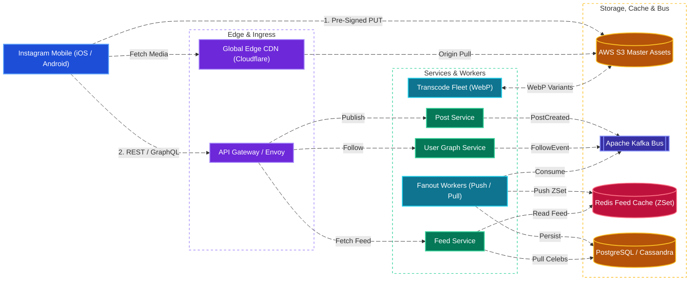
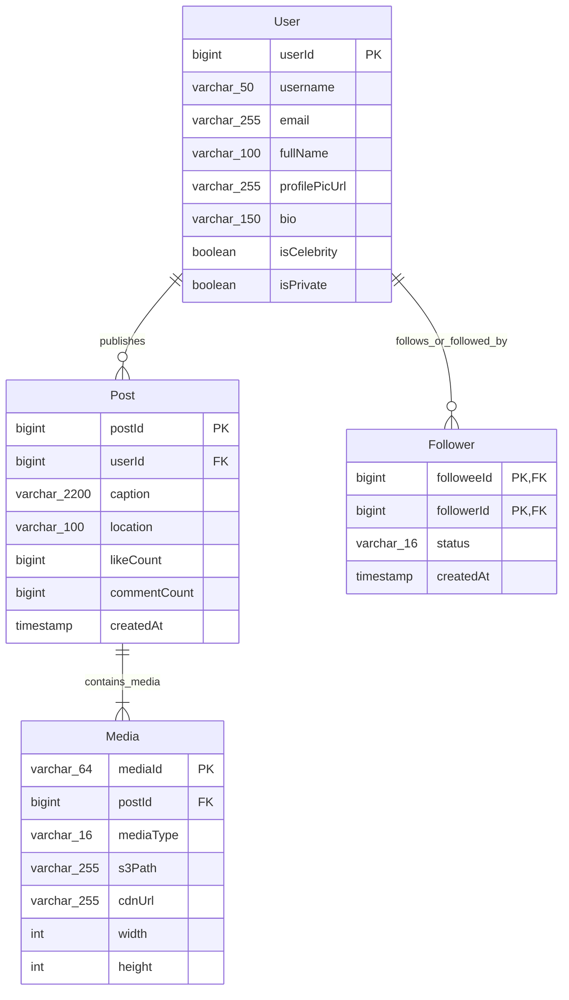
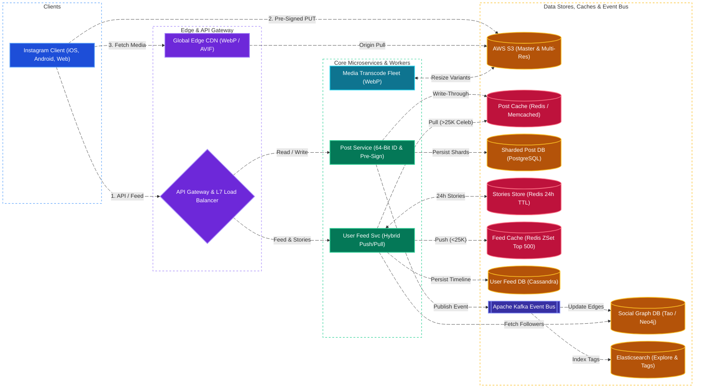
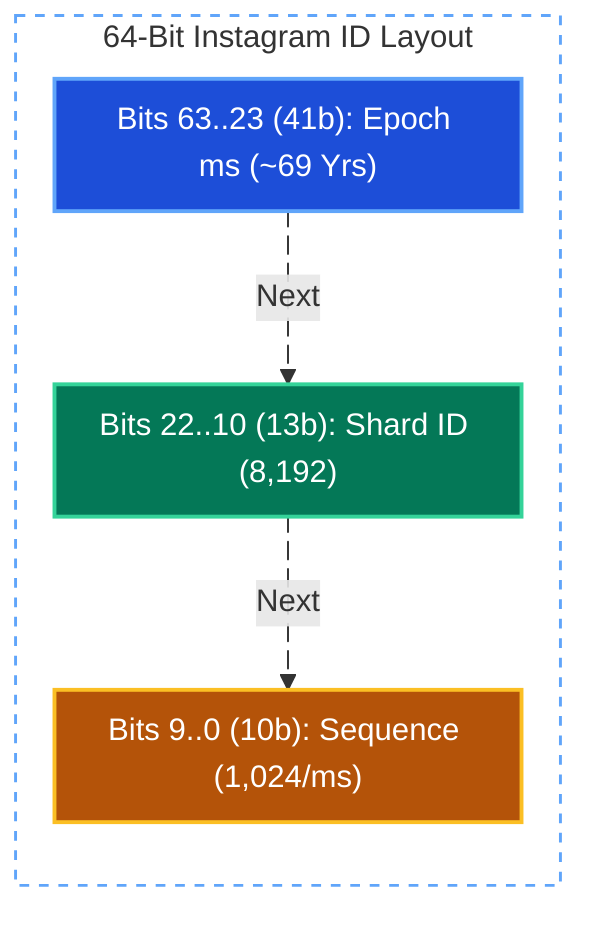

# Instagram System Design

[← Back to System Design](system-design.md)

> **Core Building Blocks Used**: [Chapter 2 — Pull CDN with Origin Shield for Media Delivery](fundamentals/02-edge-load-balancing-and-cdn.md#4-content-delivery-network-cdn) · [Chapter 3 — Redis Timeline Caching & Celebrity Hot-Key Mitigation](fundamentals/03-caching-and-scaling.md#caching-failure-modes--interview-mitigations) · [Chapter 4 — Pre-Signed S3 Uploads, Cassandra Feeds & Social Graph](fundamentals/04-databases-sql-vs-nosql.md#block-storage-vs-file-storage-vs-object-blob-storage) · [Chapter 5 — Snowflake 64-Bit Time-Sortable IDs](fundamentals/05-distributed-systems-and-messaging.md#6-distributed-unique-id-generation-snowflake-uuidv7-ticket-servers)

## Overview

Instagram is a global photo and video-centric social network serving over 500 million Daily Active Users (DAU) and 2 billion Monthly Active Users (MAU). The platform specializes in visual content sharing, ephemeral stories (24-hour expiration), short-form algorithmic video reels, user discovery, and direct messaging.

Designing Instagram requires an architecture optimized for massive media storage, ultra-fast global content delivery via CDNs, extreme read-to-write ratios ($100:1$ to $200:1$), efficient follower graph traversal, and resilient feed generation capable of handling celebrity hot-spots without latency degradation.

---

## Functional Requirements

* **Photo & Video Ingestion**: Users can upload high-resolution photos and short videos with captions, filters, location tags, and hashtags.
* **Social Graph (Follow / Unfollow)**: Users can follow or unfollow other accounts, approve follow requests for private profiles, and view followers/following lists.
* **Home Feed Generation**: Chronological and algorithmically ranked feed displaying posts from followed users, along with sponsored and recommended content.
* **User Profile & Grid**: Display user biography, follower counts, and a reverse-chronological grid of their uploaded media.
* **Stories (Ephemeral Media)**: Users can post 24-hour expiring photos/videos shown in a dedicated top carousel.
* **Social Interactions**: Users can like, comment, bookmark, and share posts.
* **Search & Explore**: Search by username, full-text captions, and explore trending tags and high-engagement media.

---

## Non-Functional Requirements

* **Ultra-Low Feed Latency**: Home feed retrieval must complete within **$< 200\text{ ms}$**; photo upload acknowledgement must take **$< 1\text{ second}$**.
* **High Availability (99.99%)**: The service must prioritize availability over strict consistency for media and feed retrieval.
* **Eventual Consistency**: New posts and likes may take a few seconds to propagate to all followers worldwide.
* **High Durability (100%)**: Once uploaded, user media must never be corrupted or lost (minimum 99.999999999% durability using multi-region cloud object storage).
* **Read-Heavy Traffic**: System must comfortably sustain at least a **$100:1$ read-to-write ratio**.
* **Global Edge Performance**: Images and video segments must be cached at edge CDN points of presence (PoPs) within milliseconds of end users.

---

## Back of the Envelope Estimations

### Scale & Traffic

* **Daily Active Users (DAU)**: $500\text{ Million}$.
* **Photos Uploaded per Day**: $100\text{ Million photos/day}$ (approx. $0.2$ photos/user/day).
* **Average Photo Write QPS**:
  $$\text{Write QPS} = \frac{100,000,000}{86,400} \approx 1,160\text{ writes/sec} \quad (\text{Peak: } \approx 2,500\text{ QPS})$$
* **Feed Read Requests per User**: $20\text{ feed views/day}$.
* **Total Daily Feed Reads**:
  $$500,000,000 \times 20 = 10,000,000,000\text{ feed reads/day}$$
* **Average Feed Read QPS**:
  $$\text{Read QPS} = \frac{10,000,000,000}{86,400} \approx 115,700\text{ QPS} \quad (\text{Peak: } \approx 250,000\text{ QPS})$$

### Storage Requirements

* **Average Compressed Photo Size**: $\approx 2\text{ MB}$ (raw upload is compressed into WebP/AVIF thumbnail formats).
* **Daily Media Storage**:
  $$100,000,000\text{ photos} \times 2\text{ MB} = 200\text{ Terabytes/day}$$
* **Yearly Media Storage**:
  $$200\text{ TB} \times 365 \approx 73\text{ Petabytes/year} \implies \approx 730\text{ PB over 10 years}$$
* **Post Metadata Size**: $\approx 500\text{ bytes}$ per post record.
  $$100,000,000 \times 500\text{ bytes} \approx 50\text{ GB/day} \implies \approx 18.25\text{ TB/year}$$

### Cache & Memory Sizing

* **80/20 Rule**: $20\%$ of posts generate $80\%$ of read traffic.
* Caching the active home feed (top 500 post IDs) for active users ($100\text{M}$ highly active users):
  $$100,000,000 \times 500\text{ post IDs} \times 8\text{ bytes (int64)} \approx 400\text{ GB RAM}$$
  *(Readily handled by a distributed Redis cluster).*

---

## High-Level System Architecture



---

## Core Components & Data Flows

### 1. Photo Upload Pipeline (Direct-to-S3 via Pre-Signed URLs)

Uploading high-resolution media through web app servers creates massive I/O bottlenecks:

1. Client requests a pre-signed upload URL from the **Post Service**.
2. Post Service generates an encrypted, short-lived Amazon S3 pre-signed URL with strict bucket policies.
3. Mobile client uploads binary image bytes directly to Amazon S3 via `HTTP PUT`.
4. S3 fires an `ObjectCreated` event to an **SQS queue**.
5. **Transcoding Workers** consume the event, download the master image, and generate 3 WebP resolutions:
   * Low/Thumbnail: $150 \times 150\text{ px}$ (for profile grid)
   * Medium: $640 \times 640\text{ px}$ (for mobile feed)
   * High: $1080 \times 1080\text{ px}$ (for tablet/desktop)
6. Processed images are saved to the CDN origin bucket, and the Post Service writes the metadata record to the database.

### 2. Hybrid Feed Generation Model

* **Fan-Out on Write (Push)**:
  * For regular users ($< 25,000$ followers): When author uploads a photo, fan-out workers insert `postId` into all followers' **Redis Sorted Sets (ZSets)** using `createdAt` as the score.
  * Fast $O(1)$ read performance when a follower opens their feed.
* **Fan-Out on Read (Pull)**:
  * For celebrities (e.g., Cristiano Ronaldo, Selena Gomez with $> 100\text{M}$ followers): Posts are **never** pushed to millions of follower mailboxes.
  * When a user opens their feed, the Feed Service reads the user's precomputed Redis ZSet and queries the celebrity user timelines in parallel, merging and sorting the top 20 items in memory.

---

## API Endpoints

### 1. Request Pre-Signed Upload URL

```http
POST /api/v1/media/presigned-url
Authorization: Bearer <user_jwt>
Content-Type: application/json
```

```json
// Request
{
  "contentType": "image/jpeg",
  "contentLengthBytes": 4291040,
  "checksumMd5": "c2FtcGxlX21kNV9oYXNoCg=="
}

// Response: 200 OK
{
  "uploadUrl": "https://s3.us-west-2.amazonaws.com/ig-masters/usr_102/med_99182a.jpg?AWSAccessKeyId=...",
  "mediaId": "med_99182a",
  "expiresInSeconds": 300
}
```

### 2. Create Post

```http
POST /api/v1/posts
Authorization: Bearer <user_jwt>
Content-Type: application/json
```

```json
// Request
{
  "mediaId": "med_99182a",
  "caption": "Sunset in Malibu #goldenhour #sunset",
  "location": "Malibu Beach, CA",
  "taggedUserIds": [9912, 10482]
}

// Response: 201 Created
{
  "postId": 1490284729102840,
  "mediaUrls": {
    "thumbnail": "https://cdn.instagram.com/p/med_99182a_150.webp",
    "medium": "https://cdn.instagram.com/p/med_99182a_640.webp",
    "full": "https://cdn.instagram.com/p/med_99182a_1080.webp"
  },
  "caption": "Sunset in Malibu #goldenhour #sunset",
  "createdAt": 1730005200
}
```

### 3. Get User Feed

```http
GET /api/v1/feed?limit=20&cursor=1490284720000000
Authorization: Bearer <user_jwt>
```

```json
// Response: 200 OK
{
  "posts": [
    {
      "postId": 1490284729102840,
      "author": {
        "userId": 102,
        "username": "tarun_photo",
        "avatarUrl": "https://cdn.instagram.com/a/102.webp"
      },
      "mediaUrls": {
        "medium": "https://cdn.instagram.com/p/med_99182a_640.webp"
      },
      "caption": "Sunset in Malibu #goldenhour #sunset",
      "likeCount": 384,
      "commentCount": 18,
      "hasLiked": false,
      "createdAt": 1730005200
    }
  ],
  "nextCursor": "1490284500000000",
  "hasMore": true
}
```

---

## Object Model & Database Schema

### Database Selection & Rationale

| Workload / Subsystem | Database Choice | Data Model & CAP Profile | Why This Database? (Justification & Trade-offs) |
| :--- | :--- | :--- | :--- |
| **Users, Posts & Media Metadata** | **Sharded PostgreSQL** | Relational (ACID, **CP / PC-EC**) | **Why:** Instagram famously scaled core metadata (`User`, `Post`, `Media`) across thousands of logical PostgreSQL shards using custom 64-bit PL/pgSQL Snowflake-like IDs (41b timestamp + 13b shard ID + 10b sequence). Embedding the logical shard ID directly inside `postId` enables single-hop routing without a central lookup table while preserving ACID guarantees and relational integrity. |
| **User Feed Timelines & Activity Inbox** | **Apache Cassandra** | Wide-Column Store (**AP / PA-EL**) | **Why:** Precomputed user feeds require high-velocity fan-out writes and sequential reverse-chronological reads (`WHERE user_id = ? ORDER BY post_id DESC LIMIT 20`). Cassandra's LSM-Tree storage engine handles massive write amplification across data centers with zero single points of failure and tunable quorum consistency. |
| **Hot Feed Cache, 24h Stories & Counters** | **Redis Cluster (+ Memcached / TAO)** | In-Memory Key-Value / ZSet (**AP / Sub-ms**) | **Why:** Sustaining $250,000\text{ Peak Read QPS}$ with $< 200\text{ ms}$ latency requires serving the active home feed (top 500 `postId`s per active user, $\sim 400\text{ GB}$ RAM) from Redis Sorted Sets (`ZSET`). Ephemeral 24-hour Stories leverage native Redis key TTLs to auto-evict without disk tombstone bloat. |
| **Social Graph (`Follower` Edges)** | **Meta TAO (Memcached + Sharded MySQL) / Cassandra** | Distributed Graph Cache + Persistent Store (**AP / Read-Your-Writes**) | **Why:** Fan-out workers and privacy checks frequently query bidirectional edges (`followers_of(u)`, `following_of(u)`). TAO caches adjacency lists in memory with write-through persistence to sharded MySQL, serving billions of graph lookups per second at microsecond latency. |
| **Photos, Videos & WebP Variants** | **AWS S3 / Meta Haystack + Global Edge CDN** | Immutable Object Storage (**11 9s Durability**) | **Why:** $200\text{ TB/day}$ ($73\text{ PB/year}$) of binary media cannot live in relational or NoSQL tables. S3 stores master and transcoded WebP variants (`150px`, `640px`, `1080px`), while Cloudflare/CloudFront Edge CDNs serve $>95\%$ of media reads directly from local ISP PoPs. |
| **Hashtag & Explore Search** | **Elasticsearch** | Inverted Index (**AP / Near Real-Time**) | **Why:** Indexes captions, hashtags (`#sunset`), and location tags for sub-100ms prefix and relevance search on the Explore page. |



---

## System Design Diagram



---

## Deep Dive & Key Technical Challenges

### 1. Database Sharding: Instagram's 64-bit ID Generation

To scale beyond a single database, Instagram shards its PostgreSQL databases across thousands of logical partitions.

* **Why Sharding by User ID has flaws**: If a user is a celebrity, all their photos and likes hit one shard, causing a **hot shard bottleneck**.
* **Instagram ID Generation Scheme (Snowflake-like)**:
  Instagram IDs are 64-bit integers generated directly inside PostgreSQL using custom PL/pgSQL sequences:
  * **41 bits**: Epoch timestamp in milliseconds (gives $\approx 69\text{ years}$ of unique IDs).
  * **13 bits**: Logical Shard ID ($2^{13} = 8,192\text{ logical shards}$).
  * **10 bits**: Auto-incrementing sequence number within the microsecond ($2^{10} = 1,024\text{ IDs per millisecond per shard}$).



* **Routing Benefit**: Given any `postId`, the application extracts the 13-bit Shard ID using a simple bitmask (`(postId >> 10) & 0x1FFF`), allowing the system to route the query directly to the responsible database shard without querying a centralized coordinator.

### 2. Ephemeral Content (Stories) Architecture

* **24-Hour Expiration**: Stories are saved with a TTL. Using Redis or DynamoDB with native TTL features ensures that expired stories are automatically dropped without heavy disk I/O.
* **Story Ring Caching**:
  * An in-memory cache maintains a bitset of viewed story IDs per user.
  * When a user opens Instagram, the Story Tray shows unread stories sorted by close friends and interaction frequency.

---

## Additional Notes

### Video References

* [](https://www.youtube.com/watch?v=anM-cr6RqDI)
