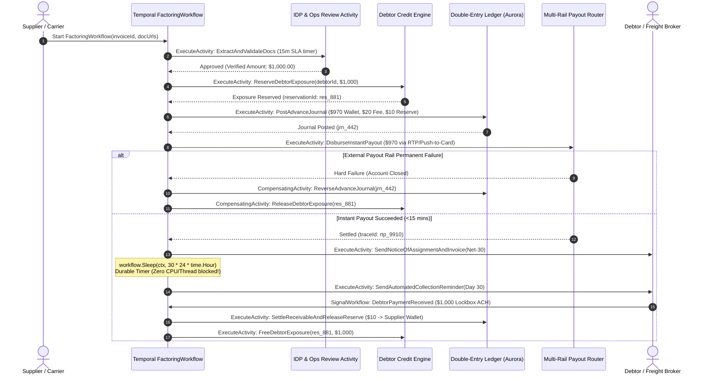
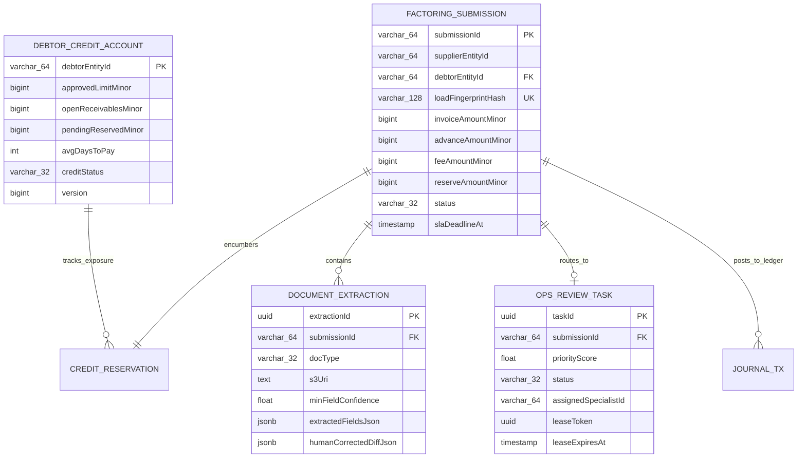

# B2B Invoice Factoring, AI Underwriting & Credit Exposure Platform System Design

[← Back to System Design](system-design.md)

> **Core Building Blocks Used**: [Chapter 4 — Strict Serializable ACID Ledgers, Pre-Signed S3 URLs & `FOR UPDATE SKIP LOCKED`](fundamentals/04-databases-sql-vs-nosql.md#3-pessimistic-vs-optimistic-concurrency-control-preventing-double-booking) · [Chapter 5 — Durable Execution (Temporal), Saga Compensation & Idempotency](fundamentals/05-distributed-systems-and-messaging.md#4-distributed-transactions-2pc-vs-saga-vs-transactional-outbox) · [Chapter 7 — CQRS Read/Write Separation](fundamentals/07-probabilistic-structures-and-stream-processing.md#cqrs-event-sourcing--lambda-vs-kappa-architecture) · [Chapter 9 — Vision LLM Document Extraction & Deterministic Guardrails](fundamentals/09-genai-llm-and-ml-system-design.md)

## Overview

A **B2B Invoice Factoring & Instant Working-Capital Platform** bridges the 30-to-90-day cash-flow gap in commercial supply chains, logistics, and freight marketplaces. When a supplier or freight carrier completes a job for a commercial buyer or broker (the **Debtor**), they upload their invoice and proof-of-delivery documents (such as a Bill of Lading, Rate Confirmation, and delivery receipts). Rather than waiting 60 days for the debtor to pay via Net-60 terms, the factoring platform verifies the documents and debtor credit risk, advances **$97\%$ of the invoice value to the supplier's digital wallet within 15 minutes**, holds **$1\%$ in a contingency reserve**, retains a **$2\%$ factoring fee**, and assumes the 30-to-90-day collection lifecycle from the debtor.

Designing an enterprise factoring and underwriting engine centers on five core distributed systems challenges:

1. **AI/LLM Document Ingestion with Deterministic Guardrails**: Extracting structured fields from thousands of skewed, crumpled mobile photos of Bills of Lading (BOLs) and Rate Confirmations per hour using OCR/Vision LLMs, while enforcing strict deterministic rules and per-field confidence thresholds so a hallucinating LLM never triggers an unauthorized payout.
2. **Human-in-the-Loop SLA Task Queue**: Routing ambiguous or high-value submissions to internal underwriting and collections specialists via a priority-scored, lease-based work queue (`SELECT ... FOR UPDATE SKIP LOCKED` / Redis heartbeat leases) that prevents double-work and guarantees the 15-minute payout SLA.
3. **Real-Time Debtor Credit Limit & Exposure Engine**: In non-recourse factoring, the platform absorbs the credit loss if a debtor goes bankrupt. The system must enforce real-time credit exposure caps (`Approved_Limit - Open_AR - In_Flight_Pending_Holds`) across 25,000+ debtors when thousands of suppliers submit invoices against the same major debtor simultaneously.
4. **Durable Execution Across Minutes and Months (Temporal)**: Coordinating a multi-step workflow that spans **15 minutes** for underwriting and instant advance disbursement, followed by **30 to 90 days** of durable timers for Notice of Assignment (NOA) delivery, collection dunning reminders, lockbox reconciliation, and reserve holdback release.
5. **Marketplace Eligibility Read Isolation & Identity Federation**: Embedding real-time *"Instant Factoring Eligible"* badges and advance estimates across ratusan of millions of marketplace search views using a cached CQRS read layer completely isolated from the core transactional ledger.

---

## Functional Requirements

* **Marketplace Eligibility & Federated Onboarding**: Display real-time debtor factorability badges on partner marketplace listings and map partner organizational accounts to verified KYB/KYC legal entities.
* **Direct Document Upload & AI Underwriting**: Ingest multi-page PDFs and mobile photos (Invoices, Bills of Lading, Rate Confirmations, receipts), extract structured fields with confidence scores, and run deterministic cross-document validation rules.
* **Human-in-the-Loop Operations Queue**: Route low-confidence or rule-flagged invoices to internal underwriting specialists ranked by SLA urgency, dollar value, and operator skill tier with lease-based claiming.
* **Real-Time Debtor Credit Exposure Reservation**: Dynamically compute debtor credit limits from internal repayment velocity and external credit bureaus, and atomically reserve credit exposure before approving an advance.
* **Instant Advance & Multi-Leg Ledger Accounting**: Disburse the advance (e.g., $97\%$) to the supplier's digital wallet or external bank rail, book the factoring fee ($2\%$), and encumber the reserve holdback ($1\%$) in an append-only double-entry ledger.
* **30-to-90-Day Collection & Reserve Release Lifecycle**: Automatically send Notices of Assignment (NOA) and invoices to debtors, track aging schedules (30/60/90 days), reconcile incoming debtor lockbox/ACH payments, and release or offset the supplier's reserve holdback.

---

## Non-Functional Requirements

* **Strict Financial & Credit Invariants (CP / Serializable ACID)**: Zero double-advances, zero unbalanced journal entries ($\sum \text{Debits} = \sum \text{Credits}$), and zero credit limit over-allocation under concurrent bursts.
* **End-to-End Payout SLA**:
  * **Auto-Approved Path ($75\%$ of volume)**: $< 30\text{ seconds}$ from document upload to wallet credit.
  * **Human-in-the-Loop Path ($25\%$ of volume)**: $< 15\text{ minutes}$ P95 end-to-end SLA.
* **Marketplace Badge Read Latency**: $< 15\text{ ms}$ P99 at $25,000\text{ read QPS}$ with zero impact on the transactional database.
* **Durable Workflow State**: Long-running factoring lifecycles (up to 120 days) must survive service restarts, deployments, and availability-zone outages without losing timer state or repeating completed payout steps.
* **Auditability & Model Feedback Loop**: Every underwriting rule check, LLM extraction diff corrected by an operator, and credit limit override must be recorded in an immutable audit log.

---

## Back of the Envelope Estimations

### Traffic & Workload Scale

* **Marketplace Load / Order Board Views (Read-Heavy Tier)**:
  * $250\text{ Million listings/year}$, generating $\approx 500\text{ Million search/detail views/day}$ checking debtor factorability.
  * $\text{Average Badge Read QPS} = \frac{500,000,000}{86,400} \approx 5,800\text{ QPS} \quad (\text{Peak: } \approx \mathbf{25,000\text{ QPS}})$.
* **Factoring Submissions & Document Uploads (Write-Critical Tier)**:
  * $250,000\text{ factored invoices/day}$ ($\approx 750,000\text{ uploaded document pages/day}$).
  * $\text{Average Submission QPS} = \frac{250,000}{86,400} \approx 3\text{ invoices/sec} \quad (\text{Peak end-of-day/Friday surge: } \approx \mathbf{40\text{--}100\text{ invoices/sec}})$.
* **Active Long-Running Durable Workflows**:
  * Average debtor Days-to-Pay (DTP) $= 42\text{ days}$.
  * $\text{Concurrent Open Factoring Workflows} = 250,000\text{ invoices/day} \times 42\text{ days} = \mathbf{10.5\text{ Million active workflows}}$ sleeping in Temporal awaiting debtor settlement.

### Storage Sizing

* **Document Blob Storage (S3)**:
  * $750,000\text{ pages/day} \times 2\text{ MB average mobile photo/PDF} = \mathbf{1.5\text{ TB/day}} \implies \mathbf{547\text{ TB/year}}$ (tiered to S3 Glacier Instant Retrieval after 90 days).
* **Transactional Ledger & Workflow History (Aurora PostgreSQL / Cassandra)**:
  * $250,000\text{ invoices/day} \times 10\text{ KB (journal legs + extraction JSON + workflow events)} = \mathbf{2.5\text{ GB/day}} \implies \mathbf{912\text{ GB/year}}$.

---

## High-Level System Architecture

```mermaid
%%{init: {'flowchart': {'nodeSpacing': 25, 'rankSpacing': 45, 'padding': 10}}}%%
flowchart LR
    subgraph ClientAndMarket["Marketplace & Supplier Clients"]
        MarketUI["Marketplace Board (25K Read QPS)"]
        SupplierApp["Supplier Mobile / Web App"]
        OpsUI["Internal Ops Workbench"]
    end
    subgraph EdgeAndRead["Edge & CQRS Eligibility Read Layer"]
        APIGW["API Gateway (OIDC / Tenant Map)"]
        EligCache[("Redis Debtor Eligibility Cache")]
        S3[("S3 Document Bucket (Pre-Signed)")]
    end
    subgraph CoreOrchestration["Durable Factoring & Underwriting Tier"]
        Temporal["Temporal Workflow Cluster"]
        IDP["OCR + Vision LLM Extraction Svc"]
        Guardrails["Deterministic Underwriting Engine"]
        OpsQueue["SLA Task Queue & Lease Router"]
        CreditEng["Debtor Credit Exposure Engine"]
    end
    subgraph DataAndLedger["Transactional Core & Financial Ledger"]
        Aurora[("Aurora PostgreSQL (Ledger & Credit)")]
        Kafka[["Kafka (Outbox / CDC Events)"]]
    end

    MarketUI e1@-->|"GET /eligibility (Sub-15ms)"| APIGW
    APIGW e2@<-->|"Read Materialized Badge"| EligCache
    SupplierApp e3@-->|"1. Direct PUT (Pre-Signed URL)"| S3
    S3 e4@-->|"2. ObjectCreated Event"| Temporal
    Temporal e5@-->|"3. Extract Structured JSON"| IDP
    Temporal e6@-->|"4. Validate Confidence & Rules"| Guardrails
    Guardrails e7@-.->|"5a. Low Confidence / Flagged"| OpsQueue
    OpsUI e8@<-->|"Claim Lease & Correct Diff"| OpsQueue
    Temporal e9@-->|"5b. Reserve Debtor Credit"| CreditEng
    CreditEng e10@-->|"SERIALIZABLE / Optimistic Lock"| Aurora
    Temporal e11@-->|"6. Post 3-Leg Advance & Sleep 30-90d"| Aurora
    Aurora e12@-->|"CDC Outbox"| Kafka
    Kafka e13@-->|"Refresh Debtor Badge"| EligCache

    e1@{ animate: true }
    e2@{ animate: true }
    e3@{ animate: true }
    e4@{ animate: true }
    e5@{ animate: true }
    e6@{ animate: true }
    e7@{ animate: true }
    e8@{ animate: true }
    e9@{ animate: true }
    e10@{ animate: true }
    e11@{ animate: true }
    e12@{ animate: true }
    e13@{ animate: true }

    classDef client fill:#1d4ed8,stroke:#60a5fa,stroke-width:2px,color:#ffffff
    classDef edge fill:#6d28d9,stroke:#a78bfa,stroke-width:2px,color:#ffffff
    classDef service fill:#047857,stroke:#34d399,stroke-width:2px,color:#ffffff
    classDef worker fill:#0e7490,stroke:#22d3ee,stroke-width:2px,color:#ffffff
    classDef cache fill:#be123c,stroke:#fb7185,stroke-width:2px,color:#ffffff
    classDef storage fill:#b45309,stroke:#fbbf24,stroke-width:2px,color:#ffffff
    classDef queue fill:#3730a3,stroke:#818cf8,stroke-width:2px,color:#ffffff

    class MarketUI,SupplierApp,OpsUI client
    class APIGW edge
    class Temporal,Guardrails,CreditEng service
    class IDP,OpsQueue worker
    class EligCache cache
    class S3,Aurora storage
    class Kafka queue

    style ClientAndMarket fill:transparent,stroke:#60a5fa,stroke-width:1.5px,stroke-dasharray: 5 5
    style EdgeAndRead fill:transparent,stroke:#a78bfa,stroke-width:1.5px,stroke-dasharray: 5 5
    style CoreOrchestration fill:transparent,stroke:#34d399,stroke-width:1.5px,stroke-dasharray: 5 5
    style DataAndLedger fill:transparent,stroke:#fbbf24,stroke-width:1.5px,stroke-dasharray: 5 5
```



---

## Core Components & End-to-End Workflows

### 1. AI/LLM Document Ingestion & Deterministic Underwriting Guardrails

Suppliers upload crumpled, low-light mobile photos of Bills of Lading (BOLs), Rate Confirmations, and lumper/scale receipts. A Principal Engineer never lets a non-deterministic LLM directly trigger a financial payout; instead, the LLM acts strictly as a **structured schema extractor**, bounded by deterministic validation rules:

```mermaid
%%{init: {'flowchart': {'nodeSpacing': 20, 'rankSpacing': 40, 'padding': 10}}}%%
flowchart LR
    Upload["S3 Pre-Signed Upload"]
    Preproc["Image Deskew, Denoise & SHA-256"]
    OCR["OCR + Vision LLM (Structured JSON)"]
    Rules["Deterministic Guardrail Engine"]
    AutoApprove["Auto-Approve Path (<30s)"]
    HITL["Ops SLA Task Queue (Human Review)"]
    GoldenSet[("Ground-Truth Eval Dataset (S3)")]

    Upload e1@-->|"S3 Event"| Preproc
    Preproc e2@-->|"Layout + Image"| OCR
    OCR e3@-->|"Fields + Confidence Scores"| Rules
    Rules e4@-->|"All Conf >= 0.96 & Rules Pass"| AutoApprove
    Rules e5@-->|"Conf < 0.96 or Rule Mismatch"| HITL
    HITL e6@-->|"Specialist Approves"| AutoApprove
    HITL e7@-.->|"Capture JSON Diff (Before vs After)"| GoldenSet

    e1@{ animate: true }
    e2@{ animate: true }
    e3@{ animate: true }
    e4@{ animate: true }
    e5@{ animate: true }
    e6@{ animate: true }
    e7@{ animate: true }

    classDef edge fill:#6d28d9,stroke:#a78bfa,stroke-width:2px,color:#ffffff
    classDef worker fill:#0e7490,stroke:#22d3ee,stroke-width:2px,color:#ffffff
    classDef service fill:#047857,stroke:#34d399,stroke-width:2px,color:#ffffff
    classDef storage fill:#b45309,stroke:#fbbf24,stroke-width:2px,color:#ffffff

    class Upload edge
    class Preproc,OCR,HITL worker
    class Rules,AutoApprove service
    class GoldenSet storage
```



1. **Direct Upload & Decoupling**: The client requests a `PUT` pre-signed S3 URL (`POST /v1/documents/upload-url`), uploads multi-megabyte images directly to S3 bypassing API servers, and S3 emits an `ObjectCreated` event via SQS/EventBridge to start the Temporal workflow.
2. **Structured Extraction with Per-Field Logprobs/Confidence**: The document pipeline runs layout-aware OCR (AWS Textract / Document AI) paired with a Vision LLM constrained by a strict JSON Schema (`response_format`). Every extracted field returns both a `value` and a calibrated `confidence` score ($0.00\text{--}1.00$).
3. **Deterministic Underwriting Guardrails**:
   * **Identity Match**: `extracted.supplier_registration_number == authenticated_tenant.mc_or_tax_id`.
   * **Cross-Document Reconciliation**: `extracted.rate_confirmation_total_minor + extracted.approved_accessorials_minor == invoice.requested_amount_minor`.
   * **Proof of Delivery Completeness**: `extracted.receiver_signature_present == true` AND `extracted.delivery_date <= TODAY()` AND `extracted.damage_or_shortage_noted == false`.
   * **Double-Factoring Fingerprint Check**: Computes a deterministic load fingerprint `SHA256(debtor_id + ":" + load_reference_num + ":" + pickup_date + ":" + delivery_date)` and verifies no prior invoice across *any* supplier has factored that same underlying shipment.
4. **Closed-Loop Ground-Truth Capture**: Whenever an operations specialist corrects an LLM extraction error in the review UI (e.g., fixing a smudged handwritten weight or rate), the system writes a structured `(document_s3_uri, model_version, llm_raw_json, human_corrected_json, field_diffs)` record to an immutable ground-truth evaluation dataset for automated prompt regression testing and LoRA fine-tuning.

---

### 2. Durable Execution Factoring Lifecycle (Why Temporal Over Standard Queues)

A standard message queue (SQS/Kafka) is designed for stateless, short-lived message processing. Factoring an invoice is a **stateful, long-running business transaction** that spans **15 minutes** for instant disbursement and **30 to 90 days** for debtor collection:



#### Multi-Leg Factoring Double-Entry Accounting ($\sum \text{Debits} = \sum \text{Credits}$)

When a $\$1,000.00$ (`100000` cents) invoice is factored with a $97\%$ advance rate, $2\%$ factoring fee, and $1\%$ contingency reserve holdback, the ledger never mutates a raw balance column—it appends balanced journal postings:

| Lifecycle Phase | Account Name | Direction | Amount (Cents) | Economic Meaning |
| :--- | :--- | :---: | :---: | :--- |
| **Phase 1: Invoice Factored (Instant Advance)** | `Accounts_Receivable_Debtor_A` | **DEBIT** | `100000` ($\$1,000.00$) | Platform now owns the $\$1,000$ receivable owed by Debtor A. |
| | `Supplier_Available_Wallet` | **CREDIT** | `97000` ($\$970.00$) | $97\%$ instant advance credited to supplier's spendable wallet. |
| | `Platform_Factoring_Fee_Revenue` | **CREDIT** | `2000` ($\$20.00$) | $2\%$ factoring discount fee earned by the platform. |
| | `Supplier_Reserve_Holdback_Escrow` | **CREDIT** | `1000` ($\$10.00$) | $1\%$ held in escrow against debtor short-pay or dispute. |
| **Phase 2: Debtor Pays Full $\$1,000$ at Day 42** | `Platform_Settlement_Bank_Cash` | **DEBIT** | `100000` ($\$1,000.00$) | Cash received from Debtor A via ACH/Wire lockbox. |
| | `Supplier_Reserve_Holdback_Escrow` | **DEBIT** | `1000` ($\$10.00$) | Release the $1\%$ contingency reserve from escrow. |
| | `Accounts_Receivable_Debtor_A` | **CREDIT** | `100000` ($\$1,000.00$) | Clear Debtor A's open receivable balance to $\$0$. |
| | `Supplier_Available_Wallet` | **CREDIT** | `1000` ($\$10.00$) | Credit the released $\$10$ reserve to the supplier's wallet. |

---

### 3. Internal Operations Task Queue & Lease-Based SLA Routing

When an invoice has an OCR confidence score $< 0.96$, a high dollar amount ($> \$10,000$), or a debtor discrepancy, it enters the **Operations Task Queue** so internal specialists can verify documents or call the debtor within the 15-minute instant-payout clock.

#### Dynamic Priority Scoring Formula

Tasks are ranked continuously using a composite urgency score:

$$\text{PriorityScore} = w_1 \cdot \left(\frac{1}{\max(\text{SLA\_Seconds\_Remaining}, 60)}\right) + w_2 \cdot \log_{10}(\text{Invoice\_Amount\_Minor}) + w_3 \cdot \text{Supplier\_Tier\_Weight}$$

As an invoice approaches the final 4 minutes of its 15-minute SLA window, the first term spikes hyperbolically, floating the task to the very top of every eligible specialist's queue.

#### Lease-Based Claiming (`FOR UPDATE SKIP LOCKED` + Heartbeats)

To prevent two specialists from reviewing the same invoice—or a task getting stuck when Specialist A closes their laptop mid-review—the queue uses **short-lived leases with heartbeats**:

```sql
-- Atomic Task Claiming Query (PostgreSQL)
WITH next_task AS (
    SELECT task_id
    FROM ops_review_tasks
    WHERE status = 'QUEUED'
      AND required_skill_tier <= $1 -- Specialist's permission level
      AND (lease_expires_at IS NULL OR lease_expires_at < NOW())
    ORDER BY priority_score DESC, sla_deadline_at ASC
    LIMIT 1
    FOR UPDATE SKIP LOCKED
)
UPDATE ops_review_tasks t
SET status = 'LEASED',
    assigned_specialist_id = $2,
    lease_token = gen_random_uuid(),
    lease_expires_at = NOW() + INTERVAL '180 seconds',
    updated_at = NOW()
FROM next_task
WHERE t.task_id = next_task.task_id
RETURNING t.*;
```

* **Active Heartbeat**: While the specialist has the review tab open in the browser, the frontend sends a heartbeat every 45 seconds (`POST /v1/ops/tasks/{id}/heartbeat` with `lease_token`) extending `lease_expires_at` by 180 seconds.
* **Automatic Lease Reclamation**: If the specialist loses Wi-Fi or closes their laptop, `lease_expires_at` passes within 3 minutes. A background reaper (or the `WHERE lease_expires_at < NOW()` predicate itself) seamlessly returns the task to the next available operator, while rejecting any stale submission carrying an expired `lease_token`.
* **Real-Time Queue Observability**: Queue depth, P95 wait time, and SLA-at-risk counts are streamed via **Server-Sent Events (SSE)** to the Ops Command Center dashboard, firing PagerDuty/Slack alerts if P95 wait time crosses 6 minutes.

---

### 4. Real-Time Debtor Credit Limit & Exposure Engine

In non-recourse factoring, the platform takes on the credit risk of 25,000+ debtors. A debtor's available credit exposure behaves like **high-contention e-commerce inventory**:

$$\text{Available\_Exposure} = \text{Approved\_Credit\_Limit} - \text{Open\_Unpaid\_Receivables} - \text{In\_Flight\_Pending\_Reservations}$$

1. **Multi-Source Dynamic Credit Limit Calculation**:
   * **Internal Repayment Velocity (Fastest Signal)**: Rolling 7-day vs. 90-day **Days-to-Pay (DTP)** trend and dilution/dispute rate in the platform's own ledger. If a debtor's average DTP suddenly slips from 31 days to 48 days, an automated risk policy tightens their `Approved_Credit_Limit` by $50\%$ in real time.
   * **Marketplace Volume Signals**: Sudden drops in order volume or spike in cancelled bookings on the partner marketplace.
   * **External Credit Bureaus**: Daily batch + webhook feeds from commercial credit bureaus (Experian Business, Dun & Bradstreet, Ansonia) and UCC-1 tax lien filings.
2. **High-Contention Reservation for Mega-Debtors**:
   * Small debtors receive $< 5\text{ invoices/day}$ (handled via standard `SELECT ... FOR UPDATE` or optimistic concurrency `WHERE version = v`).
   * Top-10 national debtors receive **hundreds of concurrent factoring requests per minute**. To prevent row-lock contention on a single debtor row, a mega-debtor's available credit pool is **striped across $K = 16$ credit sub-buckets** (`debtor_credit_bucket_00` .. `15`), rebalanced asynchronously when bucket utilization crosses $85\%$.

---

### 5. Marketplace Eligibility Badge & Federated Identity Integration

When a marketplace displays 50 order listings per search page at $25,000\text{ QPS}$, it wants to render an *"Eligible for Instant $2,400 Advance"* badge next to each listing:

* **Strict CQRS Read/Write Isolation**:
  * Marketplace traffic **never** queries the factoring platform's Aurora PostgreSQL database.
  * Whenever a debtor's credit exposure or eligibility status changes in Aurora, Debezium CDC publishes a `DebtorEligibilityUpdated` event to Kafka, which updates a globally replicated **Redis Cluster + Edge CDN Cache** storing compact precomputed eligibility records (`debtor_id -> {is_eligible: true, max_single_invoice_minor: 1500000, advance_rate_bps: 9700}`).
  * If the factoring core undergoes database maintenance, marketplace badge reads continue serving at $100\%$ availability from Redis.
* **Federated Identity & Tenant Mapping**:
  * Partner marketplace users authenticate via **OIDC / OAuth 2.0 Token Exchange (RFC 8693)**.
  * An **Identity Mapping Service** maintains a clean Anti-Corruption Layer mapping `partner_org_id` + `partner_user_id` to the factoring platform's internal `kyb_legal_entity_id` and RBAC roles (`OWNER`, `DISPATCHER`, `DRIVER_UPLOAD_ONLY`), preventing tight coupling between marketplace identity schemas and regulated fintech KYB/AML records.

---

## API Specifications

### 1. Submit Invoice for Instant Factoring

```http
POST /api/v1/factoring/submissions
Authorization: Bearer <federated_oidc_jwt>
Idempotency-Key: idem_fac_2026_9918273
Content-Type: application/json
```

```json
// Request
{
  "supplierEntityId": "ent_sup_881920",
  "debtorEntityId": "ent_deb_440192",
  "marketplaceOrderRef": "ORD-9918231",
  "requestedAmountMinor": 250000,
  "currency": "USD",
  "payoutDestination": {
    "type": "PLATFORM_WALLET",
    "walletAccountId": "acc_wal_881920"
  },
  "documents": [
    {"docType": "RATE_CONFIRMATION", "s3Uri": "s3://factoring-docs-prod/2026/11/02/rc_991.jpg"},
    {"docType": "BILL_OF_LADING", "s3Uri": "s3://factoring-docs-prod/2026/11/02/bol_991.jpg"}
  ]
}

// Response: 202 Accepted
{
  "submissionId": "sub_01JBM9K2X8P4Q7R1T3V5W6Y7",
  "temporalWorkflowId": "wf_factor_sub_01JBM9K2X8P4Q7R1T3V5W6Y7",
  "status": "UNDERWRITING_IN_PROGRESS",
  "AdvanceEstimateMinor": 242500,
  "feeEstimateMinor": 5000,
  "reserveHoldbackMinor": 2500,
  "slaTargetAt": "2026-11-02T22:40:00Z"
}
```

### 2. Batch Check Marketplace Debtor Eligibility (High-QPS Read Tier)

```http
POST /api/v1/marketplace/eligibility:batchGet
Authorization: Bearer <marketplace_m2m_jwt>
Content-Type: application/json
```

```json
// Request
{
  "debtorExternalIds": ["brk_10042", "brk_88319", "brk_77410"]
}

// Response: 200 OK (Latency: 4ms from Redis)
{
  "results": {
    "brk_10042": {"eligible": true, "maxInvoiceMinor": 1500000, "advanceRateBps": 9700, "badgeText": "Instant 97% Advance"},
    "brk_88319": {"eligible": true, "maxInvoiceMinor": 500000, "advanceRateBps": 9650, "badgeText": "Instant 96.5% Advance"},
    "brk_77410": {"eligible": false, "reasonCode": "DEBTOR_CREDIT_HOLD"}
  }
}
```

---

## Object Model & Database Schema

### Database Selection & Rationale

| Workload / Subsystem | Database Choice | Data Model & CAP Profile | Why This Database? (Justification & Trade-offs) |
| :--- | :--- | :--- | :--- |
| **Double-Entry Ledger, Debtor Credit Limits & Ops Queue (`JOURNAL_ENTRY`, `DEBTOR_CREDIT`, `OPS_TASK`)** | **Amazon Aurora PostgreSQL / CockroachDB** | Relational ACID (`SERIALIZABLE` / `READ COMMITTED` + Row Locks, **CP**) | **Why:** Enforcing $\sum \text{Debits} = \sum \text{Credits}$, preventing debtor credit over-allocation, and claiming ops tasks via `FOR UPDATE SKIP LOCKED` require strict relational ACID guarantees. |
| **Durable Workflow Execution State (`FactoringWorkflow`)** | **Temporal Server (backed by Cassandra / Aurora PostgreSQL)** | Event-Sourced Workflow History (**CP**) | **Why:** Persists deterministic workflow event histories, activity retries, and 30-to-90-day durable timers (`workflow.Sleep`) across 10.5M concurrent open invoices without polling loops. |
| **Marketplace Eligibility Cache & Identity Mapping** | **Redis Enterprise Cluster** | In-Memory Key-Value (**Sub-2ms Read**) | **Why:** Serves $25,000\text{ QPS}$ marketplace factorability badge lookups in $< 5\text{ ms}$, completely shielding the transactional ledger database from load-board traffic spikes. |
| **Uploaded Documents & Ground-Truth LLM Eval Dataset** | **AWS S3 (with Object Lock for Signed Docs)** | Object Blob Storage (**11 9s Durability**) | **Why:** Stores terabytes of raw BOL/invoice images via pre-signed URLs and archives human-corrected LLM extraction diffs in Parquet/JSONL for model evaluation. |



---

## References & Further Study

* [Building a Durable Payment Workflow with Temporal](https://readcommitted.com/blog/building-a-durable-payment-workflow-with-temporal/)
* [Temporal Official Go SDK Tutorials](https://learn.temporal.io/tutorials/go/)
* [AWS Machine Learning Blog: Architecting an Intelligent Document Processing Pipeline with Generative AI](https://aws.amazon.com/blogs/machine-learning/from-pdfs-to-insights-architecting-an-intelligent-document-processing-pipeline-with-aws-generative-ai-services/)
* [Payment System & Double-Entry Ledger Design](payment-system.md)
* [Real-Time Fraud Detection System Design](fraud-detection.md)
* [Distributed Job Scheduler & Lease Queue Design](distributed-job-scheduler.md)

