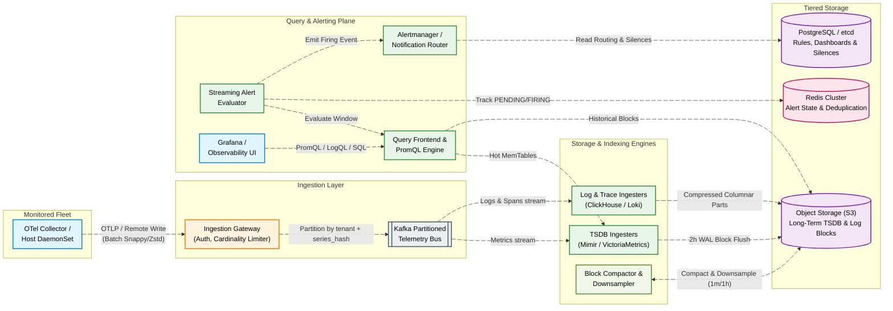
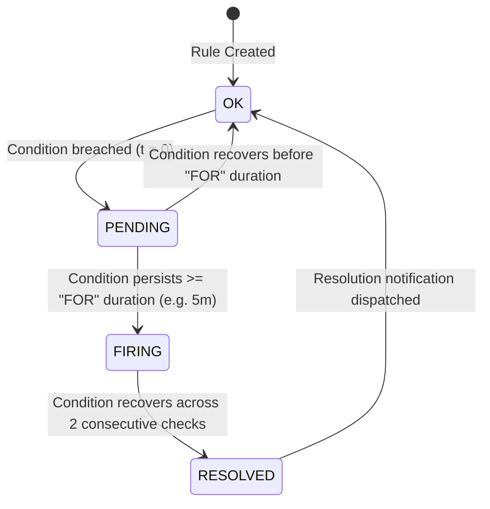
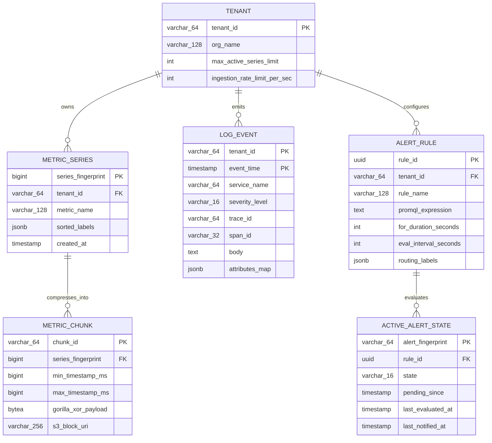
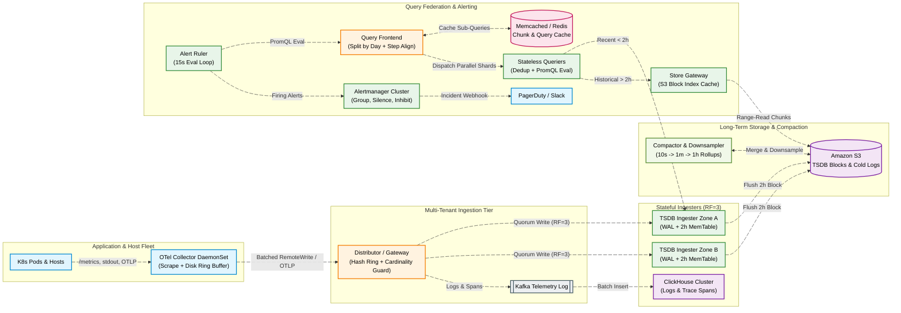

# Metrics Monitoring, Logging & Alerting Platform System Design

[← Back to System Design](system-design.md)

> **Core Building Blocks Used**: [Chapter 4 — Time-Series Databases (Gorilla XOR Compression) & LSM-Trees](fundamentals/04-databases-sql-vs-nosql.md#3-the-10-database-categories-complete-interview-taxonomy) · [Chapter 5 — Kafka High-Throughput Telemetry Ingestion](fundamentals/05-distributed-systems-and-messaging.md#8-asynchronous-messaging-message-queues-vs-pubsub-event-streams) · [Chapter 6 — SLIs/SLOs, P99 Histograms & Observability Pillars (Metrics, Logs, Traces)](fundamentals/06-resiliency-observability-and-metrics.md#3-observability-metrics-logs--distributed-tracing) · [Chapter 7 — Flink Streaming Alert Evaluation](fundamentals/07-probabilistic-structures-and-stream-processing.md#3-stream-processing--event-driven-data-architectures)

## Overview

A **Metrics Monitoring, Logging & Alerting Platform** (like Datadog, Prometheus + Grafana Mimir/Loki, or New Relic) is a unified observability system that collects, compresses, stores, queries, and evaluates telemetry across millions of hosts, containers, and serverless functions. It unifies the **Three Pillars of Observability**:

1. **Metrics**: Numeric time-series data (CPU utilization, p99 latency, request rates, queue depth) sampled at regular intervals and stored in a Time-Series Database (TSDB).
2. **Logs**: High-volume semi-structured JSON or unstructured text events emitted by applications and infrastructure.
3. **Distributed Traces**: End-to-end request waterfalls (`trace_id` / `span_id`) tracking causality and latency across microservice boundaries.
4. **Real-Time Alerting Engine**: Continuously evaluates threshold, rate-of-change, and anomaly detection rules over streaming telemetry, deduplicating and routing incidents to PagerDuty, Slack, or webhooks.

---

## Functional Requirements

- **Telemetry Ingestion**: Collect infrastructure and application metrics, structured logs, and OpenTelemetry (OTLP) spans via lightweight host agents, DaemonSets, or direct SDK push/scrape endpoints.
- **Ad-Hoc Querying & Visualization**: Execute multi-dimensional time-series aggregations (`sum`, `rate`, `histogram_quantile` by tag/label) and full-text/faceted log searches across arbitrary time ranges to power real-time dashboards.
- **Alert Rule Management & Evaluation**: Define composite alert rules (e.g., `p99_latency > 500ms FOR 5m`), evaluate them every 10–60 seconds, and track alert state transitions (`OK` $\to$ `PENDING` $\to$ `FIRING` $\to$ `RESOLVED`).
- **Notification Routing, Grouping & Silencing**: Group related alerts by cluster/service to prevent alert storms, support maintenance silences, and dispatch notifications with escalation policies.
- **Cross-Signal Correlation**: Pivot seamlessly from a spiking metric graph to the exact container logs and distributed trace exemplars (`trace_id`) recorded during that time window.

---

## Non-Functional Requirements

- **High Write Throughput**: Sustained write-heavy ingestion of millions of data points and log lines per second with horizontal partitioning and backpressure handling.
- **Low Query Latency**: Sub-second ($< 500\text{ ms}$) query execution for live operational dashboards (last 1–24 hours) and $< 3\text{ s}$ for 30-day historical rollups.
- **High Availability & Durability**: $99.99\%$ availability for the ingestion and alerting paths — the monitoring system must remain operational even when production clusters suffer cascading outages.
- **Extreme Storage Compression**: Compress time-series samples by $> 10\times$ (via Gorilla XOR + delta-of-delta encoding) and logs by $> 8\times$ (via columnar Zstd compression) with automated tiered retention ($10\text{s} \to 1\text{m} \to 1\text{h}$ downsampling).

---

## Back of the Envelope Estimations

- **Monitored Fleet Scale**:
  - **Hosts**: $100,000$ servers / nodes
  - **Containers / Pods**: $2,000,000$ ephemeral containers
  - **Metrics per Host/Container**: $\sim 500$ metrics per host + $25$ metrics per container = **100M active time series**

- **Metrics Ingestion QPS & Storage**:
  - **Scrape / Collection Interval**: Every $10\text{ seconds}$
  - **Write Throughput**:
    $$\frac{100\text{M active series}}{10\text{ s}} = 10,000,000\text{ samples/sec (10M datapoints/sec)}$$
  - **Raw Sample Size**: $8\text{ bytes}$ (`int64` timestamp) + $8\text{ bytes}$ (`float64` value) = $16\text{ bytes/sample}$ (excluding series label metadata, which is interned once per series ID)
  - **Compressed Sample Size (Gorilla XOR + Delta-of-Delta)**: $\sim 1.37\text{ bytes/sample}$
  - **Daily Compressed TSDB Storage**:
    $$10\text{M samples/sec} \times 86,400\text{ sec/day} \times 1.37\text{ bytes} \approx 1.18\text{ TB/day}$$
  - **1-Year Metrics Storage (with $1\text{m}$ and $1\text{h}$ downsampled rollups)**: $\sim 150\text{ TB}$ on Object Storage (S3).

- **Logs & Traces Ingestion & Storage**:
  - **Log Throughput**: $100,000\text{ hosts} \times 50\text{ logs/sec} = 5,000,000\text{ log events/sec}$
  - **Raw Daily Log Volume**: $5\text{M logs/sec} \times 500\text{ bytes/log} \times 86,400\text{ sec} \approx 216\text{ TB/day raw}$
  - **Compressed Daily Log Volume ($8\times$ Zstd columnar compression)**: $\approx 27\text{ TB/day}$ ($15\text{-day}$ hot/warm retention $\approx 405\text{ TB}$).

---

## High-Level System Architecture



---

## Core Components & Workflows

### 1. Push vs. Pull Collection & Local Agent Buffering

A global observability platform combines **Pull (Scraping)** inside local Kubernetes clusters with **Push (Streaming)** from cluster collectors to the central ingestion pipeline:

- **In-Cluster Pull**: Local OpenTelemetry (OTel) Collectors or Prometheus agents scrape `/metrics` endpoints on co-located pods every $10\text{s}$ and tail `/var/log/containers/*.log`.
- **Edge-to-Central Push**: Agents batch, compress (Snappy/Zstd), and push payloads over HTTP/2 or gRPC (`OTLP` / Prometheus `RemoteWrite`) to the central **Ingestion Gateway**.
- **Local Disk Ring Buffer**: If the central ingestion pipeline or WAN link experiences a transient outage, the host agent buffers up to $1\text{ GB}$ of compressed telemetry in a local disk ring buffer and replays it with original timestamps once connectivity recovers.

### 2. Time-Series Database (TSDB) Storage & Gorilla Compression

Time-series workloads are append-heavy and queried by label selectors (`service="checkout", env="prod"`) over time windows:

```text
┌─────────────────────────────────────────────────────────────────────────┐
│                    TSDB Ingester (2-Hour Head Block)                    │
│                                                                         │
│  1. Inverted Index (Label Matchers → Series IDs)                        │
│     __name__="http_req_total"  ──► [Series 101, Series 102, Series 105] │
│     service="checkout"         ──► [Series 101, Series 104]             │
│     Intersection (Roaring Bitmap): Series 101                           │
│                                                                         │
│  2. Gorilla Chunk Encoding (Series 101)                                 │
│     • Timestamps (Delta-of-Delta):                                      │
│       t0=1000, t1=1010 (Δ=10), t2=1020 (Δ=10, ΔΔ=0 → single '0' bit!)   │
│     • Values (XOR Floating-Point):                                      │
│       v0=12.5, v1=12.5 (XOR=0 → single '0' bit; else store leading/     │
│       trailing zero counts + meaningful XOR bits)                       │
└─────────────────────────────────────────────────────────────────────────┘
```

- **Write-Ahead Log (WAL) & Head Block**: Incoming samples are appended to a local disk WAL and inserted into an in-memory **Head Block** indexed by an inverted posting list (using Roaring Bitmaps for fast `AND`/`OR` label intersections).
- **Gorilla Compression (Facebook Paper)**:
  - **Timestamps (Delta-of-Delta)**: Since scrape intervals are regular ($10\text{s}$), the second derivative $(t_n - t_{n-1}) - (t_{n-1} - t_{n-2})$ is almost always $0$, which is encoded as a single `0` bit ($96\%$ of timestamps compress to $1\text{ bit}$).
  - **Values (XOR Encoding)**: Consecutive `float64` values are XORed with the previous value. Unchanged values compress to a single `0` bit; slowly changing values encode only the shifted meaningful XOR bits.
- **2-Hour Block Cut & Object Storage**: Every 2 hours, the in-memory Head Block is flushed into an immutable block directory (index + compressed chunks) and uploaded to **Object Storage (S3)**.

### 3. Streaming Alert Evaluation & Notification Deduplication



- **Two-Stage Alert Pipeline (Ruler $\to$ Alertmanager)**:
  - **Alert Evaluator (Ruler)**: Sharded across worker nodes using consistent hashing on `rule_group_id`. Every $15\text{s}$, the Ruler executes the rule's query against the **Query Frontend** (which hits in-memory TSDB Head Blocks for the most recent 5–15 minutes, bypassing S3).
  - **`FOR` Duration Anti-Flapping**: A breach first transitions the series state in **Redis** to `PENDING`. Only if the breach remains true continuously for the `FOR` window (e.g., $5\text{ minutes}$) does it transition to `FIRING`.
  - **Alertmanager Grouping & Inhibition**:
    - **Grouping**: If 50 pods in `us-east-1` breach high CPU simultaneously, Alertmanager buffers alerts for `group_wait: 30s` and sends a single consolidated PagerDuty incident (`[FIRING: 50] HighPodCPU in us-east-1`).
    - **Inhibition**: If a cluster-level `NodeNetworkUnreachable` alert is firing, Alertmanager suppresses downstream pod-level health check alerts on that node to eliminate noise.

---

## API Specifications

### 1. Telemetry Ingestion API (`POST /api/v1/write`)

Compatible with Prometheus Remote Write and OpenTelemetry OTLP/HTTP JSON or Protobuf payloads.

- **Headers**: `X-Scope-OrgID: tenant_acme`, `Content-Encoding: zstd`
- **Request Body (Logical Representation)**:

```json
{
  "timeseries": [
    {
      "labels": [
        { "name": "__name__", "value": "http_request_duration_seconds_bucket" },
        { "name": "service", "value": "payment-gateway" },
        { "name": "cluster", "value": "prod-us-east-1" },
        { "name": "le", "value": "0.25" }
      ],
      "samples": [
        { "timestamp_ms": 1761681600000, "value": 482910.0 }
      ],
      "exemplars": [
        {
          "labels": [{ "name": "trace_id", "value": "4bf92f3577b34da6a3ce929d0e0e4736" }],
          "value": 0.214,
          "timestamp_ms": 1761681600000
        }
      ]
    }
  ]
}
```

- **Response (`204 No Content`)**: Empty body on successful append to Kafka/Ingester quorum.

### 2. Range Query API (`GET /api/v1/query_range`)

- **Query Parameters**:
  - `query`: `histogram_quantile(0.99, sum by (le, service) (rate(http_request_duration_seconds_bucket{cluster="prod-us-east-1"}[5m])))`
  - `start`: `2026-10-28T17:00:00Z`
  - `end`: `2026-10-28T18:00:00Z`
  - `step`: `15s`
- **Response (`200 OK`)**:

```json
{
  "status": "success",
  "data": {
    "resultType": "matrix",
    "result": [
      {
        "metric": { "service": "payment-gateway" },
        "values": [
          [1761670800, "0.142"],
          [1761670815, "0.148"],
          [1761670830, "0.195"]
        ]
      }
    ]
  }
}
```

### 3. Create Alert Rule API (`POST /api/v1/alerts/rules`)

- **Request Body**:

```json
{
  "rule_name": "PaymentGatewayHighP99Latency",
  "expr": "histogram_quantile(0.99, sum by (le) (rate(http_request_duration_seconds_bucket{service=\"payment-gateway\"}[5m]))) > 0.5",
  "for_duration": "5m",
  "evaluation_interval": "15s",
  "labels": {
    "severity": "page",
    "team": "payments-oncall"
  },
  "annotations": {
    "summary": "Payment Gateway p99 latency > 500ms for 5m",
    "runbook_url": "https://runbooks.internal/payments/high-latency"
  }
}
```

---

## Object Model & Database Schema

### Database Selection & Rationale

| Workload / Data Domain | Database Choice | Rationale |
| :--- | :--- | :--- |
| **Time-Series Metrics (`metric_series`, `metric_samples`)** | **Prometheus TSDB / Grafana Mimir / VictoriaMetrics (Backed by Amazon S3)** | Custom-built inverted label index (Roaring Bitmaps) + Gorilla XOR/delta-of-delta chunk encoding achieves $\sim 1.37\text{ bytes/sample}$; immutable 2-hour blocks offload cleanly to cheap S3 object storage. |
| **Structured Logs & Distributed Traces (`log_events`, `trace_spans`)** | **ClickHouse (or Grafana Loki / Elasticsearch)** | ClickHouse's columnar storage with Zstd compression, sparse primary indexes on `(tenant_id, service, toStartOfMinute(timestamp))`, and SIMD vectorized execution scans billions of log rows in milliseconds at $5\times$ lower RAM cost than Elasticsearch. |
| **Alert Evaluation State & Deduplication (`active_alert_states`)** | **Redis Cluster** | Tracks high-frequency state transitions (`OK`, `PENDING`, `FIRING`), `first_triggered_at` timestamps, and notification fingerprints with sub-millisecond read/write latency. |
| **Alert Rules, Dashboards & Silences (`alert_rules`, `silences`)** | **PostgreSQL (or etcd)** | Low-volume control-plane metadata requiring strict ACID transactions, version history, and relational RBAC permissions per tenant. |

### Entity-Relationship Diagram



---

## System Design Diagram



---

## Deep Dive & Key Technical Challenges

### 1. High-Cardinality Tag Explosion Protection

The #1 operational failure mode in time-series databases is a **cardinality explosion**: a developer accidentally attaches an unbounded label such as `user_id`, `request_id`, or `ip_address` to a metric. Since every unique combination of key-value labels creates a distinct time series in the inverted index, a metric with $10\text{M}$ unique `user_id` values creates $10\text{M}$ new series, exhausting Ingester RAM (OOM) across the cluster.

- **Mitigation Architecture**:
  1. **Per-Tenant & Per-Metric Series Quotas**: The Distributor / Ingester tracks active series counts using HyperLogLog and exact per-shard hash tables, enforcing hard limits (e.g., max $1\text{M}$ active series per tenant, max $50,000$ series per metric name).
  2. **Automatic Label Drop / Relabeling Rules**: Administrators can push dynamic relabeling configs to the Distributor or OTel Collector (`action: labeldrop`, `regex: "user_id|session_id"`) that strip offending labels at the edge before they enter the TSDB index, without requiring an application redeploy.
  3. **Exemplars Instead of High-Cardinality Labels**: Instead of putting `trace_id` into metric labels, attach sample `trace_id` values as **Prometheus Exemplars** alongside histogram buckets, preserving trace correlation with zero index cardinality overhead.

### 2. Downsampling & Tiered Retention Compaction

Querying 1 year of raw $10\text{s}$-resolution metrics ($3.15\text{M}$ data points per series) to render a 1,000-pixel-wide dashboard chart wastes I/O and CPU.

- **Compactor & Downsampler Pipeline**:
  - **Raw Resolution ($10\text{s}$)**: Retained for **15 days** for fine-grained incident forensics.
  - **1-Minute Rollups ($1\text{m}$)**: Background **Compactor** workers stream 2-hour raw blocks from S3 and pre-compute `min`, `max`, `sum`, `count`, and native histogram sketches at $1\text{m}$ resolution, retained for **90 days**.
  - **1-Hour Rollups ($1\text{h}$)**: Retained for **1–2 years** ($360\times$ fewer data points than raw $10\text{s}$ data).
- **Query Frontend Step-Alignment & Caching**:
  - When a user queries a 90-day range, the **Query Frontend** automatically routes the query to the $1\text{h}$ downsampled blocks, splits the 90-day query into 90 parallel 1-day sub-queries, serves historical days from **Memcached/Redis**, and only computes the trailing live window from the Ingesters.

### 3. Alert Pipeline Availability During Outages (Meta-Monitoring)

If the region hosting the monitoring cluster suffers a network partition or overload during an incident, alerts could fail silently when they are needed most.

- **Dead Man's Switch (Watchdog Heartbeat)**: Every Alert Ruler cluster continuously fires an `AlwaysFiringHeartbeat` alert every $60\text{s}$ to an external cross-region receiver (or PagerDuty Dead Man's Snitch). If the heartbeat stops arriving for $> 3\text{ minutes}$, PagerDuty automatically pages the Observability SRE team that the alerting pipeline itself is degraded.
- **Query Priority Queues**: The Query Frontend isolates **Ruler Alert Evaluation queries** into a dedicated high-priority execution pool separate from ad-hoc user dashboard queries, ensuring an expensive user dashboard query can never starve or delay critical production alerts.
