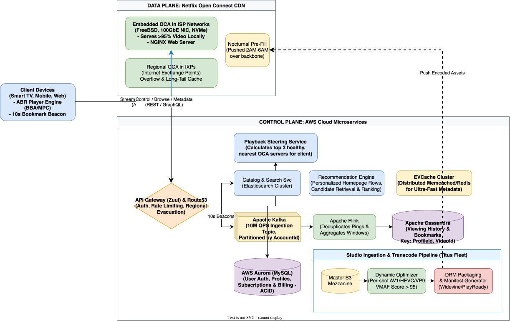
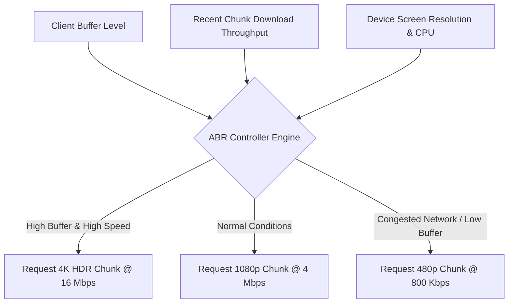

# Netflix System Design

[← Back to System Design](../system-design.md)

## Overview

Netflix is the world's leading subscription-based streaming video-on-demand (SVOD) platform, serving over 260 million subscribers in more than 190 countries. The platform delivers hundreds of millions of hours of personalized video daily across thousands of diverse consumer device profiles (Smart TVs, mobile phones, game consoles, browsers, set-top boxes).

Architecturally, Netflix is split into two distinct, decoupled subsystems:

1. **The AWS Cloud (Control Plane)**: Manages everything that happens *before* the user presses "Play"—including user account authentication, billing, catalog browsing, personalized ML recommendations, video ingestion, chunked multi-codec transcode pipelines, and API gateway routing.
2. **Netflix Open Connect (Data Plane)**: A purpose-built, globally distributed Content Delivery Network (CDN) consisting of custom physical hardware appliances (**Open Connect Appliances, or OCAs**) embedded directly within thousands of Internet Service Provider (ISP) networks and Internet Exchange Points (IXPs) worldwide, serving 100% of video streaming traffic locally.

---

## Functional Requirements

* **Adaptive Video Streaming**: Smooth, uninterrupted video playback utilizing Adaptive Bitrate Streaming (ABR via HLS and MPEG-DASH) that dynamically adjusts video resolution and bitrate based on changing client bandwidth and device capabilities.
* **Content Search & Personalized Recommendation**: Instant title and actor search; personalized home screen rows generated by deep learning recommendation models.
* **Multi-Profile Management**: Up to 5 discrete profiles per account with independent watch histories, ratings, language preferences, and maturity levels.
* **Playback State Synchronization ("Continue Watching")**: Synchronize playback timestamp bookmarks every few seconds across all user devices to allow seamless resumption.
* **Offline Download**: Secure, time-limited video downloads on mobile devices packaged with Hardware DRM.
* **Video Ingestion & Transcoding Pipeline**: Ingest uncompressed 4K studio masters, slice into scenes, transcode into hundreds of codec/resolution profiles, and apply DRM encryption.
* **Subscription & Multi-Tier Billing**: Support monthly subscription renewals across global currencies, gift cards, and partner telco integrations.

---

## Non-Functional Requirements

* **Ultra-Low Playback Latency**: Time-to-First-Frame (TTFF) must be **< 300–500 ms** from the moment the user clicks "Play".
* **Zero Mid-Stream Stutter & Buffering**: Re-buffering rate must be strictly **< 0.25%** of all streaming sessions.
* **Massive Global Scale & Throughput**: Capable of streaming over **100+ Terabits per second (Tbps)** of peak concurrent video delivery worldwide.
* **Extreme High Availability (99.999% for Playback)**: Even if core AWS control plane microservices fail, users currently watching video must continue streaming without disruption.
* **Content Security & DRM**: Complete protection against digital piracy using Widevine (Google/Android), FairPlay (Apple), and PlayReady (Microsoft) hardware DRM.
* **Chaos Resilience**: Systems must be self-healing, surviving entire cloud availability zone (AZ) or regional outages via automated traffic evacuation.

---

## Back of the Envelope Estimations

### Scale & Traffic

* **Total Global Subscribers**: $260\text{ Million}$.
* **Daily Active Users (DAU)**: $100\text{ Million}$.
* **Average Daily Viewing Time**: $2\text{ hours/day}$ per active user.
* **Total Video Hours Streamed per Day**:
  $$\text{Daily Streamed Hours} = 100,000,000 \times 2 = 200,000,000\text{ hours/day}$$
* **Average Video Bitrate**: $\approx 3.5\text{ Mbps}$ (blended across SD at 1.5 Mbps, 1080p HD at 3.5–5 Mbps, and 4K HDR at 15–20 Mbps).
* **Total Daily Bandwidth Delivered**:
  $$200,000,000\text{ hours} \times 3,600\text{ s} \times 3.5\text{ Mbps} = 2.52\times 10^{12}\text{ Megabits} \approx 315\text{ Petabytes/day}$$
* **Peak Global Throughput** (Assuming a 4-hour evening prime-time window carries 50% of the day's traffic):
  $$\text{Peak Bandwidth} = \frac{0.50 \times 2.52\times 10^{15}\text{ bits}}{4 \times 3,600\text{ seconds}} \approx 87.5\text{ Terabits per second (Tbps)}$$

### Storage Requirements (Video Catalog)

* **Active Catalog Titles**: $\approx 15,000\text{ movies and series episodes}$.
* **Average Title Duration**: 60 minutes.
* **Encoding Multiplicity**: Each title is encoded across:
  * Codecs: AVC (H.264), HEVC (H.265), VP9, AV1.
  * Resolutions: 360p, 480p, 720p, 1080p, 4K, HDR10, Dolby Vision.
  * Audio tracks: Stereo AAC, 5.1 Dolby Digital, Dolby Atmos, and 30+ language dubs.
  * Result: **120+ distinct media stream representations per title**.
* **Storage per Encoded Title**: $\approx 120\text{ streams} \times 1.5\text{ GB average} \approx 180\text{ GB per title}$.
* **Master High-Res Mezzanine Archive**: $\approx 15,000 \times 500\text{ GB master} \approx 7.5\text{ Petabytes}$.
* **Total Encoded Catalog Storage in S3**:
  $$15,000 \times 180\text{ GB} \approx 2.7\text{ Petabytes}$$
* *Note*: Distributed across tens of thousands of OCA servers globally with proactive caching.

### Bookmark / Playback State Write Traffic

* 100M concurrent streams report playback position telemetry every **10 seconds**:
  $$\text{Playback State QPS} = \frac{100,000,000}{10} = 10,000,000\text{ writes/sec (10M QPS)}$$
* Handled via client-side coalescing, edge buffering, Apache Kafka, and partitioned Apache Cassandra clusters.

---

## High-Level Architecture

```text
                                  ┌────────────────────────┐
                                  │      Client Device     │
                                  │ (SmartTV, Phone, Web)  │
                                  └────┬──────────────┬────┘
                                       │              │
                   1. Browse / Control │              │ 2. Stream Video
                      (REST / GraphQL) │              │    (HLS/DASH Chunks)
                                       ▼              ▼
┌──────────────────────────────────────────────┐   ┌────────────────────────────────┐
│           AWS CLOUD (CONTROL PLANE)          │   │  OPEN CONNECT (DATA PLANE/CDN) │
│                                              │   │                                │
│          ┌────────────────────────┐          │   │  ┌──────────────────────────┐  │
│          │  Route53 / Zuul Gateway│          │   │  │ Embedded OCA in ISP IXP  │  │
│          └───────────┬────────────┘          │   │  │ (Custom FreeBSD Hardware)│  │
│                      │                       │   │  │  - NGINX Video Streamer  │  │
│         ┌────────────┼────────────┐          │   │  │  - 100GbE NIC / NVMe Flash│  │
│         ▼            ▼            ▼          │   │  └──────────────▲───────────┘  │
│   ┌───────────┐┌───────────┐┌───────────┐    │   │                 │              │
│   │  Catalog  ││  Profile  ││ Playback  │    │   │                 │ Nocturnal    │
│   │  Search   ││ & Billing ││ Steering  │    │   │                 │ Pre-fill     │
│   └─────┬─────┘└─────┬─────┘└─────┬─────┘    │   └─────────────────┼──────────────┘
│         │            │            │          │                     │
│         │            ▼            ▼          │                     │
│         │      ┌───────────┐┌───────────┐    │                     │
│         │      │ AWS Aurora││ EVCache / │    │                     │
│         │      │  (MySQL)  ││ Redis     │    │                     │
│         │      └───────────┘└─────┬─────┘    │                     │
│         │                         │          │                     │
│         ▼                         ▼          │                     │
│   ┌───────────┐             ┌───────────┐    │   ┌─────────────────┴──────────┐
│   │Elastic-   │             │ Apache    │    │   │   S3 Encoded Master Assets │
│   │search     │             │ Cassandra │    │   │   & Transcoding Workers    │
│   └───────────┘             │ (Bookmarks│    │   │   (Dynamic Optimizer / Titus)│
│                             └───────────┘    │   └────────────────────────────┘
└──────────────────────────────────────────────┴────────────────────────────────────┘
```

---

## Core Components

### 1. The Open Connect CDN (Data Plane)

* **Open Connect Appliances (OCAs)**: Tailor-designed $1\text{U}/2\text{U}$ FreeBSD servers equipped with high-throughput network cards ($100\text{ Gbps}$ interfaces) and up to $300\text{ TB}$ of enterprise NVMe/SSD storage.
* **Proactive Nocturnal Pre-Positioning**: Instead of relying on passive pull-through caching, Netflix uses predictive algorithms to determine what users will watch in each geographic area. Between **2 AM and 6 AM** (local ISP off-peak hours), master files are pushed directly from AWS S3 to the ISP's local OCAs. By evening prime time, **> 95% of video requests hit the local ISP appliance**, bypassing the internet backbone completely.
* **Playback Steering Service**: When a user clicks "Play", the client requests a manifest from AWS. The Playback Steering Service checks network health, ISP origin, and real-time OCA load, returning an ordered list of the top 3 closest, healthy OCA server URLs.

### 2. Video Ingestion & Transcoding Pipeline (Dynamic Optimizer)

1. **Master Mezzanine Upload**: Studios upload uncompressed master files to AWS S3.
2. **Scene & Shot Chunking**: Rather than encoding whole 2-hour files, movies are split into discrete 2–3 second chunks or scene-based shots.
3. **Per-Title & Per-Shot Encoding (Dynamic Optimizer)**:
   * A high-action scene (e.g., explosions, fast car chases) requires high bitrate to prevent block artifacts.
   * A low-motion scene (e.g., static dialogue against a plain wall) achieves identical perceptual quality (**VMAF score > 95**) at a fraction of the bitrate.
   * Machine learning optimizes the bitrate curve dynamically per shot, saving up to **30% network bandwidth** without human-perceptible quality loss.
4. **DRM Packaging**: Video chunks are encrypted using AES-128 and packaged into standard manifests (M3U8 for HLS, MPD for MPEG-DASH).

### 3. Data Tier & Storage Strategy

* **AWS Aurora (MySQL Compatible)**: ACID transactions for user identity, authentication, subscriptions, billing history, and payment processing.
* **Apache Cassandra**: Horizontally scalable wide-column NoSQL database used for:
  * **Viewing History & Bookmarks**: Keyed by `(account_id, profile_id)`. High write volume, tunable eventual consistency (`LOCAL_QUORUM`).
* **EVCache (Distributed Memcached)**: In-memory cache layer deployed across AWS regions for microsecond retrieval of catalog metadata, user entitlements, and personalized row layouts.
* **Elasticsearch**: Powering title search, typo tolerance, autocomplete, actor/genre indexing, and real-time suggestions.

---

## API Specifications

### 1. Get Playback URLs & Manifest

Retrieves video chunks and authorized OCA playback nodes.

```http
POST /api/v1/playback/license-and-manifest
Authorization: Bearer <user_jwt_token>
Content-Type: application/json
```

```json
// Request
{
  "profileId": "prof_81726a",
  "videoId": 80057281,
  "clientCapabilities": {
    "supportedCodecs": ["AV1", "HEVC", "H264"],
    "supportedHdr": ["DOLBY_VISION", "HDR10"],
    "maxResolution": "3840x2160",
    "drmSystem": "WIDEVINE_L1"
  }
}

// Response: 200 OK
{
  "manifestUrl": "https://oca-nyc-isp4.netflix.com/manifest/80057281.mpd",
  "backupManifestUrls": [
    "https://oca-nyc-ixp1.netflix.com/manifest/80057281.mpd",
    "https://oca-bos-isp1.netflix.com/manifest/80057281.mpd"
  ],
  "drmLicenseServerUrl": "https://drm.netflix.com/license/widevine",
  "resumeTimestampSec": 1428.5
}
```

### 2. Update Playback Bookmark (Beacon)

Client periodically reports playback offset (buffered beacon every 10 seconds).

```http
POST /api/v1/playback/bookmark
Authorization: Bearer <user_jwt_token>
Content-Type: application/json
```

```json
// Request
{
  "profileId": "prof_81726a",
  "videoId": 80057281,
  "offsetSeconds": 1438.2,
  "durationSeconds": 7200.0,
  "sessionId": "play_sess_90ab31e",
  "rebufferCount": 0
}

// Response: 204 No Content
```

---

## Object Model & Data Entities

```text
┌─────────────────────────┐          ┌─────────────────────────┐
│         Account         │1        *│         Profile         │
├─────────────────────────┤──────────├─────────────────────────┤
│ accountId: PK (UUID)    │          │ profileId: PK (UUID)    │
│ email: Varchar(255)     │          │ accountId: FK           │
│ passwordHash: Varchar   │          │ name: Varchar(50)       │
│ subscriptionTier: Enum  │          │ avatarUrl: Varchar      │
│ billingCycleDate: Date  │          │ maturityRating: Enum    │
│ status: Enum            │          │ languagePref: Char(5)   │
└─────────────────────────┘          └────────────┬────────────┘
                                                  │1
                                                  │*
┌─────────────────────────┐          ┌────────────▼────────────┐
│          Video          │1        *│       WatchHistory      │
├─────────────────────────┤──────────├─────────────────────────┤
│ videoId: PK (BigInt)    │          │ historyId: PK (UUID)    │
│ title: Varchar(255)     │          │ profileId: FK           │
│ description: Text       │          │ videoId: FK             │
│ durationSeconds: Int    │          │ lastWatchedOffsetSec: D │
│ releaseYear: Int        │          │ completionPercentage: D │
│ maturityRating: Enum    │          │ completed: Boolean      │
│ isSeries: Boolean       │          │ updatedAt: Timestamp    │
└────────────┬────────────┘          └─────────────────────────┘
             │1
             │*
┌────────────▼────────────┐
│      VideoEncoding      │
├─────────────────────────┤
│ encodingId: PK (UUID)   │
│ videoId: FK             │
│ codec: Enum (AV1, HEVC) │
│ resolution: Enum        │
│ bitrateKbps: Int        │
│ s3MasterPath: Varchar   │
│ manifestPath: Varchar   │
└─────────────────────────┘
```

---

## System Design Diagram



[Download Draw.io File](netflix.drawio)

---

## Deep Dive & Key Technical Challenges

### 1. Adaptive Bitrate (ABR) Algorithms

Streaming video doesn't download as a single file; it is segmented into small chunks (usually **2 to 4 seconds long**).
The client video player runs an ABR algorithm to decide which resolution chunk to request next:

* **Throughput-Based Algorithms**: Measures the download speed of the previous chunk. If network speed is high, step up resolution; if speed drops, step down immediately to prevent buffer starvation.
* **Buffer-Based Algorithm (BBA)**: Ignores instantaneous network spikes and measures client buffer capacity (in seconds). If the buffer holds $>30\text{ seconds}$ of video, request maximum bitrate. If the buffer drops below $10\text{ seconds}$, degrade resolution instantly to keep playback moving.
* **Model Predictive Control (MPC)**: Netflix combines throughput forecasting with buffer occupancy using stochastic optimization for smooth, stutter-free playback.



### 2. High-Throughput Write Path for Playback Bookmarks (10M QPS)

Writing bookmarks to disk synchronously on every beacon would overwhelm standard databases. Netflix resolves this using a multi-tiered pipeline:

1. **Client-Side Coalescing**: Device buffers progress updates and flushes every 10 seconds or immediately upon pause/exit.
2. **Kafka Event Stream**: Requests hit the API Gateway and are written directly into an **Apache Kafka** topic partitioned by `account_id`.
3. **Stream Processing (Apache Flink)**: Consumes Kafka records, de-duplicates redundant pings within the same sliding window, and updates **EVCache** immediately so "Continue Watching" updates in real time.
4. **Cassandra Persistent Store**: Flink writes micro-batches to Cassandra using `profile_id` as the partition key.

### 3. Chaos Engineering & Regional Evacuation

Netflix pioneered **Chaos Engineering** (Chaos Monkey, Chaos Kong) to guarantee resilience:

* **Chaos Kong**: Simulates an entire AWS region outage by dropping connectivity to AWS us-east-1.
* **Active-Active Multi-Region Deployment**: Services and data are replicated across 3 AWS regions (us-east-1, us-west-2, eu-west-1).
* **Automated Region Failover**: Using DNS routing (Route53) and Zuul, 100% of traffic from a failing region can be evacuated and re-routed to healthy regions in **less than 7 minutes** without dropping streams.

---

## Additional Notes

### Video References

* [](https://www.youtube.com/watch?v=psQzyFfsUGU)
* [](https://www.youtube.com/watch?v=lYoSd2WCJTo)
