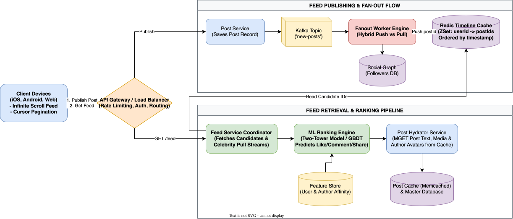
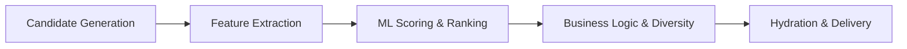

# News Feed System Design

[← Back to System Design](../system-design.md)

## Overview

A News Feed system is a real-time, personalized content aggregation and ranking engine that continuously compiles posts, photos, videos, and status updates from friends, followed pages, and algorithmic recommendation engines into an infinite scrollable stream.

Prominent examples include Facebook News Feed, Instagram Feed, Twitter/X Home Timeline, and LinkedIn Feed. The core engineering challenge is delivering sub-second personalized feeds to hundreds of millions of concurrent users while handling extreme read-to-write asymmetries, massive fan-out write amplification, and complex multi-factor ranking algorithms.

---

## Functional Requirements

* **Feed Publishing**: When a user creates a post (status update, photo, video, link), the post must be distributed to the feeds of all their followers/friends.
* **Feed Generation & Retrieval**: Users can fetch their personalized news feed ordered chronologically or scored by an algorithmic ranking model.
* **Infinite Scroll & Pagination**: Fast, cursor-based pagination supporting continuous feed scrolling without duplicate items or skipped posts.
* **Media Content Rendering**: Display embedded media (images, video previews, link cards, user tags).
* **Social Engagement**: Seamless integration with real-time like counts, comment counts, and shares.

---

## Non-Functional Requirements

* **Ultra-Low Latency**: Feed retrieval must return the top 20 posts in **$< 150–200\text{ ms}$** (P95).
* **High Availability (99.99%)**: The feed is the primary user retention surface. If the ranking pipeline is slow or fails, the system must gracefully fall back to a chronological or cached feed.
* **Eventual Consistency**: New posts may appear in a follower's feed within 2–5 seconds of being published.
* **Scalability**: Handle **$300\text{ Million}$ Daily Active Users (DAU)** with up to $50,000$ feed queries per second at peak.

---

## Back of the Envelope Estimations

### Scale & Traffic

* **Daily Active Users (DAU)**: $300\text{ Million}$.
* **Average Feed Refreshes per User**: $10\text{ times/day}$.
* **Total Daily Feed Reads**:
  $$300,000,000 \times 10 = 3,000,000,000\text{ feed reads/day}$$
* **Average Read QPS**:
  $$\text{Feed Read QPS} = \frac{3,000,000,000}{86,400} \approx 35,000\text{ QPS} \quad (\text{Peak: } \approx 70,000\text{ QPS})$$
* **New Posts Published Daily**:
  * Assume $20\%$ of users publish 1 post per day:
  $$300,000,000 \times 0.20 = 60,000,000\text{ posts/day}$$
* **Average Post Ingestion QPS**:
  $$\text{Post Write QPS} = \frac{60,000,000}{86,400} \approx 700\text{ writes/sec} \quad (\text{Peak: } \approx 1,500\text{ QPS})$$

### Feed Cache Sizing (Redis Cluster)

* **Strategy**: Cache the top 500 post IDs for the top $20\%$ most active users ($60\text{ Million users}$).
* **Memory per User**:
  $$500\text{ post IDs} \times 8\text{ bytes (Int64)} = 4,000\text{ bytes} \approx 4\text{ KB}$$
* **Total Cache RAM Required**:
  $$60,000,000 \times 4\text{ KB} = 240\text{ Gigabytes}$$
  *(Even doubling for replication and metadata overhead, $\approx 500\text{ GB}$ easily fits on a small Redis cluster).*

---

## High-Level System Architecture

```text
┌────────────────────────────────────────────────────────────────────────┐
│                              CLIENT APPS                               │
└───────────────────────────────────┬────────────────────────────────────┘
                                    │
                 ┌──────────────────┴──────────────────┐
                 │ 1. POST /feed/posts                 │ 2. GET /feed
                 ▼                                     ▼
┌─────────────────────────────────┐   ┌─────────────────────────────────┐
│       Post Ingestion Flow       │   │       Feed Retrieval Flow       │
│                                 │   │                                 │
│    ┌───────────────────────┐    │   │    ┌───────────────────────┐    │
│    │  Post Service         │    │   │    │  Feed Service         │    │
│    └──────────┬────────────┘    │   │    └──────────┬────────────┘    │
│               │                 │   │               │                 │
│               ▼                 │   │               ▼                 │
│    ┌───────────────────────┐    │   │    ┌───────────────────────┐    │
│    │  Apache Kafka Topic   │    │   │    │  Redis Feed Cache     │    │
│    │  ('new-posts')        │    │   │    │  (ZSet per User)      │    │
│    └──────────┬────────────┘    │   │    └──────────┬────────────┘    │
│               │                 │   │               │                 │
│               ▼                 │   │               ▼                 │
│    ┌───────────────────────┐    │   │    ┌───────────────────────┐    │
│    │  Fanout Workers Engine│    │   │    │  Post & Author Hydrator│   │
│    └────┬─────────────┬────┘    │   │    │  (Memcached / DB)     │    │
│         │             │         │   │    └──────────┬────────────┘    │
└─────────┼─────────────┼─────────┘   └───────────────┼─────────────────┘
          │             │                             │
          ▼             ▼                             ▼
┌──────────────┐ ┌──────────────┐             ┌──────────────┐
│ Social Graph │ │ Redis Feed   │             │ Post Master  │
│ (Followers)  │ │ Cache (ZSet) │             │ Database     │
└──────────────┘ └──────────────┘             └──────────────┘
```

---

## Core Workflows: Fanout Strategies

### 1. Fanout-on-Write (Push Model)

* **How it works**: When a user creates a post, the Fanout Service queries their followers list from the Social Graph Service and writes the `postId` directly into every follower's Redis feed cache (Sorted Set).
* **Pros**:
  * Real-time feed retrieval is extremely fast: $O(1)$ lookup from Redis.
* **Cons**:
  * **Celebrity Hotspot / Write Amplification**: An account with 40M followers triggers 40M write operations for a single post.
  * Inactive users waste cache space receiving pre-computed feeds they never read.

### 2. Fanout-on-Read (Pull Model)

* **How it works**: The user's feed is not generated ahead of time. When a user requests their feed, the system queries the latest posts from all people they follow, merges them, and ranks them on the fly.
* **Pros**:
  * No write amplification. Inactive users consume zero system resources.
* **Cons**:
  * High read latency: Querying hundreds of accounts and merge-sorting on every feed load overwhelms the database.

### 3. The Hybrid Fanout Architecture

The production industry standard splits users into two classes:

1. **Regular Users ($< 20,000$ followers)**: Use **Fanout-on-Write**. Their posts are pushed into their followers' Redis caches immediately.
2. **Celebrity Accounts ($> 20,000$ followers)**: Use **Fanout-on-Read**. Their posts are *not* broadcast to millions of follower caches.
3. **Feed Merge on Read**: When a follower fetches their feed:
   * Read the follower's pre-computed Redis cache (posts from regular friends).
   * Fetch the latest posts from the celebrities they follow.
   * Merge the two lists in memory and apply ranking.

---

## API Specifications

### 1. Publish a Post

```http
POST /api/v1/posts
Authorization: Bearer <user_token>
Content-Type: application/json
```

```json
// Request
{
  "content": "Excited to share our new distributed systems architecture!",
  "mediaUrls": ["https://cdn.example.com/images/arch.png"],
  "visibility": "PUBLIC"
}

// Response: 201 Created
{
  "postId": "pst_9812490124",
  "authorId": "usr_44012",
  "createdAt": 1730005200
}
```

### 2. Retrieve News Feed

```http
GET /api/v1/feed?limit=20&cursor=pst_9812490000
Authorization: Bearer <user_token>
```

```json
// Response: 200 OK
{
  "items": [
    {
      "postId": "pst_9812490124",
      "author": {
        "userId": "usr_44012",
        "name": "Tarun Batta",
        "avatarUrl": "https://cdn.example.com/avatars/44012.jpg"
      },
      "content": "Excited to share our new distributed systems architecture!",
      "mediaUrls": ["https://cdn.example.com/images/arch.png"],
      "likeCount": 312,
      "commentCount": 42,
      "createdAt": 1730005200
    }
  ],
  "nextCursor": "pst_9812488500",
  "hasMore": true
}
```

---

## Object Model & Database Schema

```text
┌───────────────────────┐          ┌───────────────────────┐
│         User          │1        *│         Post          │
├───────────────────────┤──────────├───────────────────────┤
│ userId: PK (BigInt)   │          │ postId: PK (BigInt)   │
│ username: Varchar(50) │          │ authorId: FK (BigInt) │
│ email: Varchar(255)   │          │ content: Text         │
│ followerCount: Int    │          │ mediaUrls: JSON       │
│ isCelebrity: Boolean  │          │ likeCount: Int        │
└──────────┬────────────┘          │ commentCount: Int     │
           │1                      │ createdAt: Timestamp  │
           │*                      └───────────────────────┘
┌──────────▼────────────┐
│      FollowEdge       │
├───────────────────────┤
│ followerId: PK, FK    │
│ followeeId: PK, FK    │
│ createdAt: Timestamp  │
└───────────────────────┘
```

---

## System Design Diagram



[Download Draw.io File](news-feed.drawio)

---

## Deep Dive: Algorithmic Feed Ranking Pipeline

While chronological feeds simply sort by `createdAt DESC`, modern feeds rank content by predicted user engagement.



1. **Candidate Generation (Retrieval)**:
   * Pull top 500 recent post IDs from friends and followed pages.
2. **Feature Extraction**:
   * **User Features**: Past engagement history, active times of day, preferred topics.
   * **Author Features**: Affinity score between viewer and author (message frequency, previous likes).
   * **Post Features**: Post age, media type (video vs image), current like/comment velocity.
3. **ML Scoring (Two-Tower Neural Network / GBDT)**:
   $$\text{Score} = w_1 P(\text{click}) + w_2 P(\text{like}) + w_3 P(\text{comment}) + w_4 P(\text{share}) - w_5 P(\text{hide})$$
4. **Diversity & Deduplication Filters**:
   * Prevent showing 5 consecutive posts from the same author.
   * Insert sponsored/promoted posts at fixed intervals (e.g., every 5th post).
5. **Post Hydration**:
   * The scored feed contains only IDs. The hydrator performs a multi-key get (`MGET`) against Memcached/Redis to inject full post text, user avatars, and media URLs in $< 10\text{ ms}$.

---

## Additional Notes

### Video References

* [](https://www.youtube.com/watch?v=Qj4-GruzyDU)
* [](https://www.youtube.com/watch?v=PE7ZwE5Ace4)
