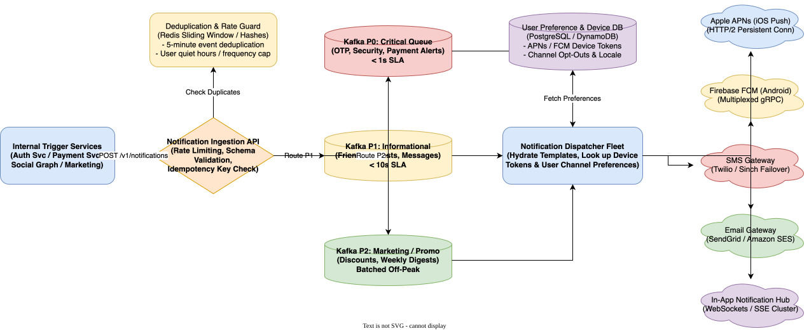

# Notification System Design

[← Back to System Design](../system-design.md)

## Overview

A modern distributed notification system serves as the mission-critical communication backbone for consumer and enterprise platforms. It delivers hundreds of millions of notifications daily across multiple communication channels—Mobile Push (iOS APNs, Android FCM), SMS, Email, and In-App WebSockets.

Designing an enterprise-grade notification platform presents rigorous distributed engineering challenges:

1. **Multi-Channel Fan-Out & Rate Heterogeneity**: Pushing high-volume bursts to external provider gateways with wildly varying throughput limits (e.g. APNs handles millions of concurrent HTTP/2 streams, while SMS carrier aggregators strictly throttle to 100 SMS/sec per shortcode).
2. **Strict Priority Queuing & SLA Isolation**: Ensuring promotional marketing campaigns never delay time-sensitive security alerts (e.g., 2FA verification codes, fraud warnings).
3. **Deduplication & User Fatigue Controls**: Preventing duplicate notifications across system retries and enforcing quiet hours (Do Not Disturb) and frequency caps.
4. **Third-Party Fault Tolerance**: Handling sudden downtime or throttling from external gateways with automated circuit breaking and dynamic fallback.

---

## Functional Requirements

* **Multi-Channel Delivery**: Support iOS Push (Apple APNs), Android Push (Firebase Cloud Messaging - FCM), SMS (Twilio, Sinch), Email (Amazon SES, SendGrid), and In-App persistent notifications.
* **Priority Tiers**:
  * **P0 (Critical)**: Two-Factor Auth (OTP), fraud alerts, password resets. Delivered in $< 1\text{ second}$.
  * **P1 (Informational)**: Direct messages, ride arrival updates, order status. Delivered in $< 10\text{ seconds}$.
  * **P2 (Marketing / Bulk)**: Promotional discounts, product recommendations, newsletters. Batched during off-peak hours.
* **User Preferences & Consent**: Users can opt in/out per channel and category, specify quiet hours in their local timezone, and set global daily frequency caps.
* **Template Hydration & Localization**: Dynamic templates parameterized with localized strings, currency formats, and user variables.
* **Delivery & Engagement Tracking**: Track end-to-end status (`queued`, `sent`, `delivered`, `failed`, `opened`, `clicked`).

---

## Non-Functional Requirements

* **Low Latency**: P0 notifications delivered to external provider gateways in **$< 500\text{ ms}$** P99.
* **High Throughput**: Capable of ingesting and dispatching over **$100,000\text{ notifications/second}$** during flash sales or breaking news.
* **Zero Lost Critical Alerts**: At-least-once delivery guarantee for all transactional notifications with dead-letter queue (DLQ) support.
* **Deduplication Guarantee**: Deduplicate identical messages sent within a configurable sliding window (e.g., 5 minutes).
* **Fault Isolation**: Outages or latency spikes in one channel (e.g., SMS provider outage) must never cascade to push or email channels.

---

## Back of the Envelope Estimations

### Traffic & Scale

* **Daily Active Users (DAU)**: $100\text{ Million}$.
* **Average Notifications per User / Day**: $5\text{ notifications/day}$.
* **Daily Notification Volume**:
  $$100,000,000\text{ users} \times 5\text{ alerts} = 500,000,000\text{ notifications/day}$$
* **Average Delivery QPS**:
  $$\text{Average QPS} = \frac{500,000,000}{86,400} \approx 5,787\text{ QPS}$$
* **Peak Delivery QPS (Breaking News / Flash Sale)**: $15\times$ average $= \approx 85,000\text{ QPS}$.

### Channel Distribution

* **Push (APNs / FCM)**: $60\% \implies 300\text{M/day} \quad (\approx 50,000\text{ peak QPS})$.
* **Email (SES / SendGrid)**: $25\% \implies 125\text{M/day} \quad (\approx 21,000\text{ peak QPS})$.
* **SMS (Twilio / Sinch)**: $10\% \implies 50\text{M/day} \quad (\approx 8,500\text{ peak QPS})$.
* **In-App WebSockets**: $5\% \implies 25\text{M/day} \quad (\approx 4,200\text{ peak QPS})$.

---

## High-Level System Architecture

```text
                                  ┌────────────────────────┐
                                  │   Upstream Services    │
                                  │ (Auth, Payment, Social)│
                                  └───────────┬────────────┘
                                              │ POST /v1/notifications
                                              ▼
┌─────────────────────────────────────────────────────────────────────────────┐
│                           INGESTION API GATEWAY                             │
│  - Authentication, Rate Limiting, Idempotency Check                         │
└──────────────────────────────────────┬──────────────────────────────────────┘
                                       │
                                       ▼
┌─────────────────────────────────────────────────────────────────────────────┐
│                      DEDUPLICATION & PREFERENCE GUARD                       │
│  - Redis Sliding Window Dedupe: (userId, eventType, hash)                   │
│  - User Preferences & Timezone Quiet Hours Evaluation                       │
└──────────────────────────────────────┬──────────────────────────────────────┘
                                       │
                                       ▼
┌─────────────────────────────────────────────────────────────────────────────┐
│                         ISOLATED PRIORITY QUEUES                            │
│                                                                             │
│  ┌──────────────────────┐  ┌──────────────────────┐  ┌───────────────────┐  │
│  │ Kafka Topic: P0      │  │ Kafka Topic: P1      │  │ Kafka Topic: P2   │  │
│  │ (OTP / Critical)     │  │ (Informational)      │  │ (Promotions/Bulk) │  │
│  └──────────┬───────────┘  └──────────┬───────────┘  └─────────┬─────────┘  │
└─────────────┼─────────────────────────┼────────────────────────┼────────────┘
              │                         │                        │
              └────────────────────┬────┴────────────────────────┘
                                   │
                                   ▼
┌─────────────────────────────────────────────────────────────────────────────┐
│                        DISPATCHER & TEMPLATE WORKERS                        │
│  - Hydrate Templates with localized strings & metadata                      │
│  - Retrieve valid device tokens (APNs / FCM) and contact details            │
└──────────────────────────────────────┬──────────────────────────────────────┘
                                       │
                                       ▼
┌─────────────────────────────────────────────────────────────────────────────┐
│                         CHANNEL GATEWAY WORKERS                             │
│                                                                             │
│  ┌──────────────┐ ┌──────────────┐ ┌──────────────┐ ┌─────────────────────┐  │
│  │ Apple APNs   │ │ Google FCM   │ │ SMS (Twilio) │ │ Email (SendGrid/SES)│  │
│  │ (HTTP/2)     │ │ (gRPC)       │ │ (Rate-Limit) │ │ (Circuit Breaker)   │  │
│  └──────┬───────┘ └──────┬───────┘ └──────┬───────┘ └──────────┬──────────┘  │
└─────────┼────────────────┼────────────────┼────────────────────┼─────────────┘
          ▼                ▼                ▼                    ▼
   [ iOS Devices ]  [ Android Dev ]    [ SMS Carriers ]    [ Email Inboxes ]
```

---

## Core Components & Processing Pipelines

### 1. Deduplication Engine (Redis Sliding Window)

Network glitches often cause upstream microservices to retry requests, threatening duplicate text messages or duplicate pushes.

* **Fingerprint Generation**:
  $$\text{DedupeKey} = \text{MD5}(user\_id + \text{":"} + notification\_type + \text{":"} + content\_hash)$$
* **Atomic Redis Guard**:

  ```text
  SET dedupe:user_102:order_shipped:a819b "1" NX EX 300
  ```

  * If key exists, the request returns immediately with `200 OK (Deduplicated)` without queuing another alert.

### 2. Quiet Hours (Do Not Disturb) Evaluation

* Users frequently set quiet hours (e.g., $10\text{ PM}$ to $8\text{ AM}$).
* **Timezone Offset Table**:
  * The system maintains the user's localized timezone offset in their profile.
  * For **P0 (Critical)**: Quiet hours are bypassed entirely (user needs the fraud code immediately).
  * For **P1 / P2**: If current local time falls in the quiet window, the message is scheduled into a delayed Kafka queue or Redis Sorted Set (`ZADD scheduled_notifications <wake_timestamp> <payload>`) to wake when quiet hours expire.

---

## API Specifications

### 1. Send Notification

```http
POST /v1/notifications
Authorization: Bearer <service_token>
Content-Type: application/json
```

```json
// Request
{
  "recipientUserId": "usr_9918231a",
  "priority": "P0",
  "templateId": "tpl_two_factor_auth",
  "channels": ["SMS", "PUSH"],
  "parameters": {
    "authCode": "849201",
    "expirationMinutes": 5
  },
  "idempotencyKey": "idem_auth_9918231_202610271945"
}

// Response: 202 Accepted
{
  "notificationId": "notif_8819201389",
  "status": "QUEUED",
  "estimatedDeliveryMs": 350
}
```

### 2. Update User Notification Preferences

```http
PUT /v1/users/{userId}/preferences
Authorization: Bearer <user_token>
Content-Type: application/json
```

```json
// Request
{
  "channels": {
    "push": true,
    "email": true,
    "sms": false
  },
  "quietHours": {
    "enabled": true,
    "start": "22:00",
    "end": "08:00",
    "timezone": "America/New_York"
  },
  "marketingOptOut": true
}

// Response: 200 OK
{
  "updatedAt": "2026-10-27T19:46:00Z"
}
```

---

## Object Model & Database Schema

```text
┌───────────────────────┐          ┌───────────────────────┐
│         User          │1        *│      DeviceToken      │
├───────────────────────┤──────────├───────────────────────┤
│ userId: PK (BigInt)   │          │ deviceId: PK (String) │
│ email: Varchar(255)   │          │ userId: FK (User)     │
│ phoneNumber: Varchar  │          │ platform: (IOS, ANDR) │
│ timezone: Varchar(50) │          │ token: Text           │
│ createdAt: Timestamp  │          │ isActive: Boolean     │
└──────────┬────────────┘          │ lastSeenAt: Timestamp │
           │1                      └───────────────────────┘
           │*
┌──────────▼────────────┐          ┌───────────────────────┐
│    NotificationLog    │          │    UserPreference     │
├───────────────────────┤          ├───────────────────────┤
│ notifId: PK (UUID)    │          │ userId: PK, FK (User) │
│ userId: FK (User)     │          │ channel: PK (Enum)    │
│ channel: Enum         │          │ category: PK (Enum)   │
│ priority: (P0,P1,P2)  │          │ isEnabled: Boolean    │
│ status: Enum(SENT,...)│          │ quietStart: Time      │
│ providerRefId: String │          │ quietEnd: Time        │
│ deliveredAt: Timestamp│          └───────────────────────┘
└───────────────────────┘
```

---

## System Design Diagram



[Download Draw.io File](notification-system.drawio)

---

## Deep Dive & Key Technical Challenges

### 1. Handling Third-Party Outages with Dynamic Circuit Breakers

If an external provider (e.g., SendGrid) experiences an outage:

* **Circuit Breaker Pattern**:
  * Track error rates using resilience patterns (e.g., Resilience4j or Envoy Outlier Detection).
  * If failure rate exceeds $15\%$ over a 30-second rolling window, trip the circuit to **OPEN**.
* **Automated Fallback**:
  * Route all pending emails to secondary provider (Amazon SES).
  * Periodically send $1\%$ canary traffic to SendGrid. Once canary succeeds, transition circuit to **HALF-OPEN** then **CLOSED**.

### 2. Push Notification Token Invalidation & Churn

* When users delete an app or get a new phone, device tokens become stale.
* APNs and FCM return specific error codes: `410 Unregistered` or `BadDeviceToken`.
* Dispatcher workers publish invalidation events to a cleanup topic:

  ```sql
  UPDATE device_tokens SET is_active = FALSE WHERE token = 'stale_token_xyz';
  ```

* Pruning dead tokens prevents sending wasted network calls to Apple/Google servers.

---

## Additional Notes

### Video References

* [](https://www.youtube.com/watch?v=bBTPZ946NnI)
