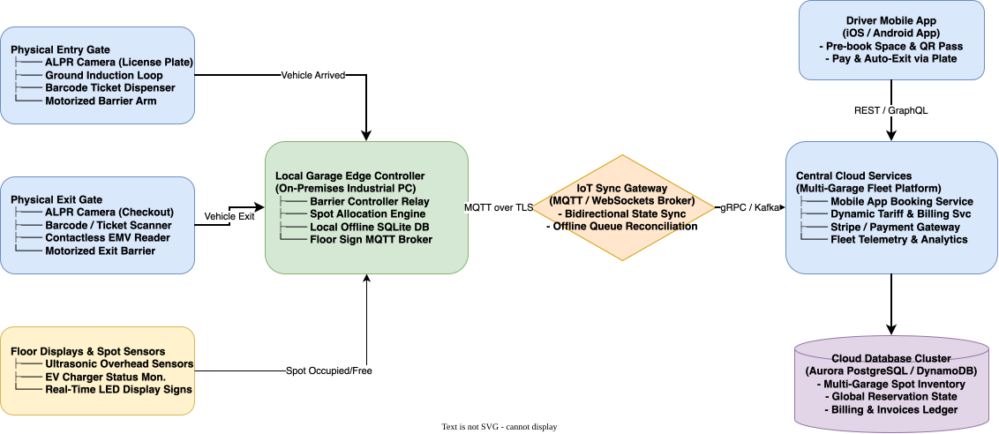

# Parking Garage System Design

[← Back to System Design](../system-design.md)

## Overview

A smart parking garage management system orchestrates vehicle access, real-time stall occupancy tracking, dynamic spot allocation, and automated billing across multi-level physical parking structures. Modern installations integrate physical hardware—Automatic License Plate Recognition (ALPR) cameras, ground induction loops, ultrasonic overhead stall sensors, and motorized barrier arms—with edge IoT controllers and cloud reservation platforms.

Designing an enterprise parking garage system requires bridging physical-world hardware with distributed software:

1. **Edge-to-Cloud Hybrid Architecture & Offline Autonomy**: If the facility loses internet connectivity, the local garage controller must continue admitting vehicles, lifting barrier arms, and processing payments without downtime.
2. **Real-Time Spot Allocation & Floor Guidance**: Directing incoming motorists to the nearest available stall matching their vehicle size (Compact, Regular, Large, EV, Handicapped).
3. **Zero Double-Allocation & Race Condition Prevention**: Preventing two drivers (or a drive-up customer and a mobile pre-booking app) from claiming the same physical parking spot simultaneously.
4. **Automated ALPR Ticketless Checkout**: Seamless drive-in and drive-out billing linked to credit card profiles.

---

## Functional Requirements

* **Automated Entry Processing**:
  * Vehicle triggers ground induction loop.
  * ALPR camera captures license plate number.
  * System allocates an optimal stall, prints a timestamped barcode ticket (or links to driver's pre-paid mobile profile), and triggers the motorized barrier arm to lift.
* **Multi-Tier Spot Classification**:
  * Supports **Compact** (motorcycle / small car), **Regular** (sedan / SUV), **Large** (van / truck), **EV** (with electric charger), and **Handicapped / Accessible** stalls across multiple floors.
* **Real-Time Wayfinding & Displays**: Overhead digital LED signboards at garage entrances and floor ramps show real-time available counts per floor and vehicle category.
* **Automated Exit & Payment**:
  * Exit kiosk validates ticket barcode or detects license plate.
  * Calculates fee based on duration, vehicle class, and dynamic peak tariffs.
  * Accepts credit card, contactless Apple Pay/Google Pay, or debits driver's registered account.
  * Lifts barrier arm upon payment confirmation.
* **Mobile Pre-Booking**: Drivers can reserve a guaranteed stall in advance for a specified time window with a 15-minute grace period.

---

## Non-Functional Requirements

* **Offline Edge Resilience**: Garage entry/exit gates must operate at **$100\%$ availability** even during prolonged cloud network outages.
* **Sub-Second Gate Response**: Barrier arm must raise within **$< 1\text{ second}$** of vehicle arrival or payment authorization to prevent street traffic queues.
* **Strict Physical Consistency**: Under no circumstances can the system issue more entry tickets than physical open stalls (Zero over-admission).
* **Fault Tolerance & Safety**: Barrier arms must feature infrared safety sensors to never close on a pedestrian or moving vehicle.

---

## Back of the Envelope Estimations

### Single Facility Scale

* **Garage Capacity**: 5 floors $\times$ 200 stalls $= 1,000\text{ parking spots}$.
* **Daily Vehicle Turnover**: Each spot used by 3 vehicles/day $= 3,000\text{ parking events/day}$.
* **Peak Entry Rate (Morning Rush)**:
  * 600 vehicles arriving between 8:00 AM and 9:00 AM.
  * Average Peak Entry Rate $= \frac{600}{3,600} \approx 0.17\text{ vehicles/sec}$ (1 vehicle every 6 seconds across 2 entry gates).

### Nationwide Fleet Scale (10,000 Garages)

* **Total Network Capacity**: $10,000\text{ facilities} \times 1,000\text{ spots} = 10,000,000\text{ parking spots}$.
* **Daily Ingress/Egress Transactions**:
  $$10,000\text{ garages} \times 3,000 = 30,000,000\text{ parking events/day}$$
* **Cloud API QPS**:
  $$\text{Average QPS} = \frac{30,000,000}{86,400} \approx 347\text{ QPS} \quad (\text{Peak: } \approx 2,500\text{ QPS})$$
* **Storage Requirement**:
  * 30M tickets/day $\times 500\text{ bytes per ticket} \approx 15\text{ GB/day} \implies 5.5\text{ Terabytes/year}$.

---

## High-Level System Architecture

```text
       ENTRY GATE HARDWARE                        EXIT GATE HARDWARE
  ┌─────────────────────────────┐            ┌─────────────────────────────┐
  │ - ALPR Camera (Plate Scan)  │            │ - ALPR Camera (Checkout)    │
  │ - Ground Induction Loop     │            │ - Barcode Scanner & Kiosk   │
  │ - Barcode Ticket Printer    │            │ - EMV Contactless Reader    │
  │ - Motorized Barrier Arm     │            │ - Motorized Barrier Arm     │
  └──────────────┬──────────────┘            └──────────────┬──────────────┘
                 │ Local Relay (RS-485 / IP)                │ Local Relay
                 ▼                                          ▼
┌──────────────────────────────────────────────────────────────────────────┐
│              LOCAL GARAGE EDGE CONTROLLER (On-Premises Industrial PC)    │
│                                                                          │
│  ┌────────────────────────┐  Spot Updates  ┌──────────────────────────┐  │
│  │ Barrier Controller Svc │◀───────────────│ Floor Display Manager    │  │
│  └──────────┬─────────────┘                │ (Ramp LED Signs: Open 14)│  │
│             │                              └──────────────┬───────────┘  │
│             ▼                                             │              │
│  ┌────────────────────────┐                ┌──────────────▼───────────┐  │
│  │ Local Allocation Engine│◀──────────────▶│ Local Edge Database      │  │
│  │ (Closest Stall Match)  │                │ (SQLite / Edge Postgres) │  │
│  └────────────────────────┘                └──────────────┬───────────┘  │
└───────────────────────────────────────────────────────────┼──────────────┘
                                                            │ MQTT over TLS
                                                            ▼ (Bi-directional)
┌──────────────────────────────────────────────────────────────────────────┐
│                      CENTRAL CLOUD RESERVATION PLATFORM                  │
│                                                                          │
│  ┌───────────────────────┐  ┌──────────────────────┐  ┌───────────────┐  │
│  │ Mobile Booking Svc    │  │ Tariff & Billing Svc │  │ Fleet Telemetry│ │
│  │ (Driver App Pre-book) │  │ (Dynamic Pricing)    │  │ & Monitoring  │  │
│  └──────────┬────────────┘  └──────────┬───────────┘  └───────┬───────┘  │
│             │                          │                      │          │
│             ▼                          ▼                      ▼          │
│  ┌────────────────────────────────────────────────────────────────────┐  │
│  │ Cloud Database Cluster (Aurora PostgreSQL: Multi-Garage Inventory) │  │
│  └────────────────────────────────────────────────────────────────────┘  │
└──────────────────────────────────────────────────────────────────────────┘
```

---

## Object-Oriented Domain Model

```text
┌───────────────────────┐
│     ParkingGarage     │
├───────────────────────┤
│ garageId: String      │
│ name: String          │
│ address: Address      │
│ floors: List<Floor>   │
│ entryGates: List<Gate>│
│ exitGates: List<Gate> │
└──────────┬────────────┘
           │1
           │*
┌──────────▼────────────┐          ┌───────────────────────┐
│     ParkingFloor      │1        *│      ParkingSpot      │
├───────────────────────┤──────────├───────────────────────┤
│ floorNumber: Int      │          │ spotId: String        │
│ spots: List<Spot>     │          │ floorNumber: Int      │
│ displayBoard: Board   │          │ spotType: SpotType    │
└───────────────────────┘          │ isOccupied: Boolean   │
                                   │ distanceToElevator: M │
                                   └───────────┬───────────┘
                                               │1
                                               │*
┌───────────────────────┐          ┌───────────▼───────────┐
│        Vehicle        │          │     ParkingTicket     │
├───────────────────────┤          ├───────────────────────┤
│ licensePlate: String  │          │ ticketId: String (PK) │
│ vehicleType: VehType  │          │ spotId: FK            │
│ driverId: String      │          │ licensePlate: String  │
└───────────────────────┘          │ issuedAt: Timestamp   │
                                   │ paidAt: Timestamp     │
                                   │ exitedAt: Timestamp   │
                                   │ feeAmount: Decimal    │
                                   │ status: TicketStatus  │
                                   └───────────────────────┘
```

### Spot Allocation Strategy

```java
public enum SpotType {
    COMPACT, REGULAR, LARGE, EV, ACCESSIBLE
}

public class SpotAllocationEngine {
    // Greedy heuristic: allocate closest available spot matching vehicle constraint
    public synchronized ParkingSpot allocateSpot(Vehicle vehicle, int entryGateId) {
        return availableSpots.stream()
            .filter(spot -> spot.canFitVehicle(vehicle.getType()))
            .min(Comparator.comparingInt(spot -> spot.getDistanceToGate(entryGateId)))
            .orElseThrow(() -> new GarageFullException("No suitable spots available"));
    }
}
```

---

## API Specifications

### 1. Ingest Entry Scan (Local Edge Gate)

```http
POST /api/v1/edge/entry
Content-Type: application/json
```

```json
// Request
{
  "gateId": "gate_entry_01",
  "scannedLicensePlate": "7XYZ912",
  "detectedVehicleClass": "SEDAN",
  "timestamp": 1730008500
}

// Response: 200 OK
{
  "ticketId": "tkt_8819231",
  "allocatedSpot": {
    "spotId": "F2-R045",
    "floorNumber": 2,
    "spotType": "REGULAR"
  },
  "action": "LIFT_BARRIER_ARM",
  "barcodeData": "BARCODE_DATA_8819231"
}
```

### 2. Process Exit & Checkout

```http
POST /api/v1/edge/exit
Content-Type: application/json
```

```json
// Request
{
  "gateId": "gate_exit_01",
  "ticketId": "tkt_8819231",
  "paymentMethod": "EMV_CONTACTLESS",
  "paymentToken": "tok_visa_4242"
}

// Response: 200 OK
{
  "totalDurationMinutes": 145,
  "chargedAmount": 18.50,
  "currency": "USD",
  "paymentStatus": "SUCCESS",
  "action": "LIFT_BARRIER_ARM"
}
```

---

## System Design Diagram



[Download Draw.io File](parking-garage.drawio)

---

## Deep Dive & Key Technical Challenges

### 1. Edge-to-Cloud Synchronization & Offline Mode

* Garages frequently experience fiber cuts or local ISP outages.
* **Local Autonomous Operation**:
  * The Edge Controller maintains local SQLite/PostgreSQL tables containing current stall allocations, active tickets, and local tariff rate cards.
  * Gate barriers open and close normally via local hardware relays without making WAN calls.
* **Reconciliation on Reconnect**:
  * Upon WAN restoration, the Edge Controller publishes an idempotent batch sync via MQTT to the cloud backend.
  * Pre-bookings made in the mobile app during the disconnection window are merged; if a conflict occurs, the system utilizes a dedicated reserve pool of 5% contingency stalls.

### 2. Preventing Drive-Up vs. Pre-Booking Race Conditions

* If a mobile user pre-books spot `F1-R010` for 2:00 PM, a physical drive-up customer entering at 1:55 PM must not be routed into that space.
* **Dual Inventory Bucketing**:
  * The system separates physical capacity into two pools:
    1. **Pre-Booking Quota (Max 40% of garage)**.
    2. **Drive-Up Transient Quota (60% of garage)**.
  * When a pre-booking is confirmed, a virtual hold is placed. The spot allocation engine marks that spot unavailable for physical drive-up customers starting 30 minutes prior to reservation start time.

---

## Additional Notes
