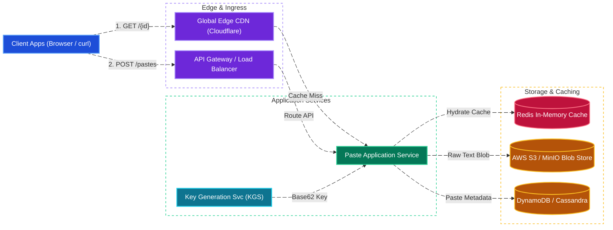
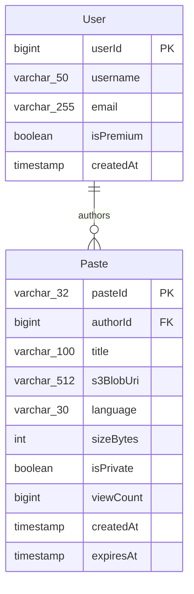
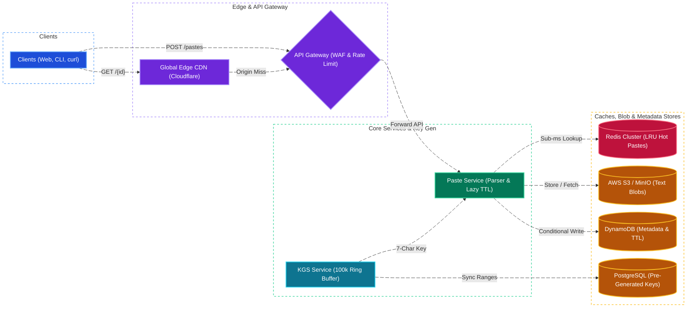

# Pastebin System Design

[← Back to System Design](system-design.md)

## Overview

Pastebin is a text-sharing platform that allows users to store plain text, code snippets, or configuration dumps and share them via compact, readable URLs (e.g. `https://pastebin.com/k9Az8Q`). The platform supports optional syntax highlighting, custom vanity URLs, password protection, and time-to-live (TTL) expiration schedules.

Designing Pastebin involves solving classic high-throughput distributed systems challenges:

1. **Short Unique Key Generation**: Generating 7-character Base62 keys ($62^7 \approx 3.5\text{ Trillion}$) with zero collisions using an offline Key Generation Service (KGS).
2. **Read-Heavy Storage Tiering**: Separating raw text blob storage (AWS S3 / MinIO) from metadata queries (DynamoDB / Cassandra) to achieve cost efficiency and extreme scalability.
3. **High-Ratio Read Caching**: Handling a $20:1$ read-to-write traffic ratio using a distributed Redis caching layer and edge CDN caching.
4. **Automated Expiration Cleanup**: Purging billions of expired pastes efficiently without locking production tables.

---

## Functional Requirements

* **Create Paste**: Users can upload text content (up to $10\text{ MB}$), select syntax highlighting language, and specify expiration TTL (10 minutes, 1 hour, 1 day, 1 week, 1 month, or Never).
* **View Paste**: Anyone possessing the short URL can view the raw or syntax-highlighted text.
* **Custom Vanity URLs**: Users can choose a custom alias (e.g., `/my-cool-script`), subject to availability.
* **Access Control**: Support Public, Unlisted (accessible only via link), and Private (requires login/password) pastes.
* **Automatic Expiration**: Pastes must become inaccessible immediately after their expiration deadline passes.

---

## Non-Functional Requirements

* **High Read Availability**: $99.99\%$ uptime for reading pastes.
* **Ultra-Low Read Latency**: P95 retrieval latency **$< 50\text{ ms}$** globally via edge caching and Redis.
* **Durability**: Pastes configured as "Never Expire" must have $99.999999999\%$ (11 9s) durability.
* **Unpredictable Keys**: URL keys should not be sequentially guessable (preventing malicious scrapers from enumerating all pastes).

---

## Back of the Envelope Estimations

### Traffic & Scale

* **Write Traffic (New Pastes)**: $10\text{ Million new pastes/day}$.
* **Read-to-Write Ratio**: $20:1 \implies 200\text{ Million reads/day}$.
* **Write QPS**:
  $$\text{Write QPS} = \frac{10,000,000}{86,400} \approx 116\text{ writes/sec} \quad (\text{Peak: } \approx 500\text{ QPS})$$
* **Read QPS**:
  $$\text{Read QPS} = \frac{200,000,000}{86,400} \approx 2,315\text{ reads/sec} \quad (\text{Peak: } \approx 10,000\text{ QPS})$$

### Storage Calculations

* **Average Paste Size**: $10\text{ KB}$.
* **Daily Ingested Storage**:
  $$10,000,000\text{ pastes} \times 10\text{ KB} = 100\text{ Gigabytes/day}$$
* **Annual Storage Footprint**:
  $$100\text{ GB} \times 365 \approx 36.5\text{ Terabytes/year}$$
* **3-Year Total Storage**: $\approx 110\text{ Terabytes}$ (managed cleanly in Amazon S3).

### Memory Caching (80-20 Rule)

* $20\%$ of daily read traffic generates $80\%$ of requests:
  $$200,000,000\text{ reads} \times 0.20 \times 10\text{ KB} = 400\text{ Gigabytes RAM}$$
* A cluster of 4 Redis nodes with 128 GB RAM each comfortably caches all hot pastes.

---

## High-Level System Architecture



---

## Short Key Generation Strategy: KGS vs. Hashing

### 1. MD5 / Base62 Hashing Approach (and why it struggles)

* Taking $\text{MD5}(text + timestamp)$ produces a 128-bit hash. Taking the first 7 characters in Base62 produces duplicates under high concurrency, requiring expensive database collision retry loops.

### 2. Standalone Key Generation Service (KGS)

To guarantee zero collisions and $< 1\text{ ms}$ key acquisition:

* **Offline Key Pre-Generation**:
  * An offline worker generates all $62^7$ random 7-character string permutations and stores them in a relational database (`unused_keys` table).
  * Random shuffling ensures keys are non-sequential.
* **In-Memory Ring Buffer**:
  * The KGS service loads 100,000 unused keys into memory.
  * When a Paste Service worker needs a key, KGS hands one over in sub-microseconds and marks it as used.
  * Two KGS instances manage disjoint key ranges to eliminate single points of failure.

---

## API Specifications

### 1. Create Paste

```http
POST /api/v1/pastes
Content-Type: application/json
```

```json
// Request
{
  "content": "const express = require('express');\nconst app = express();",
  "language": "javascript",
  "title": "Express Boilerplate",
  "expirationTtlSeconds": 86400,
  "customAlias": "express-starter",
  "isPrivate": false
}

// Response: 201 Created
{
  "pasteId": "express-starter",
  "url": "https://pastebin.com/express-starter",
  "createdAt": "2026-10-27T19:50:00Z",
  "expiresAt": "2026-10-28T19:50:00Z"
}
```

### 2. Get Paste

```http
GET /api/v1/pastes/express-starter
Accept: application/json
```

```json
// Response: 200 OK
{
  "pasteId": "express-starter",
  "title": "Express Boilerplate",
  "language": "javascript",
  "content": "const express = require('express');\nconst app = express();",
  "views": 421,
  "createdAt": "2026-10-27T19:50:00Z"
}
```

---

## Object Model & Database Schema



---

## System Design Diagram



---

## Deep Dive & Key Technical Challenges

### 1. Handling Custom Alias Collisions

* When a user supplies a `customAlias`, the system cannot use the KGS pre-allocated key pool.
* **Atomic Insert Guarantee**:
  * In DynamoDB, execute a conditional write:

    ```json
    {
      "ConditionExpression": "attribute_not_exists(paste_id)"
    }
    ```

  * If the alias exists, DynamoDB throws `ConditionalCheckFailedException`, allowing the API to immediately return `409 Conflict ("Alias already in use")`.

### 2. High-Efficiency Expiration & Storage Reclamation

Active polling of expired records via `SELECT * WHERE expires_at < NOW()` table scans causes database degradation.

* **Dual Expiration Mechanism**:
  1. **Lazy Expiration on Read**: When a paste is fetched, the application compares `expiresAt` with `NOW()`. If expired, return HTTP 404 immediately and delete the Redis cache key.
  2. **Automated DynamoDB TTL**: DynamoDB scans partition headers in the background without consuming provisioned throughput, automatically dropping expired records within 48 hours.
  3. **S3 Object Lifecycle Rules**: Paste files in S3 are organized with timestamp prefixes or object tags, triggering automatic deletion via S3 lifecycle policies without application intervention.

---

## Additional Notes

### Video References

* [](https://www.youtube.com/watch?v=BAwUuEdNgy8)
* [](https://www.youtube.com/watch?v=V_yOcipUqUE)
