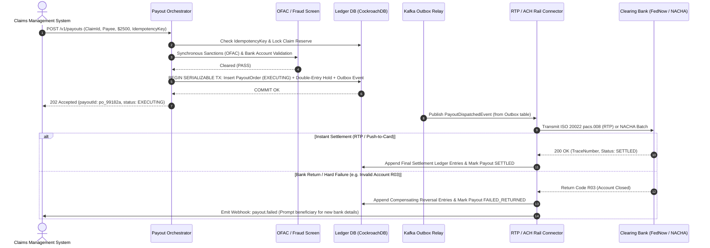
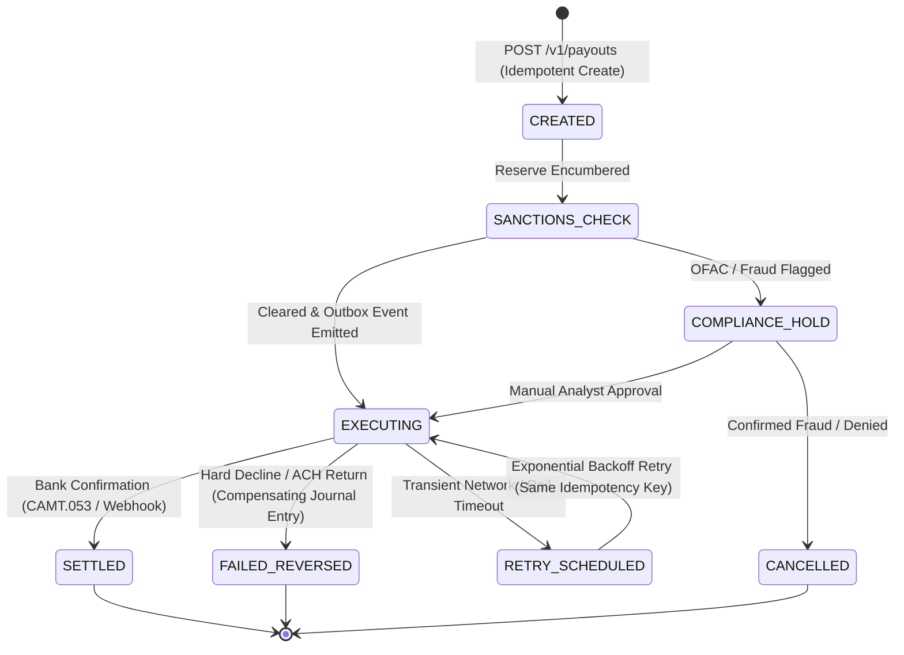
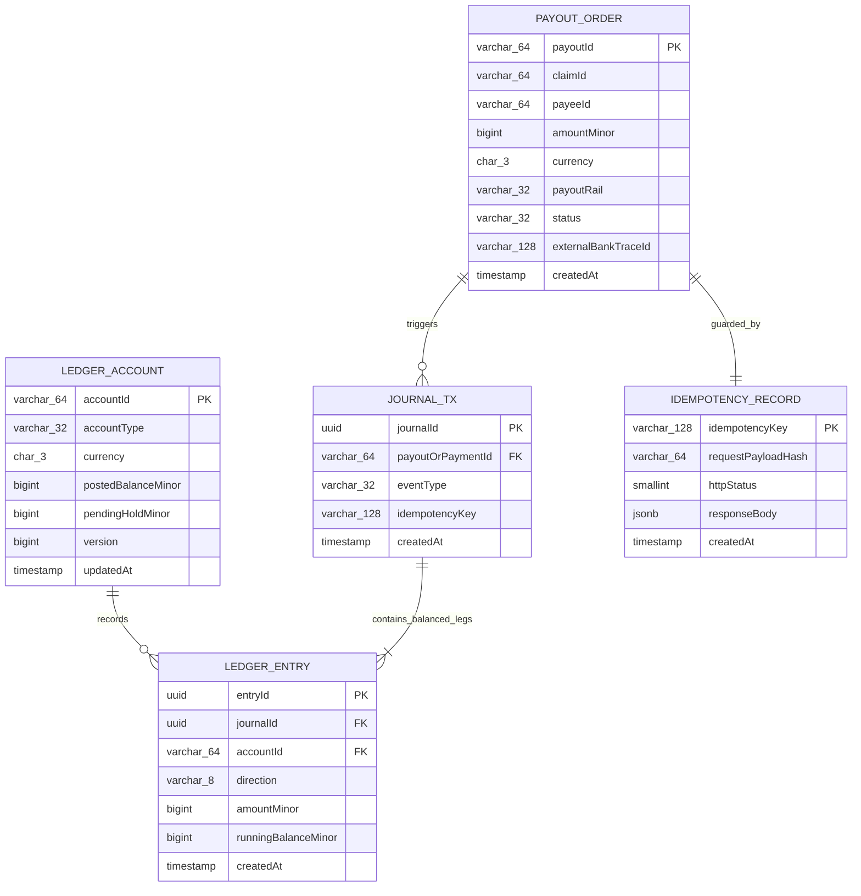

# Payment System & Claims Payout Ledger System Design

[← Back to System Design](system-design.md)

## Overview

A modern enterprise **Payment System & Claims Payout Ledger** (such as Stripe, Adyen, PayPal, or an insurance/healthcare claims disbursement platform) processes billions of dollars in both **Pay-Ins** (collecting customer premiums, checkout charges, and subscriptions) and **Pay-Outs** (disbursing approved insurance claims, marketplace seller settlements, and refunds via ACH, FedNow/RTP, SEPA, Wire, or Push-to-Debit rails).

Unlike standard CRUD applications, a financial payment and claims payout engine cannot tolerate race conditions, lost messages, or approximate balances. Designing this system centers on four foundational distributed systems guarantees:

1. **Immutable Double-Entry Ledger Accounting**: Every cent moved is recorded as balanced, append-only debit and credit journal entries ($\sum \text{Debits} - \sum \text{Credits} = 0$) where balances are never mutated via destructive `UPDATE` statements without an accompanying ledger entry.
2. **End-to-End Idempotency & Exactly-Once Execution Semantics**: Network timeouts, client retries, or Kafka consumer rebalances must never double-charge a customer or double-disburse an insurance claim payout.
3. **Distributed Saga Orchestration & Transactional Outbox**: Coordinating multi-step payment authorizations, fraud/AML screening, reserve holds, and external Payment Service Provider (PSP) / banking rail settlements without distributed two-phase commit (2PC) locks across external networks.
4. **Automated T+1 Reconciliation & Settlement**: Continuously auditing internal ledger states against external bank/PSP settlement files (BAI2, ISO 20022 CAMT.053, NACHA) to detect and resolve penny discrepancies automatically.

---

## Functional Requirements

* **Pay-In Processing (Authorization & Capture)**: Collect funds from customers via credit/debit cards, digital wallets (Apple Pay, Google Pay), or bank debits (ACH/SEPA) using a two-step Authorize $\to$ Capture lifecycle.
* **Claims Payout & Disbursement**: Disburse approved claims or marketplace payouts to beneficiaries via multiple payout rails:
  * **Instant Rails**: Push-to-Card (Visa Direct / Mastercard Send), Real-Time Payments (RTP / FedNow) settling in $< 30\text{ seconds}$.
  * **Batch Banking Rails**: Same-Day / Standard ACH (NACHA), Wire (Fedwire / SWIFT), and paper check fallback.
* **Double-Entry Financial Ledger**: Maintain an immutable journal of all monetary movements across internal clearing accounts, escrow/reserve accounts, revenue accounts, and beneficiary accounts.
* **Claim Reserve Holds & Multi-Party Split Payouts**: Place encumbrance holds on approved claim reserves and support splitting a single claim payout across multiple payees (e.g., policyholder + medical provider / repair shop + deductible offset).
* **Retry, Reversal & Refund Workflows**: Handle soft declines with smart retries, process customer refunds, and ingest asynchronous ACH return codes (e.g., `R01 Insufficient Funds`, `R03 No Account`) with compensating ledger reversals.
* **End-to-End Reconciliation**: Ingest daily settlement files from acquiring banks and clearing houses to reconcile every internal ledger entry against external bank statements.

---

## Non-Functional Requirements

* **Strict Financial Consistency (CP / Serializable ACID)**: Zero financial discrepancy. Double-spending, negative reserve over-disbursement, or orphaned ledger entries are strictly prohibited.
* **Strict Idempotency**: $100\%$ of mutating API endpoints and async workers must enforce deterministic idempotency keys.
* **High Availability**: $99.999\%$ availability for payment ingestion and authorization; graceful queueing for asynchronous batch payouts if downstream banking rails are under maintenance.
* **Low Latency**:
  * Synchronous card authorization / claim reserve lock: **$< 300\text{ ms}$** internal processing overhead ($< 1.5\text{ s}$ end-to-end including external card network round-trip).
  * Ledger balance inquiry: **$< 50\text{ ms}$** P99.
* **Durability & Auditability**: $99.999999999\%$ (11 9s) durability with cryptographically verifiable, tamper-evident WORM (Write-Once-Read-Many) audit trails for SOX, PCI-DSS Level 1, and state insurance regulatory compliance.

---

## Back of the Envelope Estimations

### Scale & Traffic

* **Daily Payment & Claim Transactions**: $50\text{ Million transactions/day}$ ($40\text{M}$ Pay-Ins + $10\text{M}$ Claims/Seller Payouts).
* **Average Transaction QPS**:
  $$\text{Average TPS} = \frac{50,000,000}{86,400} \approx 580\text{ TPS}$$
* **Peak Transaction QPS** (Monthly billing renewals, catastrophe claim surges, or holiday spikes $\approx 10\times$):
  $$\text{Peak TPS} \approx 5,800\text{ TPS}$$
* **Double-Entry Ledger Rows per Transaction**:
  * Average transaction transitions through 2 states (Auth/Hold $\to$ Capture/Settle), generating 2 journal transactions $\times 2\text{ legs (Debit + Credit)} = 4\text{ ledger entries}$.
  * **Peak Ledger Write QPS**: $5,800 \times 4 \approx 23,200\text{ ledger row inserts/sec}$.

### Storage Requirements

* **Transaction & Ledger Record Size**: $\approx 1\text{ KB}$ per transaction (payment order + 4 ledger entries + idempotency record).
* **Daily Database Growth**:
  $$50,000,000 \times 1\text{ KB} = 50\text{ GB/day}$$
* **Annual Active Ledger Storage**:
  $$50\text{ GB/day} \times 365 \approx 18.25\text{ Terabytes/year}$$
* **7-Year Regulatory Compliance Archive (SOX / IRS / FinCEN)**:
  $$18.25\text{ TB} \times 7 \approx 128\text{ Terabytes}$$ (tiered to immutable S3 Object Lock / Glacier storage).

---

## High-Level System Architecture

```mermaid
%%{init: {'flowchart': {'nodeSpacing': 25, 'rankSpacing': 45, 'padding': 10}}}%%
flowchart LR
    Client["Clients & Claims Core"]
    subgraph EdgeTier["Edge & Security"]
        GW["API Gateway (mTLS & WAF)"]
        IdemCache[("Redis Idempotency & Locks")]
    end
    subgraph CoreTier["Payment & Payout Orchestration"]
        PaySvc["Payment & Payout Orchestrator"]
        LedgerSvc["Double-Entry Ledger Service"]
        RailConn["PSP & Banking Rail Connectors"]
        ReconSvc["Reconciliation Engine"]
    end
    subgraph DataTier["Storage, Messaging & External Rails"]
        LedgerDB[("CockroachDB / Spanner Ledger")]
        Kafka[["Kafka (Transactional Outbox)"]]
        Banks["External PSPs & ACH / RTP Rails"]
    end
    Client e1@-->|"1. POST /payouts"| GW
    GW e2@<-->|"Check IdempotencyKey"| IdemCache
    GW e3@-->|"Route Request"| PaySvc
    PaySvc e4@-->|"2. Record Hold Entry"| LedgerSvc
    LedgerSvc e5@-->|"Serializable ACID"| LedgerDB
    LedgerDB e6@-->|"CDC Outbox"| Kafka
    Kafka e7@-->|"3. Dispatch Command"| RailConn
    RailConn e8@<-->|"ISO 20022 / REST"| Banks
    RailConn e9@-->|"4. Settlement Event"| LedgerSvc
    Banks e10@-->|"5. T+1 Settlement Files"| ReconSvc
    ReconSvc e11@-->|"Verify Balances"| LedgerDB

    e1@{ animate: true }
    e2@{ animate: true }
    e3@{ animate: true }
    e4@{ animate: true }
    e5@{ animate: true }
    e6@{ animate: true }
    e7@{ animate: true }
    e8@{ animate: true }
    e9@{ animate: true }
    e10@{ animate: true }
    e11@{ animate: true }

    classDef client fill:#1d4ed8,stroke:#60a5fa,stroke-width:2px,color:#ffffff
    classDef edge fill:#6d28d9,stroke:#a78bfa,stroke-width:2px,color:#ffffff
    classDef service fill:#047857,stroke:#34d399,stroke-width:2px,color:#ffffff
    classDef worker fill:#0e7490,stroke:#22d3ee,stroke-width:2px,color:#ffffff
    classDef cache fill:#be123c,stroke:#fb7185,stroke-width:2px,color:#ffffff
    classDef storage fill:#b45309,stroke:#fbbf24,stroke-width:2px,color:#ffffff
    classDef queue fill:#3730a3,stroke:#818cf8,stroke-width:2px,color:#ffffff

    class Client,Banks client
    class GW edge
    class PaySvc,LedgerSvc service
    class RailConn,ReconSvc worker
    class IdemCache cache
    class LedgerDB storage
    class Kafka queue

    style EdgeTier fill:transparent,stroke:#a78bfa,stroke-width:1.5px,stroke-dasharray: 5 5
    style CoreTier fill:transparent,stroke:#34d399,stroke-width:1.5px,stroke-dasharray: 5 5
    style DataTier fill:transparent,stroke:#fbbf24,stroke-width:1.5px,stroke-dasharray: 5 5
```



---

## Core Components & Workflows

### 1. Immutable Double-Entry Ledger Mechanics

In a naive database, transferring $\$2,500.00$ for an approved auto insurance claim updates two rows (`UPDATE accounts SET balance = balance - 2500`). If a bug or partial failure occurs, money vanishes or is created out of thin air with no audit trail.

In a **Double-Entry Ledger**, every state transition appends balanced rows to `ledger_entries` where total debits equal total credits:

| Step | Event | Debit Account | Credit Account | Amount (Cents) |
| :--- | :--- | :--- | :--- | :--- |
| **1. Claim Approved** | Encumber funds from Claims Reserve | `Claims_Expense_Pool` | `Claim_Reserve_Hold` | `250000` ($\$2,500.00$) |
| **2. Payout Initiated** | Move from Reserve to Outbound Clearing | `Claim_Reserve_Hold` | `ACH_Outbound_Clearing` | `250000` ($\$2,500.00$) |
| **3. Bank Settled** | Bank confirms beneficiary credit | `ACH_Outbound_Clearing` | `External_Bank_Cash_Asset` | `250000` ($\$2,500.00$) |
| **4. ACH Returned (If R03)** | Compensating reversal entry (never delete!) | `Claim_Reserve_Hold` | `ACH_Outbound_Clearing` | `-250000` (or reverse legs) |

> [!IMPORTANT]
> **Always Store Money as Integers (Minor Units):**
> Never use IEEE 754 floating-point types (`FLOAT`, `DOUBLE`) for currency, as binary rounding (`0.1 + 0.2 = 0.30000000000000004`) causes penny drift across millions of transactions. Store all amounts as 64-bit integers (`BIGINT`) in minor currency units (e.g., cents for USD, where $\$2,500.00 = 250000$) paired with an ISO 4217 currency code (`USD`).

### 2. Claims Payout Saga & Transactional Outbox Flow



### 3. Payout Order Lifecycle State Machine



---

## API Specifications

### 1. Create Claim Payout (Disbursement)

```http
POST /api/v1/payouts
Authorization: Bearer <service_m2m_jwt>
Idempotency-Key: idem_claim_8819204_leg1
Content-Type: application/json
```

```json
// Request
{
  "claimId": "clm_2026_9918231",
  "policyNumber": "POL-8849201",
  "amountMinor": 250000,
  "currency": "USD",
  "payoutRail": "RTP_FEDNOW",
  "beneficiary": {
    "payeeId": "usr_771829",
    "accountType": "CHECKING",
    "routingNumberToken": "tok_rtn_021000021",
    "accountNumberToken": "tok_acct_99182311"
  },
  "metadata": {
    "claimType": "AUTO_COLLISION",
    "adjusterId": "adj_4410"
  }
}

// Response: 202 Accepted
{
  "payoutId": "po_01J9X8Z2M4K7N8P9Q0R1S2T3",
  "claimId": "clm_2026_9918231",
  "status": "EXECUTING",
  "amountMinor": 250000,
  "currency": "USD",
  "ledgerJournalId": "jrn_778192041",
  "createdAt": "2026-10-28T18:55:00Z"
}
```

### 2. Get Ledger Account Balance & Audit Entries

```http
GET /api/v1/ledger/accounts/acc_claim_reserve_01/entries?limit=2
Authorization: Bearer <finance_service_jwt>
```

```json
// Response: 200 OK
{
  "accountId": "acc_claim_reserve_01",
  "currency": "USD",
  "postedBalanceMinor": 145000000,
  "pendingHoldBalanceMinor": 250000,
  "availableBalanceMinor": 144750000,
  "version": 84920,
  "recentEntries": [
    {
      "entryId": "ent_991823101",
      "journalId": "jrn_778192041",
      "direction": "DEBIT",
      "amountMinor": 250000,
      "runningBalanceMinor": 144750000,
      "createdAt": "2026-10-28T18:55:00Z"
    }
  ]
}
```

---

## Object Model & Database Schema

### Database Selection & Rationale

| Workload / Subsystem | Database Choice | Data Model & CAP Profile | Why This Database? (Justification & Trade-offs) |
| :--- | :--- | :--- | :--- |
| **Double-Entry Ledger, Payout Orders & Outbox (`LEDGER_ENTRY`, `PAYOUT_ORDER`)** | **CockroachDB / Google Cloud Spanner (or Sharded Amazon Aurora PostgreSQL)** | Distributed SQL (`SERIALIZABLE` ACID, **CP / PC-EC**) | **Why:** Financial ledgers require strict `SERIALIZABLE` isolation, multi-row ACID transactions (atomically inserting debit + credit legs + outbox event + idempotency key), and zero RPO across availability zones. Eventual-consistency NoSQL stores (Cassandra/MongoDB) cannot enforce cross-account balance invariants (`CHECK (available_balance >= 0)`) without risking double-disbursement during network partitions. |
| **Fast Idempotency Locks & Hot Account Rate Guards** | **Redis Cluster** | In-Memory Key-Value (**CP on Primary**) | **Why:** Absorbs duplicate retry storms at the API Gateway in $< 1\text{ ms}$ using `SET idem:<key> IN_PROGRESS NX EX 86400` before hitting the relational database, while the authoritative idempotency record is still committed inside the SQL transaction. |
| **Immutable Regulatory Audit Trail & Hash Chain** | **Amazon QLDB (Quantum Ledger DB) + AWS S3 Object Lock (WORM)** | Cryptographic Journal + WORM Object Store (**CP / 11 9s Durability**) | **Why:** SOX and state insurance auditors require mathematical proof that historical ledger entries were never altered or backdated by a rogue DBA. QLDB maintains a SHA-256 Merkle tree digest of every journal transaction, archived to S3 Compliance WORM for 7–10 years. |
| **T+1 Reconciliation & Financial Reporting OLAP** | **ClickHouse / Snowflake / Google BigQuery** | Columnar Data Warehouse (**Analytical OLAP**) | **Why:** Joining 50M daily internal ledger entries against external bank settlement files (BAI2 / NACHA / ISO 20022) and running month-end GAAP revenue/loss-run aggregations would lock OLTP database pages. Streaming CDC events to a columnar warehouse isolates heavy reconciliation queries from live payment traffic. |



---

## System Design Diagram

```mermaid
%%{init: {'flowchart': {'nodeSpacing': 20, 'rankSpacing': 40, 'padding': 10}}}%%
flowchart LR
    subgraph ClientTier["Upstream Callers"]
        Checkout["Checkout & Billing Apps"]
        ClaimsCore["Claims Adjudication Engine"]
    end
    subgraph EdgeTier["Edge & PCI Vault"]
        Gateway{"API Gateway (mTLS, Auth)"}
        TokenVault["PCI-DSS Token Vault (HSM)"]
        RedisLock[("Redis Idempotency Guard")]
    end
    subgraph CoreServices["Payment, Payout & Ledger Core"]
        PayOrch["Payment & Payout Orchestrator"]
        RiskCompliance["OFAC Sanctions & AML Check"]
        LedgerEngine["Double-Entry Ledger Engine"]
        RailConnectors["Banking & PSP Connectors"]
        ReconWorker["T+1 Reconciliation Engine"]
    end
    subgraph DataAndExternal["Ledgers, Outbox & Banking Rails"]
        LedgerDB[("CockroachDB / Spanner (ACID)")]
        KafkaBus[["Kafka Bus (Debezium Outbox)"]]
        AuditWORM[("QLDB & S3 WORM Archive")]
        OLAP[("ClickHouse / Snowflake Recon")]
        ExtRails["Stripe / Visa Direct / FedNow / ACH"]
    end
    Checkout e1@-->|"POST /payments"| Gateway
    ClaimsCore e2@-->|"POST /payouts"| Gateway
    Gateway e3@<-->|"Tokenize PAN/Routing"| TokenVault
    Gateway e4@<-->|"SETNX IdemKey"| RedisLock
    Gateway e5@-->|"Execute Command"| PayOrch
    PayOrch e6@-->|"Screen Payee"| RiskCompliance
    PayOrch e7@-->|"Post Journal Legs"| LedgerEngine
    LedgerEngine e8@-->|"SERIALIZABLE Tx"| LedgerDB
    LedgerDB e9@-->|"CDC Outbox"| KafkaBus
    KafkaBus e10@-->|"Consume Event"| RailConnectors
    KafkaBus e11@-->|"Append Digest"| AuditWORM
    KafkaBus e12@-->|"Stream Rows"| OLAP
    RailConnectors e13@<-->|"ISO 20022 / Webhook"| ExtRails
    RailConnectors e14@-->|"Settle / Reverse"| LedgerEngine
    ExtRails e15@-->|"BAI2 / CAMT.053 Files"| ReconWorker
    ReconWorker e16@<-->|"Match & Flag Drift"| OLAP

    e1@{ animate: true }
    e2@{ animate: true }
    e3@{ animate: true }
    e4@{ animate: true }
    e5@{ animate: true }
    e6@{ animate: true }
    e7@{ animate: true }
    e8@{ animate: true }
    e9@{ animate: true }
    e10@{ animate: true }
    e11@{ animate: true }
    e12@{ animate: true }
    e13@{ animate: true }
    e14@{ animate: true }
    e15@{ animate: true }
    e16@{ animate: true }

    classDef client fill:#1d4ed8,stroke:#60a5fa,stroke-width:2px,color:#ffffff
    classDef edge fill:#6d28d9,stroke:#a78bfa,stroke-width:2px,color:#ffffff
    classDef service fill:#047857,stroke:#34d399,stroke-width:2px,color:#ffffff
    classDef worker fill:#0e7490,stroke:#22d3ee,stroke-width:2px,color:#ffffff
    classDef cache fill:#be123c,stroke:#fb7185,stroke-width:2px,color:#ffffff
    classDef storage fill:#b45309,stroke:#fbbf24,stroke-width:2px,color:#ffffff
    classDef queue fill:#3730a3,stroke:#818cf8,stroke-width:2px,color:#ffffff

    class Checkout,ClaimsCore,ExtRails client
    class Gateway,TokenVault edge
    class PayOrch,RiskCompliance,LedgerEngine service
    class RailConnectors,ReconWorker worker
    class RedisLock cache
    class LedgerDB,AuditWORM,OLAP storage
    class KafkaBus queue

    style ClientTier fill:transparent,stroke:#60a5fa,stroke-width:1.5px,stroke-dasharray: 5 5
    style EdgeTier fill:transparent,stroke:#a78bfa,stroke-width:1.5px,stroke-dasharray: 5 5
    style CoreServices fill:transparent,stroke:#34d399,stroke-width:1.5px,stroke-dasharray: 5 5
    style DataAndExternal fill:transparent,stroke:#fbbf24,stroke-width:1.5px,stroke-dasharray: 5 5
```



---

## Deep Dive & Key Technical Challenges

### 1. Eliminating Dual-Writes with the Transactional Outbox Pattern

A classic distributed systems bug occurs when a service commits a ledger row to the database and then attempts to publish a `PayoutInitiated` message to Kafka:

* If the process crashes after the DB commit but before the Kafka publish, the claim reserve is locked forever, and the beneficiary is never paid.
* If the service publishes to Kafka *before* the DB commit and the DB transaction rolls back, the beneficiary is paid without a corresponding ledger deduction!
* **Solution (Transactional Outbox + Debezium CDC)**:
  1. Inside the exact same ACID database transaction that inserts the `PAYOUT_ORDER` and `LEDGER_ENTRY` legs, the service inserts a row into an `outbox_events` table.
  2. **Debezium** (or CockroachDB Changefeeds) tails the database Write-Ahead Log (WAL) and streams the committed outbox row to Kafka with guaranteed at-least-once delivery.
  3. Downstream Rail Connectors consume the event idempotently using the `payoutId` as the external PSP idempotency key.

### 2. Handling Hot Ledger Accounts (Sharded Sub-Accounts)

While individual beneficiary or customer accounts experience low concurrency, platform-wide clearing accounts (e.g., `Claims_Expense_Pool` or `Stripe_USD_Clearing`) are hit on **every single transaction** ($5,800\text{ TPS}$). Updating `postedBalanceMinor` on a single hot row in `SERIALIZABLE` isolation causes catastrophic row-lock contention.

* **Solution (Sharded Virtual Sub-Accounts / Striping)**:
  * Split a hot corporate ledger account into $N$ physical sub-accounts (e.g., $N = 64$ buckets: `acc_clearing_usd_00` through `acc_clearing_usd_63`).
  * Incoming transactions hash `hash(payoutId) % 64` to pick a deterministic shard bucket, increasing write concurrency by $64\times$ with zero lock contention.
  * Total corporate account balance is computed via `SELECT SUM(posted_balance_minor) FROM ledger_accounts WHERE parent_account_id = 'acc_clearing_usd'`.

### 3. Automated T+1 Reconciliation & Exception Handling

External banking networks can drop webhooks or apply unexpected FX/interchange fees. Every night at 02:00 UTC:

1. The **Reconciliation Engine** downloads settlement files (NACHA return files, bank BAI2/CAMT.053 statements, Stripe/Adyen settlement CSVs/Parquet).
2. Runs a distributed streaming join in ClickHouse/Spark matching `(externalBankTraceId, amountMinor, currency)` against internal `LEDGER_ENTRY` records.
3. Classify discrepancies into three buckets:
   * **Timing Differences (In-Flight)**: Payout initiated at 23:58 UTC settles in T+2 bank file $\rightarrow$ automatically re-checked next day.
   * **Missing Webhook (State Drift)**: Bank settled the payout, but internal status is still `EXECUTING` $\rightarrow$ Reconciliation worker replays the settlement event to advance the ledger to `SETTLED`.
   * **Amount / Orphan Mismatch**: Bank settled a different amount or unknown trace ID $\rightarrow$ opens a P0 Finance & Engineering incident ticket and freezes automated adjustments on that batch.

---

## Additional Notes

### Related Case Studies in This Repository

* [🌟 DocuSign Billing & Invoicing Modernization Retrospective](project-retrospective.md)
* [ATM System Design](atm.md)

### Video References

* [](https://www.youtube.com/watch?v=olfaBgJrUBI)

