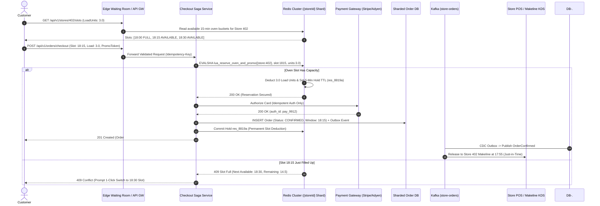
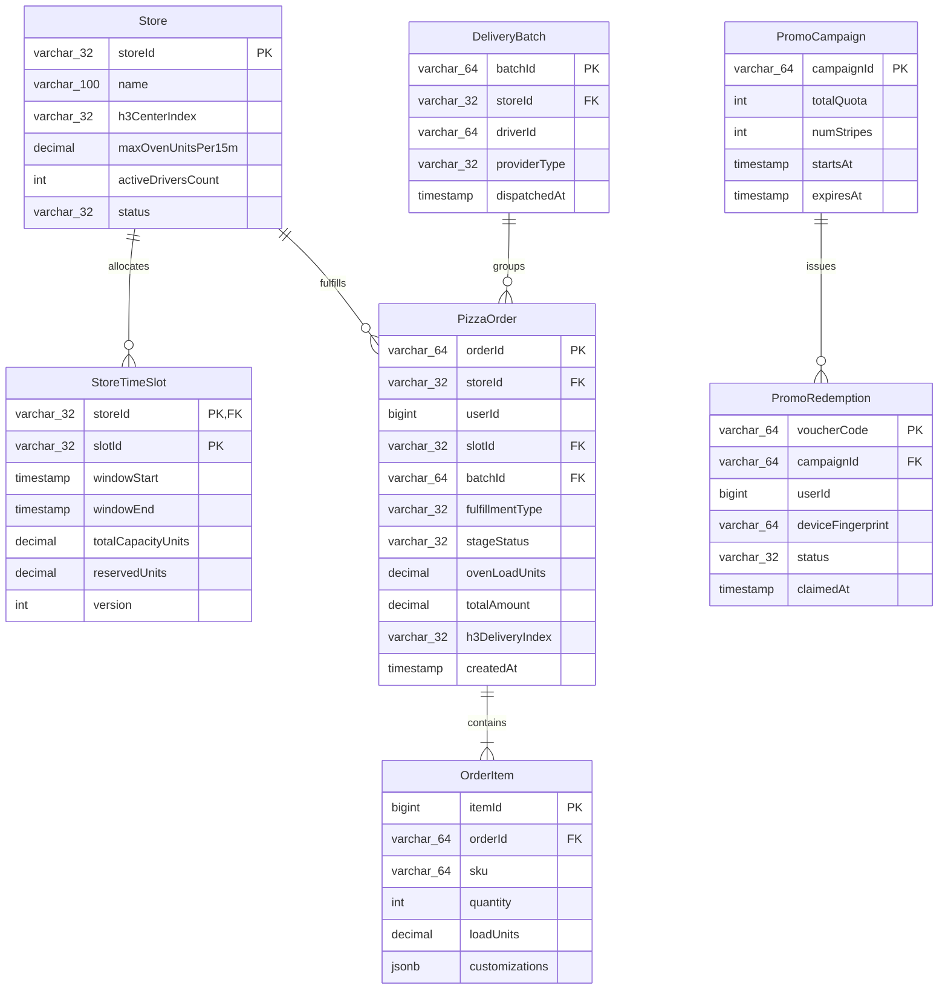
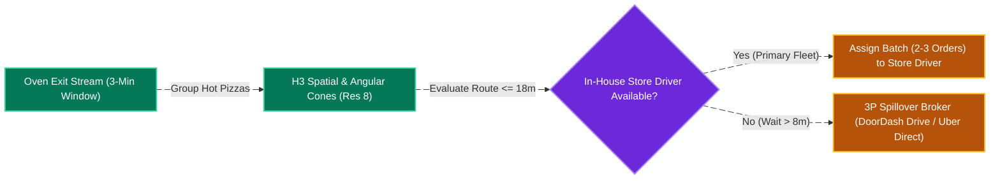

# Pizza Super Bowl Campaign & Ordering System Design

[← Back to System Design](system-design.md)

> **Core Building Blocks Used**: [Chapter 1 — Server-Sent Events (SSE) for Real-Time Pizza Tracker & gRPC Store POS Sync](fundamentals/01-networking-and-api-paradigms.md#3-real-time-protocols-polling-vs-sse-vs-websockets-vs-webrtc) · [Chapter 2 — Edge CDN Offloading & Virtual Waiting Room](fundamentals/02-edge-load-balancing-and-cdn.md#push-cdn-vs-pull-cdn--origin-shield) · [Chapter 3 — Redis Counter Striping (Hot-Key Mitigation) & Atomic Lua Slot Reservation](fundamentals/03-caching-and-scaling.md#caching-failure-modes--interview-mitigations) · [Chapter 4 — Sharding by `storeId` & Uber H3 Delivery Polygon Indexing](fundamentals/04-databases-sql-vs-nosql.md#geospatial-indexing-geohash-vs-quadtree-vs-uber-h3) · [Chapter 5 — Checkout Saga Pattern, Idempotency Keys & Kafka Backpressure](fundamentals/05-distributed-systems-and-messaging.md#4-distributed-transactions-2pc-vs-saga-vs-transactional-outbox) · [Chapter 6 — Load Shedding, Circuit Breakers & Little's Law](fundamentals/06-resiliency-observability-and-metrics.md#littles-law--the-queueing-delay-hockey-stick-curve)

## Overview

A national pizza chain (such as **Domino's** or **Pizza Hut**, operating **7,000+ physical brick-and-mortar stores** across the United States) is launching a flagship **Super Bowl Sunday Campaign**. During a 30-second national TV commercial aired to **120+ million live viewers** (e.g., at Halftime or upon a game event like an Overtime kickoff), a QR code and promotional offer appear on screen alongside massive game-day ordering demand.

Designing a pizza ordering system for the Super Bowl requires solving a unique **dual-bottleneck distributed systems problem** that distinguishes food commerce from purely digital e-commerce:

1. **The Digital "Thundering Herd" Bottleneck**: Unlike normal daily traffic or even a rolling holiday sale, a live Super Bowl broadcast synchronizes human behavior to the exact second. Within **5 to 10 seconds** of the commercial airing, millions of viewers simultaneously open the app, scan the QR code, claim limited promotional vouchers, customize complex pizzas, and hit checkout.
2. **The Physical World (Kitchen & Oven) Bottleneck**: Even if the cloud backend scales elastically to ingest $25,000\text{ orders/second}$ without crashing, **a physical pizza oven cannot auto-scale**. A brick-and-mortar store's conveyor oven can only bake $\approx 120\text{–}160\text{ pizzas/hour}$ ($\approx 30\text{–}40\text{ pizzas per 15-minute window}$). Accepting 1,000 simultaneous "ASAP" orders for a single neighborhood store would create an 8-hour kitchen backlog, spoil ingredients, overwhelm drivers, and trigger mass cancellations.
3. **Hot-Key Contention on National Promo Counters**: A national campaign offering *"500,000 Free / 50%-Off Pizzas"* creates a massive single-key write hotspot if every request attempts to decrement a single database row or single Redis key at $300,000+\text{ QPS}$.
4. **Real-Time "Pizza Tracker" & Last-Mile Dispatch**: Millions of customers concurrently watch live stage-by-stage kitchen telemetry (`Order Placed` $\to$ `Prep` $\to$ `Baking` $\to$ `Quality Check` $\to$ `Out for Delivery`) while stores batch deliveries across neighborhood geospatial zones.

---

## Functional Requirements

* **Geospatial Store Discovery & Menu Browsing**: Locate the customer's assigned delivery store (via delivery polygon / **Uber H3** cell) or nearest carryout locations, and render store-specific menus, localized pricing, and item availability.
* **Complex Pizza Customization & Cart Pricing**: Support customizable items (size, crust, sauce, cheese levels, left-half / right-half / whole toppings, wing flavors, and multi-item combo deals) with deterministic price calculation.
* **Super Bowl TV Ad Promo & Voucher Redemption**: Allow users scanning the Super Bowl commercial QR code (or entering a promo code) to atomically claim limited promotional vouchers (`1 per account/device`) without over-issuing beyond the campaign cap.
* **Physical Store & Oven Time-Slot Throttling**: Dynamically allocate orders into discrete **15-minute kitchen capacity buckets** per store (`ASAP` vs. scheduled time windows like `18:15–18:30`), automatically throttling or shifting ETAs when a local store's makeline or oven reaches capacity.
* **High-Concurrency Asynchronous Checkout**: Process payment authorizations, promo redemptions, and oven slot reservations with strict idempotency, queueing confirmed orders for reliable store Point-of-Sale (POS) / Kitchen Display System (KDS) dispatch.
* **Real-Time "Pizza Tracker"**: Push live order lifecycle transitions (`PLACED` $\to$ `PREP` $\to$ `BAKING` $\to$ `BOXING` $\to$ `OUT_FOR_DELIVERY` $\to$ `DELIVERED`) and live driver GPS coordinates to millions of connected clients.
* **Last-Mile Delivery Dispatch & Batching**: Group completed orders exiting the oven within the same time window and directional H3 corridor for in-house store drivers, with automated spillover to third-party (3P) delivery networks (e.g., DoorDash Drive, Uber Direct) when store driver fleets are saturated.

---

## Non-Functional Requirements

* **Extreme Burst Resilience ($100\times$ Spike)**: Absorb a synchronized **5-million concurrent user surge** and **$1.5\text{M+ Edge Read QPS}$ / $300\text{K Promo QPS}$ / $25\text{K Checkout QPS}$** within seconds of the TV commercial without cascading failures.
* **Zero Promo Over-Redemption & Zero Oven Overbooking (Strict Consistency)**:
  * A campaign capped at 500,000 promotional pizzas must never issue 500,001 vouchers.
  * A store oven slot capped at 40 "Oven Load Units" per 15-minute window must never accept 400 ASAP orders.
* **Low-Latency Browsing & Cart Assembly**: Store lookup and menu rendering must achieve **$P99 < 150\text{ ms}$** via edge caching; checkout submission must acknowledge within **$P99 < 800\text{ ms}$**.
* **High Availability (`99.99%`) & Graceful Degradation**: If recommendations, loyalty history, or 3P analytics fail during the spike, core pizza ordering and payment capture must continue uninterrupted.
* **Store Partition Isolation (Blast-Radius Containment)**: If a store in Kansas City or San Francisco is completely sold out for the next 3 hours, customers ordering from a store in Austin must experience zero lock contention or latency impact.

---

## Back of the Envelope Estimations

### 1. Digital Traffic & Synchronized TV Ad Spike

* **US Physical Store Footprint**: $7,000\text{ stores}$.
* **Baseline Sunday Traffic**: $\approx 2\text{ Million orders/day} \approx 23\text{ orders/sec}$ average ($\approx 300\text{ orders/sec}$ dinner peak).
* **Super Bowl Sunday Scale**:
  * Live TV Broadcast Audience: $120+\text{ Million viewers}$.
  * Concurrent Active Users during the 30-second TV Commercial: **$5,000,000\text{ concurrent users}$**.
* **Read QPS (Menu, Store Polygons, Promo Landing Page)**:
  $$\text{Peak Read QPS} = \frac{5,000,000\text{ users} \times 4\text{ requests}}{10\text{ seconds}} = 2,000,000\text{ QPS (2M QPS at CDN Edge)}$$
  *(With $98\%$ CDN & Edge Worker cache hit ratio, origin services receive $\approx 40,000\text{ Read QPS}$).*
* **Promo / Voucher Claim QPS**:
  * $3,000,000\text{ users}$ attempting to claim the Super Bowl promo within a 10-second window:
  $$\text{Peak Promo Claim QPS} = \frac{3,000,000}{10\text{ sec}} = 300,000\text{ writes/sec}$$
* **Order Checkout QPS**:
  * Peak game-day checkout burst (pre-kickoff & halftime surge):
  $$\text{Peak Checkout QPS} \approx 25,000\text{ checkouts/sec}$$

### 2. Physical Kitchen & Oven Throughput Math (Why Throttling is Mandatory)

* **Single Store Oven Capacity**:
  * A standard multi-deck conveyor oven bakes a pizza in $\approx 6.5\text{ minutes}$ and can output $\approx 160\text{ pizzas/hour}$ ($\approx 40\text{ pizzas per 15-minute bucket}$).
* **National Physical Production Ceiling ($7,000\text{ stores}$)**:
  $$\text{National Oven Capacity} = 7,000\text{ stores} \times 40\text{ pizzas / 15 min} = 280,000\text{ pizzas per 15-min window}$$
  $$\text{Max Physical Throughput} = \frac{280,000\text{ pizzas}}{900\text{ seconds}} \approx 311\text{ pizzas/second nationwide}$$
* **Architectural Insight**:
  * Digital checkout demand during the Super Bowl spike reaches **$25,000\text{ orders/sec}$** ($\approx 50,000\text{ pizzas/sec}$), which is **$160\times$ higher than the physical ovens' instantaneous baking rate ($311\text{ pizzas/sec}$)**!
  * Therefore, the ordering system **cannot** treat all orders as immediate `ASAP` kitchen dispatches. It **must** decouple digital checkout from physical baking using **15-minute Time-Slot Reservations** (spreading orders across future time windows `17:30`, `17:45`, `18:00`, `18:15`, etc., or deferring redeemable promo vouchers to future days).

### 3. Memory, Bandwidth & Storage Sizing

* **Redis Store Capacity & Promo State**:
  * 7,000 stores $\times$ 96 time-slots/day (15-min buckets) $\times$ $128\text{ bytes} \approx 86\text{ MB}$ (fits effortlessly in RAM).
  * 5,000,000 active cart & reservation keys $\times$ $1\text{ KB} \approx 5\text{ GB}$ across a Redis Cluster.
* **Pizza Tracker Active Connections**:
  * $1,500,000\text{ active orders}$ being tracked simultaneously via Server-Sent Events (SSE) during the 4-hour broadcast window.
  * At $\approx 20\text{ KB}$ overhead per idle SSE connection across Envoy/Go edge gateways: $1.5\text{M} \times 20\text{ KB} \approx 30\text{ GB RAM}$ ($\approx 15\text{–}20$ gateway nodes).
* **Order Persistence Storage**:
  * $5\text{ Million orders}$ on Super Bowl Sunday $\times 4\text{ KB/order} \approx 20\text{ GB/day}$.

---

## High-Level System Architecture

```mermaid
%%{init: {'flowchart': {'nodeSpacing': 25, 'rankSpacing': 45, 'padding': 10}}}%%
flowchart LR
    Clients["5M+ Fans (Mobile App / Web QR)"]
    subgraph EdgeTier["Edge CDN & Spike Absorption"]
        CDN["Cloudflare CDN (Static Menus)"]
        WaitRoom["Edge Worker Waiting Room & Bot Shield"]
        APIGW["API Gateway (Envoy)"]
    end
    subgraph CoreServices["Stateless Ordering & Promo Services"]
        PromoSvc["Promo Claim Svc (Striped Counters)"]
        SlotSvc["Store Capacity & Time-Slot Svc"]
        CheckoutSvc["Checkout & Order Saga Svc"]
        TrackerGW["SSE Pizza Tracker Gateway"]
    end
    subgraph DataAndBus["Sharded Cache, Event Bus & Persistence"]
        RedisCluster[("Redis Cluster (Lua Slots & Promos)")]
        Kafka[["Kafka Bus (Partitioned by storeId)"]]
        OrderDB[("CockroachDB / Sharded Postgres")]
    end
    subgraph StoreAndDelivery["Physical Stores & Last-Mile Fleet"]
        StorePOS["7,000 Store POS / KDS (Makeline)"]
        DispatchSvc["H3 Delivery Batching & 3P Spillover"]
    end

    Clients e1@-->|"1. Scan QR / Browse Menu"| CDN
    Clients e2@-->|"2. Claim Promo / Checkout"| WaitRoom
    WaitRoom e3@-->|"3. Signed Admission JWT"| APIGW
    APIGW e4@-->|"Claim Voucher"| PromoSvc
    APIGW e5@-->|"Query / Hold 15m Slot"| SlotSvc
    APIGW e6@-->|"Submit Order"| CheckoutSvc
    Clients e7@-.->|"7. Live SSE Stream"| TrackerGW
    PromoSvc e8@-->|"Striped DECR"| RedisCluster
    SlotSvc e9@-->|"Atomic Lua Hold"| RedisCluster
    CheckoutSvc e10@-->|"ACID Persist"| OrderDB
    CheckoutSvc e11@-->|"Publish Order Event"| Kafka
    Kafka e12@-->|"Scheduled Release"| StorePOS
    StorePOS e13@-->|"Stage Telemetry"| Kafka
    Kafka e14@-->|"Push Status"| TrackerGW
    Kafka e15@-->|"Oven Exit Event"| DispatchSvc

    e1@{ animate: true }
    e2@{ animate: true }
    e3@{ animate: true }
    e4@{ animate: true }
    e5@{ animate: true }
    e6@{ animate: true }
    e7@{ animate: true }
    e8@{ animate: true }
    e9@{ animate: true }
    e10@{ animate: true }
    e11@{ animate: true }
    e12@{ animate: true }
    e13@{ animate: true }
    e14@{ animate: true }
    e15@{ animate: true }

    classDef client fill:#1d4ed8,stroke:#60a5fa,stroke-width:2px,color:#ffffff
    classDef edge fill:#6d28d9,stroke:#a78bfa,stroke-width:2px,color:#ffffff
    classDef service fill:#047857,stroke:#34d399,stroke-width:2px,color:#ffffff
    classDef cache fill:#be123c,stroke:#fb7185,stroke-width:2px,color:#ffffff
    classDef storage fill:#b45309,stroke:#fbbf24,stroke-width:2px,color:#ffffff
    classDef queue fill:#3730a3,stroke:#818cf8,stroke-width:2px,color:#ffffff

    class Clients client
    class CDN,WaitRoom,APIGW edge
    class PromoSvc,SlotSvc,CheckoutSvc,TrackerGW,DispatchSvc service
    class RedisCluster cache
    class OrderDB,StorePOS storage
    class Kafka queue

    style EdgeTier fill:transparent,stroke:#a78bfa,stroke-width:1.5px,stroke-dasharray: 5 5
    style CoreServices fill:transparent,stroke:#34d399,stroke-width:1.5px,stroke-dasharray: 5 5
    style DataAndBus fill:transparent,stroke:#fbbf24,stroke-width:1.5px,stroke-dasharray: 5 5
    style StoreAndDelivery fill:transparent,stroke:#60a5fa,stroke-width:1.5px,stroke-dasharray: 5 5
```



---

## Core Components & End-to-End Workflows

### 1. Store Discovery & Client-Side Cart Pricing

To prevent $5\text{ million}$ users from hammering backend compute nodes every time they toggle a pepperoni topping:

1. **Geospatial Store Assignment**: When a user enters their address or GPS coordinates, an Edge Worker converts `(lat, lon)` into an **Uber H3** hexagonal index (`resolution 8`, $\approx 0.7\text{ km}^2$) and looks up the assigned `storeId` from an edge-replicated KV map in $< 5\text{ ms}$.
2. **Edge-Cached Store Menu & Pricing Rules**: Each store's menu, topping price matrix, and tax rate (`store_menu_{storeId}.json`, $\approx 40\text{ KB}$ compressed) is served directly from the CDN edge with a `stale-while-revalidate` policy and instant cache-tag purge if a store marks an ingredient out-of-stock (e.g., running out of thin crust).
3. **Zero-Origin Cart Assembly**: Building a pizza, adding wings, and calculating subtotal happen **100% locally on the client** using the downloaded ruleset. The backend is only contacted when the user views live oven time-slots or initiates checkout, eliminating $90\%$ of dynamic origin RPCs.

### 2. Two-Phase Oven Slot Reservation & Async Checkout Flow

When a customer checks out on Super Bowl Sunday, the system must verify **both** digital payment/promo validity and physical store oven capacity without holding long-lived SQL locks:



---

## API Specifications

### 1. Claim Super Bowl TV Ad Promo Voucher

```http
POST /api/v1/promos/claim
Authorization: Bearer <user_jwt>
X-Device-Attestation: <apple_devicecheck_or_play_integrity_token>
Idempotency-Key: idem_promo_99182736
Content-Type: application/json
```

```json
// Request
{
  "campaignId": "sb_lx_halftime_free_pizza",
  "qrNonce": "sb60_tv_spot_q3_99182a"
}

// Response: 200 OK
{
  "voucherCode": "SB60-9K2M-X8P1",
  "campaignId": "sb_lx_halftime_free_pizza",
  "status": "CLAIMED",
  "discountType": "FREE_MEDIUM_2_TOPPING",
  "validFrom": "2026-02-08T18:00:00Z",
  "expiresAt": "2026-02-15T23:59:59Z",
  "signature": "hmac_sha256_8f91a2b3c4..."
}
```

### 2. Query Store Oven Time-Slots & Dynamic ETA

```http
GET /api/v1/stores/str_0402/slots?fulfillment=DELIVERY&ovenLoadUnits=3.5
Authorization: Bearer <user_jwt>
```

```json
// Response: 200 OK
{
  "storeId": "str_0402",
  "storeStatus": "HIGH_VOLUME_THROTTLED",
  "asapAvailable": false,
  "slots": [
    {
      "slotId": "20260208_1800",
      "windowStart": "2026-02-08T18:00:00Z",
      "windowEnd": "2026-02-08T18:15:00Z",
      "status": "FULL",
      "remainingLoadUnits": 0.0
    },
    {
      "slotId": "20260208_1815",
      "windowStart": "2026-02-08T18:15:00Z",
      "windowEnd": "2026-02-08T18:30:00Z",
      "status": "AVAILABLE",
      "remainingLoadUnits": 12.5,
      "estimatedDeliveryEtaMinutes": 45
    }
  ]
}
```

### 3. Submit High-Concurrency Order Checkout

```http
POST /api/v1/orders/checkout
Authorization: Bearer <user_jwt>
Idempotency-Key: ord_idem_77281920
Content-Type: application/json
```

```json
// Request
{
  "storeId": "str_0402",
  "fulfillmentType": "DELIVERY",
  "slotId": "20260208_1815",
  "items": [
    {
      "sku": "PIZZA_LG_HANDTOSSED",
      "quantity": 2,
      "ovenLoadUnits": 3.0,
      "customizations": {
        "sauce": "MARINARA",
        "leftToppings": ["PEPPERONI", "JALAPENO"],
        "rightToppings": ["MUSHROOM", "OLIVES"]
      }
    },
    {
      "sku": "WINGS_8PC_BUFFALO",
      "quantity": 1,
      "ovenLoadUnits": 0.5
    }
  ],
  "voucherCode": "SB60-9K2M-X8P1",
  "paymentMethodToken": "pm_applepay_88192a",
  "deliveryAddress": {
    "street": "742 Evergreen Terrace",
    "zip": "89101",
    "lat": 36.1699,
    "lon": -115.1398,
    "h3IndexRes8": "8829a1d2b9fffff"
  }
}

// Response: 201 Created
{
  "orderId": "ord_0402_8819204",
  "storeId": "str_0402",
  "status": "CONFIRMED_SCHEDULED",
  "scheduledSlot": "2026-02-08T18:15:00Z",
  "estimatedDeliveryAt": "2026-02-08T18:42:00Z",
  "totalCharged": 24.99,
  "trackerStreamUrl": "https://tracker.pizzaco.com/api/v1/orders/ord_0402_8819204/stream"
}
```

### 4. Real-Time "Pizza Tracker" SSE Stream

```http
GET /api/v1/orders/ord_0402_8819204/stream
Accept: text/event-stream
Last-Event-ID: evt_002
```

```text
id: evt_003
event: order_stage_update
data: {"orderId":"ord_0402_8819204","stage":"BAKING","ovenEnteredAt":"2026-02-08T18:16:10Z","ovenExitEta":"2026-02-08T18:22:40Z","makerName":"Marco"}

id: evt_004
event: order_stage_update
data: {"orderId":"ord_0402_8819204","stage":"OUT_FOR_DELIVERY","driverName":"Alex","driverLat":36.1650,"driverLon":-115.1320,"etaMinutes":8}
```

---

## Object Model & Database Schema

### Database Selection & Rationale

| Workload / Subsystem | Database Choice | Data Model & CAP Profile | Why This Database? (Justification & Trade-offs) |
| :--- | :--- | :--- | :--- |
| **Transactional Orders & Outbox (`PizzaOrder`, `OrderItem`)** | **CockroachDB / Sharded PostgreSQL (by `storeId`)** | Sharded Relational (ACID, **CP / PC-EC**) | **Why:** Financial order capture, tax auditing, refunds, and transactional outbox events require strict ACID guarantees. Sharding by `storeId` ensures that all orders for Store `#0402` live on a single shard, preventing cross-shard distributed transactions and isolating local hotspots. |
| **Store Oven Time-Slot Quotas & Promo Striping** | **Redis Cluster (Hash-Tagged by `{storeId}` & `{promoShard}`)** | In-Memory Key-Value (**CP on Primary via Atomic Lua**) | **Why:** Checking and decrementing a store's 15-minute oven capacity (`store:{0402}:slot:1815`) and user promo locks must execute in sub-millisecond time without relational row-lock contention (`SELECT FOR UPDATE`). Redis single-threaded Lua scripts (`EVALSHA`) guarantee zero overbooking at $50,000+\text{ ops/sec}$ per shard. |
| **Store Menus, Polygons & Feature Flags** | **Cloudflare Workers KV + Edge CDN** | Global Replicated Key-Value (**AP / Sub-10ms Edge Read**) | **Why:** Offloads $2\text{M+ QPS}$ of menu fetches, store hours, and H3 delivery polygon lookups to 300+ global edge PoPs so origin databases never see read traffic during the Super Bowl TV spot. |
| **Async Order Release & Kitchen Telemetry Bus** | **Apache Kafka (Partitioned by `storeId`)** | Distributed Commit Log (**Durable Stream**) | **Why:** Buffers confirmed orders during massive spikes and releases them to physical store POS terminals at a controlled pace (`Just-in-Time` makeline release). Also ingests makeline/oven sensor events to fan out to the Pizza Tracker and H3 delivery batcher. |
| **Real-Time Campaign & Store Operations Dashboard** | **ClickHouse (via Kafka Ingestion)** | Columnar OLAP (**Real-Time Analytical**) | **Why:** Allows headquarters and regional managers to watch live Super Bowl promo redemption rates, store oven saturation heatmaps, and P99 delivery ETAs with sub-second aggregation queries. |



---

## System Design Diagram

```mermaid
%%{init: {'flowchart': {'nodeSpacing': 20, 'rankSpacing': 40, 'padding': 10}}}%%
flowchart LR
    subgraph Users["Clients & Store Hardware"]
        FanApp["5M+ Fan Apps (iOS / Android / Web)"]
        StoreKDS["7,000 Store POS & Makeline KDS"]
    end
    subgraph EdgeLayer["Edge Shield & Waiting Room"]
        CDN["Global CDN (Menus & H3 Polygons)"]
        EdgeWait["Edge Waiting Room & Turnstile Bot Filter"]
        Gateway{"Envoy API Gateway (JWT & Rate Limit)"}
    end
    subgraph Microservices["Core Ordering & Dispatch Fleet"]
        PromoEngine["Promo Service (256-Way Striped)"]
        CapacitySvc["Store Capacity & Time-Slot Service"]
        CheckoutSaga["Checkout Saga & Payment Service"]
        POSBridge["Store POS gRPC/MQTT Bridge"]
        TrackerSSE["Pizza Tracker SSE Fanout Fleet"]
        BatchDispatch["H3 Delivery Batcher & 3P Router"]
    end
    subgraph DataBackplane["Caching, Streaming & Persistence"]
        RedisPromo[("Redis Promo Cluster (256 Shards)")]
        RedisSlot[("Redis Store Slot Cluster ({storeId})")]
        OrderDB[("Sharded CockroachDB / Postgres")]
        Kafka[["Kafka Event Bus (by storeId)"]]
        PubSub[("Redis Pub/Sub (Tracker Events)")]
    end

    FanApp e1@-->|"GET Menu & H3 Store"| CDN
    FanApp e2@-->|"Claim / Checkout"| EdgeWait
    EdgeWait e3@-->|"Metered Admission"| Gateway
    Gateway e4@-->|"POST /promos/claim"| PromoEngine
    Gateway e5@-->|"GET /slots"| CapacitySvc
    Gateway e6@-->|"POST /checkout"| CheckoutSaga
    FanApp e7@-.->|"SSE Stream"| TrackerSSE

    PromoEngine e8@-->|"Eval Shard N"| RedisPromo
    CapacitySvc e9@-->|"Read Bucket"| RedisSlot
    CheckoutSaga e10@-->|"Lua Slot Hold"| RedisSlot
    CheckoutSaga e11@-->|"ACID Tx + Outbox"| OrderDB
    OrderDB e12@-.->|"CDC Outbox"| Kafka

    Kafka e13@-->|"JIT Makeline Push"| POSBridge
    POSBridge e14@<-->|"Bi-Dir gRPC / Local Buffer"| StoreKDS
    POSBridge e15@-->|"Stage Transitions"| Kafka
    Kafka e16@-->|"Publish Update"| PubSub
    PubSub e17@-->|"Push SSE"| TrackerSSE
    Kafka e18@-->|"Oven Exit Trigger"| BatchDispatch

    e1@{ animate: true }
    e2@{ animate: true }
    e3@{ animate: true }
    e4@{ animate: true }
    e5@{ animate: true }
    e6@{ animate: true }
    e7@{ animate: true }
    e8@{ animate: true }
    e9@{ animate: true }
    e10@{ animate: true }
    e11@{ animate: true }
    e12@{ animate: true }
    e13@{ animate: true }
    e14@{ animate: true }
    e15@{ animate: true }
    e16@{ animate: true }
    e17@{ animate: true }
    e18@{ animate: true }

    classDef client fill:#1d4ed8,stroke:#60a5fa,stroke-width:2px,color:#ffffff
    classDef edge fill:#6d28d9,stroke:#a78bfa,stroke-width:2px,color:#ffffff
    classDef service fill:#047857,stroke:#34d399,stroke-width:2px,color:#ffffff
    classDef worker fill:#0e7490,stroke:#22d3ee,stroke-width:2px,color:#ffffff
    classDef cache fill:#be123c,stroke:#fb7185,stroke-width:2px,color:#ffffff
    classDef storage fill:#b45309,stroke:#fbbf24,stroke-width:2px,color:#ffffff
    classDef queue fill:#3730a3,stroke:#818cf8,stroke-width:2px,color:#ffffff

    class FanApp,StoreKDS client
    class CDN,EdgeWait,Gateway edge
    class PromoEngine,CapacitySvc,CheckoutSaga service
    class POSBridge,TrackerSSE,BatchDispatch worker
    class RedisPromo,RedisSlot,PubSub cache
    class OrderDB storage
    class Kafka queue

    style Users fill:transparent,stroke:#60a5fa,stroke-width:1.5px,stroke-dasharray: 5 5
    style EdgeLayer fill:transparent,stroke:#a78bfa,stroke-width:1.5px,stroke-dasharray: 5 5
    style Microservices fill:transparent,stroke:#34d399,stroke-width:1.5px,stroke-dasharray: 5 5
    style DataBackplane fill:transparent,stroke:#fbbf24,stroke-width:1.5px,stroke-dasharray: 5 5
```



---

## Deep Dive & Key Technical Challenges

### 1. TV Ad "Thundering Herd" Mitigation (Surviving the 5-Second Spike)

When a 30-second Super Bowl commercial flashes a QR code to 120 million viewers, reactive cloud auto-scaling (Kubernetes HPA / AWS ASG taking 60–180 seconds to boot pods) is **too slow**—the spike peaks in 5 seconds.

* **Pre-Warmed Infrastructure & Shadow Load Testing**:
  * Compute clusters, DB connection pools (PgBouncer), and Redis shards are pre-scaled $20\times$ above baseline 4 hours before kickoff based on historical game-day curves.
* **Edge Static Offload & Client-Side Jitter**:
  * The QR code resolves to a 100% static, edge-cached landing page (`Cloudflare / Fastly PoPs`) with zero origin hits.
  * For mobile app users already logged in, the app downloads a signed campaign manifest prior to kickoff and injects a **randomized client-side submission jitter (`0–3,000 ms`)** when claiming non-FCFS rewards, smoothing a 1-second vertical wall of requests into a wider plateau.
* **Edge Virtual Waiting Room & Token Admission**:
  * If concurrent checkout or promo requests exceed the origin's safe processing threshold (e.g., $> 25,000\text{ checkouts/sec}$), Edge Workers activate a **Virtual Waiting Room** using Edge KV atomic counters.
  * Users are issued a lightweight queue position and admitted in metered batches via short-lived, HMAC-signed admission cookies (`X-Queue-Admission-Token`, 5-minute TTL).
* **Feature Shedding (Graceful Degradation)**:
  * During `DEFCON 1` (commercial airing + halftime), non-essential RPCs—such as past order history, ML cross-sell carousels (*"People also ordered cheesy bread"*), and loyalty point ledger recalculations—are automatically short-circuited via feature flags at the API Gateway, preserving 100% of CPU and DB IOPS for checkout.

---

### 2. Physical Store & Oven Capacity Throttling (Digital-to-Physical Backpressure)

A pizza store is a physical factory with three sequential bottlenecks: **Makeline (Prep)** $\to$ **Conveyor Oven (Bake)** $\to$ **Driver Fleet (Delivery)**.

* **Weighted "Oven Load Units" (OLU)**:
  * Not all menu items consume equal oven deck space. Each SKU is assigned an `ovenLoadUnit`:
    * `1 Large Specialty Pizza` $= 1.5\text{ OLU}$
    * `1 Medium 1-Topping Pizza` $= 1.0\text{ OLU}$
    * `8-Piece Wings / Bread Twists` $= 0.5\text{ OLU}$
    * `2-Liter Soda` $= 0.0\text{ OLU}$ (bypasses the oven entirely!)
* **Discrete 15-Minute Time-Slot Buckets**:
  * Each store's day is partitioned into 15-minute buckets (`17:45`, `18:00`, `18:15`, `18:30`, ...), stored in Redis under hash-tagged keys `{store:0402}:slots:20260208`.
  * Suppose Store `#0402` has a physical oven capacity of `40.0 OLU` per 15-minute bucket:
    * **Pre-Orders**: Up to $60\%$ of each bucket (`24.0 OLU`) can be booked in advance (morning / pre-game scheduled orders), reserving $40\%$ (`16.0 OLU`) for game-time `ASAP` orders.
* **Atomic Lua Reservation (`EVALSHA`)**:
  * When a user clicks checkout for the `18:15` slot with `3.5 OLU`, the Checkout Service runs an atomic Redis Lua script:

    ```lua
    -- KEYS[1]: {store:0402}:slot:1815:remaining_olu
    -- KEYS[2]: {store:0402}:hold:ord_idem_77281920
    -- ARGV[1]: requested_olu (3.5), ARGV[2]: hold_ttl_sec (300)
    if redis.call("EXISTS", KEYS[2]) == 1 then
        return 1 -- Idempotent retry: already held
    end
    local remaining = tonumber(redis.call("GET", KEYS[1]) or "0")
    if remaining < tonumber(ARGV[1]) then
        return 0 -- Slot full!
    end
    redis.call("DECRBYFLOAT", KEYS[1], ARGV[1])
    redis.call("SETEX", KEYS[2], tonumber(ARGV[2]), ARGV[1])
    return 1
    ```

* **Just-in-Time (JIT) Makeline Release**:
  * If a customer places an order at `16:00` scheduled for `19:00` (Halftime), the cloud **does not** dump that order onto the store's Kitchen Display System (KDS) at `16:00` (which would clutter the screen with hundreds of future tickets).
  * Instead, a scheduled Kafka/Timing-Wheel releaser dispatches the order to the store's makeline at `18:35` ($\text{Target Window} - \text{Prep/Bake/Delivery Lead Time}$).
* **Dynamic Circuit Breaking per Store**:
  * If a store's physical POS reports that makeline ticket times exceed 20 minutes (e.g., an oven belt malfunctions or staff calls out sick), the store's `maxOvenUnitsPer15m` is dynamically throttled down in Redis, or `DELIVERY` is temporarily paused in favor of `CARRYOUT` only.

---

### 3. Promo Code & Limited Voucher Atomic Redemption at 500K+ QPS

Suppose the Super Bowl campaign promises: **"First 500,000 fans to scan the QR code get a Free Medium Pizza voucher!"**

* **The Hot-Key Problem**:
  * Even though a single Redis instance can execute $\approx 100,000\text{ ops/sec}$, a spike of $300,000\text{ QPS}$ hitting a single key (`promo:sb60:remaining`) saturates a single Redis CPU core and network NIC, causing tail latency spikes (`P99 > 2s`).
* **Solution — 256-Way Counter Striping (Token Bucket Sharding)**:
  * Instead of 1 global counter with `500,000` vouchers, we split the quota across **$N = 256$ independent Redis shards/keys**:
    $$\text{Key}_i = \texttt{promo:sb60:shard:\{i\}:quota}, \quad i \in [0, 255]$$
  * Each of the 256 keys is initialized with $\lfloor 500,000 / 256 \rfloor = 1,953\text{ vouchers}$ (with the remainder distributed across the first 32 shards).
  * **Routing & Deduplication**:
    1. When `userId` requests a voucher, we first verify device attestation (`Apple DeviceCheck` / `Google Play Integrity` / `Cloudflare Turnstile`) at the API Gateway to block headless scripts.
    2. We hash `userId` deterministically to a stripe: $\text{shardId} = \text{CRC32}(\text{userId}) \pmod{256}$.
    3. On that shard, an atomic Lua script checks `SISMEMBER` / `SETNX` on `promo:sb60:shard:{i}:user:{userId}` (preventing double-claims by the same user) and decrements `promo:sb60:shard:{i}:quota`.
    4. If a user's primary shard hits `0` while the tail end of the campaign still has a few vouchers left on other shards, the service falls back to a lightweight gossiped list of non-empty shards for the final $< 1\%$ of inventory.
  * **Throughput Gain**: $256\text{ shards} \times 80,000\text{ ops/sec/shard} > 20,000,000\text{ ops/sec}$ theoretical capacity—handling a $300\text{K QPS}$ TV commercial burst with sub-millisecond latency and **zero over-redemption**.

---

### 4. Real-Time "Pizza Tracker" & Resilient Store POS Synchronization

Hungry Super Bowl viewers obsessively watch the Pizza Tracker (`Order Placed` $\to$ `Prep` $\to$ `Baking` $\to$ `Quality Check` $\to$ `Out for Delivery`).

* **Why Server-Sent Events (SSE) over Polling or WebSockets**:
  * Short polling every 3 seconds from $1.5\text{M}$ active orders would generate $500,000\text{ useless read QPS}$ against the backend.
  * Since the Pizza Tracker is strictly **unidirectional** (server pushing stage updates & driver GPS to the client), **SSE over HTTP/2 or HTTP/3** is lighter than full-duplex WebSockets, works seamlessly through corporate/cellular proxies, and supports native reconnection via `Last-Event-ID`.
* **Store-to-Cloud Telemetry Pipeline**:
  1. Each physical store maintains a persistent, mutually authenticated (`mTLS`) **gRPC / MQTT stream** to the cloud `POSBridge` service.
  2. When a pizza maker bumps an order on the Makeline KDS—or when an optical/RFID tray sensor detects the pizza entering the conveyor oven—the store POS emits a compact event (`orderId`, `stage: BAKING`, `ovenExitEta: +6.5m`).
  3. `POSBridge` publishes the event to **Kafka** (`topic: order-tracker-events`), which updates the order state in Redis/DB and fans out via **Redis Pub/Sub** to the specific `TrackerSSE` gateway pod holding that customer's SSE connection.
* **Offline Store Resiliency & Simulated Interpolation**:
  * If a local store's ISP connection drops briefly during the game, the in-store POS continues operating off a local SQLite/Edge queue and syncs queued events upon reconnection.
  * While a pizza is inside the conveyor oven (a deterministic 6.5-minute physical process), the client UI smoothly interpolates the progress bar locally without needing per-second network packets.

---

### 5. Last-Mile Delivery Dispatch, H3 Batching & 3P Fleet Spillover

During the Super Bowl, driver labor is the hardest physical constraint. Sending 1 driver out with 1 pizza at a time destroys store throughput.



* **Oven-Synchronized Micro-Batching**:
  * Unlike general ride-sharing, a pizza loses peak quality if it sits on a warming rack for more than **8–10 minutes** after exiting the oven.
  * When an order enters the `BAKING` stage (`T - 6.5 mins` before oven exit), the **Delivery Batching Engine** evaluates all orders in that store exiting the oven within a **3-minute sliding window**.
* **Uber H3 + Polar Angle Cone Clustering**:
  * Two or three orders are grouped into a single `DeliveryBatch` only if:
    1. Their delivery addresses fall within the same or adjacent **Uber H3 (`res=8`)** hexagons.
    2. Their bearing angles $(\theta)$ from the store coordinates lie within a narrow **$\le 30^\circ$ directional cone** (so a driver never drives 2 miles North and then 2 miles South).
    3. The combined drop-off route keeps the last pizza's total transit time under **18 minutes**.
* **Automated 3P Delivery Spillover**:
  * If a store's in-house driver pool is fully dispatched and an order exiting the oven within 5 minutes has no returning store driver available, the `BatchDispatch` service automatically invokes a **3P White-Label Delivery API** (e.g., DoorDash Drive or Uber Direct) to summon an external gig courier, keeping pizzas hot without turning off the store's online ordering.

---

## Summary of Architectural Trade-offs

| Decision Area | Chosen Approach | Alternative Considered | Why This Trade-off Wins for Super Bowl Scale |
| :--- | :--- | :--- | :--- |
| **Order Admission Model** | **15-Minute Oven Time-Slot Buckets (`OLU`)** | Unlimited `ASAP` FIFO Queue | Unlimited `ASAP` queues cause 4–6 hour surprise wait times, cold pizzas, overwhelmed kitchens, and mass chargebacks. Explicit 15-min slots align digital intake with physical oven physics. |
| **National Promo Quota** | **256-Way Striped Redis Counters + Lua** | Single Redis Key or SQL `UPDATE ... WHERE quota > 0` | A single key bottlenecks at ~100K ops/sec (and SQL locks collapse at ~2K ops/sec). 256 stripes scale linearly to millions of QPS with zero over-issuance. |
| **Cart & Pricing Calculation** | **Edge-Cached Menu JSON + Client-Side Pricing (Verified at Checkout)** | Server-Side Cart Mutation RPC on Every Topping Click | Eliminates $90\%$ of backend write/read chatter while 5M users customize half-and-half toppings during the commercial. |
| **Pizza Tracker Protocol** | **Server-Sent Events (SSE) + Redis Pub/Sub** | Client Short Polling (every 3s) or Full WebSockets | Unidirectional SSE avoids $500\text{K QPS}$ of polling waste and requires less connection state overhead than bi-directional WebSockets. |
| **Database Sharding Key** | **Sharded by `storeId`** | Sharded by `userId` or `orderId` | Store operations (makeline queue, oven capacity, delivery batching, reconciliation) are 100% store-local. Sharding by `storeId` isolates hot stores and eliminates cross-shard joins. |
