# DocuSign Billing & Invoicing Modernization — Architectural Project Retrospective

[← Back to System Design](system-design.md)

> **Core Building Blocks Used**: [Chapter 3 — Redis Distributed Caching](fundamentals/03-caching-and-scaling.md#1-caching-deep-dive) · [Chapter 5 — Event-Driven Architecture, Saga Orchestration & Idempotency](fundamentals/05-distributed-systems-and-messaging.md#4-distributed-transactions-2pc-vs-saga-vs-transactional-outbox) · [Chapter 6 — SLIs/SLOs, Distributed Tracing & Alerting](fundamentals/06-resiliency-observability-and-metrics.md#3-observability-metrics-logs--distributed-tracing) · [Chapter 8 — Zero-Downtime Shadow / Dual-Run Migration Pattern](fundamentals/08-security-multi-region-and-deployments.md#4-zero-downtime-deployment--database-migration-patterns)

## Executive Summary & Interview Context

* **Role**: Lead Architect / Staff Software Engineer
* **Scope**: Enterprise Billing, Invoicing, Payment Collection, and Subscription Management at DocuSign
* **Core Technology Stack**: DocuSign Core Microservices (C# / .NET, Azure), MuleSoft AnyPoint Integration Platform, Zuora Billing & Subscription Engine, Oracle ERP, Istio Service Mesh, Redis Distributed Cache, Azure Monitor, Grafana, PagerDuty

This project retrospective captures a mission-critical enterprise architecture transformation executed at DocuSign. It details the migration from an overloaded, brittle legacy batch-processing system to an event-driven, real-time integration architecture powered by MuleSoft, decoupling DocuSign Core from third-party billing engines (Zuora) while dramatically eliminating financial reconciliation errors and operational overhead.

---

## 1. Situation & The Problem Statement

### Legacy Technical Debt & Operational Bottlenecks

DocuSign's commercial success resulted in explosive transaction volume that overwhelmed the legacy billing infrastructure:

* **Overloaded Quartz Batch Jobs**: Invoicing and subscription synchronization relied on nightly and weekly monolithic Quartz batch jobs. As subscriber accounts surged, batch jobs suffered thread starvation, lock contention, and runtime timeouts, delaying invoice generation by up to **7 days**.
* **Payment Reconciliation Discrepancies**: High discrepancy rates between payments collected via payment gateways and records in the Core database required extensive manual intervention by finance teams.
* **Ambiguous Single Source of Truth (SSOT)**: Both Zuora and DocuSign Core stored overlapping customer account, billing, and subscription status attributes with no deterministic master, leading to split-brain states and customer support escalations.
* **Convoluted Monolithic APIs**: Core backend APIs violated the Single Responsibility Principle (SRP)—mixing subscription lifecycle management, invoice calculation, and user account provisioning in monolithic controllers.
* **High Latency & Abuse Vulnerabilities**: Synchronous external calls during checkout caused user-perceived latency spikes and created security vulnerabilities (e.g. PayPal race conditions and authorization exploits).
* **High Days Sales Outstanding (DSO)**: Collecting payments took an average of **5 days**, locking up corporate cash flow.

```mermaid
%%{init: {'flowchart': {'nodeSpacing': 25, 'rankSpacing': 45, 'padding': 10}}}%%
flowchart LR
    subgraph LegacyIngress["Client & Edge"]
        Client["Client (Web)"]
        GW["Gateway & Load Balancer"]
    end
    subgraph LegacyMonolith["Monolithic App & API"]
        App["Monolithic Web App"]
        Core["Core Monolithic API"]
    end
    subgraph LegacyBatch["Batch & External Billing"]
        Quartz["Quartz Batch Jobs"]
        Zuora["Zuora Billing Engine"]
    end
    Client e1@-->|"HTTPS"| GW
    GW e2@-->|"Route"| App
    App e3@-->|"Sync Call"| Core
    Core e4@-->|"Lock Contention"| Quartz
    Quartz e5@-->|"Batch Polling"| Zuora

    e1@{ animate: true }
    e2@{ animate: true }
    e3@{ animate: true }
    e4@{ animate: true }
    e5@{ animate: true }

    classDef client fill:#1d4ed8,stroke:#60a5fa,stroke-width:2px,color:#ffffff
    classDef edge fill:#6d28d9,stroke:#a78bfa,stroke-width:2px,color:#ffffff
    classDef service fill:#047857,stroke:#34d399,stroke-width:2px,color:#ffffff
    classDef worker fill:#be123c,stroke:#fb7185,stroke-width:2px,color:#ffffff
    classDef storage fill:#b45309,stroke:#fbbf24,stroke-width:2px,color:#ffffff

    class Client client
    class GW edge
    class App,Core service
    class Quartz worker
    class Zuora storage

    style LegacyIngress fill:transparent,stroke:#60a5fa,stroke-width:1.5px,stroke-dasharray: 5 5
    style LegacyMonolith fill:transparent,stroke:#34d399,stroke-width:1.5px,stroke-dasharray: 5 5
    style LegacyBatch fill:transparent,stroke:#fb7185,stroke-width:1.5px,stroke-dasharray: 5 5
```



---

## 2. Target Architectural Solution

The modernization strategy re-architected the billing lifecycle into an **event-driven, decoupled integration platform**:

```mermaid
%%{init: {'flowchart': {'nodeSpacing': 25, 'rankSpacing': 45, 'padding': 10}}}%%
flowchart LR
    subgraph ClientEdge["Clients & Edge"]
        Client["Client (Web)"]
        IstioGW["Istio Service Gateway"]
        Zuora["Zuora (SSOT: Billing)"]
    end
    subgraph IntegrationAndApp["App & Integration Tier"]
        App["App (Micro-Frontends)"]
        MuleSoft["MuleSoft AnyPoint (DLQ & Retry)"]
    end
    subgraph CoreMesh["DocuSign Core Mesh"]
        Core["Core Microservices (Istio Mesh)"]
    end
    subgraph DataAndObs["Persistence & Observability"]
        DB[("Relational & NoSQL DB")]
        Obs["Azure Monitor, Grafana & PagerDuty"]
    end
    Client e1@-->|"HTTPS"| IstioGW
    IstioGW e2@-->|"Route"| App
    App e3@-->|"mTLS API"| Core
    Zuora e4@-->|"Webhooks"| MuleSoft
    MuleSoft e5@-->|"Idempotent REST"| Core
    MuleSoft e6@-->|"Flow Alerts"| Obs
    Core e7@-->|"ACID Write"| DB
    Core e8@-->|"Telemetry"| Obs

    e1@{ animate: true }
    e2@{ animate: true }
    e3@{ animate: true }
    e4@{ animate: true }
    e5@{ animate: true }
    e6@{ animate: true }
    e7@{ animate: true }
    e8@{ animate: true }

    classDef client fill:#1d4ed8,stroke:#60a5fa,stroke-width:2px,color:#ffffff
    classDef edge fill:#6d28d9,stroke:#a78bfa,stroke-width:2px,color:#ffffff
    classDef service fill:#047857,stroke:#34d399,stroke-width:2px,color:#ffffff
    classDef worker fill:#0e7490,stroke:#22d3ee,stroke-width:2px,color:#ffffff
    classDef storage fill:#b45309,stroke:#fbbf24,stroke-width:2px,color:#ffffff
    classDef queue fill:#3730a3,stroke:#818cf8,stroke-width:2px,color:#ffffff

    class Client client
    class IstioGW edge
    class Zuora,DB storage
    class App,Core service
    class MuleSoft queue
    class Obs worker

    style ClientEdge fill:transparent,stroke:#a78bfa,stroke-width:1.5px,stroke-dasharray: 5 5
    style IntegrationAndApp fill:transparent,stroke:#818cf8,stroke-width:1.5px,stroke-dasharray: 5 5
    style CoreMesh fill:transparent,stroke:#34d399,stroke-width:1.5px,stroke-dasharray: 5 5
    style DataAndObs fill:transparent,stroke:#fbbf24,stroke-width:1.5px,stroke-dasharray: 5 5
```



### Core Architectural Decisions

#### 1. Deterministic Single Source of Truth (SSOT)

* **Zuora**: Established as the authoritative SSOT for **Billing, Invoices, Payments, and Subscriptions**.
* **DocuSign Core**: Established as the authoritative SSOT for **Product Objects, Account Provisioning, Feature Flags, and Entitlements**.

#### 2. MuleSoft AnyPoint Integration Platform (Contract Abstraction)

Rather than tightly coupling DocuSign Core microservices to Zuora’s proprietary schema, MuleSoft acts as an enterprise integration layer:

* **Contract Abstraction**: Insulates Core microservices from Zuora API version changes and rate limits.
* **DataWeave Transformations**: In-memory, high-throughput bidirectional transformation mapping Zuora JSON webhooks into DocuSign Core domain models.
* **Resilience & DLQ**: Built-in exponential backoff retries with Dead Letter Queues (DLQ) for transient network or database failures.
* **Traffic Shaping & Rate Limiting**: Buffers traffic bursts during high-volume end-of-quarter renewals.

#### 3. Core Microservices Refactoring

* Decomposed monolithic controllers into focused domain microservices (`Account`, `Billing`, `Subscription`, `Entitlement`).
* Introduced **Istio Service Mesh** on Azure Kubernetes Service (AKS) for traffic routing, mutual TLS (mTLS), and distributed telemetry.
* Integrated **Redis Distributed Caching** to serve real-time subscription entitlement checks with sub-millisecond latency.

#### 4. Database & Storage Architecture (Choice & Rationale)

| Workload / Domain | Database / Store Choice | Consistency & Data Model | Why This Database? (Justification & Trade-offs) |
| :--- | :--- | :--- | :--- |
| **Authoritative Billing, Invoices & Subscriptions (SSOT)** | **Zuora Billing Ledger + Oracle ERP** | Financial Double-Entry Relational (**Strict ACID / CP**) | **Why:** Invoices, tax calculations, pro-rated upgrades, and revenue recognition (ASC 606) demand strict financial ACID guarantees, audit trails, and GAAP compliance. Designating Zuora as the single source of truth eliminated split-brain billing calculations previously duplicated in Core. |
| **Core Account Provisioning & Idempotency Ledger** | **DocuSign Core RDBMS (SQL Server / PostgreSQL)** | Relational (ACID, **CP / PC-EC**) | **Why:** Account entitlements, seat quotas, and the `billing_event_deduplication` table (`PRIMARY KEY (event_id)`) require strong consistency, optimistic concurrency control (`version` timestamps), and transactional rollbacks so retried MuleSoft webhooks never double-provision or corrupt customer accounts. |
| **Real-Time Entitlement Cache & Tenant Concurrency Locks** | **Redis Enterprise Cluster** | In-Memory Key-Value (**Sub-ms Read / CP Lock**) | **Why:** Serving real-time feature entitlement checks on every envelope creation requires sub-millisecond reads, while distributed locks partitioned by `account_id` serialize concurrent webhook mutations per tenant to eliminate relational deadlocks. |
| **Dual-Run "Learning Mode" Shadow Audit Store** | **NoSQL Document Store (Azure Cosmos DB / MongoDB)** | Schemaless JSON Document (**AP / High Write Throughput**) | **Why:** During the migration cutover, MuleSoft wrote transformed webhook payloads and diff comparisons into an isolated shadow datastore without impacting production SQL tables, enabling automated reconciliation daemons to verify $< 0.1\%$ drift across two full billing cycles. |

#### 5. The Zero-Downtime "Learning Mode" Migration Strategy

Migrating financial infrastructure while processing millions of dollars daily requires extreme verification:

* **Dual-Run "Learning Mode"**:
  1. MuleSoft subscribed to real-time Zuora webhooks and processed transformations concurrently with the legacy Quartz batch jobs.
  2. Rather than mutating production records directly, MuleSoft recorded execution results to a shadow audit datastore.
  3. Automated reconciliation daemons compared the legacy batch state against MuleSoft’s shadow state.
  4. Once synchronization discrepancies fell below $0.1\%$ across two continuous billing cycles, production writes were atomically cut over to MuleSoft, and Quartz batch jobs were permanently retired.

---

## 3. System Design Diagram

```mermaid
%%{init: {'flowchart': {'nodeSpacing': 20, 'rankSpacing': 40, 'padding': 10}}}%%
flowchart LR
    subgraph ClientEdge["Clients & Ingress"]
        Client["Web & Enterprise Clients"]
        Akamai["Akamai Edge CDN"]
        IstioIngress{"Istio Ingress Gateway"}
    end
    subgraph FrontendAndBilling["Web Apps & Billing Ecosystem"]
        AppShell["App Container (Micro-FE)"]
        AcctServer["Account Server"]
        EcomBackend["Ecommerce Checkout Svc"]
        Zuora["Zuora Billing (SSOT)"]
    end
    subgraph IntegrationAndMesh["MuleSoft & Core Service Mesh"]
        MuleSoft["MuleSoft Engine (DataWeave)"]
        MuleDLQ[["Dead Letter Queue (DLQ)"]]
        APIServer["Core Domain Microservices"]
        OracleERP["Oracle ERP & Pay Gateways"]
    end
    subgraph DataAndObs["Stores, Caches & Observability"]
        RedisCache[("Redis Cache & Locks")]
        RelDB[("Core Relational & NoSQL DB")]
        ShadowAudit[("Shadow Audit Datastore")]
        Obs["Azure Monitor, Grafana & PagerDuty"]
    end
    Client e1@-->|"Static Assets"| Akamai
    Client e2@-->|"HTTPS"| IstioIngress
    IstioIngress e3@-->|"Route UI"| AppShell
    IstioIngress e4@-->|"Route Auth"| AcctServer
    AppShell e5@-->|"Checkout"| EcomBackend
    AppShell e6@-->|"mTLS Mesh"| APIServer
    AcctServer e7@-->|"Direct API"| APIServer
    EcomBackend e8@-->|"Create Sub"| Zuora
    EcomBackend e9@-->|"Ledger & Auth"| OracleERP
    Zuora e10@-->|"Webhooks"| MuleSoft
    MuleSoft e11@-->|"Retries"| MuleDLQ
    MuleSoft e12@-.->|"Learning Mode"| ShadowAudit
    MuleSoft e13@-->|"Idempotent API"| APIServer
    APIServer e14@-->|"Tenant Lock"| RedisCache
    APIServer e15@-->|"ACID Commit"| RelDB
    APIServer e16@-->|"Metrics & Traces"| Obs
    MuleSoft e17@-->|"DLQ Alerts"| Obs

    e1@{ animate: true }
    e2@{ animate: true }
    e3@{ animate: true }
    e4@{ animate: true }
    e5@{ animate: true }
    e6@{ animate: true }
    e7@{ animate: true }
    e8@{ animate: true }
    e9@{ animate: true }
    e10@{ animate: true }
    e11@{ animate: true }
    e12@{ animate: true }
    e13@{ animate: true }
    e14@{ animate: true }
    e15@{ animate: true }
    e16@{ animate: true }
    e17@{ animate: true }

    classDef client fill:#1d4ed8,stroke:#60a5fa,stroke-width:2px,color:#ffffff
    classDef edge fill:#6d28d9,stroke:#a78bfa,stroke-width:2px,color:#ffffff
    classDef service fill:#047857,stroke:#34d399,stroke-width:2px,color:#ffffff
    classDef worker fill:#0e7490,stroke:#22d3ee,stroke-width:2px,color:#ffffff
    classDef cache fill:#be123c,stroke:#fb7185,stroke-width:2px,color:#ffffff
    classDef storage fill:#b45309,stroke:#fbbf24,stroke-width:2px,color:#ffffff
    classDef queue fill:#3730a3,stroke:#818cf8,stroke-width:2px,color:#ffffff

    class Client client
    class Akamai,IstioIngress edge
    class AppShell,AcctServer,EcomBackend,APIServer service
    class MuleSoft,OracleERP,Obs worker
    class MuleDLQ queue
    class RedisCache cache
    class Zuora,RelDB,ShadowAudit storage

    style ClientEdge fill:transparent,stroke:#60a5fa,stroke-width:1.5px,stroke-dasharray: 5 5
    style FrontendAndBilling fill:transparent,stroke:#a78bfa,stroke-width:1.5px,stroke-dasharray: 5 5
    style IntegrationAndMesh fill:transparent,stroke:#34d399,stroke-width:1.5px,stroke-dasharray: 5 5
    style DataAndObs fill:transparent,stroke:#fbbf24,stroke-width:1.5px,stroke-dasharray: 5 5
```



---

## 4. Technical Deep Dives & Engineering Rigor

### A. Non-Negotiable Idempotency in Core APIs

Because webhooks can be retried across network boundaries (at-least-once delivery), Core microservices must guarantee idempotency:

* Every webhook event carries a unique `eventId` and `transactionToken` generated by Zuora/MuleSoft.
* **Unique DB Constraints & Conditional Writes**:

  ```sql
  CREATE TABLE billing_event_deduplication (
      event_id VARCHAR(64) NOT NULL,
      idempotency_key VARCHAR(128) NOT NULL,
      processed_at TIMESTAMP NOT NULL DEFAULT CURRENT_TIMESTAMP,
      response_payload JSONB,
      PRIMARY KEY (event_id)
  );
  ```

* Before mutating account subscription state, Core checks the deduplication table. Duplicate deliveries immediately return the cached historical response with HTTP 200 without executing secondary downstream side-effects.

### B. Automated Alerting & Operational Thresholds

Operational telemetry was integrated into Azure Monitor, Grafana dashboards, and PagerDuty escalations:

* **DLQ Message Volume Spike**: PagerDuty trigger if $> 5\text{ messages}$ land in the Dead Letter Queue within 15 minutes.
* **Sustained Flow Error Rate**: P0 alert if MuleSoft integration flow failure exceeds $> 1\%$ over a 5-minute rolling window.
* **Core API Degradation**: Immediate alert on non-2xx status spikes from Core subscription endpoints.
* **Flow Latency Drift**: Dynamic anomaly detection if median transaction latency increases by $> 25\%$ above baseline.
* **Worker Saturation & Backlog**: Alerts on MuleSoft / AKS worker CPU $> 80\%$ or pending message queues exceeding queue depth limits.

---

## 5. Measurable Business & Engineering Impact

| Key Metric | Legacy State (Before) | Modernized State (After) | Business / Technical Impact |
| :--- | :--- | :--- | :--- |
| **Invoicing Latency** | Up to **7 Days** (batch delays) | **Real-Time (< 2 Seconds)** | **100% improvement**; immediate customer receipts. |
| **Reconciliation Errors** | High manual mismatch rate | **90% Reduction** | Millions saved in payment tracking discrepancies. |
| **Days Sales Outstanding (DSO)** | Average **5 Days** | **< 1 Day** | **80% improvement**; accelerated corporate cash flows. |
| **Manual Operations Effort** | High (Finance/Ops investigation) | **~95% Reduction** | Hundreds of engineering and accounting person-hours saved. |
| **Sync Attribute Error Rate** | Frequent drift across systems | **< 0.1% (Near Zero)** | Eliminated split-brain subscription states. |
| **Integration Flow Success Rate** | Variable batch completion | **> 99.9%** | Robust exponential backoff and DLQ recovery. |
| **System Uptime & Availability** | Vulnerable to batch lockouts | **> 99.9%** | Seamless horizontal scaling during peak renewal periods. |

---

## 6. Challenges & Solutions (Interview Gold)

### Challenge 1: Complex Schema Transformations

* **Problem**: Zuora’s hierarchical invoice line-item structure did not align with DocuSign Core’s flat subscription entitlement model.
* **Resolution**: Developed modular DataWeave transformation scripts with comprehensive unit test suites mocking hundreds of legacy edge cases (pro-rated refunds, partial payments, tier upgrades).

### Challenge 2: Legacy API Constraints & Concurrency Locks

* **Problem**: Core’s relational database experienced deadlocks when multiple webhooks updated related account records concurrently.
* **Resolution**: Re-indexed primary account tables, introduced optimistic concurrency control (version timestamps), and implemented Redis distributed locks partitioned by `account_id` inside MuleSoft to serialize updates per tenant.

### Challenge 3: Cross-Functional Alignment & "Us vs. Them" Culture

* **Problem**: Friction existed between Core product engineering and IT Business Applications teams regarding ownership and release velocity.
* **Resolution**: Championed a **Combined Engineering** model. Established clear API contracts, co-authored integration test harnesses across Zuora Sandbox, MuleSoft, and Core QA, and established shared operational SLAs.

---

## 7. Key Learnings & Takeaways

1. **A Clear Single Source of Truth (SSOT) is Foundational**: Ambiguity in data ownership invariably corrupts distributed systems. Defining strict boundaries between Zuora (finance) and Core (entitlement) was the critical architectural breakthrough.
2. **Idempotency is Non-Negotiable**: In high-scale financial distributed systems, assuming exactly-once delivery leads to billing corruption. Designing every endpoint with deterministic idempotency keys saved countless production hours.
3. **Dual-Run / Learning Modes Build Trust**: Migrating mission-critical billing infrastructure cannot rely on big-bang releases. The shadow "Learning Mode" proved zero data loss before cutting over real revenue.
4. **Architectural Decoupling Accelerates Product Velocity**: Abstracting billing logic through MuleSoft allowed Core engineering to ship product features without waiting for Zuora billing cycle dependencies.
