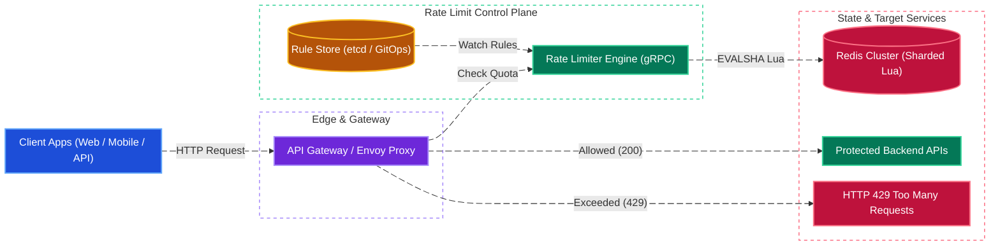
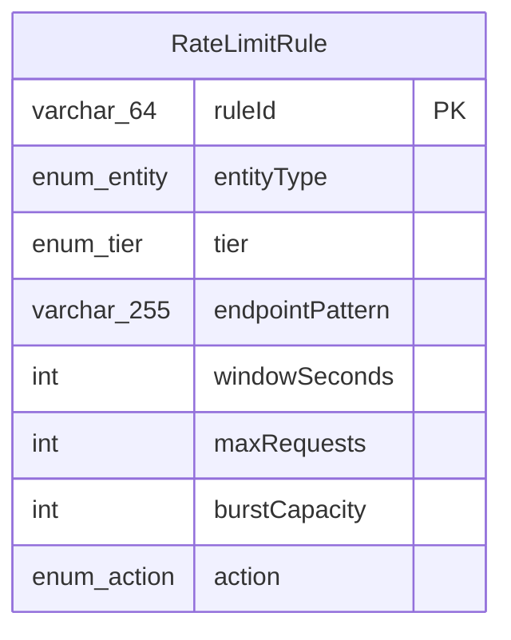
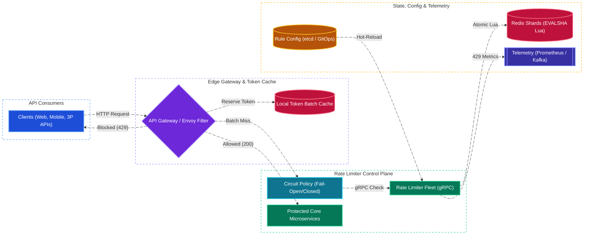

# Rate Limiter System Design

[← Back to System Design](system-design.md)

> **Core Building Blocks Used**: [Chapter 2 — Edge API Gateway Enforcement (Envoy / Kong)](fundamentals/02-edge-load-balancing-and-cdn.md#3-api-gateway) · [Chapter 3 — Redis In-Memory Atomic Lua Scripts & Race Condition Prevention](fundamentals/03-caching-and-scaling.md#redis-vs-memcached) · [Chapter 6 — Token Bucket, Leaky Bucket & Sliding Window Counter Algorithms](fundamentals/06-resiliency-observability-and-metrics.md#rate-limiting-algorithms-comparison) · [Chapter 9 — LLM Token-Aware (TPM / RPM) Rate Limiting](fundamentals/09-genai-llm-and-ml-system-design.md#3-ai-gateway-semantic-caching-token-rate-limiting--guardrails)

## Overview

A distributed rate limiter controls the rate of traffic sent by clients or services to prevent resource starvation, defend against Distributed Denial of Service (DDoS) attacks, enforce API subscription tiers, and protect downstream databases from cascading failures. In modern hyperscale infrastructure, a rate limiter must evaluate millions of requests per second with sub-millisecond latency overhead.

Designing an enterprise distributed rate limiter requires mastering:

1. **Algorithmic Trade-offs**: Token Bucket, Leaky Bucket, Fixed Window, Sliding Window Log, and Sliding Window Counter.
2. **Distributed Concurrency & Race Conditions**: Eliminating read-then-write race conditions across distributed cache instances using atomic Redis Lua scripts.
3. **Low-Latency Edge Deployment**: Balancing centralized accuracy against edge latency using local token batching / token reservation.
4. **Policy & Rule Configuration**: Multi-dimensional limiting based on Client IP, Authenticated User ID, API Key, and target endpoint risk profiles.

---

## Functional Requirements

* **Multi-Dimensional Throttling**: Limit requests based on client IP address, authenticated user ID, API key, or geographic region.
* **Tiered & Endpoint-Specific Rules**: Different quotas for Free vs. Premium tiers, and sensitive endpoints (e.g. `/api/v1/auth/login` capped at 5 req/min vs `/api/v1/search` capped at 600 req/min).
* **Standard HTTP Feedback**: Return HTTP status code `429 Too Many Requests` when limits are breached, accompanied by descriptive headers (`X-RateLimit-Limit`, `X-RateLimit-Remaining`, `X-RateLimit-Reset`, `Retry-After`).
* **Configurable Enforcement**: Dynamic rule updates with hot reloading without restarting services.
* **Telemetry & Metrics**: Real-time logging of throttled traffic for security analysis and anomaly detection.

---

## Non-Functional Requirements

* **Ultra-Low Latency Overhead**: P99 decision latency must be **$< 2\text{ ms}$** to avoid bottlenecking API request pipelines.
* **High Throughput & Scale**: Must evaluate **$1,000,000+\text{ QPS}$** globally.
* **High Availability & Fault Tolerance**: $99.999\%$ uptime. If the rate limiter cluster suffers an outage, the system must support configurable **Fail-Open** mode to maintain service continuity.
* **Memory Efficiency**: Minimal memory footprint per rate-limited entity to support hundreds of millions of concurrent client trackers.
* **Distributed Accuracy**: Strict consistency across a horizontally scaled server fleet.

---

## Rate Limiting Algorithms Comparison

| Algorithm | Mechanism | Pros | Cons | Best Used For |
| :--- | :--- | :--- | :--- | :--- |
| **Token Bucket** | Tokens refill at fixed rate $r$ up to capacity $b$. Request consumes 1 token. | Supports controlled traffic bursts; memory efficient (stores 2 integers). | Bursts can saturate downstream if capacity $b$ is set too high. | General API gateways (Amazon AWS, Stripe). |
| **Leaky Bucket** | Requests enter FIFO queue; processed at constant smooth rate. | Completely smooths out traffic spikes; deterministic egress rate. | Bursts can fill queue, causing legitimate requests to drop; high latency for queued items. | E-commerce checkout, payment gateways. |
| **Fixed Window** | Time divided into fixed windows (e.g. 1 min). Counter resets each window. | Extremely simple; low memory (single counter per window). | **Boundary burst anomaly**: $2\times$ traffic burst at window boundary ($2N$ requests). | Simple internal cron tasks, coarse limiting. |
| **Sliding Window Log** | Stores timestamp of every request in sorted set. Discards timestamps older than window. | $100\%$ mathematically accurate; zero boundary spikes. | **High memory consumption**: $100$ requests $= 100$ timestamp records in RAM. | Low-volume, high-security endpoints (Password reset). |
| **Sliding Window Counter** | Blends counter from previous window with current window based on time overlap. | Smooths boundaries; memory efficient (stores only 2 numbers); $< 0.05\%$ error. | Assumes uniform request distribution in previous window (minor heuristic flaw). | High-scale production APIs (Cloudflare, GitHub). |

---

## Back of the Envelope Estimations

### Scale & Memory Sizing

* **Global API Requests**: $1,000,000\text{ QPS}$.
* **Active Unique Tracking Keys per Minute**: $50\text{ Million users / IPs}$.
* **Memory per Entity (Token Bucket in Redis)**:
  * Key: `rate:usr_9918231` ($\approx 32\text{ bytes}$)
  * Hash fields: `tokens` (integer, 8 bytes) + `last_refreshed_at` (timestamp, 8 bytes)
  * Redis metadata overhead per key $\approx 50\text{ bytes}$
  * Total memory per user $\approx 100\text{ bytes}$.
* **Total Memory Footprint**:
  $$50,000,000\text{ keys} \times 100\text{ bytes} \approx 5\text{ Gigabytes RAM}$$
  *(Can comfortably run in a small 3-node Redis cluster with master-replica replication)*.

---

## High-Level System Architecture



---

## Concurrency & Redis Lua Script Deep Dive

### The Race Condition Problem

A naive rate limit check involves:

1. `GET rate:user_102:tokens`
2. If `tokens >= 1`, compute `tokens - 1`
3. `SET rate:user_102:tokens (new_val)`

If two concurrent requests arrive at the same millisecond, both read `tokens = 1`, and both decrement to 0, allowing $2$ requests instead of $1$.

### Atomic Token Bucket Lua Script

By executing logic inside Redis via Lua, the operation runs atomically on the single-threaded Redis engine:

```lua
-- KEYS[1]: Rate limit key (e.g. rate:user_102)
-- ARGV[1]: Max bucket capacity
-- ARGV[2]: Refill rate per second
-- ARGV[3]: Current epoch timestamp (seconds)
-- ARGV[4]: Requested tokens (usually 1)

local key = KEYS[1]
local capacity = tonumber(ARGV[1])
local refill_rate = tonumber(ARGV[2])
local now = tonumber(ARGV[3])
local requested = tonumber(ARGV[4])

local data = redis.call("HMGET", key, "tokens", "last_updated")
local tokens = tonumber(data[1])
local last_updated = tonumber(data[2])

if not tokens then
    tokens = capacity
    last_updated = now
else
    -- Compute refilled tokens based on delta time
    local delta = math.max(0, now - last_updated)
    tokens = math.min(capacity, tokens + delta * refill_rate)
    last_updated = now
end

if tokens >= requested then
    tokens = tokens - requested
    redis.call("HMSET", key, "tokens", tokens, "last_updated", last_updated)
    redis.call("EXPIRE", key, math.ceil(capacity / refill_rate))
    return {1, math.floor(tokens)} -- Allowed, remaining tokens
else
    redis.call("HMSET", key, "tokens", tokens, "last_updated", last_updated)
    return {0, math.floor(tokens)} -- Rejected
end
```

---

## HTTP Standard Response Headers

When an API responds through the rate limiter:

### Successful Request (Within Limit)

```http
HTTP/1.1 200 OK
Content-Type: application/json
X-RateLimit-Limit: 100
X-RateLimit-Remaining: 84
X-RateLimit-Reset: 1730006400
```

### Rate Limited Request

```http
HTTP/1.1 429 Too Many Requests
Content-Type: application/json
Retry-After: 26
X-RateLimit-Limit: 100
X-RateLimit-Remaining: 0
X-RateLimit-Reset: 1730006426

{
  "error": "too_many_requests",
  "message": "Rate limit exceeded. Try again in 26 seconds.",
  "retryAfter": 26
}
```

---

## Object Model & Rule Schema

### Database Selection & Rationale

| Workload / Subsystem | Database Choice | Data Model & CAP Profile | Why This Database? (Justification & Trade-offs) |
| :--- | :--- | :--- | :--- |
| **Distributed Token Bucket & Sliding Window Counters** | **Redis Cluster (In-Memory Shards + Lua)** | In-Memory Key-Value (**CP on Master Shard**) | **Why:** Evaluating $1,000,000+\text{ QPS}$ with a strict $< 2\text{ ms}$ P99 latency budget makes disk-based SQL or NoSQL databases unusable ($5\text{--}20\text{ ms}$ disk I/O + lock contention). Redis holds 50M active rate-limit trackers in just $\sim 5\text{ GB}$ of RAM, executes Token Bucket / Sliding Window logic atomically via single-threaded `EVALSHA` Lua scripts (eliminating read-modify-write race conditions), and automatically cleans up idle keys via native `EXPIRE` TTLs. |
| **Gateway-Local Token Batch Cache** | **In-Process Memory (Envoy / Go Sync Map)** | Local Process Memory (**Zero-Network Hop**) | **Why:** For ultra-hot API keys or global DDoS surges ($10\text{M+}\text{ QPS}$), reserving batches of $N$ tokens in the API Gateway's local memory eliminates $98\%$ of network round-trips to the Redis cluster at the cost of a small, bounded over-admission margin. |
| **Rate Limit Policy & Rule Configuration (`RateLimitRule`)** | **etcd / Consul (backed by PostgreSQL / GitOps)** | Strongly Consistent KV Store (**CP / Raft Consensus**) | **Why:** Rate-limiting rules (`maxRequests`, `burstCapacity`, `endpointPattern`) are small (< 10 MB total), rarely mutated, and must be pushed to all API Gateway and Rate Limiter nodes immediately upon change. `etcd` provides Raft-backed strong consistency and long-polling `WATCH` streams for sub-second hot reloading without service restarts. |
| **Throttled Request Telemetry (HTTP 429 Logs)** | **ClickHouse / Prometheus (+ Kafka)** | Time-Series / Columnar OLAP (**AP / Append-Heavy**) | **Why:** Synchronously logging blocked requests during a DDoS attack would overwhelm transactional databases. Asynchronous Kafka streaming into ClickHouse/Prometheus enables real-time anomaly detection and customer quota usage dashboards. |



---

## System Design Diagram



---

## Deep Dive & Key Technical Challenges

### 1. Scaling to 10M QPS with Local Token Reservation

Sending 10 million remote Redis network roundtrips per second would require an enormous Redis cluster.

* **Token Batching Pattern**:
  * Instead of querying Redis on every single request, the API Gateway worker acquires a batch of $N$ tokens (e.g., 50 tokens) from Redis in a single network roundtrip.
  * The gateway worker decrements against its local thread-safe counter.
  * Only when the local batch is exhausted does it request the next batch from Redis.
  * **Result**: Reduces Redis network operations by **$98\%$**.

### 2. Fail-Open vs. Fail-Closed Resilience

If the Redis cluster is partitioned or becomes unresponsive:

* **Fail-Open (Recommended for Customer APIs)**: The rate limiter allows requests through without throttling, logging a critical alert. Service availability is prioritized over rate enforcement.
* **Fail-Closed (For High-Risk Financial & Auth APIs)**: For `/v1/auth/login` or payment authorization, requests are blocked with HTTP 503 until Redis health recovers, preventing credential stuffing and financial double-spend.

---

## Additional Notes

### Video References

* [](https://www.youtube.com/watch?v=SgWb6tWx3S8)
* [](https://www.youtube.com/watch?v=MIJFyUPG4Z4)
