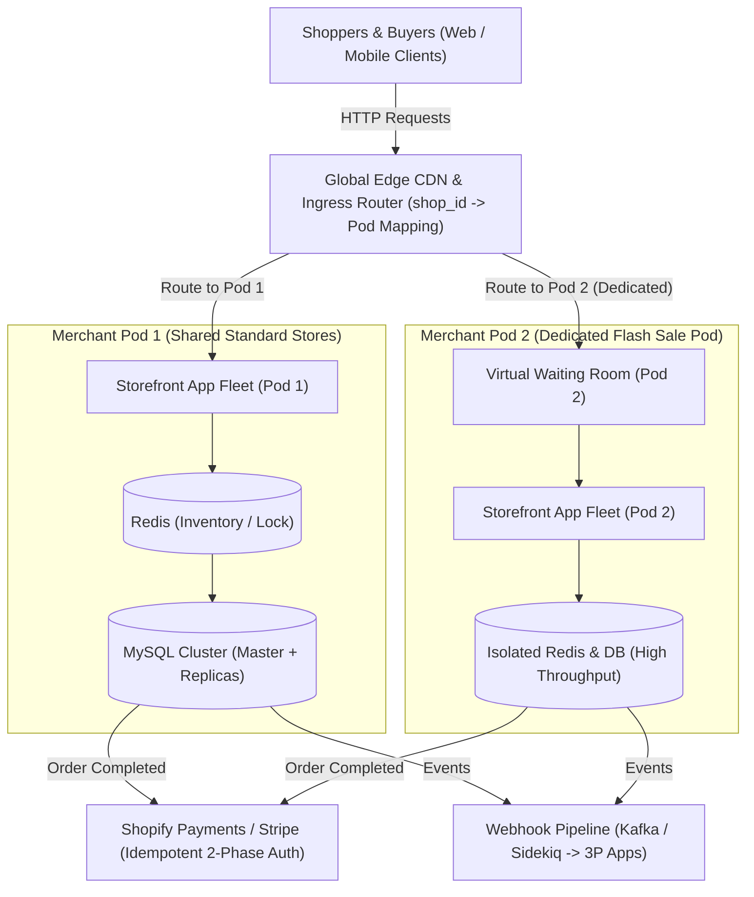
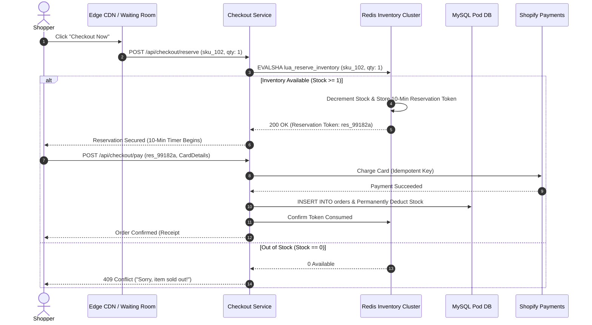
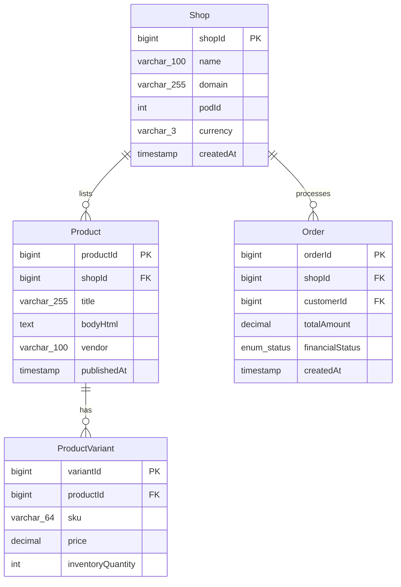
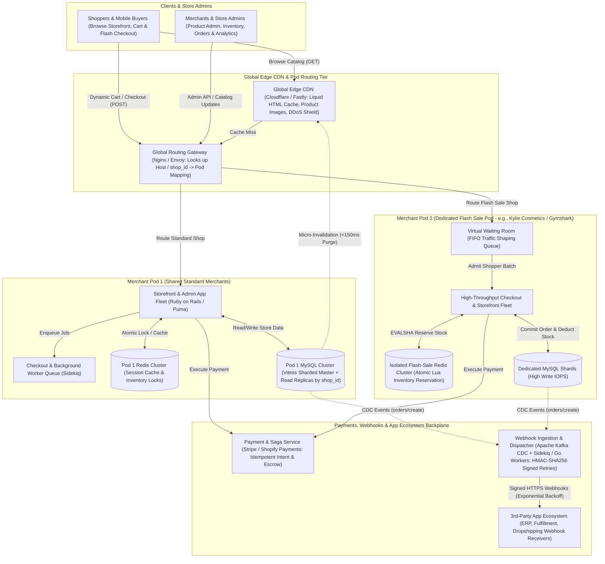

# Shopify System Design

[← Back to System Design](system-design.md)

## Overview

Shopify is a multi-tenant commerce operating system powering over 4 million active merchants in 175+ countries, processing over $200+ billion in gross merchandise volume (GMV) annually. During global shopping events like Black Friday / Cyber Monday (BFCM), the platform withstands peak traffic exceeding $100,000+\text{ orders/minute}$ and $30+\text{ Terabytes/minute}$ of edge egress.

Designing Shopify requires solving core distributed e-commerce challenges:

1. **Multi-Tenant Pod Architecture**: Isolating thousands of merchants per autonomous, self-contained infrastructure pod to eliminate catastrophic single points of failure.
2. **The "Noisy Neighbor" Problem & Flash Sales**: Protecting normal small businesses from being knocked offline when a celebrity merchant (e.g. Kylie Cosmetics) launches a viral flash sale.
3. **High-Concurrency Inventory Reservation**: Preventing inventory overselling during concurrent checkout races without crippling relational database write locks.
4. **Resilient Webhook Dispatching**: Dispersing billions of asynchronous events to third-party app developers and logistics integrations.

---

## Functional Requirements

* **Multi-Store Management**: Merchants can create custom storefronts, manage product catalogs, variants (size, color, SKU), pricing, and discount codes.
* **Storefront Browsing**: Customers can browse catalog items, search products, and add items to a shopping cart with sub-second latency.
* **High-Concurrency Checkout**: Real-time checkout with inventory reservation, tax calculation, shipping rate estimation, and payment processing.
* **Flash Sale Waiting Room**: Regulate traffic spikes during flash sales by queueing shoppers in a virtual waiting room before entering checkout.
* **Order Processing & Fulfillment**: Tracking order lifecycle (`Pending`, `Paid`, `Unfulfilled`, `Fulfilled`, `Refunded`).
* **App Ecosystem Webhooks**: Trigger signed webhooks to external logistics, ERP, and dropshipping applications on state changes (`orders/create`, `inventory_levels/update`).

---

## Non-Functional Requirements

* **High Availability (99.99%)**: Storefront browsing must remain active even during heavy backend checkout surges.
* **Zero Overselling (Strict Consistency)**: Under no circumstances may an item with 10 units in stock be purchased by 11 customers.
* **Sub-Second Latency**: P95 storefront page load latency **$< 250\text{ ms}$** via edge CDN caching.
* **Horizontal Scalability**: Scalable to withstand $15\times$ baseline traffic surges during Black Friday.
* **Tenant Isolation**: Complete data and operational isolation; one merchant's traffic spike or bad script must never affect another merchant's store.

---

## Back of the Envelope Estimations

### Scale & Traffic

* **Active Stores**: $4\text{ Million merchants}$.
* **Average Daily Visits**: $500\text{ Million page views/day}$.
* **Baseline Orders / Day**: $15\text{ Million orders/day} \approx 175\text{ orders/second}$.
* **Peak Event (BFCM)**:
  * Orders per minute: $120,000\text{ orders/min} \implies 2,000\text{ orders/second}$.
  * Peak HTTP Request QPS: $1,200,000\text{ QPS}$ at CDN edge; $120,000\text{ QPS}$ origin traffic.
* **Checkout Conversion Ratio**: $100\text{ views} \implies 10\text{ cart adds} \implies 1-2\text{ checkouts completed}$.

### Storage Calculations

* **Products Catalog**: 4M stores $\times$ 500 products $\approx 2\text{ Billion product records}$.
* **Product Record Size**: $\approx 2\text{ KB}$ (Title, description, SKU list, pricing, media URLs).
* **Catalog Database Size**:
  $$2,000,000,000 \times 2\text{ KB} = 4\text{ Terabytes}$$ (replicated and cached).
* **Order History Storage**:
  * 15M orders/day $\times 4\text{ KB per order} \approx 60\text{ GB/day} \implies \approx 22\text{ Terabytes/year}$.

---

## High-Level System Architecture (Pod Architecture)

Shopify's groundbreaking engineering architecture partitions the entire platform into isolated **Pods**:



---

## Core Components & Mechanics

### 1. The Pod Architecture & Noisy Neighbor Isolation

* A **Pod** is a fully functional, self-contained instance of Shopify containing:
  * Application server worker pools (Ruby on Rails / Puma).
  * Sharded MySQL database clusters (Vitess / MySQL master-replicas).
  * In-memory Redis cache and key-value locks.
* **Routing**: The Global Ingress proxy inspects the incoming Host header (`gymshark.com` or `shop1.myshopify.com`), queries an in-memory routing table, and forwards traffic directly to Pod 42.
* **Flash Sale Isolation**: If a merchant announces a flash sale, Shopify operations seamlessly migrate that merchant to a dedicated Pod with pre-warmed Redis clusters, ensuring other merchants experience zero latency degradation.

### 2. High-Concurrency Inventory Reservation Flow

During a flash sale where 50,000 customers fight for 100 sneaker pairs, relational SQL locks (`SELECT FOR UPDATE`) cause thread pool exhaustion and lock wait timeouts.



---

## API Specifications

### 1. Reserve Inventory (Checkout Step 1)

```http
POST /api/v1/checkouts/reserve
Authorization: Bearer <cart_session_token>
Content-Type: application/json
```

```json
// Request
{
  "shopId": "shp_99182",
  "items": [
    {"variantId": "var_881920", "quantity": 1}
  ],
  "idempotencyKey": "idem_chk_182910a"
}

// Response: 200 OK
{
  "reservationToken": "tok_res_88192a",
  "reservationExpiresAt": 1730007000,
  "subtotal": 120.00,
  "status": "RESERVED"
}
```

### 2. Complete Order & Payment

```http
POST /api/v1/checkouts/complete
Authorization: Bearer <cart_session_token>
Content-Type: application/json
```

```json
// Request
{
  "reservationToken": "tok_res_88192a",
  "paymentMethodId": "pm_card_visa_4242",
  "shippingAddress": {
    "name": "Jane Doe",
    "street": "123 Market St",
    "city": "San Francisco",
    "zip": "94105"
  }
}

// Response: 201 Created
{
  "orderId": "ord_881923104",
  "orderNumber": "#1042",
  "financialStatus": "PAID",
  "fulfillmentStatus": "UNFULFILLED",
  "totalPrice": 132.50
}
```

---

## Object Model & Database Schema



---

## System Design Diagram



---

## Deep Dive & Key Technical Challenges

### 1. Liquid Template Engine & Storefront Caching

* Every Shopify theme uses the **Liquid** templating language.
* Compiling Liquid templates dynamically on every page load would destroy server CPU.
* **Edge Caching with Micro-Invalidation**:
  * Storefront HTML pages are heavily cached at edge CDNs.
  * Personalization (cart item count, user greeting) is decoupled from the main page and hydrated client-side via lightweight asynchronous JSON calls (`/cart.js`).
  * When a merchant modifies a product description or price, an invalidation webhook purges the edge CDN cache key (`shop:product:102`) in $< 150\text{ ms}$.

### 2. High-Throughput Webhook Delivery Engine

* Shopify generates billions of webhooks daily for app developers (`orders/create`, `fulfillments/update`).
* **Architecture**:
  * Database changes publish change data capture (CDC) events via Kafka.
  * Sidekiq / Go background worker pools consume from Kafka topics.
  * Workers sign payloads with the merchant's app shared secret:
    $$\text{HMAC-SHA256}(\text{payload}, \text{shared\_secret})$$
  * Failed endpoints are retried using exponential backoff over 48 hours; repeatedly unresponsive endpoints have their webhook subscriptions automatically disabled to preserve cluster bandwidth.

---

## Additional Notes

### Video References

* [](https://www.youtube.com/watch?v=9yY6A0HvDT4)
* [](https://www.youtube.com/watch?v=U2Acfwcah80)
