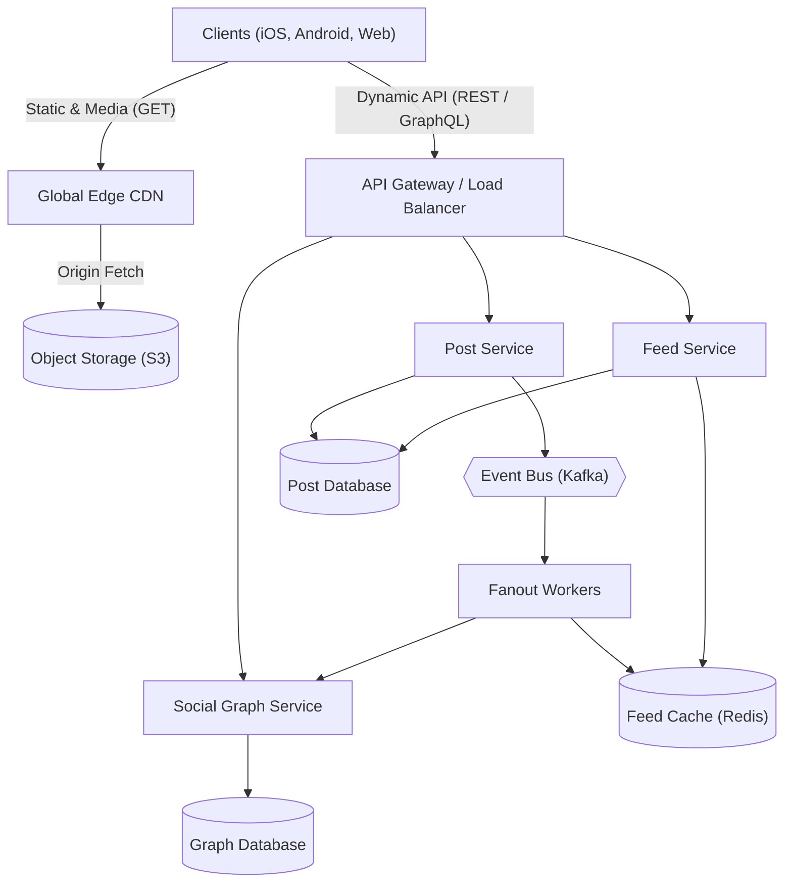
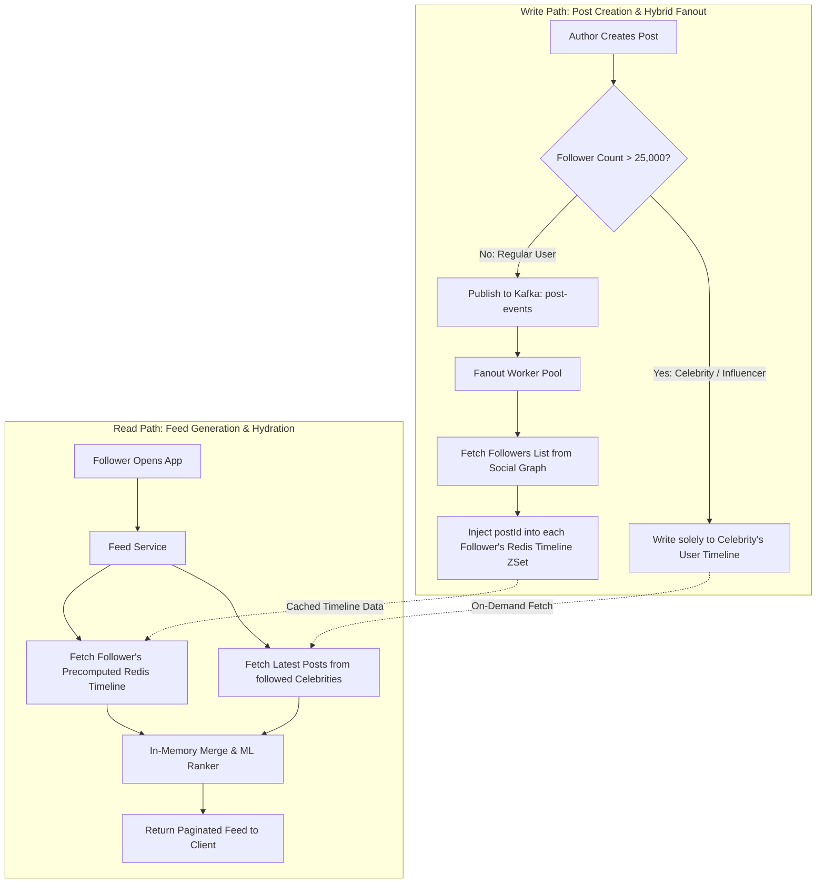
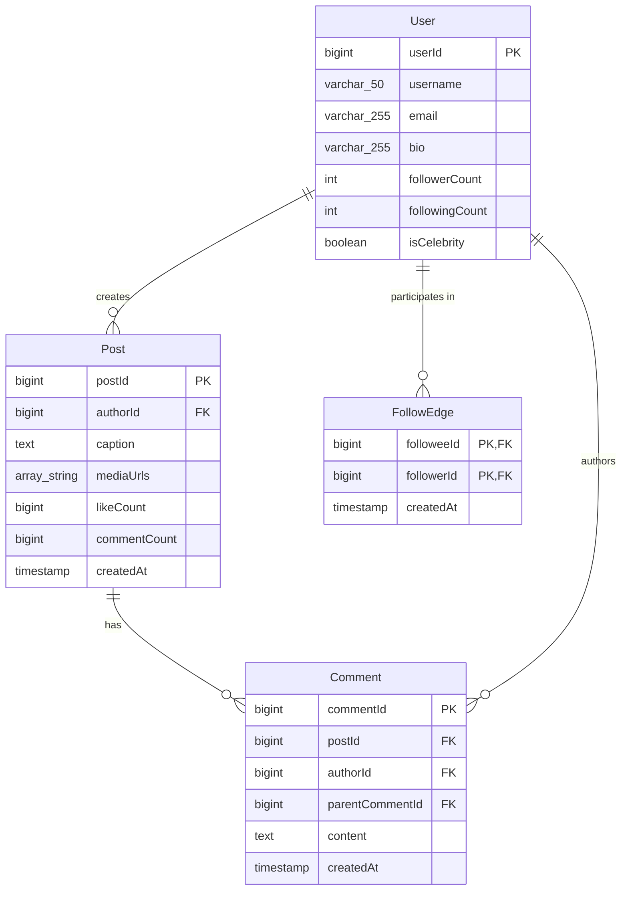
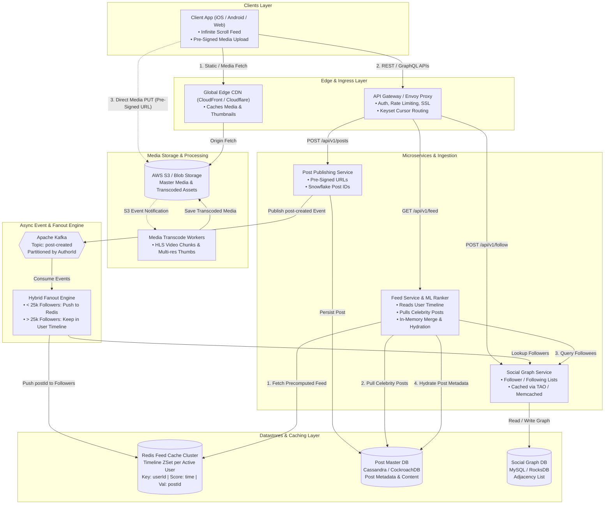

# Social Media System Design

[← Back to System Design](system-design.md)

## Overview

A social media application connects hundreds of millions to billions of users globally, enabling them to discover content, publish updates (text, photos, short videos), build social relationships (following, friends), interact via comments and likes, and consume a personalized, algorithmically ranked feed in real time.

Designing a modern social media platform requires solving fundamental distributed systems challenges: handling asymmetric read-to-write ratios ($100:1$ to $500:1$), mitigating celebrity hot-key write amplification (the "Justin Bieber problem"), streaming high-volume media across global CDNs, querying dense social graphs at sub-millisecond latencies, and delivering low-latency personalized feeds.

---

## Functional Requirements

* **User Profiles & Identity**: User registration, authentication, customizable profiles (bio, avatar), privacy controls (public vs. private accounts).
* **Social Graph**: Follow, unfollow, block, and list followers and followees.
* **Content Publishing**: Create posts containing text, hashtags, images, and video clips with pre-signed direct-to-cloud uploads.
* **Personalized News Feed**: Aggregate, rank, and paginate a dynamic stream of posts from followed accounts and recommended creators with infinite scroll.
* **Engagement & Social Interactions**: Like, comment, reply to comments (nested threads), bookmark, and re-share/repost.
* **Search & Discovery**: Search by username, full-text post contents, and trending hashtags.
* **Real-Time Notifications**: Push notifications for likes, comments, mentions, and new followers.

---

## Non-Functional Requirements

* **Global Scale**: Support **$500\text{ Million}$ Daily Active Users (DAU)**.
* **Ultra-Low Feed Latency**: P95 feed load latency must be **$< 200\text{ ms}$**; post publishing acknowledgment must be **$< 500\text{ ms}$**.
* **High Availability (99.99%)**: The feed and browsing experience must never go down; partial degradation (e.g., cached feed without real-time recommendations) is preferred over hard errors.
* **Tunable Consistency**:
  * **Eventual Consistency** for follower feed delivery: A few seconds delay in a follower seeing a new post is completely acceptable.
  * **Read-Your-Own-Writes Consistency**: The author of a post must see their new post immediately upon submitting.
* **Read-Heavy Optimization**: Architected for extreme read-to-write ratios ($100:1$ or higher).
* **Media Durability & Delivery**: Zero data loss for uploaded media, served via globally distributed edge CDNs.

---

## Back of the Envelope Estimations

### Scale & Request Volume

* **Daily Active Users (DAU)**: $500\text{ Million}$.
* **Feed Reads per User per Day**: $\approx 10\text{ feed refreshes/day}$.
* **Total Daily Feed Reads**:
  $$\text{Daily Feed Reads} = 500,000,000 \times 10 = 5,000,000,000\text{ requests/day}$$
* **Average Feed Read QPS**:
  $$\text{Read QPS} = \frac{5,000,000,000}{86,400} \approx 58,000\text{ QPS}$$
* **Peak Feed Read QPS** ($2.5\times$ peak factor): $\approx 145,000\text{ QPS}$.
* **Posts Created per Day**: $10\%$ of DAU post once per day $= 50\text{ Million posts/day}$.
* **Average Post Write QPS**:
  $$\text{Write QPS} = \frac{50,000,000}{86,400} \approx 580\text{ QPS} \quad (\text{Peak: } \approx 1,500\text{ QPS})$$

### Storage Calculations

* **Post Metadata Size**: $\approx 600\text{ bytes}$ (`postId`, `authorId`, `caption`, `mediaUrl`, `createdAt`, `location`).
* **Daily Post Metadata Storage**:
  $$50,000,000 \times 600\text{ bytes} \approx 30\text{ GB/day} \implies \approx 11\text{ TB/year}$$
* **Media Uploads Storage**:
  * $70\%$ of posts contain an image ($\approx 1.5\text{ MB}$ compressed).
  * $15\%$ of posts contain a short video clip ($\approx 15\text{ MB}$ compressed).
  * Daily Media Ingestion:
    $$(50\text{M} \times 0.70 \times 1.5\text{ MB}) + (50\text{M} \times 0.15 \times 15\text{ MB}) = 52.5\text{ TB} + 112.5\text{ TB} = 165\text{ TB/day}$$
  * Yearly Media Storage:
    $$165\text{ TB} \times 365 \approx 60.2\text{ Petabytes/year}$$
* **Feed Cache Sizing (Redis)**:
  * Cache top 800 post IDs for the top $20\%$ of active users ($100\text{ Million users}$):
  * Storage per user: $800\text{ post IDs} \times 8\text{ bytes} \approx 6.4\text{ KB}$.
  * Total Redis RAM:
    $$100,000,000 \times 6.4\text{ KB} \approx 640\text{ GB}$$
  *(Readily fits across a small Redis cluster with primary-replica replication).*

---

## High-Level System Architecture



---

## Core Components & Data Flows

### 1. Feed Generation: Fan-out on Write vs. Fan-out on Read vs. Hybrid

The defining architectural decision of any social media app is how feeds are constructed:

| Strategy | Mechanism | Pros | Cons |
| :--- | :--- | :--- | :--- |
| **Fanout-on-Write (Push)** | When a user posts, a background worker pushes the `postId` into the Redis timeline of **every follower**. | Instant feed reads ($O(1)$ from Redis cache); extremely low latency. | **Celebrity Problem**: A user with 80M followers causes 80M Redis writes for a single post; massive write amplification. |
| **Fanout-on-Read (Pull)** | Feed is generated dynamically when the user opens the app by querying all followed accounts and merge-sorting. | Zero write amplification; trivial for authors with millions of followers. | Feed read latency is slow ($O(N \log N)$ over hundreds of followed users); high database load during traffic spikes. |
| **Hybrid Fanout (Industry Standard)** | Combines Push and Pull based on follower threshold ($\approx 25,000$ followers). | Optimal balance: fast reads for 99% of posts while eliminating celebrity write amplification. | Slightly higher application complexity during feed merge. |

#### The Hybrid Fanout Architecture

1. **Regular Users ($< 25,000$ followers)**: Use **Fanout-on-Write**. When published, `postId` is pushed into all followers' Redis Sorted Sets (Timeline ZSet).
2. **Celebrities / High-Follower Accounts ($> 25,000$ followers)**: Use **Fanout-on-Read**. Their posts are *never* pushed to millions of individual follower timelines. Instead, their posts stay solely in the celebrity's own user timeline.
3. **Feed Consumption**: When user Bob opens his feed:
   * Fetch Bob's precomputed Redis timeline (containing regular friends' posts).
   * Fetch the latest posts from the few celebrities Bob follows.
   * Merge-sort the two streams in memory by timestamp or recommendation score and return the top 20 items.



### 2. Media Upload Pipeline (Direct-to-S3 with Pre-Signed URLs)

Uploading large images and videos directly through backend application servers causes thread exhaustion and bandwidth bottlenecks.

1. **Step 1**: Client calls `POST /api/v1/posts/media/pre-signed-url` with file metadata (size, content type, hash).
2. **Step 2**: Server validates permissions, generates a short-lived cryptographically signed Amazon S3 / GCS URL, and returns it.
3. **Step 3**: Client uploads the raw media binary directly from the device to S3 via HTTP `PUT`.
4. **Step 4**: S3 triggers an asynchronous `ObjectCreated` event to AWS SQS / Kafka.
5. **Step 5**: Media Processing Workers pull the task, transcode video into multi-bitrate HLS chunks, generate multiple image resolution thumbnails (webp/jpeg), and save them to the public CDN origin bucket.

---

## API Specifications

### 1. Publish a Post

```http
POST /api/v1/posts
Authorization: Bearer <user_jwt_token>
Content-Type: application/json
```

```json
// Request
{
  "caption": "Exploring the Pacific Coast Highway! #travel #california",
  "mediaIds": ["med_987123aa", "med_987123ab"],
  "location": {
    "name": "Big Sur, CA",
    "latitude": 36.2704,
    "longitude": -121.8081
  },
  "privacy": "PUBLIC"
}

// Response: 201 Created
{
  "postId": "pst_108294829104",
  "authorId": "usr_55102",
  "createdAt": 1730005200,
  "caption": "Exploring the Pacific Coast Highway! #travel #california",
  "mediaUrls": [
    "https://cdn.socialapp.com/media/2026/10/med_987123aa_thumb.webp",
    "https://cdn.socialapp.com/media/2026/10/med_987123ab_thumb.webp"
  ]
}
```

### 2. Get User News Feed (Cursor Paginated)

```http
GET /api/v1/feed?limit=20&cursor=pst_108294820000
Authorization: Bearer <user_jwt_token>
```

```json
// Response: 200 OK
{
  "posts": [
    {
      "postId": "pst_108294829104",
      "author": {
        "userId": "usr_55102",
        "username": "sarah_travels",
        "avatarUrl": "https://cdn.socialapp.com/avatars/usr_55102.jpg"
      },
      "caption": "Exploring the Pacific Coast Highway! #travel #california",
      "likeCount": 1420,
      "commentCount": 85,
      "hasLiked": true,
      "createdAt": 1730005200
    }
  ],
  "nextCursor": "pst_108294790000",
  "hasMore": true
}
```

---

## Object Model & Database Schema



---

## System Design Diagram



---

## Deep Dive & Key Technical Challenges

### 1. High-Concurrency Likes & Engagement Counting

In popular posts, thousands of users may like a post in the same second. Running `UPDATE posts SET like_count = like_count + 1 WHERE post_id = ?` creates catastrophic database row-lock contention.

* **Distributed In-Memory Counters (Redis)**:
  * Likes are toggled instantly using Redis HyperLogLogs or Sets (`SADD post:likes:{postId} {userId}`).
  * Counter is incremented using `INCR post:like_count:{postId}`.
* **Write-Behind Batching**:
  * An asynchronous daemon flushes dirty counters from Redis to the relational/NoSQL database every 5 seconds in bulk batches:

  ```sql
  INSERT INTO post_stats (post_id, like_count) VALUES (101, 520)
  ON CONFLICT (post_id) DO UPDATE SET like_count = post_stats.like_count + EXCLUDED.like_count;
  ```

### 2. Cursor-Based Pagination vs. Offset Pagination

* **Why `OFFSET / LIMIT` Fails**:
  * `SELECT * FROM posts ORDER BY created_at DESC LIMIT 20 OFFSET 10000;` requires scanning and discarding 10,000 database index records ($O(N)$ penalty).
  * **Page Drift**: If 5 new posts are published while the user is reading page 1, requesting page 2 with `OFFSET 20` will return 5 duplicated posts from page 1.
* **Cursor-Based Approach (Keyset Pagination)**:
  * Uses an immutable, sequentially decreasing 64-bit ID (such as a **Snowflake ID** combining timestamp and node ID):

  ```sql
  SELECT * FROM posts 
  WHERE post_id < :cursor 
  ORDER BY post_id DESC 
  LIMIT 20;
  ```

  * Execution time is always $O(1)$ regardless of how deep the user scrolls.

### 3. Ephemeral Content (Stories) Architecture

* **TTL-Based Storage**: Stories expire strictly after 24 hours. Storing stories in primary relational tables requires expensive background deletion batch jobs that bloat database write-ahead logs.
* **Separation of Concerns**: Stories are stored in an in-memory key-value store (Redis) or dedicated TTL-supported tables (Cassandra / DynamoDB with native TTL attributes).
* **Storage Eviction**: When the 24-hour TTL expires, the database automatically drops the item without CPU overhead or table locks.

---

## Additional Notes

### Video References

* [](https://www.youtube.com/watch?v=Qj4-GruzyDU)
* [](https://www.youtube.com/watch?v=QmX2NPkJTKg)
