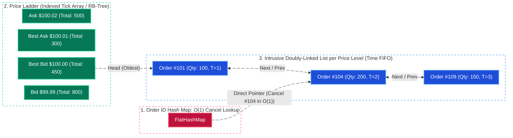
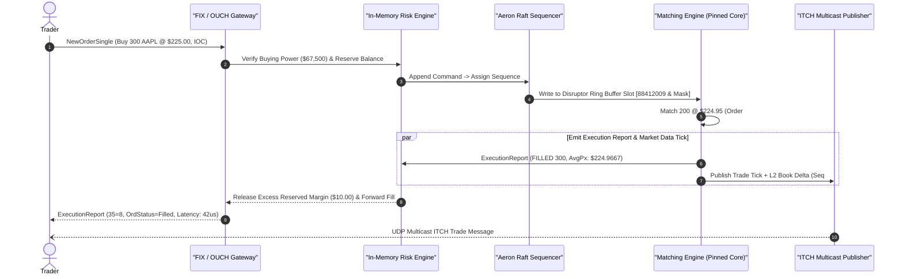
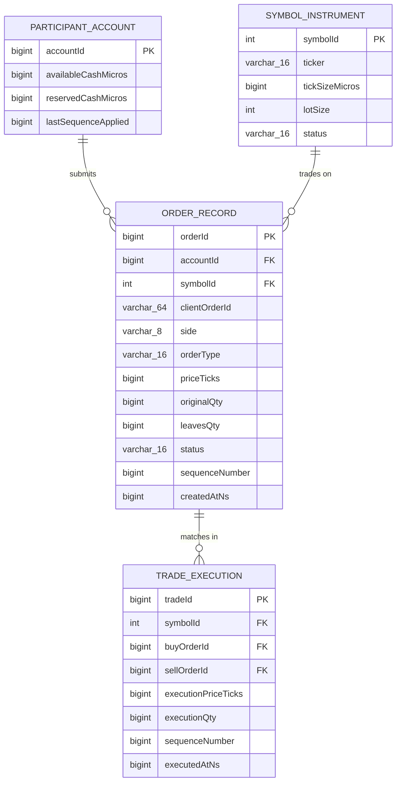

# Stock Exchange & High-Frequency Order Matching Engine System Design

[← Back to System Design](system-design.md)

> **Core Building Blocks Used**: [Chapter 1 — TCP vs. UDP Multicast & Binary Protocols](fundamentals/01-networking-and-api-paradigms.md#transport-layer-tcp-vs-udp-vs-quic) · [Chapter 4 — In-Memory Data Structures & ACID Ledgers](fundamentals/04-databases-sql-vs-nosql.md) · [Chapter 5 — Consensus (Raft), Sequencers & Deterministic Ordering](fundamentals/05-distributed-systems-and-messaging.md#2-consensus--leader-election-raft-paxos-etcd-zookeeper) · [Chapter 6 — P99.9 Tail Latency Optimization](fundamentals/06-resiliency-observability-and-metrics.md#latency-percentiles-p50-p90-p95-p99--p999-tail-latency) · [Chapter 7 — Event Sourcing & CQRS](fundamentals/07-probabilistic-structures-and-stream-processing.md#cqrs-event-sourcing--lambda-vs-kappa-architecture)

## Overview

A **Modern Electronic Stock / Crypto Exchange** (such as NASDAQ, NYSE, CME, or Coinbase Advanced) matches buy (**Bid**) and sell (**Ask**) orders across thousands of financial instruments in real time with **microsecond-level deterministic latency**, zero financial discrepancies, and continuous real-time market data distribution.

Unlike standard web microservices where $50\text{ ms}$ database queries and multi-threaded locks are normal, an exchange matching engine turns conventional architecture upside down around five core engineering principles:

1. **Deterministic Single-Threaded Matching per Symbol Partition**: Multi-threaded locking (`Mutex`, `RWLock`, or DB row locks) on an active order book causes CPU cache-line bouncing and non-deterministic execution order. High-frequency exchanges pin **one single-threaded Matching Engine core per symbol shard** (`AAPL`, `NVDA`, `BTC-USD`) so every order, cancel, and fill is 100% lock-free and deterministic.
2. **$O(1)$ Limit Order Book (LOB) Data Structure (Price-Time FIFO)**: Using a hybrid **`HashMap<OrderId, Node>` + `PriceLevel Array / Red-Black Tree` + `Doubly-Linked List`** to achieve **$O(1)$ order placement, $O(1)$ order cancellation, and $O(1)$ best-bid/best-ask matching**.
3. **LMAX Disruptor Lock-Free Ring Buffer & Mechanical Sympathy**: Eliminating OS kernel context switches, heap allocations (GC pauses), and lock contention using pre-allocated cache-line-padded ring buffers (`LMAX Disruptor`) and kernel-bypass networking (`DPDK` / `Solarflare OpenOnload`).
4. **Total-Order Sequencer & Event-Sourced State Machine Replication**: Since the matching engine is a pure deterministic function of its input command stream ($S_{t+1} = f(S_t, \text{Command}_t)$), replicating the sequenced input log via **Aeron Raft / UDP Multicast** allows hot-standby replicas to maintain an identical in-memory Order Book with **zero disk I/O on the critical path**.
5. **Dual-Plane Protocol Architecture**: Ultra-low-latency binary protocols (**FIX / SBE / NASDAQ OUCH** over TCP for orders; **ITCH** over **UDP Multicast** for L1/L2/L3 market data feeds) alongside REST/WebSocket gateways for retail web/mobile traders.

---

## Functional Requirements

* **Order Placement & Cancellation**: Support **Limit Orders** (`GTC`, `IOC`, `FOK`), **Market Orders**, and **Cancel / Cancel-Replace (`Modify`)** requests with strict **Price-Time Priority (FIFO)** matching.
* **Inline Pre-Trade Risk & Balance Verification**: Verify that a trader has sufficient buying power / margin / inventory and passes regulatory fat-finger limits *before* an order enters the matching book.
* **Real-Time Execution Reports**: Immediately notify the submitting participant when an order is `NEW (Accepted)`, `PARTIALLY_FILLED`, `FILLED`, `CANCELLED`, or `REJECTED`.
* **Real-Time Market Data Broadcast**:
  * **L1 (Top of Book)**: Best Bid price/qty, Best Ask price/qty, Last Trade price/qty.
  * **L2 (Aggregated Price Depth)**: Total volume at the top 50 Bid/Ask price levels + OHLCV candlestick bars (1s, 1m, 1h, 1d).
  * **L3 (Full Order-by-Order Tick Feed)**: Every individual order add, cancel, and trade execution event.
* **Post-Trade Clearing & Settlement Ledger**: Persist immutable double-entry trade clearing records and update participant asset balances.

---

## Non-Functional Requirements

* **Sub-Millisecond / Microsecond Matching Latency**:
  * **Institutional Direct Market Access (DMA)**: P99 wire-to-wire order ack/fill **$< 50\text{--}200\text{ microseconds}$** ($\mu\text{s}$).
  * **Retail Web/Mobile Gateway**: P99 **$< 10\text{ ms}$**.
* **Strict Fairness & Determinism**: Orders must be matched strictly in the exact sequence they were stamped by the ingress **Sequencer**. Replaying the day's sequenced command log from index `0` must produce the exact same trades and balances down to the penny.
* **High Throughput**: Sustain **$500,000+\text{ orders & cancellations per second}$** across the exchange ($50,000+\text{ ops/sec}$ on a single hot symbol like `SPY` or `NVDA`).
* **Zero Data Loss (`RPO = 0`) & Instant Failover (`RTO < 10 ms`)**: Hot-standby matching engine replicas process the sequenced log in lockstep so hardware failure causes no lost orders or book corruption.

---

## Back of the Envelope Estimations

### Traffic & Order Flow

* **Trading Ratio (Cancel-to-Fill Ratio)**: In modern algorithmic markets, market makers continuously update quotes, generating **$\sim 20\text{--}50$ order placements/cancellations per 1 actual trade fill**.
* **Daily Order Events (Add / Cancel / Modify)**: $5\text{ Billion order events/day}$ across a 6.5-hour ($23,400\text{ sec}$) trading session (or 24/7 crypto market).
* **Average & Peak Order QPS**:
  $$\text{Average QPS} = \frac{5,000,000,000}{23,400\text{ sec}} \approx 213,675\text{ orders/sec} \quad (\text{Market Open/Close Peak: } \mathbf{1,000,000\text{ orders/sec}})$$

### Memory & Storage Sizing

* **In-Memory Order Object Size** (Cache-line aligned struct in C++ / Rust / Java off-heap): **`64 bytes`** (`orderId: 8B`, `clientId: 8B`, `priceTicks: 8B`, `qty: 8B`, `prevPtr: 8B`, `nextPtr: 8B`, `flags/ts: 16B`).
* **Active Open Orders in the Order Book**: $50\text{ Million open resting limit orders}$ across all symbols:
  $$50,000,000 \times 64\text{ bytes} = \mathbf{3.2\text{ Gigabytes RAM}}$$
  *(The entire exchange's active Limit Order Book fits inside the RAM—and largely the L3 CPU cache—of a few bare-metal servers!)*
* **Daily Sequenced Event Log Size** ($5\text{B events/day} \times 64\text{ bytes}$ binary SBE frame):
  $$5 \times 10^9 \times 64\text{ bytes} = \mathbf{320\text{ GB/day}} \quad (\approx 80\text{ TB/year archived to S3/Glacier for SEC CAT audit})$$

---

## High-Level System Architecture

```mermaid
%%{init: {'flowchart': {'nodeSpacing': 25, 'rankSpacing': 45, 'padding': 10}}}%%
flowchart LR
    subgraph Participants["Trading Clients"]
        HFT["Institutional HFT (FIX / SBE / OUCH)"]
        Retail["Retail Web / Mobile (REST / WS)"]
    end
    subgraph GatewayTier["Ingress Gateways & Pre-Trade Risk"]
        DMA["DMA Binary Gateway (Kernel Bypass)"]
        WebGW["Retail API & WebSocket Gateway"]
        Risk["In-Memory Pre-Trade Risk & Balance Engine"]
    end
    subgraph CoreExchange["Deterministic Sequencer & Matching Core"]
        Seq[["Aeron Raft Sequencer (Total Order Log)"]]
        PrimaryME["Primary Matching Engine (Single-Threaded LOB)"]
        StandbyME["Hot-Standby Matching Engine (Active Replica)"]
    end
    subgraph EgressAndPostTrade["Market Data & Post-Trade Persistence"]
        MDPub["Market Data Publisher (ITCH UDP + WS)"]
        Candle["Candle & L2 Depth Aggregator"]
        Ledger[("Async Clearing Ledger (PostgreSQL / Kafka)")]
    end

    HFT e1@-->|"TCP Binary"| DMA
    Retail e2@-->|"HTTPS / WSS"| WebGW
    DMA e3@-->|"Validate Margin (<5us)"| Risk
    WebGW e4@-->|"Hold Balance"| Risk
    Risk e5@-->|"Stamp Sequence #"| Seq
    Seq e6@-->|"Disruptor Ring Buffer"| PrimaryME
    Seq e7@-->|"Lockstep Replay"| StandbyME
    PrimaryME e8@-->|"Exec Reports (Fills/Acks)"| Risk
    Risk e9@-->|"Order Ack/Fill"| DMA
    Risk e10@-->|"Order Ack/Fill"| WebGW
    PrimaryME e11@-->|"Tick Events"| MDPub
    MDPub e12@-.->|"UDP Multicast L2/L3"| HFT
    MDPub e13@-->|"Build Bars"| Candle
    Candle e14@-.->|"WS Push"| WebGW
    PrimaryME e15@-->|"Async Settlement"| Ledger

    e1@{ animate: true }
    e2@{ animate: true }
    e3@{ animate: true }
    e4@{ animate: true }
    e5@{ animate: true }
    e6@{ animate: true }
    e7@{ animate: true }
    e8@{ animate: true }
    e9@{ animate: true }
    e10@{ animate: true }
    e11@{ animate: true }
    e12@{ animate: true }
    e13@{ animate: true }
    e14@{ animate: true }
    e15@{ animate: true }

    classDef client fill:#1d4ed8,stroke:#60a5fa,stroke-width:2px,color:#ffffff
    classDef edge fill:#6d28d9,stroke:#a78bfa,stroke-width:2px,color:#ffffff
    classDef service fill:#047857,stroke:#34d399,stroke-width:2px,color:#ffffff
    classDef worker fill:#0e7490,stroke:#22d3ee,stroke-width:2px,color:#ffffff
    classDef cache fill:#be123c,stroke:#fb7185,stroke-width:2px,color:#ffffff
    classDef storage fill:#b45309,stroke:#fbbf24,stroke-width:2px,color:#ffffff
    classDef queue fill:#3730a3,stroke:#818cf8,stroke-width:2px,color:#ffffff

    class HFT,Retail client
    class DMA,WebGW edge
    class Risk,MDPub,Candle service
    class PrimaryME,StandbyME cache
    class Seq queue
    class Ledger storage

    style Participants fill:transparent,stroke:#60a5fa,stroke-width:1.5px,stroke-dasharray: 5 5
    style GatewayTier fill:transparent,stroke:#a78bfa,stroke-width:1.5px,stroke-dasharray: 5 5
    style CoreExchange fill:transparent,stroke:#fb7185,stroke-width:1.5px,stroke-dasharray: 5 5
    style EgressAndPostTrade fill:transparent,stroke:#34d399,stroke-width:1.5px,stroke-dasharray: 5 5
```



---

## Core Components & Data Flows

### 1. The $O(1)$ Limit Order Book (LOB) Data Structure

To match orders under **Price-Time Priority (FIFO)**:

* **Price Priority**: Higher Bid prices execute before lower Bid prices; lower Ask prices execute before higher Ask prices.
* **Time Priority**: At the exact same price level, orders that arrived earlier execute first (FIFO).

If we used only a Heap or Balanced BST of orders, **cancelling** an arbitrary `orderId` in the middle of a price level would take $O(N)$ or $O(\log N)$ pointer chasing. By combining three structures in pre-allocated slab memory, we achieve **$O(1)$ for every critical operation**:



| Operation | Execution Path | Time Complexity |
| :--- | :--- | :--- |
| **Match Incoming Order** | Compare incoming price against `bestAsk` (for Buy) or `bestBid` (for Sell); consume `Head` nodes of the doubly-linked list sequentially. | **$O(1)$ per matched fill** |
| **Add Resting Limit Order** | Look up price level in direct-indexed tick array (or TreeMap), append `OrderNode` to `Tail` of doubly-linked list, and insert pointer into `orderIdMap`. | **$O(1)$** (with tick array) |
| **Cancel Order (`orderId`)** | Look up `OrderNode*` in `orderIdMap` ($O(1)$), unlink `node->prev` and `node->next` from the doubly-linked list ($O(1)$), and decrement price level volume. | **$O(1)$** |

### 2. LMAX Disruptor Ring Buffer & Single-Threaded Execution Pipeline

Why does a single pinned CPU thread using an **LMAX Disruptor Ring Buffer** outperform a 64-thread locked service?

1. **Zero Lock Contention**: Standard `ArrayBlockingQueue` uses locks (`pthread_mutex` / `Monitor`) at head and tail, causing kernel context switches ($3\text{--}5\ \mu\text{s}$ penalty). The Disruptor uses a single-writer monotonic cursor (`uint64 sequence`) with memory barriers (`Release/Acquire` semantics).
2. **Zero Garbage Collection (Pre-Allocated Object Pool)**: All slots in the $2^{20}$ ($1,048,576$-entry) ring buffer are pre-allocated as contiguous `64-byte` structs at startup. Network threads overwrite existing structs in place—**zero `new` allocations on the hot path**.
3. **CPU Cache-Line Padding**: The producer sequence cursor and consumer sequence cursor are padded with `56 bytes` of dummy `long` fields so they never share a `64-byte` L1/L2 CPU cache line (preventing **False Sharing**).



---

## API Endpoints & Binary Wire Protocols

Institutional participants use **FIX 4.2/5.0** or fixed-width binary **SBE (Simple Binary Encoding) / OUCH**, while retail clients use REST/WebSockets:

### 1. Place Order (REST Gateway / Internal SBE Equivalent)

```http
POST /api/v1/orders
Authorization: Bearer <trader_jwt>
X-Idempotency-Key: clOrdId_20261028_009412
Content-Type: application/json
```

```json
// Request
{
  "clientOrderId": "clOrdId_20261028_009412",
  "symbol": "AAPL",
  "side": "BUY",
  "orderType": "LIMIT",
  "timeInForce": "GTC",
  "priceTicks": 22500,
  "quantity": 300
}

// Response: 200 OK
{
  "exchangeOrderId": "ord_998120045",
  "clientOrderId": "clOrdId_20261028_009412",
  "sequenceNumber": 88412009,
  "status": "FILLED",
  "filledQuantity": 300,
  "remainingQuantity": 0,
  "fills": [
    {"tradeId": "trd_5501", "priceTicks": 22495, "quantity": 200},
    {"tradeId": "trd_5502", "priceTicks": 22500, "quantity": 100}
  ],
  "transactTimeNs": 1793246100123456789
}
```

### 2. Real-Time L2 Order Book & Trade Stream (WebSocket / ITCH Feed)

```json
// WebSocket Push Message (Channel: l2_book.AAPL)
{
  "type": "L2_DELTA",
  "symbol": "AAPL",
  "sequence": 88412010,
  "bids": [["224.90", "1500"], ["224.85", "3200"]],
  "asks": [["225.00", "400"], ["225.05", "1900"]],
  "lastTrade": {"price": "225.00", "size": "100", "side": "BUY"},
  "timestampNs": 1793246100123460000
}
```

---

## Object Model & Database Schema

### Storage Tier & Event Sourcing Rationale

> [!IMPORTANT]
> **Critical Interview Insight: Never Put a Traditional Database on the Matching Hot Path!**
> All order book mutations and balance checks happen **100% in RAM** inside deterministic single-threaded state machines backed by a replicated **Sequenced Event Log (Aeron / Kafka)**. Relational and analytical databases sit asynchronously **off the critical path**, consuming the event stream to materialize trade history, clearing ledgers, and candlestick charts.

| Workload / Subsystem | Storage Choice | Data Model & CAP Profile | Why This Storage? (Justification & Trade-offs) |
| :--- | :--- | :--- | :--- |
| **Active Limit Order Book & Pre-Trade Balances** | **In-Memory C++/Rust State Machine + Memory-Mapped Snapshots** | Deterministic Event-Sourced RAM (**Strict CP via Raft Sequencer**) | **Why:** Delivers $< 5\ \mu\text{s}$ matching and risk checks with zero network or disk I/O stalls. Periodic Copy-on-Write (`fork()`) memory snapshots allow instant restart recovery. |
| **Total-Order Command & Execution Event Log** | **Aeron Cluster (Raft over UDP/IPC) + Kafka** | Replicated Append-Only Binary Log (**CP / RPO = 0**) | **Why:** Replicates every sequenced command across 3 bare-metal sequencer nodes in $< 15\ \mu\text{s}$ before the Matching Engine emits an external fill, guaranteeing zero lost trades on hardware failure. |
| **Post-Trade Settlement, Clearing & Tax Lots** | **PostgreSQL (Sharded Double-Entry Ledger)** | Relational (ACID) | **Why:** Asynchronously consumes `OrderFilled` events from the sequencer bus to maintain regulatory double-entry account ledgers, audit trails, and end-of-day clearing statements. |
| **Historical Tick Data & Candlestick (OHLCV) Store** | **ClickHouse / TimescaleDB / QuestDB** | Columnar Time-Series OLAP | **Why:** Ingests millions of market ticks per second and serves instant `1m / 5m / 1h / 1d` candlestick chart queries and regulatory surveillance analytics. |



---

## System Design Diagram

```mermaid
%%{init: {'flowchart': {'nodeSpacing': 20, 'rankSpacing': 40, 'padding': 10}}}%%
flowchart LR
    subgraph Clients["Market Participants"]
        DMA_Client["Institutional HFT (FIX / SBE)"]
        Web_Client["Retail App (REST / WebSocket)"]
    end
    subgraph Ingress["Gateway & Pre-Trade Risk Tier"]
        FIX_GW["FIX / OUCH Binary Gateway"]
        REST_GW{"Retail API & WS Gateway"}
        RiskMem[("In-Memory Risk & Wallet State")]
    end
    subgraph CoreMatching["Deterministic Event-Sourced Matching Core"]
        Sequencer[["Aeron Raft Sequencer (Total Order Log)"]]
        ME_Shard1["Matching Core 1 (AAPL, MSFT - Primary/Standby)"]
        ME_Shard2["Matching Core 2 (NVDA, SPY - Primary/Standby)"]
    end
    subgraph MarketDataAndClearing["Market Data & Async Clearing Tier"]
        ITCH_Pub["ITCH UDP Multicast Publisher"]
        WS_Fanout["L2 Depth & OHLCV Candle Builder"]
        KafkaBus[["Kafka Post-Trade Bus"]]
        ClearingDB[("PostgreSQL Double-Entry Ledger")]
        TickTSDB[("QuestDB / ClickHouse Tick Store")]
    end

    DMA_Client e1@-->|"TCP SBE"| FIX_GW
    Web_Client e2@-->|"HTTPS / WSS"| REST_GW
    FIX_GW e3@-->|"Check & Reserve"| RiskMem
    REST_GW e4@-->|"Check & Reserve"| RiskMem
    RiskMem e5@-->|"Append Cmd"| Sequencer
    Sequencer e6@-->|"Symbol Hash 1"| ME_Shard1
    Sequencer e7@-->|"Symbol Hash 2"| ME_Shard2
    ME_Shard1 e8@-->|"Fills / Acks"| RiskMem
    ME_Shard2 e9@-->|"Fills / Acks"| RiskMem
    ME_Shard1 e10@-->|"Tick Stream"| ITCH_Pub
    ME_Shard1 e11@-->|"Tick Stream"| WS_Fanout
    ITCH_Pub e12@-.->|"UDP Multicast"| DMA_Client
    WS_Fanout e13@-.->|"WS Push"| REST_GW
    WS_Fanout e14@-->|"Write Candles"| TickTSDB
    ME_Shard1 e15@-->|"Settlement Events"| KafkaBus
    KafkaBus e16@-->|"ACID Clearing"| ClearingDB

    e1@{ animate: true }
    e2@{ animate: true }
    e3@{ animate: true }
    e4@{ animate: true }
    e5@{ animate: true }
    e6@{ animate: true }
    e7@{ animate: true }
    e8@{ animate: true }
    e9@{ animate: true }
    e10@{ animate: true }
    e11@{ animate: true }
    e12@{ animate: true }
    e13@{ animate: true }
    e14@{ animate: true }
    e15@{ animate: true }
    e16@{ animate: true }

    classDef client fill:#1d4ed8,stroke:#60a5fa,stroke-width:2px,color:#ffffff
    classDef edge fill:#6d28d9,stroke:#a78bfa,stroke-width:2px,color:#ffffff
    classDef service fill:#047857,stroke:#34d399,stroke-width:2px,color:#ffffff
    classDef worker fill:#0e7490,stroke:#22d3ee,stroke-width:2px,color:#ffffff
    classDef cache fill:#be123c,stroke:#fb7185,stroke-width:2px,color:#ffffff
    classDef storage fill:#b45309,stroke:#fbbf24,stroke-width:2px,color:#ffffff
    classDef queue fill:#3730a3,stroke:#818cf8,stroke-width:2px,color:#ffffff

    class DMA_Client,Web_Client client
    class FIX_GW,REST_GW edge
    class ITCH_Pub,WS_Fanout service
    class RiskMem,ME_Shard1,ME_Shard2 cache
    class Sequencer,KafkaBus queue
    class ClearingDB,TickTSDB storage

    style Clients fill:transparent,stroke:#60a5fa,stroke-width:1.5px,stroke-dasharray: 5 5
    style Ingress fill:transparent,stroke:#a78bfa,stroke-width:1.5px,stroke-dasharray: 5 5
    style CoreMatching fill:transparent,stroke:#fb7185,stroke-width:1.5px,stroke-dasharray: 5 5
    style MarketDataAndClearing fill:transparent,stroke:#34d399,stroke-width:1.5px,stroke-dasharray: 5 5
```



---

## Deep Dive & Key Technical Challenges

### 1. Integer Fixed-Point Price Arithmetic (Never Use IEEE-754 `float` / `double`)

Floating-point numbers cannot represent `$0.10` or `$0.01` exactly in base-2 (`0.1 + 0.2 == 0.30000000000000004`), causing catastrophic penny rounding bugs and non-deterministic order book sorting across CPU architectures:

* **Solution**: All prices and quantities inside the exchange are stored as **64-bit signed integers (`int64`)** representing **price ticks** or **micro-units** (e.g., `$225.05` with a `$0.01` tick size is stored as `22505`; or scaled by $10^8$ satoshis/micros as `22505000000`). Integer addition and comparison take a single `1 ns` CPU clock cycle and are $100\%$ exact.

### 2. Reliable UDP Multicast for Market Data (MoldUDP64 / NAK Gap Recovery)

If 500 institutional trading firms subscribe to the L3 full tick feed, sending 500 separate TCP streams from the matching engine would saturate NIC bandwidth and introduce TCP Head-of-Line blocking:

* **UDP Multicast (`MoldUDP64`)**: The Market Data Publisher emits a **single UDP multicast packet** onto the exchange LAN switch, which replicates the packet in hardware to all 500 subscriber ports simultaneously.
* **Sequence Gap Detection**: Every UDP packet header carries a strictly sequential `sequence_number`. If a subscriber sees sequence `1005` followed by `1007`, it immediately knows packet `1006` was dropped and sends a unicast **Retransmission Request (NAK)** to a dedicated Replay Server without slowing down the primary multicast publisher.

### 3. Self-Trade Prevention (STP) & Market Circuit Breakers (LULD)

* **Self-Trade Prevention**: Two independent trading desks within the same firm (same `firmId`) may accidentally place a crossing Buy and Sell order. Before executing a match, the engine checks `incomingOrder.firmId == restingOrder.firmId` and applies the trader's configured STP instruction (`CANCEL_RESTING`, `CANCEL_INCOMING`, or `CANCEL_BOTH`) to prevent illegal **wash trading**.
* **Limit Up-Limit Down (LULD) Volatility Halts**: If a flash crash or fat-finger order moves a symbol's price $> 5\%$ outside its 5-minute rolling reference price band within 15 seconds, the Matching Engine automatically transitions the symbol state from `CONTINUOUS_TRADING` $\to$ `VOLATILITY_AUCTION_HALT`, rejecting market orders and queuing limit orders for a reopening call auction.

---

## Additional Notes

### Architectural References & Videos

* [LMAX Disruptor High-Performance Inter-Thread Messaging Paper (Martin Thompson et al.)](https://lmax-exchange.github.io/disruptor/files/Disruptor-1.0.pdf)
* [](https://www.youtube.com/watch?v=iFA3zwZc0dc)

