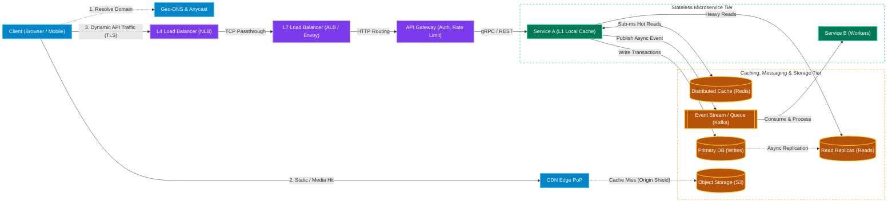
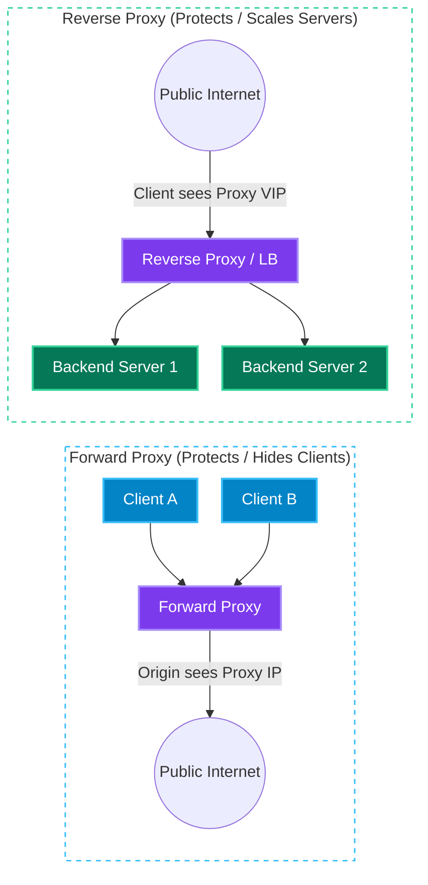
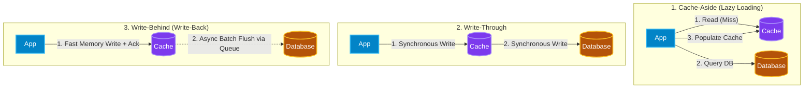
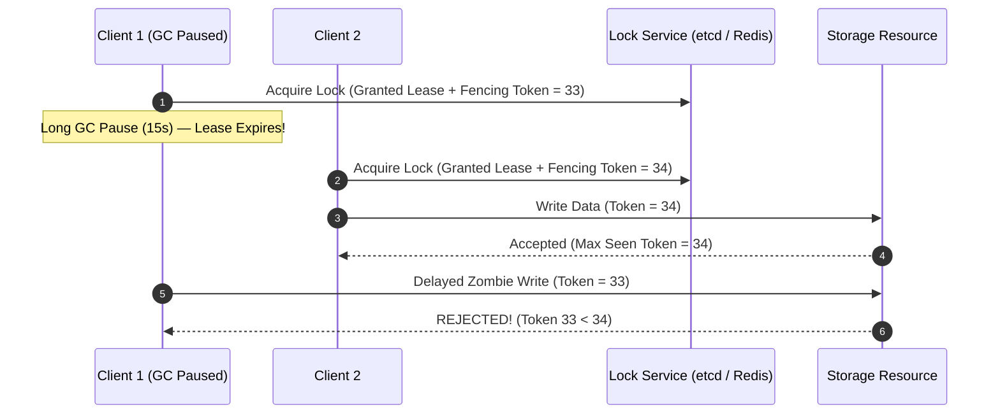
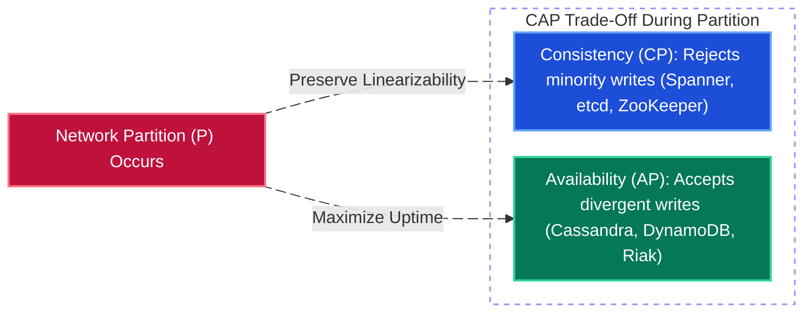

# System Design Documentation

[← Back to Main README](../README.md)

## Table of Contents

- [Real-World Architectural Retrospectives](#real-world-architectural-retrospectives)
- [Interview System Design Case Studies (31 Systems)](#interview-system-design-case-studies-31-systems)
- [System Design Interview 45-Minute Execution Framework](#system-design-interview-45-minute-execution-framework)
- [Core Architectural Building Blocks](#core-architectural-building-blocks)
  - [End-to-End Request Lifecycle Architecture](#end-to-end-request-lifecycle-architecture)
  - [1. Networking & OSI Layers](#1-networking--osi-layers)
  - [2. Proxies & Load Balancers](#2-proxies--load-balancers)
  - [3. API Gateway](#3-api-gateway)
  - [4. Content Delivery Network (CDN)](#4-content-delivery-network-cdn)
  - [5. Caching Deep Dive](#5-caching-deep-dive)
  - [6. Compute Scaling, Auto-Scaling & Data Partitioning](#6-compute-scaling-auto-scaling--data-partitioning)
  - [7. Storage Engine Internals & Blob/Object Storage](#7-storage-engine-internals--blobobject-storage)
  - [8. Search, Geospatial & Specialized Indexing](#8-search-geospatial--specialized-indexing)
  - [9. Distributed Coordination, Consensus & Transactions](#9-distributed-coordination-consensus--transactions)
  - [10. Resiliency, Fault Tolerance & Reliability Patterns](#10-resiliency-fault-tolerance--reliability-patterns)
  - [11. Observability: Metrics, Logs & Distributed Tracing](#11-observability-metrics-logs--distributed-tracing)
- [Distributed Systems Fundamentals: CAP & PACELC Theorem](#distributed-systems-fundamentals-cap--pacelc-theorem)
  - [CAP Theorem Overview](#cap-theorem-overview)
  - [CP vs. AP Systems Comparison](#cp-vs-ap-systems-comparison)
  - [The PACELC Theorem (Modern Extension)](#the-pacelc-theorem-modern-extension)
  - [Interview Cheatsheet: Making the Right Trade-Off](#interview-cheatsheet-making-the-right-trade-off)
  - [Database Selection Cheat Sheet (When to Choose Which DB)](#database-selection-cheat-sheet-when-to-choose-which-db)
- [Back-of-the-Envelope Calculations Cheat Sheet](#back-of-the-envelope-calculations-cheat-sheet)
  - [Powers of Two Quick Reference](#powers-of-two-quick-reference)
  - [SQL Data Type Storage Rules](#sql-data-type-storage-rules)
  - [Latency Numbers Every Programmer Should Know](#latency-numbers-every-programmer-should-know)
  - [Traffic & QPS Conversion Rules of Thumb](#traffic--qps-conversion-rules-of-thumb)
- [References](#references)

---

## Real-World Architectural Retrospectives

- [🌟 **DocuSign Billing & Invoicing Modernization**](project-retrospective.md) — Production architecture retrospective: Migrating legacy Quartz batch systems to event-driven MuleSoft & Core microservices, reducing invoice latency from 7 days to real-time (< 2s), achieving a 90% reduction in reconciliation discrepancies, and an 80% DSO reduction.

---

## Interview System Design Case Studies (31 Systems)

| # | System | Focus Areas | Documentation |
| :--- | :--- | :--- | :--- |
| 1 | **Airbnb** | Search indexing, booking concurrency, payments, availability calendar | [Airbnb Design](airbnb.md) |
| 2 | **Amazon** | E-commerce catalog, cart persistence, inventory reservation, checkout | [Amazon Design](amazon.md) |
| 3 | **Amazon Prime** | Video streaming CDN, chunking, adaptive bitrate, metadata service | [Prime Design](amazon-prime.md) |
| 4 | **ATM** | Hardware sensors, ISO 8583 protocol, financial ACID saga, HSM encryption | [ATM Design](atm.md) |
| 5 | **Autocomplete Search** | Trie cache, typeahead latency, prefix indexing, ranking | [Autocomplete Design](autocomplete-search.md) |
| 6 | **Bitly** | URL shortening, Base62 encoding, high read-to-write ratio caching | [Bitly Design](bitly.md) |
| 7 | **DocuSign** | Digital signatures, audit trails, document hashing, encryption | [DocuSign Design](docusign.md) |
| 8 | **Dropbox** | Block-level sync, deduplication, conflict resolution, chunking | [Dropbox Design](dropbox.md) |
| 9 | **Email Archive** | Large-scale cold storage, full-text search indexing, compression | [Email Archive Design](email-archive.md) |
| 10 | **Fraud Detection** | Sub-50ms risk scoring, Flink velocity features, dual feature store, GNN rings | [Fraud Detection Design](fraud-detection.md) |
| 11 | **Google Docs** | Real-time collaborative editing, OT / CRDT, WebSocket sync | [Google Docs Design](google-docs.md) |
| 12 | **Google Drive** | File metadata, chunked upload/download, versioning, quota service | [Google Drive Design](google-drive.md) |
| 13 | **Instagram** | Feed generation, image delivery CDN, followers graph, fanout | [Instagram Design](instagram.md) |
| 14 | **Metrics Monitoring** | TSDB Gorilla compression, log/trace ingestion, PromQL, streaming alert rules | [Metrics Monitoring Design](metrics-monitoring.md) |
| 15 | **Netflix** | Open Connect CDN, dynamic optimizer transcode, ABR, state bookmarks | [Netflix Design](netflix.md) |
| 16 | **News Feed** | Fanout-on-write vs fanout-on-read, timeline caching, ranking | [News Feed Design](news-feed.md) |
| 17 | **Notification System** | Push notifications, SMS/Email gateways, deduplication, rate limits | [Notification Design](notification-system.md) |
| 18 | **Parking Garage** | Concurrency control, spot allocation, ticket validation, sensors | [Parking Garage Design](parking-garage.md) |
| 19 | **PasteBin** | Text storage, expiring keys, S3/blob integration, rate limiting | [PasteBin Design](pastebin.md) |
| 20 | **Payment System** | Double-entry ledger, idempotency keys, claims payout saga, T+1 reconciliation | [Payment System Design](payment-system.md) |
| 21 | **Rate Limiter** | Token bucket, sliding window counter, Redis distributed locking | [Rate Limiter Design](rate-limiter.md) |
| 22 | **Shopify** | Multi-tenant architecture, order processing, flash-sale traffic handling | [Shopify Design](shopify.md) |
| 23 | **Social Media** | Hybrid fanout, pre-signed media upload, social graph, timeline cache | [Social Media Design](social-media.md) |
| 24 | **Tag Service** | Inverted index, tag aggregation, lookup performance, caching | [Tag Service Design](tag-service.md) |
| 25 | **TicketMaster** | Virtual queues, fair ticketing, seat reservation locking | [TicketMaster Design](ticketmaster.md) |
| 26 | **TikTok** | Video feed recommendation pipeline, transcode pipeline, delivery | [TikTok Design](tiktok.md) |
| 27 | **Twitter** | Distributed timeline, Redis fanout cluster, search indexing | [Twitter Design](twitter.md) |
| 28 | **Uber** | Geospatial indexing (QuadTree/H3), driver dispatch, location updates | [Uber Design](uber.md) |
| 29 | **Web Crawler** | Mercator frontier, multi-format doc parsing/OCR, SimHash dedupe, RAG chunking | [Web Crawler Design](webcrawler.md) |
| 30 | **WhatsApp** | Real-time chat, WebSocket connection managers, E2E encryption | [WhatsApp Design](whatsapp.md) |
| 31 | **YouTube** | Video upload pipeline, transcode farm, CDN distribution, views counting | [YouTube Design](youtube.md) |

---

## System Design Interview 45-Minute Execution Framework

A strong system design interview is structured, hypothesis-driven, and proactive about trade-offs. Use this 5-step pacing framework during a 45–60 minute session:

| Phase | Time Allocation | Key Actions & Deliverables | What Interviewers Look For |
| :--- | :--- | :--- | :--- |
| **1. Requirements & Scope** | `5 – 7 mins` | Clarify **3–5 Core Functional Requirements** (user journeys) and **Non-Functional Requirements** (scale/DAU, read:write ratio, P99 latency targets, CP vs. AP consistency, durability). | Asking targeted questions before drawing boxes; explicitly scoping out non-essential features. |
| **2. Back-of-the-Envelope Estimation** | `3 – 5 mins` | Estimate **Average & Peak QPS** (reads vs. writes), **Daily/5-Year Storage**, **Network Bandwidth**, and **Cache Memory (80/20 rule)**. | Translating numbers into architectural decisions (e.g., *"150K write QPS means a single SQL primary won't suffice — we need sharding or LSM-Tree NoSQL"*). |
| **3. API Contracts & Data Model** | `7 – 10 mins` | Define core **REST / gRPC / WebSocket endpoints** (request parameters, auth headers, idempotency keys, pagination tokens) and **Core Entities / Schema** (PK, SK, indexes). | Clean API ergonomics, cursor-based pagination over offset pagination, and matching the database engine to the access pattern. |
| **4. High-Level Architecture (HLD)** | `10 – 12 mins` | Draw the end-to-end flow for the **Write Path** and **Read Path**: Client $\rightarrow$ CDN $\rightarrow$ LB/API Gateway $\rightarrow$ Microservices $\rightarrow$ Cache / Message Queue / Database. | Clear separation of read/write paths, stateless compute, and end-to-end functional completeness. |
| **5. Deep Dives, Bottlenecks & Resilience** | `15 – 20 mins` | Proactively identify Single Points of Failure (SPOFs), hot keys/shards, race conditions, replication lag, and failure modes. Walk through 2–3 deep-dive trade-offs. | Driving the conversation without prompting; defending why Approach B beats Approach A for the specific problem constraints. |

---

## Core Architectural Building Blocks

Before diving into individual system designs, mastering the foundational components that appear in almost every distributed architecture is critical.

### End-to-End Request Lifecycle Architecture

---

### 1. Networking & OSI Layers

#### OSI 7-Layer Model (System Design Perspective)

In system design interviews, discussions primarily center around **Layer 3 (Network)**, **Layer 4 (Transport)**, and **Layer 7 (Application)**:

| OSI Layer | Name | Data Unit | Key Protocols | System Design Relevance & Components |
| :--- | :--- | :--- | :--- | :--- |
| **Layer 7** | **Application** | Data / Message | HTTP/1.1, HTTP/2, HTTP/3, gRPC, WebSockets, DNS, TLS | Content-aware routing, API Gateways, L7 Load Balancers (ALB, NGINX, Envoy), CDNs, WAF. |
| **Layer 6** | **Presentation** | Data | TLS/SSL, gzip, Brotli, Protobuf, JSON | Serialization/deserialization, encryption at transit, payload compression. |
| **Layer 5** | **Session** | Data | Sockets, RPC sessions, TLS session resumption | Connection pooling, sticky sessions, session state tokens. |
| **Layer 4** | **Transport** | Segment (TCP) / Datagram (UDP) | TCP, UDP, QUIC | L4 Load Balancers (AWS NLB, IPVS), port-level routing, congestion & flow control. |
| **Layer 3** | **Network** | Packet | IP (IPv4/IPv6), ICMP, BGP, Anycast, IPSec | IP routing, BGP Anycast for global CDNs/DNS, VPC subnetting, L3 DDoS mitigation. |
| **Layer 2** | **Data Link** | Frame | Ethernet, ARP, VLAN, MAC | Intra-datacenter switch fabric, MAC address forwarding (Direct Server Return / DSR). |
| **Layer 1** | **Physical** | Bits | Fiber optics, subsea cables, copper/NICs | Physical rack diversity, subsea cable RTT limits (speed of light in fiber $\approx 200\text{ km/ms}$). |

#### Transport Layer: TCP vs. UDP vs. QUIC

| Feature | TCP (Transmission Control Protocol) | UDP (User Datagram Protocol) | QUIC (UDP-Based Multiplexed Transport) |
| :--- | :--- | :--- | :--- |
| **Connection Setup** | Connection-oriented: 3-way handshake (`SYN`, `SYN-ACK`, `ACK`) + TLS handshake (2–3 RTTs). | Connectionless: 0 RTT setup; fire-and-forget datagrams. | Connection-oriented over UDP: combines transport + TLS 1.3 into **1-RTT** (or **0-RTT** on resumption). |
| **Reliability & Ordering** | Guaranteed delivery, strict in-order byte stream, automatic retransmission. | Best-effort delivery; packets may be dropped, duplicated, or arrive out of order. | Reliable per-stream delivery; packet loss in one stream does **not** block other streams. |
| **Head-of-Line (HoL) Blocking** | **Yes** at TCP layer (one lost packet stalls all multiplexed HTTP/2 streams on that TCP connection). | **No** (no stream ordering enforced by transport). | **No** transport-level HoL blocking; independent multiplexed streams. |
| **Header Overhead** | 20–60 bytes (heavy stateful tracking). | 8 bytes (minimal stateless header). | Variable small header + built-in connection migration across IP/Wi-Fi changes. |
| **Primary Interview Use Cases** | REST APIs, database connections, financial transactions, email, file transfers. | Live WebRTC video/voice calls, online gaming, DNS queries, VoIP, telemetry streaming. | HTTP/3 web delivery, mobile apps moving between cellular and Wi-Fi networks, video streaming. |

#### Application Layer: HTTP Evolution & Real-Time Protocols

| Protocol | Transport | Directionality | Key Characteristics | Ideal System Design Use Case |
| :--- | :--- | :--- | :--- | :--- |
| **HTTP/1.1** | TCP | Client $\rightarrow$ Server (Request/Response) | Text-based headers; requires multiple TCP connections (typically 6 per browser domain) to work around HoL blocking. | Simple legacy CRUD APIs, basic internal webhooks. |
| **HTTP/2** | TCP | Multiplexed Request/Response + Server Push | Binary framing, HPACK header compression, single TCP connection with multiplexed streams (still vulnerable to TCP-level HoL blocking). | Public REST/GraphQL APIs, **gRPC** microservice-to-microservice communication. |
| **HTTP/3** | QUIC (UDP) | Multiplexed Streams without HoL Blocking | Eliminates TCP HoL blocking, faster 0-RTT/1-RTT handshakes, seamless connection migration when mobile client IP changes. | High-scale mobile feeds ([TikTok](tiktok.md), [Instagram](instagram.md)), global CDN edge delivery. |
| **Short Polling** | HTTP | Client $\rightarrow$ Server (Repeated intervals) | Client polls every $X$ seconds. Simple, stateless backend, but wastes bandwidth with empty responses. | Low-frequency status checks (e.g., checking batch job completion every 30s). |
| **Long Polling** | HTTP | Client $\rightarrow$ Server (Held open until data ready) | Server holds request open until new data arrives or timeout occurs, then client immediately reconnects. | Notification fallback when WebSockets are blocked by corporate firewalls. |
| **Server-Sent Events (SSE)** | HTTP | **Unidirectional** (Server $\rightarrow$ Client stream) | Persistent HTTP connection pushing text/event streams (`text/event-stream`). Automatic reconnection, works natively over HTTP/2. | Live LLM token streaming, live sports scores, stock tickers, activity feeds ([News Feed](news-feed.md)). |
| **WebSockets** | TCP (Upgraded via HTTP) | **Full-Duplex Bidirectional** | Persistent stateful TCP connection allowing low-overhead binary/text frames in both directions at any time. | Real-time chat ([WhatsApp](whatsapp.md)), collaborative editing ([Google Docs](google-docs.md)), multiplayer games. |
| **gRPC** | HTTP/2 | Unary, Client/Server/Bidirectional Streaming | Uses **Protocol Buffers (Protobuf)** binary serialization (5–10x smaller and faster to parse than JSON) + strict `.proto` contracts. | Internal polyglot microservice-to-microservice RPCs. |

---

### 2. Proxies & Load Balancers

#### Forward Proxy vs. Reverse Proxy

| Dimension | Forward Proxy | Reverse Proxy |
| :--- | :--- | :--- |
| **Sits In Front Of** | **Clients** (inside a private network or user device). | **Backend Servers** (at the edge of a service provider's infrastructure). |
| **Who Knows About It?** | Configured explicitly by the client; transparent to the destination server. | Configured by the server infrastructure; completely transparent to the client. |
| **Identity Hidden** | Hides the **client's IP** from the destination server. | Hides the **internal server topology and IPs** from the public internet. |
| **Core Responsibilities** | Outbound firewall filtering, corporate content blocking, egress IP whitelisting, anonymization (VPN/Tor), local egress caching. | Load balancing, TLS/SSL termination, DDoS protection, gzip/Brotli compression, static response caching, canary routing (NGINX, HAProxy, Envoy, Cloudflare). |

#### Layer 4 vs. Layer 7 Load Balancing

| Feature | Layer 4 (Transport Load Balancer) | Layer 7 (Application Load Balancer) |
| :--- | :--- | :--- |
| **Inspection Scope** | Inspects only network/transport headers (**Source/Dest IP + TCP/UDP Port**). Does **not** inspect payload. | Terminates the TCP/TLS connection and inspects **HTTP headers, URL path, cookies, and payload**. |
| **Connection Model** | Single TCP connection (NAT packet forwarding or Direct Server Return) between client and backend. | Two separate TCP connections: Client $\leftrightarrow$ L7 LB (TLS terminated), and L7 LB $\leftrightarrow$ Backend Server. |
| **Throughput & Latency** | Extremely high throughput (millions of concurrent connections), ultra-low CPU overhead and latency. | Higher CPU/memory overhead due to TLS decryption and HTTP parsing, slightly higher latency. |
| **Routing Intelligence** | Dumb packet/connection forwarding based on 5-tuple hash. | Smart content-based routing (e.g., `/api/v1/users` $\rightarrow$ User Service, `/api/v1/orders` $\rightarrow$ Order Service). |
| **Protocols Supported** | Any TCP/UDP protocol (HTTP, WebSockets, raw TCP, MySQL, DNS, SMTP). | Application-specific (HTTP/1.1, HTTP/2, HTTP/3, gRPC, WebSockets). |
| **Examples** | AWS Network Load Balancer (NLB), Linux IPVS / LVS, Maglev. | AWS Application Load Balancer (ALB), NGINX, Envoy, HAProxy (L7 mode). |

> [!TIP]
> **Production Two-Tier Load Balancing Pattern:**
> Large-scale systems combine both: an **L4 Load Balancer tier** (e.g., AWS NLB / Google Maglev) sits at the edge to absorb massive TCP traffic and distribute connections evenly across a horizontally scaled fleet of **L7 Load Balancers / Reverse Proxies** (e.g., Envoy / NGINX), which then perform TLS termination and path-based microservice routing.

#### Load Balancing Routing Algorithms

| Algorithm | How It Works | Pros | Cons / Pitfalls | Best Used For |
| :--- | :--- | :--- | :--- | :--- |
| **Round Robin** | Cycles through healthy backend servers sequentially ($1 \rightarrow 2 \rightarrow 3 \rightarrow 1$). | Simple, stateless, zero overhead. | Assumes all servers have identical hardware and all requests cost the same CPU/time. | Stateless microservices with uniform, fast request execution times. |
| **Weighted Round Robin** | Assigns a capacity weight $W_i$ to each server; servers receive requests proportional to their weight. | Handles heterogeneous server hardware (e.g., `c6i.4xlarge` vs `c6i.xlarge`) and canary rollouts. | Still blind to slow/expensive individual queries piling up on one node. | Mixed-instance fleets or gradual traffic shifting ($5\% \rightarrow 25\% \rightarrow 100\%$). |
| **Least Connections** | Routes each new request to the server with the fewest active open connections. | Adapts dynamically when some requests take much longer than others. | Requires the LB to track active connection state across backends. | Long-lived connections (**WebSockets**, SSE, database connection pools). |
| **Least Response Time / P2C** | Routes based on fewest active connections weighted by lowest recent P50/P95 response latency (often via *Power of Two Random Choices*). | Automatically routes around degraded or GC-pausing nodes. | Slightly higher telemetry tracking overhead. | Latency-sensitive APIs where downstream slowness can affect individual pods. |
| **IP / URL Hash** | Hashes client IP or URL path (`hash(client_ip) % N`) to pick a deterministic backend. | Provides stateless session affinity without cookie inspection (works at L4). | Adding/removing a server reshuffles almost all keys unless **Consistent Hashing** is used; corporate NATs concentrate many users onto one IP. | Stateful in-memory caches or L4 sticky sessions. |

#### High Availability for Load Balancers

A single Load Balancer is a Single Point of Failure (SPOF). To make the Load Balancer tier fault-tolerant:

1. **Active-Passive Failover (Floating VIP / VRRP)**:
   - Two load balancers share a Virtual IP (VIP) using `Keepalived` / VRRP heartbeats. If the Active LB fails to send a heartbeat within a threshold (e.g., 3 seconds), the Passive LB claims the Floating VIP and takes over traffic.
2. **Active-Active Multi-Node (DNS Round Robin + BGP Anycast)**:
   - Multiple active LBs advertise the same Anycast IP via BGP to upstream routers (using ECMP — Equal-Cost Multi-Path routing). If one LB dies, its BGP session drops and routers immediately stop sending packets to it with zero downtime.

---

### 3. API Gateway

An **API Gateway** is a specialized Layer 7 edge server that acts as the single entry point for external clients into a microservices ecosystem, decoupling client-facing API contracts from internal service decomposition.

#### Core Responsibilities of an API Gateway

1. **Authentication & Authorization Offloading**: Validates OAuth2 tokens, OIDC sessions, API keys, and JWT signatures at the perimeter before forwarding enriched identity headers (`X-User-Id`, `X-Tenant-Id`) to internal services.
2. **Rate Limiting & Quota Enforcement**: Protects downstream services from abuse, scraping, and DDoS bursts using Token Bucket or Sliding Window counters (typically backed by Redis). See [Rate Limiter Design](rate-limiter.md).
3. **Request Routing, Versioning & Canary Releases**: Maps external paths (`/v2/checkout`) to internal services and splits traffic by percentage or header for A/B testing and canary deployments.
4. **Protocol Translation & Request Aggregation (BFF — Backend for Frontend)**: Accepts external REST/JSON or GraphQL calls from mobile/web clients, fans out parallel **gRPC** calls to multiple internal microservices, and aggregates the responses into a single payload.
5. **Cross-Cutting Observability & Security**: Injects distributed tracing correlation IDs (`traceparent`), logs access metrics, enforces CORS, validates JSON schemas, and integrates with Web Application Firewalls (WAF).

#### Comparison: Load Balancer vs. Reverse Proxy vs. API Gateway vs. Service Mesh

| Component | Traffic Direction | Primary Focus | Typical Technologies |
| :--- | :--- | :--- | :--- |
| **L4/L7 Load Balancer** | **North-South** (External $\rightarrow$ Cluster) | High-throughput traffic distribution across healthy server replicas and basic health checking. | AWS NLB / ALB, Google Cloud LB, HAProxy |
| **Reverse Proxy** | **North-South** (Edge / Web Server) | TLS termination, static file serving, response compression, HTTP caching, hiding server topology. | NGINX, Cloudflare, Apache Traffic Server |
| **API Gateway** | **North-South** (Client $\rightarrow$ Microservices) | Business-aware API management: AuthN/AuthZ, per-tenant rate limiting, billing metering, BFF aggregation, REST $\rightarrow$ gRPC translation. | Kong, AWS API Gateway, Apigee, Envoy Gateway, MuleSoft |
| **Service Mesh** | **East-West** (Service $\leftrightarrow$ Service) | Sidecar proxies attached to every pod handling internal mTLS encryption, circuit breaking, retries, and service discovery without code changes. | Istio, Linkerd, Consul Connect (with Envoy sidecars) |

---

### 4. Content Delivery Network (CDN)

A **Content Delivery Network (CDN)** is a globally distributed network of **Edge Points of Presence (PoPs)** deployed in hundreds of cities and ISP exchanges (IXPs). By serving static and cacheable dynamic content from an edge server physically close to the user, a CDN eliminates cross-continental network round-trip latency and offloads 85–99% of read bandwidth from origin servers.

#### How a CDN Works

1. **Anycast / Geo-DNS Routing**: When a user requests `cdn.example.com`, DNS or BGP **Anycast** routes the request to the nearest/lowest-latency Edge PoP (reducing network RTT from ~150ms cross-continent to **< 10–20ms**).
2. **Edge Cache Hit**: If the requested asset (`logo.png` or `segment_04.ts`) is cached in the Edge PoP's RAM/NVMe tier and its TTL has not expired, the Edge returns it immediately.
3. **Edge Cache Miss & Origin Shield**: On a cache miss, instead of every global Edge PoP hammering the Origin server directly, the Edge queries a regional **Origin Shield** (a middle-tier cache layer) which collapses concurrent misses (request coalescing) into a single fetch to Origin (e.g., AWS S3).

#### Push CDN vs. Pull CDN

| Dimension | Pull CDN | Push CDN |
| :--- | :--- | :--- |
| **How Data Reaches the Edge** | **Lazy / On-Demand**: The Origin holds the assets. When the first user in a region requests an asset, the Edge PoP experiences a cache miss, pulls it from Origin, caches it, and serves subsequent requests. | **Proactive / Pre-Populated**: The application or media pipeline actively uploads/pushes content to CDN edge appliances ahead of time (often during off-peak night hours). |
| **Storage Efficiency** | High — only popular assets actually requested in a given geography consume edge storage. | Lower — requires careful predictive placement to avoid storing unpopular files everywhere. |
| **First-Request Latency** | First user in a PoP pays the **Cache Miss penalty** (Edge $\rightarrow$ Origin RTT). | Zero cold-start miss penalty; first user gets an immediate local **Cache Hit**. |
| **Maintenance Overhead** | Minimal — completely automated via standard HTTP `Cache-Control` headers. | High — application must orchestrate uploads, manifest versions, and deletions across edges. |
| **Ideal Interview Use Cases** | General web assets (JS/CSS/HTML), user-uploaded profile images, long-tail social media photos ([Instagram](instagram.md), [Shopify](shopify.md)). | Blockbuster video releases, top-catalog streaming chunks pre-staged onto ISP appliances ([Netflix Open Connect](netflix.md), [Amazon Prime](amazon-prime.md), OS software updates). |

#### CDN Cache Invalidation & Freshness Strategies

1. **Content-Addressable URL Versioning (Best Practice)**: Embed a file content hash or version in the filename (e.g., `app.8f3a1c.bundle.js` or `avatar_v4.jpg`) and set an immutable long TTL (`Cache-Control: public, max-age=31536000, immutable`). When the file changes, the HTML/API references the new URL — zero purge latency!
2. **Stale-While-Revalidate**: Use `Cache-Control: max-age=60, stale-while-revalidate=300` for semi-dynamic API responses (e.g., product catalog pages). The CDN serves slightly stale cached data immediately while asynchronously refreshing the cache from Origin in the background.
3. **Explicit Purge / Surrogate-Key Tagging**: Tag cached objects with `Surrogate-Key: product-123` (Fastly/Cloudflare) and trigger an API purge when a merchant updates a price or takes down content for legal/DMCA compliance.

---

### 5. Caching Deep Dive

Caching stores copies of frequently accessed or computationally expensive data in fast storage tiers (typically RAM) to reduce read latency, increase throughput, and shield primary databases from overload.

#### Multi-Tier Caching Across the System Stack

| Cache Tier | Location | Typical Latency | What Is Cached & How |
| :--- | :--- | :--- | :--- |
| **L1: Client / Browser Cache** | User's device memory / local disk (`IndexedDB`, HTTP cache) | `< 1 ms` (0 network hops) | Static assets, user preferences, offline state controlled via `ETag`, `If-None-Match` (`304 Not Modified`), and `Cache-Control`. |
| **L2: CDN Edge Cache** | Global ISP / Edge PoPs (Cloudflare, CloudFront, Fastly) | `5 – 25 ms` | Static media (images, HLS/DASH video chunks), public HTML pages, high-read public GET API responses. |
| **L3: API Gateway / Reverse Proxy Cache** | Datacenter perimeter (NGINX, Varnish, Envoy) | `1 – 5 ms` | Short-TTL micro-caching (e.g., 1–5s TTL) for unauthenticated public endpoints during traffic spikes. |
| **L4: Application In-Process (Local L1) Cache** | Inside microservice JVM/CLR/Go heap (`Caffeine`, `MemoryCache`, `Guava`) | `~100 ns – 10 µs` (0 network hops) | Ultra-hot immutable config, feature flags, celebrity hot keys (avoids network serialization & Redis single-shard bottlenecks). |
| **L5: Distributed In-Memory Cache (Shared L2)** | Dedicated cluster (Redis Cluster, Memcached) | `0.5 – 2 ms` (intra-DC network hop) | Shared user sessions, precomputed feeds, rate-limiter counters, distributed locks, DB query/entity cache. |
| **L6: Database Internal Cache** | Inside DB engine RAM (`InnoDB Buffer Pool`, PostgreSQL `shared_buffers`) | `0.1 – 1 ms` | Frequently accessed B-Tree index pages and table data pages kept in memory by the storage engine. |

#### Redis vs. Memcached

| Feature | Redis | Memcached |
| :--- | :--- | :--- |
| **Data Structures** | Rich native structures: Strings, Hashes, Lists, Sets, **Sorted Sets (`ZSET`)**, Bitmaps, HyperLogLog, Geospatial (`GEO`), Streams. | Simple flat **Key-Value strings** only (up to 1 MB per value). |
| **Threading Model** | Primarily single-threaded event loop for command execution (eliminates lock contention; atomic Lua scripts) with multi-threaded I/O. | Multi-threaded architecture using per-slab locks; scales vertically across many CPU cores on a single box. |
| **Persistence & HA** | Supports RDB snapshots, AOF (Append-Only File) durability, Primary-Replica replication, and automatic Redis Sentinel / Cluster failover. | Purely volatile in-memory cache; no built-in persistence or native replication (handled by client routing or wrappers like Meta's Mcrouter / Netflix EVCache). |
| **When to Choose** | **Default choice in 95% of interviews**: whenever you need leaderboards/timelines (`ZSET`), rate limiting/locks (Lua), pub/sub, geospatial, or high availability without cold-cache wipeouts. | Simple, massive multi-core string/blob caching where memory fragmentation must be strictly bounded via slab allocation. |

#### Caching Read & Write Strategies

| Strategy | How It Works | Pros | Cons / Risks | Best Interview Use Cases |
| :--- | :--- | :--- | :--- | :--- |
| **Cache-Aside (Lazy Loading)** | **Read**: App checks Cache; on miss, App reads from DB, writes to Cache, and returns. **Write**: App writes directly to DB and **deletes/invalidates** the cache entry. | Resilient to cache failures; only requested data is cached; avoids corrupting cache on concurrent writes when using cache invalidation rather than overwrite. | First read always incurs a **Cache Miss penalty** (3 round trips); risk of stale data if invalidation fails (mitigated by TTL + CDC). | General-purpose read-heavy workloads (User profiles, Product catalogs, [Bitly](bitly.md) URL lookups). |
| **Read-Through** | App treats Cache as the primary datastore. On a miss, the **Cache provider/library itself** fetches data from the underlying DB, caches it, and returns it to the App. | Simplifies application code by abstracting DB fetch logic into a data-access layer or daemon (e.g., Meta TAO, DynamoDB DAX). | Same cold-start miss penalty as Cache-Aside; requires custom cache plugin or proxy support. | Read-heavy social graphs ([Social Media](social-media.md)), managed caching proxies (DAX). |
| **Write-Through** | Every write goes through the Cache **synchronously** to the DB within the same operation; write succeeds only when both Cache and DB acknowledge. | Cache is **never stale**; subsequent reads are guaranteed fast Cache Hits without cold-start misses. | Higher **write latency** (must wait for both Cache + DB); pollutes cache if written data is rarely read back. | Systems requiring immediate read-your-writes consistency on hot objects (e.g., active user session state, banking account summary). |
| **Write-Behind (Write-Back)** | App writes **only to Cache** and receives an immediate acknowledgement. Cache asynchronously batches and flushes writes to the DB in the background. | **Ultra-low write latency** and massive write throughput; coalesces multiple rapid updates to the same key into a single DB write. | **Data loss risk** if the cache node crashes before flushing to disk/DB (mitigated via Redis AOF + Kafka WAL). | High-velocity counters: video view counts ([YouTube](youtube.md)), post likes, gaming leaderboards, user presence heartbeats. |
| **Write-Around** | App writes **directly to the DB**, bypassing the Cache completely. Only reads (via Cache-Aside/Read-Through) populate the Cache. | Prevents write-heavy bulk operations or rarely read data from flooding the cache and evicting hot items. | Immediate read after a write will always result in a Cache Miss. | Log ingestion, audit archives ([Email Archive](email-archive.md)), large file metadata uploads. |

> [!IMPORTANT]
> **Why Cache-Aside invalidates (deletes) the cache key on write instead of updating it:**
> If two concurrent requests update the database and then update the cache:
>
> - Request A writes `x = 1` to DB.
> - Request B writes `x = 2` to DB.
> - Request B writes `x = 2` to Cache.
> - Request A (delayed by a GC pause or network jitter) writes `x = 1` to Cache.
>
> Now the cache is permanently stale (`x = 1` while DB has `x = 2`)! **Deleting** the key from the cache after committing to the DB (or via Change Data Capture / Debezium reading the DB WAL) avoids this write-write race condition.

#### Cache Eviction Policies

When cache memory is full, the cache must evict existing keys according to its eviction policy:

- **LRU (Least Recently Used)**: Evicts the item that has not been accessed for the longest time (implemented via a **Hash Map + Doubly Linked List** in $O(1)$ time). *Default choice for most workloads leveraging temporal locality.*
- **LFU (Least Frequently Used)**: Tracks access frequency counts and evicts the least frequently accessed item. Prevents a one-time bulk scan from flushing out genuinely popular items, though old items that accumulated high counts in the past can linger unless frequency decay (**W-TinyLFU**) is used.
- **TTL (Time-To-Live)**: Assigns an expiration timestamp to every key (e.g., `EXPIRE key 300`). Essential as a safety net against stale data even when active invalidation is used.
- **FIFO (First-In, First-Out)**: Evicts the oldest inserted item regardless of how often it is accessed. Simple ring-buffer overhead, rarely optimal for skewed workloads.

#### Caching Failure Modes & Interview Mitigations

| Failure Scenario | What Happens | Production Mitigation Strategies |
| :--- | :--- | :--- |
| **1. Cache Stampede (Thundering Herd)** | A very popular key expires (or is invalidated), and 10,000 concurrent requests simultaneously see a Cache Miss and hammer the database with the exact same expensive query. | **Request Coalescing / Singleflight / Distributed Mutex** (only 1 worker queries DB while 9,999 wait); **Logical Expiration / Background Refresh** (refresh asynchronously before physical TTL expires). |
| **2. Cache Penetration** | Malicious or buggy clients repeatedly query keys that **do not exist** in either the Cache or the DB (e.g., `GET /users?id=-9999`), bypassing the cache on every request and overloading the DB. | **Cache Negative Results (`NULL` Sentinel)** with a short TTL (30–60s); place a space-efficient probabilistic **Bloom Filter** in front of the cache to reject non-existent keys immediately. |
| **3. Cache Avalanche** | Millions of cache keys expire at the exact same second (e.g., after a batch warm-up job) OR an entire Redis cluster node fails, shifting massive load onto the database. | **TTL Jitter** (`TTL = base_ttl + random(0, 300s)`) so keys expire smoothly over time; **Redis Cluster Multi-AZ Replicas**, consistent hashing, and DB circuit breakers / rate shedding. |
| **4. Hot Key (Celebrity Problem)** | A single key (e.g., Justin Bieber's latest tweet or a flash-sale iPhone SKU) receives 500,000 reads/sec. Even though it is a Cache Hit, all traffic hashes to **one single Redis shard**, saturating its NIC/CPU. | **Local In-Process L1 Cache** (`Caffeine` / `MemoryCache`) with a 1–5s TTL; **Key Replication (Salted Keys)** duplicating `item:123#1` .. `item:123#10` across 10 Redis shards. |

---

### 6. Compute Scaling, Auto-Scaling & Data Partitioning

#### Vertical Scaling (Scale Up) vs. Horizontal Scaling (Scale Out)

| Dimension | Vertical Scaling (Scale Up) | Horizontal Scaling (Scale Out) |
| :--- | :--- | :--- |
| **Definition** | Upgrading a single machine with more CPU cores, RAM, or faster NVMe disks (e.g., `m6i.large` $\rightarrow$ `m6i.24xlarge`). | Adding more independent commodity nodes/containers to a pool behind a load balancer ($1 \rightarrow 100$ nodes). |
| **Hardware Ceiling** | **Hard physical limit** — eventually hits the largest motherboard/instance size available in the cloud. | **Virtually infinite** — scales elastically to thousands of servers across Availability Zones and regions. |
| **Fault Tolerance & Availability** | **Single Point of Failure (SPOF)** — hardware failure or OS reboot causes total downtime. | **High Availability** — if one node crashes, the Load Balancer routes traffic to the remaining $N-1$ nodes with zero downtime. |
| **Application Architecture Complexity** | **Simple** — no network hops between components, in-memory locks work natively, zero distributed data consistency issues. | **Complex** — requires stateless compute tiers, distributed caching, externalized sessions, and distributed consensus/sharding for state. |
| **Cost Curve** | **Super-linear** — high-end enterprise hardware becomes disproportionately expensive per core/GB. | **Linear & Elastic** — uses cheap commodity VMs/containers that can scale down during off-peak hours to save money. |
| **Interview Rule of Thumb** | Start here for early-stage MVPs or single-primary relational databases up to ~5–10K QPS. | Mandatory for web/microservice tiers and any system requiring `99.99%+` availability or high scale. |

#### Stateless vs. Stateful Compute Tiers

To scale horizontally without friction, always separate **Stateless Compute** from **Stateful Storage**:

1. **Stateless Services (Web / API Microservices)**:
   - No user session or local state is stored on the server's local disk/memory across requests.
   - Authentication state is carried in self-contained **JWTs** or stored in a shared **Redis Cluster**.
   - Any request from any user can be routed to **any** pod by the Load Balancer, allowing new pods to spin up or terminate at any moment.
2. **Stateful Services (WebSocket Gateways, Multiplayer Game Servers, Databases, Kafka Brokers)**:
   - Maintain persistent open connections or local disk state tied to specific users or partitions.
   - Require **Consistent Hashing**, **Connection Registries** (e.g., Redis mapping `user_id -> gateway_node_ip`), and **Graceful Connection Draining** before a node can be terminated.

#### Auto-Scaling Nodes in Production

Auto-scaling dynamically adjusts the number of running compute instances or containers (`pods`) to match real-time traffic demand while minimizing cloud cost.

##### 1. Auto-Scaling Trigger Strategies

| Strategy | Trigger Signal | Best Used For | Key Trade-Offs |
| :--- | :--- | :--- | :--- |
| **Target Tracking (Resource-Based)** | Average CPU Utilization (e.g., maintain `65%` CPU) or Memory Utilization. | Standard stateless REST/gRPC APIs with CPU-bound request processing. | Reactive — lags behind sudden vertical traffic spikes if instance boot time takes 30–120 seconds. |
| **Request / Custom Metric Scaling** | Requests per second per pod (ALB RequestCountPerTarget) or P95 latency. | I/O-bound microservices where CPU stays low even when thread pools or connections saturate. | Requires reliable high-resolution metrics pipeline (Prometheus Adapter / CloudWatch). |
| **Queue-Depth Scaling (KEDA)** | Backlog length divided by target messages per worker (e.g., `SQS ApproximateNumberOfMessagesVisible / 50` or Kafka consumer lag). | Asynchronous background workers (video transcoding in [YouTube](youtube.md), notification dispatch in [Notification System](notification-system.md)). | Prevents consumer starvation during burst events and scales down to `0` pods when the queue is empty. |
| **Scheduled & Predictive Scaling** | Cron schedules or ML time-series forecasting based on historical daily/weekly traffic curves. | Predictable traffic surges (8:00 AM commuter spike in [Uber](uber.md), prime-time streaming in [Netflix](netflix.md), Black Friday flash sales). | Pre-warms capacity **before** the spike hits, completely avoiding cold-start latency. |

##### 2. Two-Layer Kubernetes Auto-Scaling

- **Pod-Level Scaling**:
  - **HPA (Horizontal Pod Autoscaler)**: Adjusts replica count (`replicas: 5 -> 50`) based on CPU/memory/custom metrics.
  - **KEDA (Kubernetes Event-Driven Autoscaling)**: Scales pods based on external event sources (Kafka lag, SQS length, Redis streams), including **scale-to-zero**.
  - **VPA (Vertical Pod Autoscaler)**: Adjusts CPU/memory requests & limits per pod for workloads that cannot easily shard horizontally.
- **Node-Level Scaling**:
  - **Cluster Autoscaler / Karpenter**: Watches for `Pending` pods that cannot be scheduled due to insufficient cluster CPU/RAM, and provisions new underlying cloud VMs (EC2 instances) in seconds, consolidating and terminating underutilized VMs when traffic drops.

##### 3. Critical Auto-Scaling Pitfalls & Interview Mitigations

- **Flapping / Thrashing**: Rapidly scaling out and immediately scaling back in due to brief traffic oscillations.
  - *Mitigation*: Configure asymmetric **Stabilization / Cooldown Windows** — scale out aggressively (e.g., within 30–60s of spike), but scale in conservatively (e.g., wait 5–10 minutes of sustained low load before terminating nodes).
- **Cold-Start & Cache/JIT Warm-Up**: Newly launched nodes have cold local L1 caches, uncompiled JVM/CLR JIT code, and empty DB connection pools, causing them to time out if hit with full traffic immediately.
  - *Mitigation*: Use pre-baked container/AMI images, run a warm-up script inside the **Readiness Probe** before registering with the Load Balancer, and use **Slow-Start / Warm-Up Mode** on the Load Balancer to linearly ramp traffic to new nodes over 30–60 seconds.
- **Dropped In-Flight Requests on Scale-In**: Killing a node abruptly drops active HTTP requests or WebSocket connections.
  - *Mitigation*: Enforce **Connection Draining / Graceful Shutdown**:
    1. Load Balancer deregisters the pod and stops sending *new* requests.
    2. Pod executes a `preStop` sleep hook (e.g., 5–10s) to allow endpoint removal to propagate across Envoy/kube-proxy nodes.
    3. App handles `SIGTERM` by finishing in-flight requests and committing Kafka offsets within `terminationGracePeriodSeconds` (e.g., 30–60s) before exiting.
- **Downstream Database Connection Exhaustion**: Auto-scaling a microservice from 20 pods to 500 pods (where each pod opens 20 DB connections) suddenly opens `10,000` connections and crashes PostgreSQL/MySQL!
  - *Mitigation*: Always place a **Connection Pooler / Proxy** (`PgBouncer`, `ProxySQL`, `AWS RDS Proxy`) between auto-scaling compute pods and relational databases, and enforce strict max-replica caps (`maxReplicas`).

#### Consistent Hashing

With naive modular hashing (`server = hash(key) % N`), adding or removing a single node changes $N$, causing **nearly 100% of keys** ($\frac{N-1}{N}$) to remap to different servers and triggering a catastrophic cache avalanche.

**Consistent Hashing** maps both **Servers** and **Keys** onto a circular **Hash Ring** ($0$ to $2^{32}-1$):

1. A key is assigned to the first server encountered moving **clockwise** on the ring from `hash(key)`.
2. When a node is added or removed, only **$O(K / N)$ keys** (the fraction of keys on that single segment) are reassigned; all other keys remain undisturbed.
3. **Virtual Nodes (vnodes)**: Because placing only a few physical servers on the ring leads to uneven key distribution and "hot spots", each physical server is assigned 100–200 **virtual nodes** distributed across the ring. Virtual nodes ensure uniform load balance and allow powerful servers to own proportionally more vnodes.

*Used in: Amazon DynamoDB, Apache Cassandra, Discord/WhatsApp chat routing, Akamai CDN, and distributed Memcached/Redis clusters.*

#### Asynchronous Messaging: Message Queues vs. Pub/Sub Event Streams

Decoupling synchronous producers from consumers smooths out traffic spikes (load leveling), enables independent failure isolation, and supports event-driven architectures.

| Dimension | Traditional Message Queue (Point-to-Point) | Distributed Append-Only Event Log (Pub/Sub Stream) |
| :--- | :--- | :--- |
| **Representative Tech** | **RabbitMQ, AWS SQS, ActiveMQ** | **Apache Kafka, AWS Kinesis, Apache Pulsar** |
| **Storage & Retention** | Messages are deleted from the queue as soon as a consumer acknowledges (`ACK`) processing. | Immutable append-only disk log; events are retained for a configured window (e.g., 7–30 days or forever) regardless of consumption. |
| **Consumption Model** | **Push or Pull Competing Consumers**: Broker tracks per-message ACK state and routes each task to one available worker. | **Pull with Consumer Offsets**: Consumers track their own offset pointer inside a **Consumer Group**; multiple independent Consumer Groups can read the exact same stream simultaneously. |
| **Message Replayability** | **No** — once acknowledged, the message is gone. | **Yes** — consumers can rewind their offset to reprocess historical events (e.g., backfilling a new ML model or fixing a bug). |
| **Ordering Guarantee** | Best-effort or strict FIFO only at low throughput (SQS FIFO). | **Strict ordering guaranteed within a Partition** (keyed by `partition_key`, e.g., `user_id` or `order_id`). |
| **Routing & Dead-Letter Queues** | Rich exchange routing (topic, fanout, header routing) and native per-message retry + **Dead-Letter Queue (DLQ)** support. | Partition-based routing; requires explicit retry topics / DLQ topics managed by the consumer application. |
| **When to Choose** | Task queues, background job execution (sending emails/SMS, image resizing, PDF generation), complex per-message retry workflows. | High-throughput event streaming (millions of events/sec), CDC pipelines, real-time analytics/Flink, event sourcing, multi-consumer fanout ([Fraud Detection](fraud-detection.md), [Metrics Monitoring](metrics-monitoring.md)). |

#### Database Scaling: Replication & Sharding

When a single database node hits CPU, memory, disk I/O, or network limits, systems scale along two axes:

##### 1. Replication (Scaling Reads & High Availability)

| Topology | How It Works | Trade-Offs & Consistency Anomalies |
| :--- | :--- | :--- |
| **Single-Leader (Primary–Replica)** | All **writes** go to a single Primary node. The Primary streams its Write-Ahead Log (WAL / binlog) to one or more **Read Replicas** which serve read queries. | **Synchronous Replication**: Strong consistency, but higher write latency. **Asynchronous Replication**: Fast writes, but replicas suffer **Replication Lag** (ms to seconds); mitigate via **Read-Your-Writes** routing to Primary and **Monotonic Reads** session pinning. |
| **Multi-Leader (Active–Active)** | Multiple nodes across different regions accept writes concurrently and replicate changes asynchronously to each other. | Low local write latency for global users, but introduces **Write Conflicts** that must be resolved via Last-Write-Wins (LWW), custom merge logic, or **CRDTs**. |
| **Leaderless (Dynamo-Style)** | Any node accepts reads and writes. Client or coordinator sends writes to $N$ replicas in parallel and waits for $W$ acks; reads query $R$ replicas in parallel. | High availability (no leader failover delay). Enforces tunable quorum consistency when **$R + W > N$** (e.g., $N=3, W=2, R=2$). Stale replicas are healed via **Read Repair** and background **Merkle Tree Anti-Entropy**. |

##### 2. Sharding / Horizontal Partitioning (Scaling Writes & Storage)

Splitting a massive dataset across multiple independent database shards so each shard holds a subset of rows:

| Sharding Strategy | Mechanism | Pros | Cons & Mitigation |
| :--- | :--- | :--- | :--- |
| **Range-Based Sharding** | Partitions rows by contiguous key ranges (e.g., `user_id 1..1M` $\rightarrow$ Shard 1, or timestamps by month). | Efficient range scans (`BETWEEN`, time-series queries). | Prone to **Write Hot Spots** (e.g., sharding by timestamp sends 100% of current writes to today's shard). *Mitigate by prefixing key with a hash/tenant ID.* |
| **Hash-Based Sharding** | Applies a hash function to a shard key (`ConsistentHash(user_id)`) to assign rows evenly across shards. | Uniform distribution of data and write load across shards. | Destroys range queries (range scans must scatter-gather across all shards). **Celebrity Hot Shard** still possible if one `user_id` dominates traffic (mitigate via compound shard key `user_id + bucket`). |
| **Directory / Lookup-Based** | A dedicated Lookup Service (cached in Redis/ZooKeeper) maps each entity/tenant ID to its physical shard. | Maximum flexibility — can migrate individual heavy tenants to dedicated shards without changing hash formulas. | Lookup table becomes a critical dependency and extra hop if not cached locally; metadata must stay strictly consistent. |

---

### 7. Storage Engine Internals & Blob/Object Storage

#### B-Tree vs. LSM-Tree (Why SQL vs. NoSQL Engines Differ)

Understanding the underlying disk storage structure explains *why* PostgreSQL/MySQL excel at low-latency reads and transactions while Cassandra/RocksDB/ScyllaDB excel at massive write ingestion:

| Dimension | B+Tree Storage Engine | LSM-Tree (Log-Structured Merge-Tree) |
| :--- | :--- | :--- |
| **Representative Databases** | **PostgreSQL, MySQL (InnoDB), Oracle, SQLite** | **Apache Cassandra, ScyllaDB, RocksDB, Bigtable, LevelDB** |
| **Write Path Mechanics** | Appends to Write-Ahead Log (WAL) and performs **random in-place page updates** (4–16 KB pages) on disk; splits pages when full. | Appends sequentially to **WAL** and inserts into an in-memory sorted tree (**MemTable**). When full, flushes sequentially to disk as an immutable **SSTable** (Sorted String Table). |
| **Read Path Mechanics** | **Fast & Predictable ($O(\log N)$)**: Traverses a single balanced tree with high fanout (3–4 levels deep); at most 1 disk page read for a point lookup. | **Slower on Cold Reads**: Must check the `MemTable` and potentially multiple immutable `SSTables` from newest to oldest. Relies on in-memory **Bloom Filters** and sparse indexes to skip SSTables that do not contain the key. |
| **Write Throughput** | Lower — bottlenecked by random disk I/O and page-level locking/latching. | **Extremely High** — converts all random writes into fast sequential disk appends. |
| **Space & Write Amplification** | Fragmented pages waste ~20–30% disk space; each logical write modifies an entire 16 KB page. | Background **Compaction** merges SSTables and purges deleted tombstones, offering superior compression but causing temporary CPU/I/O spikes during compaction. |
| **When to Choose in Interviews** | Read-heavy workloads (`80%+` reads), complex secondary index lookups, strict ACID row/page locking. | Write-heavy workloads (`100K+` writes/sec): chat messages ([WhatsApp](whatsapp.md)), IoT/metrics ingestion ([Metrics Monitoring](metrics-monitoring.md)), user activity logs. |

#### Block Storage vs. File Storage vs. Object (Blob) Storage

| Storage Type | Abstraction | Latency & Throughput | Mutability | Cloud Examples & Interview Use Cases |
| :--- | :--- | :--- | :--- | :--- |
| **Block Storage** | Raw fixed-size disk blocks (`LBA`) mounted as a local volume to a single VM. | `< 1 ms` latency, high random IOPS. | In-place block mutation. | **AWS EBS, GCP Persistent Disk**: Backing volumes for relational/NoSQL databases (PostgreSQL, Cassandra, Kafka brokers). |
| **File Storage** | Hierarchical POSIX directory tree (`/dir/sub/file.txt`) shared across multiple VMs over network locks. | `1 – 5 ms` latency. | In-place file reads/writes with file locking. | **AWS EFS, NFS, SMB**: Legacy shared configuration, shared ML training checkpoints, enterprise CMS mounts. |
| **Object (Blob) Storage** | Flat namespace (`bucket + key + metadata + binary blob`) accessed via REST HTTP API (`GET`/`PUT`). | `10 – 50 ms` first-byte latency, virtually infinite aggregate throughput & capacity (`99.999999999%` durability). | **Immutable** — objects are written or overwritten whole (or via multipart upload), never modified in-place. | **AWS S3, GCS, Azure Blob**: User photos, raw & transcoded video chunks ([YouTube](youtube.md), [Netflix](netflix.md)), backups, Parquet data lakes, WARC archives ([Web Crawler](webcrawler.md)). |

> [!TIP]
> **The Pre-Signed URL Upload Pattern:**
> Never stream large binary files (photos, videos, PDFs) *through* your stateless API microservices — it ties up worker threads and doubles network egress costs. Instead:
>
> 1. Client calls `POST /api/v1/media/upload-url` on your API Service.
> 2. API Service authenticates the user and returns a short-lived cryptographic **S3 Pre-Signed URL** (valid for 5–15 minutes).
> 3. Client uploads the binary file **directly to S3** (`PUT <presigned-url>`) using multipart upload.
> 4. S3 fires an event notification (via SQS/EventBridge) to trigger async post-processing (thumbnailing, transcoding, virus scanning).

---

### 8. Search, Geospatial & Specialized Indexing

#### Full-Text Search & Inverted Index (Elasticsearch / Lucene)

Relational `LIKE '%keyword%'` queries trigger full table scans ($O(N)$) and cannot rank results by relevance. Full-text search engines (**Elasticsearch, OpenSearch, Apache Lucene**) use an **Inverted Index**:

1. **Document Analysis Pipeline**: Raw text is tokenized into terms, lowercased, stripped of stop words (`"the"`, `"is"`), and reduced to root stems (`"running"` $\rightarrow$ `"run"`).
2. **Posting Lists**: Maps each unique term to a sorted list of `[DocumentID, TermFrequency, Positions]` (compressed via **Roaring Bitmaps** and delta encoding).
3. **Relevance Ranking (BM25)**: Scores matching documents using Term Frequency (TF), Inverse Document Frequency (IDF — rare words carry higher weight), and field length normalization.

#### Geospatial Indexing (Proximity & Location Systems)

When designing location-based systems ([Uber](uber.md), [Airbnb](airbnb.md), Yelp/DoorDash), querying `WHERE lat BETWEEN x1 AND x2 AND lon BETWEEN y1 AND y2` on two separate B-Tree columns is inefficient because a single B-Tree can only narrow down one 1D range effectively. Instead, convert 2D `(latitude, longitude)` into a 1D indexable key:

| Geospatial Index | How It Works | Pros | Cons | Best Interview Use Case |
| :--- | :--- | :--- | :--- | :--- |
| **Geohash** | Interleaves binary bits of latitude and longitude (Z-order space-filling curve) and encodes them into a Base32 string (e.g., `"9q8yyk"` = ~1.2 km $\times$ 0.6 km cell). Shared string prefixes mean physical proximity. | Trivial to store and query in Redis (`GEORADIUS`) or any SQL/NoSQL database using prefix queries (`LIKE '9q8yy%'`). | Fixed grid sizes independent of density; boundary edge cases require always querying the target cell **plus its 8 surrounding neighbor cells**. | Store locators, nearby restaurants (Yelp), simple proximity filters ([Airbnb](airbnb.md)). |
| **QuadTree** | Recursively subdivides 2D space into 4 quadrants whenever a cell exceeds $K$ points (e.g., max 500 places per leaf node). | **Adaptive resolution**: tiny cells in dense Manhattan, huge cells in the Pacific Ocean or desert. | Tree rebalancing overhead on rapid mutations; must be maintained in memory or custom storage. | Static or semi-static POI (Points of Interest) maps with highly skewed urban vs. rural density. |
| **Uber H3 (Hexagonal Index)** | Partitions the globe into a hierarchical grid of **hexagons** across 16 resolutions. | **Uniform distance to all 6 neighbors** (unlike squares which have 4 edge neighbors and 4 further diagonal neighbors). Ideal for smooth radius rings and surge pricing smoothing. | Slightly higher math/library dependency (`h3` library) than simple Geohash strings. | High-frequency real-time dispatch, ride-sharing matching, and dynamic surge pricing ([Uber](uber.md)). |

---

### 9. Distributed Coordination, Consensus & Transactions

#### Consensus & Leader Election (Raft, Paxos, etcd, ZooKeeper)

In a distributed cluster, nodes must agree on a single source of truth (e.g., *"Which node is the current Primary for Shard 4?"* or *"Which configuration version is active?"*) even if nodes crash or network packets are delayed:

- **Quorum Consensus (`Raft` / `Paxos`)**: Requires a strict majority of nodes ($\lfloor \frac{N}{2} \rfloor + 1$, e.g., 3 out of 5 nodes) to acknowledge every state transition. If a network partition splits a 5-node cluster into 3 nodes and 2 nodes, only the 3-node majority partition can elect a leader and commit writes — preventing **Split-Brain**.
- **Coordination Services (`etcd`, `Apache ZooKeeper`, `Consul`)**: Strongly consistent (`CP`) key-value stores built on Raft/ZAB used for **Leader Election**, **Service Discovery**, **Distributed Configuration**, and **Ephemeral Leases / Heartbeats** (not for storing high-volume application data).

#### Distributed Locks & Fencing Tokens

When two processes try to modify a shared resource (e.g., booking the same concert seat in [TicketMaster](ticketmaster.md) or executing a scheduled cron job once), a **Distributed Lock** (via Redis or etcd) ensures mutual exclusion:

> [!WARNING]
> **Why TTL Locks Alone Are Unsafe Without Fencing Tokens:**
> If Client 1 acquires a Redis lock with a 10-second TTL, then experiences a 15-second JVM Garbage Collection pause, its lock expires. Client 2 acquires the lock and writes to the storage system. When Client 1 wakes up from GC, it doesn't know its lock expired and overwrites Client 2's data!
> **Solution**: The Lock Service returns a monotonically increasing **Fencing Token** (`33`, then `34`) with every lock grant. The downstream database/storage rejects any write carrying a token smaller than the highest token it has already processed (`WHERE fencing_token >= current_token`).

#### Distributed Transactions: 2PC vs. Saga vs. Outbox Pattern

When a business workflow spans multiple microservices or database shards (e.g., *Create Order $\rightarrow$ Charge Credit Card $\rightarrow$ Reserve Inventory*), single-node SQL `BEGIN / COMMIT` cannot span network boundaries:

| Pattern | Mechanism | Pros | Cons | Best Interview Use Case |
| :--- | :--- | :--- | :--- | :--- |
| **Two-Phase Commit (2PC)** | A central Coordinator asks all participants to **Phase 1: Prepare** (lock rows & vote Yes/No), then **Phase 2: Commit or Abort** globally. | Strong atomic all-or-nothing semantics across heterogeneous nodes. | **Blocking protocol & SPOF**: holds database row locks across network RTTs; if the Coordinator crashes mid-commit, participants remain blocked holding locks. Poor throughput. | Internal cross-shard commits inside distributed SQL engines (Spanner) or low-QPS legacy banking transfers. |
| **Saga Pattern (Orchestration or Choreography)** | Breaks a distributed transaction into a sequence of **local ACID transactions** ($T_1 \rightarrow T_2 \rightarrow T_3$). If $T_3$ fails, executes backward **Compensating Transactions** ($C_2 \rightarrow C_1$, e.g., *Refund Payment*) to undo prior steps. | Non-blocking (no cross-service locks held), high throughput, works across independent microservices and third-party APIs. | **Eventual Consistency** (no isolation between steps — users may briefly see a "Pending" state); every step and compensating action must be **idempotent**. | E-commerce checkout ([Amazon](amazon.md)), ride payment & payout workflows ([Payment System](payment-system.md), [Uber](uber.md)), travel booking. |
| **Transactional Outbox + CDC** | Service writes the business entity **and** an outgoing event row into an `outbox_events` table within the **same local SQL transaction**. A background **Change Data Capture (CDC)** process (Debezium) tails the DB WAL and publishes the event to Kafka. | Completely eliminates the **Dual-Write Bug** (where the DB commit succeeds but publishing to Kafka fails due to a crash/network blip). | At-least-once delivery means downstream Kafka consumers must deduplicate events by `event_id`. | Reliable event publishing across all event-driven microservices ([DocuSign Retrospective](project-retrospective.md)). |

#### Idempotency Keys (Safe Retries Over Unreliable Networks)

An operation is **idempotent** if performing it multiple times produces the exact same side effect as performing it once ($f(f(x)) = f(x)$):

- `GET`, `PUT`, and `DELETE` are naturally idempotent; `POST` (e.g., `POST /v1/payments/charge`) is **not**.
- If a client calls `POST /v1/payments/charge` and the network connection drops *after* the server charges the card but *before* the client receives the `200 OK` response, the client will retry.
- **How to Prevent Double Charging**:
  1. Client generates a unique `Idempotency-Key: <UUIDv4>` header per logical user action (e.g., clicking "Pay Now") and reuses that exact UUID on all retries.
  2. Server checks an `idempotency_keys` table (with a unique constraint in DB/Redis):
     - If **not found**: inserts key with status `IN_PROGRESS`, executes the charge, and atomically saves the final HTTP response payload (`COMPLETED`) alongside the key.
     - If **already `COMPLETED`**: returns the cached HTTP response immediately without executing the charge again.
     - If **currently `IN_PROGRESS`** (concurrent retry in flight): returns `409 Conflict` / `429 Retry-After`.

---

### 10. Resiliency, Fault Tolerance & Reliability Patterns

#### Availability Tiers ("The Nines") & SLA / SLO / SLI

- **SLI (Service Level Indicator)**: The quantitative metric being measured (e.g., *P99 latency = 42ms*, *HTTP 5xx error rate = 0.01%*).
- **SLO (Service Level Objective)**: The internal engineering target for an SLI (e.g., *99.95% of requests succeed in < 100ms over a rolling 30-day window*).
- **SLA (Service Level Agreement)**: The external legal/financial contract with customers (usually slightly looser than the internal SLO, e.g., *99.9% uptime*, with financial credits if breached).

| Availability Tier | Allowed Downtime / Year | Allowed Downtime / Month | Allowed Downtime / Day | Typical System Classification |
| :--- | :--- | :--- | :--- | :--- |
| **99% ("Two Nines")** | `3.65 days` | `7.31 hours` | `14.40 mins` | Internal batch tools, non-critical back-office portals. |
| **99.9% ("Three Nines")** | `8.77 hours` | `43.83 mins` | `1.44 mins` | Standard commercial SaaS APIs, internal microservices. |
| **99.95% ("Three and a Half Nines")** | `4.38 hours` | `21.92 mins` | `43.20 secs` | High-priority customer-facing e-commerce & media services. |
| **99.99% ("Four Nines")** | `52.60 mins` | `4.38 mins` | `8.64 secs` | Tier-1 cloud infrastructure, ride-dispatch, social feeds, enterprise e-signature ([DocuSign](docusign.md)). |
| **99.999% ("Five Nines")** | `5.26 mins` | `26.30 secs` | `0.86 secs` | Core payment rails ([Payment System](payment-system.md)), ATM switches ([ATM](atm.md)), global DNS/edge routing. |

#### Rate Limiting Algorithms Comparison

See the full [Rate Limiter Design](rate-limiter.md) case study for implementation details.

| Algorithm | How It Works | Pros | Cons |
| :--- | :--- | :--- | :--- |
| **Token Bucket** | Bucket holds up to $B$ tokens and refills at rate $R$ tokens/sec. Each request consumes 1 token; rejected (`429 Too Many Requests`) if empty. | Memory efficient (2 numbers per key); naturally allows controlled **short traffic bursts** up to bucket capacity $B$. | Requires atomic read-modify-write (Redis Lua script) in distributed environments. |
| **Leaky Bucket** | Requests enter a bounded FIFO queue and are processed at a strictly constant outflow rate. | Smooths out bursty traffic into a predictable steady stream for fragile downstream systems. | Bursts sit waiting in the queue (increasing latency) rather than being served immediately when capacity exists. |
| **Fixed Window Counter** | Increments an integer counter for the current time bucket (e.g., `user_123:12:01`). | Simplest to implement (`INCR` + `EXPIRE`). | **Boundary Burst Bug**: A user can send $N$ requests at `12:00:59` and another $N$ requests at `12:01:01` ($2\times$ the limit in 2 seconds). |
| **Sliding Window Log** | Stores the exact timestamp of every request in a Redis Sorted Set (`ZSET`), removing timestamps older than $T - \text{window}$. | **100% accurate** rolling window enforcement; zero boundary burst issue. | **High memory footprint** — storing millions of timestamps for high-limit users is expensive. |
| **Sliding Window Counter** | Approximates the rolling count using a weighted average of the previous fixed window and the current fixed window. | $O(1)$ memory footprint (only 2 counters) while solving 99%+ of the fixed-window boundary burst bug. | Slight mathematical approximation assuming uniform distribution within the previous window. |

#### Fault Isolation & Cascading Failure Prevention

When one downstream service becomes slow, calling services can exhaust all their threads waiting for timeouts, triggering a **Cascading Failure** across the entire company. Prevent this with four defensive patterns:

1. **Circuit Breaker (`Closed` $\rightarrow$ `Open` $\rightarrow$ `Half-Open`)**:
   - **Closed (Normal)**: Requests pass through to the downstream service; failure rate is tracked over a rolling window.
   - **Open (Tripped)**: If the failure/timeout rate exceeds a threshold (e.g., `50%` failures over 10 seconds), the circuit trips **Open** and fails fast locally (or returns a cached fallback) for a sleep window (e.g., 30s) without making any network calls to the struggling service.
   - **Half-Open (Recovery Probe)**: After the sleep window, allows a small number of probe requests through. If they succeed, transitions back to **Closed**; if they fail, trips back to **Open**.
2. **Retries with Exponential Backoff & Full Jitter**:
   - Never retry failed requests immediately in a tight loop — when a service recovers from a brief blip, simultaneous retries from 100,000 clients create a **Retry Storm** that knocks it right back down.
   - Wait exponentially longer between retries with random jitter:
     $$\text{sleep} = \text{random}\left(0, \min\left(\text{cap}, \text{base} \times 2^{\text{attempt}}\right)\right)$$
3. **Bulkhead Pattern**:
   - Partition thread pools or connection pools per downstream dependency (just like watertight compartments in a ship's hull). If the *Recommendation Service* hangs, it can only exhaust its dedicated 10-thread pool, leaving the *Checkout Service* thread pool untouched.
4. **Load Shedding & Graceful Degradation**:
   - When a server's CPU or queue latency approaches saturation, proactively drop low-priority requests (e.g., analytics pings, unauthenticated crawlers) at the perimeter so high-priority requests (checkout, payments) continue to meet their P99 latency SLO.
   - Degrade non-essential UI features gracefully (e.g., serve a static popular-items list if the personalized ML recommendation engine times out).

---

### 11. Observability: Metrics, Logs & Distributed Tracing

You cannot operate or debug a distributed system at scale without the **Three Pillars of Observability** (see [Metrics Monitoring Design](metrics-monitoring.md) for a deep dive):

| Pillar | What It Answers | Storage & Query Characteristics | Standard Tooling |
| :--- | :--- | :--- | :--- |
| **1. Metrics** | *"Is there a problem right now, and what is the trend?"* (Aggregated numerical time-series: QPS, P99 latency, CPU %, error rate). | Ultra-compact Gorilla XOR/delta-of-delta compression; constant memory/disk cost regardless of traffic volume (unless label **high cardinality** explodes). | Prometheus, Cortex/Mimir, VictoriaMetrics, Datadog, Grafana. |
| **2. Structured Logs** | *"What exact error message and payload occurred on this node?"* (Discrete immutable JSON event records). | High ingestion volume (TB/day); indexed via inverted index or columnar stores with tiered hot-to-cold S3 retention. | OpenSearch / ELK, ClickHouse, Grafana Loki, FluentBit / Vector. |
| **3. Distributed Tracing** | *"Where did this specific slow request spend its 800ms across 12 microservices?"* (DAG of parent/child **Spans** sharing a `TraceID`). | Propagates `traceparent` headers across HTTP/gRPC/Kafka hops; uses **Head-Based Sampling** (e.g., 1% of all requests) + **Tail-Based Sampling** (keep 100% of traces that resulted in an error or P99 slowness). | OpenTelemetry, Jaeger, Grafana Tempo, AWS X-Ray. |

- **RED Method (For Request-Driven Microservices)**: Monitor **R**ate (requests/sec), **E**rrors (failed requests/sec), and **D**uration (P50 / P95 / P99 latency histogram) on every service endpoint.
- **USE Method (For Hardware & Infrastructure Resources)**: Monitor **U**tilization (% time busy), **S**aturation (queue length / wait time), and **E**rrors (hardware/network drops) for every CPU, disk, memory, and network interface.

---

## Distributed Systems Fundamentals: CAP & PACELC Theorem

In distributed systems, trade-offs between consistency, availability, and latency are inevitable. Understanding these models is essential during system design interviews when choosing databases, replication strategies, and caching layers.

### CAP Theorem Overview

Formulated by Eric Brewer and proved by Gilbert & Lynch, the CAP theorem states that a distributed data store can guarantee at most **two out of three** properties:

| Property | Definition | Interview Reality |
| :--- | :--- | :--- |
| **Consistency (C)** | **Linearizability / Single-Copy Consistency**: Every read receives the most recent write or an error. All nodes see identical data simultaneously. | Note: This refers to *linearizability* in distributed systems, not ACID's "C" (database schema invariants/integrity). |
| **Availability (A)** | Every non-failing node returns a non-error response for every received request (without guaranteeing it contains the most recent write). | Does not mean high uptime percentage (e.g., 99.99%); it means non-blocking responses without explicit error. |
| **Partition Tolerance (P)** | The system continues to operate despite arbitrary dropped, delayed, or duplicated messages across network partitions. | **Non-negotiable** in distributed systems; networks will experience partitions, packet drops, or hardware links going down. |

> [!IMPORTANT]
> **Why "CA" is not a valid choice in distributed systems:**
> Network partitions ($P$) cannot be avoided across distributed networks. Therefore, when a network partition occurs, a system must choose between:
>
> 1. **Cancel the operation / return an error** to preserve consistency $\rightarrow$ **CP**
> 2. **Proceed with the operation** accepting stale or divergent reads/writes $\rightarrow$ **AP**
>
> "CA" only exists in single-node systems (e.g., traditional single-instance RDBMS) where network partitions between data replicas cannot happen.

---

### CP vs. AP Systems Comparison

| Dimension | CP (Consistency + Partition Tolerance) | AP (Availability + Partition Tolerance) |
| :--- | :--- | :--- |
| **Primary Goal** | Data correctness and linearizability. | Maximum availability and minimal downtime. |
| **Partition Behavior** | Nodes on minority partitions refuse writes/reads to prevent stale/split-brain states. | All partitions accept reads/writes; data diverges and syncs later. |
| **Consistency Model** | Strong Consistency (Sequential / Linearizable). | Eventual Consistency / Causal Consistency / Read-Your-Writes. |
| **Conflict Handling** | Prevented up-front using distributed consensus (Raft, Paxos, 2PC). | Resolved asynchronously (CRDTs, Last-Write-Wins, Vector Clocks). |
| **Typical Use Cases** | Banking, payment gateways, ledger balances, distributed locks, inventory reservation. | Social feeds, comments/likes, product catalogs, shopping carts, metrics collection. |

---

### The PACELC Theorem (Modern Extension)

The CAP theorem only describes behavior **during network partitions** ($P$). However, distributed systems run under normal operating conditions most of the time. Daniel Abadi created **PACELC** to describe trade-offs under both states:

$$\text{If } \mathbf{P} \text{ (Partition) } \rightarrow \text{choose between } \mathbf{A} \text{ and } \mathbf{C}; \quad \mathbf{E} \text{lse (Normal Operation) } \rightarrow \text{choose between } \mathbf{L} \text{ (Latency) and } \mathbf{C} \text{ (Consistency)}$$

| Classification | Meaning | Database Examples |
| :--- | :--- | :--- |
| **PA / EL** | During partition: choose **Availability**; Else (normal): choose **Latency** (async replication). | Cassandra, DynamoDB, CouchDB |
| **PC / EC** | During partition: choose **Consistency**; Else (normal): choose **Consistency** (sync replication / consensus). | Google Spanner, Bigtable, HBase, etcd |
| **PA / EC** | During partition: choose **Availability**; Else (normal): choose **Consistency**. | MongoDB (configured with primary writes and replica sync) |
| **PC / EL** | During partition: choose **Consistency**; Else (normal): choose **Latency**. | Megastore, VoltDB / H-Store |

---

### Interview Cheatsheet: Making the Right Trade-Off

When designing a system in an interview:

1. **Clarify Business Requirements First**:
   - *"Does a user need to see their own updates immediately?"* $\rightarrow$ Read-Your-Writes consistency.
   - *"Is double-spending or overselling acceptable?"* $\rightarrow$ Strong Consistency (CP).
   - *"Can users tolerate seeing 10-second-old comments or views?"* $\rightarrow$ Eventual Consistency (AP).
2. **Hybrid Architectural Patterns**:
   - **Dual-path architecture**: Use CP datastores for transactions/checkout/orders and AP datastores for product search, recommendations, and analytics.
   - **Tunable consistency**: Many modern distributed databases (e.g., Cassandra, DynamoDB) allow tuning consistency per operation using quorum read/write levels:
     $$R + W > N$$
     *(Where $N$ = replication factor, $W$ = write ack count, $R$ = read replica count. If $R + W > N$, you guarantee strong consistency; otherwise eventual consistency).*

---

### Database Selection Cheat Sheet (When to Choose Which DB)

| Database Category | Representative Engines | CAP / PACELC | Ideal Access Patterns & Why to Choose | Systems Using It |
| :--- | :--- | :--- | :--- | :--- |
| **Relational (RDBMS / Sharded SQL)** | PostgreSQL, MySQL, Amazon Aurora, Vitess | **CP** (`PC / EC`) | Structured schemas, multi-row ACID transactions, foreign-key integrity, and financial/inventory ledgers where double-spending or double-booking is unacceptable. | [Airbnb](airbnb.md), [Amazon](amazon.md), [DocuSign](docusign.md), [Fraud Detection](fraud-detection.md), [Instagram](instagram.md), [Metrics Monitoring](metrics-monitoring.md), [Payment System](payment-system.md), [Shopify](shopify.md), [YouTube](youtube.md) |
| **Distributed SQL (NewSQL)** | Google Cloud Spanner, CockroachDB | **CP** (`PC / EC`) | Global multi-region active-active writes requiring external consistency / `SERIALIZABLE` ACID isolation without manual application-level sharding. | [ATM](atm.md), [Google Docs](google-docs.md), [Google Drive](google-drive.md), [Payment System](payment-system.md), [TicketMaster](ticketmaster.md), [Uber](uber.md) |
| **Wide-Column / LSM-Tree NoSQL** | Apache Cassandra, ScyllaDB, Google Bigtable | **AP** (`PA / EL`) | Massive append-heavy write velocity (millions of writes/sec), time-series/ordered range scans by `(partition_key, clustering_key)`, and zero single point of failure. | [Fraud Detection](fraud-detection.md), [Google Docs](google-docs.md), [Netflix](netflix.md), [Notification System](notification-system.md), [Social Media](social-media.md), [TikTok](tiktok.md), [Twitter](twitter.md), [Web Crawler](webcrawler.md), [WhatsApp](whatsapp.md), [YouTube](youtube.md) |
| **Key-Value / Document NoSQL** | Amazon DynamoDB, MongoDB, RocksDB | **AP** (`PA / EL`) | Predictable single-digit millisecond point lookups (`GET/PUT` by primary key), flexible JSON schemas, and native item TTL expiration at any scale. | [Amazon Prime](amazon-prime.md), [Amazon](amazon.md), [Bitly](bitly.md), [Fraud Detection](fraud-detection.md), [PasteBin](pastebin.md), [Payment System](payment-system.md), [Web Crawler](webcrawler.md) |
| **In-Memory Cache & Data Structures** | Redis Cluster, Memcached (EVCache) | **AP / CP-Primary** | Sub-millisecond hot reads, sorted-set timelines (`ZSET`), availability bitmaps, geospatial indexes (`H3`/`GEOADD`), and atomic Lua distributed locks/rate-limiters. | All 31 Systems ([Rate Limiter](rate-limiter.md), [Fraud Detection](fraud-detection.md), [Metrics Monitoring](metrics-monitoring.md), [News Feed](news-feed.md), [Uber](uber.md), etc.) |
| **Search & Inverted Index** | Elasticsearch, OpenSearch, Apache Lucene (Earlybird) | **AP** (`PA / EL`) | Full-text keyword search, typo tolerance, faceted filtering, boolean Roaring Bitmap intersections, and `geo_point` bounding-box queries. | [Airbnb](airbnb.md), [Amazon](amazon.md), [Email Archive](email-archive.md), [Google Drive](google-drive.md), [Payment System](payment-system.md), [Tag Service](tag-service.md), [Twitter](twitter.md), [Web Crawler](webcrawler.md) |
| **Graph & Relation Tuple Stores** | Amazon Neptune, Neo4j, Meta TAO, Google Zanzibar | **AP / CP** | Highly connected many-to-many relationships, social follower adjacency lists, fraud ring detection, and transitive hierarchical ACL checks. | [Amazon Prime](amazon-prime.md), [Fraud Detection](fraud-detection.md), [Google Drive](google-drive.md), [Instagram](instagram.md), [News Feed](news-feed.md), [Social Media](social-media.md) |
| **Vector Databases** | Milvus, FAISS, Pinecone, Qdrant | **AP** (`PA / EL`) | High-dimensional Approximate Nearest Neighbor (ANN / HNSW) embedding similarity search for real-time ML candidate retrieval and RAG document chunks. | [TikTok](tiktok.md), [Web Crawler](webcrawler.md) |
| **Columnar OLAP & Time-Series** | ClickHouse, Prometheus/Mimir TSDB, BigQuery, Snowflake | **AP** (Analytical) | Gorilla XOR/delta-of-delta time-series compression and sub-second SIMD `GROUP BY` aggregations over billions of metrics, logs, click, or billing rows. | [Bitly](bitly.md), [Fraud Detection](fraud-detection.md), [Metrics Monitoring](metrics-monitoring.md), [Parking Garage](parking-garage.md), [Payment System](payment-system.md), [Rate Limiter](rate-limiter.md), [Shopify](shopify.md) |
| **Object / Blob & WORM Ledger** | AWS S3, Google Colossus, Magic Pocket, Amazon QLDB | **11 9s Durability** | Immutable binary media (photos, HLS/DASH video chunks, PDFs, WARC archives, TSDB blocks) and SEC/court-compliant Write-Once-Read-Many (WORM) cryptographic audit trails. | [ATM](atm.md), [DocuSign](docusign.md), [Dropbox](dropbox.md), [Email Archive](email-archive.md), [Metrics Monitoring](metrics-monitoring.md), [Netflix](netflix.md), [Payment System](payment-system.md), [Web Crawler](webcrawler.md), [YouTube](youtube.md) |

---

## Back-of-the-Envelope Calculations Cheat Sheet

### Powers of Two Quick Reference

| Power | Exact Value (Bytes) | Approx Value | Unit |
| :--- | :--- | :--- | :--- |
| **$2^{10}$** | 1,024 | 1 Thousand | 1 KB |
| **$2^{16}$** | 65,536 | 65 Thousand | 64 KB |
| **$2^{20}$** | 1,048,576 | 1 Million | 1 MB |
| **$2^{30}$** | 1,073,741,824 | 1 Billion | 1 GB |
| **$2^{32}$** | 4,294,967,296 | 4 Billion | 4 GB |
| **$2^{40}$** | 1,099,511,627,776 | 1 Trillion | 1 TB |
| **$2^{50}$** | 1,125,899,906,842,624 | 1 Quadrillion | 1 PB |

### SQL Data Type Storage Rules

- **ASCII Character**: 1 Byte
- **Unicode Character**: 2 Bytes
- **String of length $N$**:
  - UTF-8 / ASCII: $N$ bytes
  - Unicode (UTF-16): $2 \times N$ bytes
- **Integer / Numeric**: 4 Bytes (`INT` / 32-bit) or 8 Bytes (`BIGINT` / `DOUBLE` / 64-bit)
- **UUID / GUID**: 16 Bytes (binary) or 36 Bytes (string formatted)
- **Timestamp**: 4 Bytes (32-bit Unix epoch) or 8 Bytes (64-bit datetime)
- Reference: [MySQL 8.0 Data Type Storage Requirements](https://dev.mysql.com/doc/refman/8.0/en/storage-requirements.html)

### Latency Numbers Every Programmer Should Know

In system design interviews, relative orders of magnitude matter more than memorizing exact nanoseconds:

| Operation | Approximate Latency / Throughput | Relative Comparison |
| :--- | :--- | :--- |
| **L1 Cache Reference** | `~0.5 – 1 ns` | Baseline ($1\times$, $14\times$ faster than L2) |
| **L2 Cache Reference** | `~7 ns` | $14\times$ slower than L1 |
| **Main Memory (RAM) Reference** | `~100 ns` | $20\times$ slower than L2, $200\times$ slower than L1 |
| **1 MB Sequential Read from RAM** | `~250 µs` (`~4 GB/sec`) | Baseline for 1 MB block read |
| **1 MB Sequential Read from SSD (NVMe)** | `~1 ms` (`~1+ GB/sec`) | $4\times$ slower than RAM |
| **1 MB Sequential Read from Spinning Disk (HDD)** | `~20 ms` (`~30–50 MB/sec`) | $80\times$ slower than RAM (Disk seeks: `~10 ms` / 100 seeks/sec) |
| **Intra-Datacenter Round Trip (Same Region)** | `~0.5 ms` (`2,000 trips/sec`) | Equivalent to a Redis / microservice RPC hop |
| **Cross-Continental Round Trip (US $\leftrightarrow$ Europe/Asia)** | `~150 ms` (`6–7 trips/sec`) | Bounded by speed of light in fiber |
| **Payload Compression (Snappy / LZ4 / Zstd)** | `~250–500 MB/sec` | Fast CPU trade-off to save network I/O |
| **1 Gbps Network Link Throughput** | `~100 MB/sec` (`10 Gbps` $\approx$ `1 GB/sec`) | Practical wire saturation limit |

### Traffic & QPS Conversion Rules of Thumb

- **Seconds per Day**: $86,400 \approx 10^5\text{ seconds/day}$
- **Seconds per Month**: $2,592,000 \approx 2.5 \times 10^6\text{ seconds/month}$
- **Seconds per Year**: $31,536,000 \approx 3 \times 10^7\text{ seconds/year}$

| Monthly Traffic Volume | Average Requests / Sec (QPS) | Peak QPS ($2\times$ – $5\times$ Average) |
| :--- | :--- | :--- |
| **1 Million requests / month** | `~0.4 reqs/sec` | `~1 – 2 reqs/sec` |
| **2.6 Million requests / month** | `~1.0 req/sec` | `~2 – 5 reqs/sec` |
| **5 Million requests / month** | `~2.0 reqs/sec` | `~4 – 10 reqs/sec` |
| **10 Million requests / month** | `~4.0 reqs/sec` | `~8 – 20 reqs/sec` |
| **100 Million requests / month** | `~40 reqs/sec` | `~80 – 200 reqs/sec` |
| **1 Billion requests / month** | `~400 reqs/sec` | `~800 – 2,000 reqs/sec` |

---

## References

- [The System Design Primer (donnemartin)](https://github.com/donnemartin/system-design-primer)
- [Brewer's CAP Theorem (Eric Brewer)](https://www.infoq.com/articles/cap-twelve-years-later-how-the-rules-have-changed/)
- [Consistency Tradeoffs in Modern Distributed Database System Design (Daniel Abadi on PACELC)](https://www.cs.umd.edu/~abadi/papers/abadi-pacelc.pdf)
- [Latency Numbers Every Programmer Should Know (Jeff Dean / Colin Scott)](https://colin-scott.github.io/personal_website/research/interactive_latency.html)
