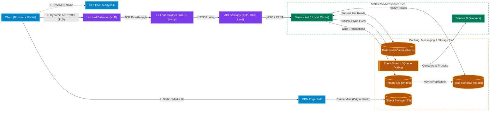

# System Design Documentation Hub

[← Back to Main README](../README.md)

## Table of Contents

- [System Design Fundamentals Curriculum (9 Chapters)](#system-design-fundamentals-curriculum-9-chapters)
- [System Design Interview 45-Minute Execution Framework](#system-design-interview-45-minute-execution-framework)
- [End-to-End Request Lifecycle Architecture](#end-to-end-request-lifecycle-architecture)
- [Real-World Architectural Retrospectives](#real-world-architectural-retrospectives)
- [Interview System Design Case Studies (35 Systems)](#interview-system-design-case-studies-35-systems)
- [Back-of-the-Envelope Calculations Cheat Sheet](#back-of-the-envelope-calculations-cheat-sheet)
  - [Powers of Two Quick Reference](#powers-of-two-quick-reference)
  - [SQL Data Type Storage Rules](#sql-data-type-storage-rules)
  - [Latency Numbers Every Programmer Should Know](#latency-numbers-every-programmer-should-know)
  - [Traffic & QPS Conversion Rules of Thumb](#traffic--qps-conversion-rules-of-thumb)
- [References](#references)

---

## System Design Fundamentals Curriculum (9 Chapters)

To keep the material modular and easy to study, core system design building blocks and distributed systems theory are organized into **9 focused chapters** under [`system-design/fundamentals/`](fundamentals/):

| Chapter | Title & Link | Core Topics Covered |
| :--- | :--- | :--- |
| **Chapter 1** | [**Networking, API Paradigms & Real-Time Protocols**](fundamentals/01-networking-and-api-paradigms.md) | **OSI 7-Layer Model** (L3/L4/L7); **TCP vs. UDP vs. QUIC** & **HTTP/1.1 vs. HTTP/2 vs. HTTP/3** (HoL blocking, 0-RTT); **REST vs. GraphQL vs. gRPC** (JSON vs. Protobuf, Over/Under-fetching, DataLoader $N+1$); **Short Polling vs. Long Polling vs. SSE vs. WebSockets vs. WebRTC** (Stateful WS scaling with Redis Pub/Sub). |
| **Chapter 2** | [**Proxies, Load Balancers, API Gateways & CDNs**](fundamentals/02-edge-load-balancing-and-cdn.md) | **Forward Proxy vs. Reverse Proxy**; **Layer 4 (NLB) vs. Layer 7 (ALB/Envoy) Load Balancing** & Two-Tier Edge LB Architecture; **Routing Algorithms** (Round Robin, Weighted, Least Connections, P2C, IP Hash) & **HA (VRRP / BGP Anycast)**; **API Gateway vs. Load Balancer vs. Service Mesh**; **Push CDN vs. Pull CDN** (Origin Shield, Cache Busting). |
| **Chapter 3** | [**Caching Deep Dive, Compute Scaling & Auto-Scaling**](fundamentals/03-caching-and-scaling.md) | **L1–L6 Caching Tiers** & **Redis vs. Memcached**; **Caching Strategies** (Cache-Aside, Read-Through, Write-Through, Write-Behind/Write-Back, Write-Around); **Eviction Policies** (LRU, LFU, W-TinyLFU, TTL) & **Failure Modes** (Stampede, Penetration, Avalanche, Hot Keys); **Vertical vs. Horizontal Scaling**, **Auto-Scaling Nodes** (HPA, KEDA, VPA, Connection Draining), & **Consistent Hashing**. |
| **Chapter 4** | [**Databases Deep Dive: SQL vs. NoSQL, Internals & Sharding**](fundamentals/04-databases-sql-vs-nosql.md) | **Relational (SQL) vs. NoSQL** (ACID vs. BASE, Schema-on-Write vs. Read, Normalization vs. Denormalization); **Isolation Levels & Concurrency Control** (`MVCC`, Write Skew, Pessimistic `FOR UPDATE` vs. Optimistic `OCC`); **Storage Internals** (**B+Tree vs. LSM-Tree**, **OLTP Row vs. OLAP Columnar**, **Block/File/Object Storage** & Pre-Signed URLs); **All 10 Database Categories**; **Replication**, **Sharding**, & **Geospatial Indexing** (Geohash, QuadTree, Uber H3). |
| **Chapter 5** | [**Distributed Systems, Consensus, Clocks, IDs & Messaging**](fundamentals/05-distributed-systems-and-messaging.md) | **CAP Theorem & PACELC Theorem** (CP vs. AP trade-offs, $R + W > N$ tunable quorum); **Consensus & Leader Election** (Raft, Paxos, etcd, ZooKeeper); **Distributed Locks & Fencing Tokens**; **Distributed Transactions** (**2PC** vs. **Saga Pattern** vs. **Transactional Outbox + CDC**) & **Idempotency Keys**; **Unique ID Generation** (**Twitter Snowflake 64-bit**, UUIDv7, Ticket Servers); **Physical vs. Logical Clocks** (NTP skew, Lamport, Vector Clocks, Google TrueTime, HLC); **Message Queues (RabbitMQ/SQS) vs. Event Streams (Kafka/Kinesis)**. |
| **Chapter 6** | [**Performance Metrics, Resiliency & Observability**](fundamentals/06-resiliency-observability-and-metrics.md) | **Latency vs. Response Time vs. Processing Time**; **Throughput vs. Bandwidth**, **Little's Law ($L = \lambda W$)**, & the **Queueing Delay Hockey-Stick Curve**; **Latency Percentiles (`P50`, `P95`, `P99`, `P99.9`)**, **Tail Latency Amplification**, & **Hedged Requests**; **Timeouts, Deadline Propagation & Backpressure**; **SLAs/SLOs/SLIs ("The Nines")**, **Rate Limiting**, **Circuit Breakers**, **Backoff + Jitter**, **Bulkheads**, & **Observability (Metrics, Logs, Tracing)**. |
| **Chapter 7** | [**Probabilistic Data Structures, Gossip & Stream Processing**](fundamentals/07-probabilistic-structures-and-stream-processing.md) | **Bloom Filter & Cuckoo Filter**; **Count-Min Sketch & Top-K Heavy Hitters** (Trending Topics); **HyperLogLog (HLL)** (`12 KB` unique counting); **Locality-Sensitive Hashing (`SimHash` / `MinHash`)**; **Gossip Protocol & Merkle Trees**; **CRDTs vs. Operational Transformation (OT)**; **Batch vs. Stream Processing (Apache Flink)**, **Windows (Tumbling/Sliding/Session)**, **Event Time vs. Processing Time & Watermarks**, **CQRS**, **Event Sourcing**, & **Lambda vs. Kappa Architecture**. |
| **Chapter 8** | [**Security, Multi-Region DR & Zero-Downtime Deployments**](fundamentals/08-security-multi-region-and-deployments.md) | **Session Cookies vs. Stateless JWTs** (+ solving **JWT Revocation** via Refresh Token Rotation); **OAuth 2.0 & OIDC**; **mTLS & SPIFFE Zero-Trust**; **RBAC vs. ABAC vs. ReBAC (Google Zanzibar)**; **KMS Envelope Encryption (KEK + DEK)**, **PCI Tokenization**, & **Multi-Layer DDoS Protection**; **RPO vs. RTO & DR Tiers** (Pilot Light, Warm Standby, Active-Active); **Cell-Based Architecture & Shuffle Sharding**; **Rolling vs. Blue-Green vs. Canary vs. Shadow Deployments** & **Expand-and-Contract Zero-Downtime DB Migrations**. |
| **Chapter 9** | [**Modern GenAI, LLM & Real-Time ML System Design**](fundamentals/09-genai-llm-and-ml-system-design.md) | **Production RAG Architecture** (Semantic Chunking, **Two-Stage Hybrid BM25 + Vector ANN Search**, **Reciprocal Rank Fusion**, **Cross-Encoder Reranking**); **LLM Inference Serving** (**Prefill vs. Decode**, **TTFT vs. ITL**, **KV-Cache**, **PagedAttention / vLLM**, **Continuous Batching**, **Speculative Decoding**); **AI Gateway** (**Semantic Caching**, **TPM/RPM Token Rate Limiting**, **Guardrails**); **4-Stage Recommendation Funnel** & **Dual Feature Store (Online Redis vs. Offline Parquet)**. |

---

## System Design Interview 45-Minute Execution Framework

A strong system design interview is structured, hypothesis-driven, and proactive about trade-offs. Use this 5-step pacing framework during a 45–60 minute session:

| Phase | Time Allocation | Key Actions & Deliverables | What Interviewers Look For |
| :--- | :--- | :--- | :--- |
| **1. Requirements & Scope** | `5 – 7 mins` | Clarify **3–5 Core Functional Requirements** (user journeys) and **Non-Functional Requirements** (scale/DAU, read:write ratio, P99 latency targets, CP vs. AP consistency, durability). | Asking targeted questions before drawing boxes; explicitly scoping out non-essential features. |
| **2. Back-of-the-Envelope Estimation** | `3 – 5 mins` | Estimate **Average & Peak QPS** (reads vs. writes), **Daily/5-Year Storage**, **Network Bandwidth**, and **Cache Memory (80/20 rule)**. | Translating numbers into architectural decisions (e.g., *"150K write QPS means a single SQL primary won't suffice — we need sharding or LSM-Tree NoSQL"*). |
| **3. API Contracts & Data Model** | `7 – 10 mins` | Define core **REST / GraphQL / gRPC / WebSocket endpoints** (request parameters, auth headers, idempotency keys, cursor pagination) and **Core Entities / Schema** (PK, SK, indexes). | Clean API ergonomics ([Chapter 1](fundamentals/01-networking-and-api-paradigms.md)) and matching the database engine to the access pattern ([Chapter 4](fundamentals/04-databases-sql-vs-nosql.md)). |
| **4. High-Level Architecture (HLD)** | `10 – 12 mins` | Draw the end-to-end flow for the **Write Path** and **Read Path**: Client $\rightarrow$ CDN $\rightarrow$ LB/API Gateway $\rightarrow$ Microservices $\rightarrow$ Cache / Message Queue / Database. | Clear separation of read/write paths, stateless compute ([Chapter 3](fundamentals/03-caching-and-scaling.md)), and end-to-end functional completeness. |
| **5. Deep Dives, Bottlenecks & Resilience** | `15 – 20 mins` | Proactively identify Single Points of Failure (SPOFs), hot keys/shards, race conditions, replication lag, and failure modes. Walk through 2–3 deep-dive trade-offs. | Driving the conversation without prompting; defending trade-offs ([Chapter 5](fundamentals/05-distributed-systems-and-messaging.md) & [Chapter 6](fundamentals/06-resiliency-observability-and-metrics.md)). |

---

## End-to-End Request Lifecycle Architecture

---

## Real-World Architectural Retrospectives

- [🌟 **DocuSign Billing & Invoicing Modernization**](project-retrospective.md) — Production architecture retrospective: Migrating legacy Quartz batch systems to event-driven MuleSoft & Core microservices, reducing invoice latency from 7 days to real-time (< 2s), achieving a 90% reduction in reconciliation discrepancies, and an 80% DSO reduction.

---

## Interview System Design Case Studies (35 Systems)

| # | System | Focus Areas | Documentation |
| :--- | :--- | :--- | :--- |
| 1 | **Airbnb** | Search indexing, booking concurrency, payments, availability calendar | [Airbnb Design](airbnb.md) |
| 2 | **Amazon** | E-commerce catalog, cart persistence, inventory reservation, checkout | [Amazon Design](amazon.md) |
| 3 | **Amazon Prime** | Video streaming CDN, chunking, adaptive bitrate, metadata service | [Prime Design](amazon-prime.md) |
| 4 | **ATM** | Hardware sensors, ISO 8583 protocol, financial ACID saga, HSM encryption | [ATM Design](atm.md) |
| 5 | **Autocomplete Search** | Trie cache, typeahead latency, prefix indexing, ranking | [Autocomplete Design](autocomplete-search.md) |
| 6 | **Bitly** | URL shortening, Base62 encoding, high read-to-write ratio caching | [Bitly Design](bitly.md) |
| 7 | **ChatGPT & Enterprise RAG Copilot** | Hybrid BM25 + Vector RAG, Zanzibar ACLs, SSE streaming, vLLM PagedAttention | [ChatGPT & RAG Design](chatgpt-rag-copilot.md) |
| 8 | **Distributed Job Scheduler** | Hierarchical timing wheel, shard leases & fencing tokens, cron materialization, DLQ | [Job Scheduler Design](distributed-job-scheduler.md) |
| 9 | **Distributed Key-Value Store** | Consistent hashing (`vnodes`), tunable quorum ($R+W>N$), vector clocks, gossip, Merkle trees, LSM-Tree | [Key-Value Store Design](distributed-key-value-store.md) |
| 10 | **DocuSign** | Digital signatures, audit trails, document hashing, encryption | [DocuSign Design](docusign.md) |
| 11 | **Dropbox** | Block-level sync, deduplication, conflict resolution, chunking | [Dropbox Design](dropbox.md) |
| 12 | **Email Archive** | Large-scale cold storage, full-text search indexing, compression | [Email Archive Design](email-archive.md) |
| 13 | **Fraud Detection** | Sub-50ms risk scoring, Flink velocity features, dual feature store, GNN rings | [Fraud Detection Design](fraud-detection.md) |
| 14 | **Google Docs** | Real-time collaborative editing, OT / CRDT, WebSocket sync | [Google Docs Design](google-docs.md) |
| 15 | **Google Drive** | File metadata, chunked upload/download, versioning, quota service | [Google Drive Design](google-drive.md) |
| 16 | **Instagram** | Feed generation, image delivery CDN, followers graph, fanout | [Instagram Design](instagram.md) |
| 17 | **Metrics Monitoring** | TSDB Gorilla compression, log/trace ingestion, PromQL, streaming alert rules | [Metrics Monitoring Design](metrics-monitoring.md) |
| 18 | **Netflix** | Open Connect CDN, dynamic optimizer transcode, ABR, state bookmarks | [Netflix Design](netflix.md) |
| 19 | **News Feed** | Fanout-on-write vs fanout-on-read, timeline caching, ranking | [News Feed Design](news-feed.md) |
| 20 | **Notification System** | Push notifications, SMS/Email gateways, deduplication, rate limits | [Notification Design](notification-system.md) |
| 21 | **Parking Garage** | Concurrency control, spot allocation, ticket validation, sensors | [Parking Garage Design](parking-garage.md) |
| 22 | **PasteBin** | Text storage, expiring keys, S3/blob integration, rate limiting | [PasteBin Design](pastebin.md) |
| 23 | **Payment System** | Double-entry ledger, idempotency keys, claims payout saga, T+1 reconciliation | [Payment System Design](payment-system.md) |
| 24 | **Rate Limiter** | Token bucket, sliding window counter, Redis distributed locking | [Rate Limiter Design](rate-limiter.md) |
| 25 | **Shopify** | Multi-tenant architecture, order processing, flash-sale traffic handling | [Shopify Design](shopify.md) |
| 26 | **Social Media** | Hybrid fanout, pre-signed media upload, social graph, timeline cache | [Social Media Design](social-media.md) |
| 27 | **Stock Exchange** | LMAX Disruptor ring buffer, $O(1)$ in-memory order book (Price-Time FIFO), Raft sequencer, ITCH multicast | [Stock Exchange Design](stock-exchange.md) |
| 28 | **Tag Service** | Inverted index, tag aggregation, lookup performance, caching | [Tag Service Design](tag-service.md) |
| 29 | **TicketMaster** | Virtual queues, fair ticketing, seat reservation locking | [TicketMaster Design](ticketmaster.md) |
| 30 | **TikTok** | Video feed recommendation pipeline, transcode pipeline, delivery | [TikTok Design](tiktok.md) |
| 31 | **Twitter** | Distributed timeline, Redis fanout cluster, search indexing | [Twitter Design](twitter.md) |
| 32 | **Uber** | Geospatial indexing (QuadTree/H3), driver dispatch, location updates | [Uber Design](uber.md) |
| 33 | **Web Crawler** | Mercator frontier, multi-format doc parsing/OCR, SimHash dedupe, RAG chunking | [Web Crawler Design](webcrawler.md) |
| 34 | **WhatsApp** | Real-time chat, WebSocket connection managers, E2E encryption | [WhatsApp Design](whatsapp.md) |
| 35 | **YouTube** | Video upload pipeline, transcode farm, CDN distribution, views counting | [YouTube Design](youtube.md) |

---

## Back-of-the-Envelope Calculations Cheat Sheet

### Powers of Two Quick Reference

| Power | Exact Value (Bytes) | Approx Value | Unit |
| :--- | :--- | :--- | :--- |
| **$2^{10}$** | 1,024 | 1 Thousand | 1 KB |
| **$2^{16}$** | 65,536 | 65 Thousand | 64 KB |
| **$2^{20}$** | 1,048,576 | 1 Million | 1 MB |
| **$2^{30}$** | 1,073,741,824 | 1 Billion | 1 GB |
| **$2^{32}$** | 4,294,967,296 | 4 Billion | 4 GB |
| **$2^{40}$** | 1,099,511,627,776 | 1 Trillion | 1 TB |
| **$2^{50}$** | 1,125,899,906,842,624 | 1 Quadrillion | 1 PB |

### SQL Data Type Storage Rules

- **ASCII Character**: 1 Byte
- **Unicode Character**: 2 Bytes
- **String of length $N$**:
  - UTF-8 / ASCII: $N$ bytes
  - Unicode (UTF-16): $2 \times N$ bytes
- **Integer / Numeric**: 4 Bytes (`INT` / 32-bit) or 8 Bytes (`BIGINT` / `DOUBLE` / 64-bit)
- **UUID / GUID**: 16 Bytes (binary) or 36 Bytes (string formatted)
- **Timestamp**: 4 Bytes (32-bit Unix epoch) or 8 Bytes (64-bit datetime)
- Reference: [MySQL 8.0 Data Type Storage Requirements](https://dev.mysql.com/doc/refman/8.0/en/storage-requirements.html)

### Latency Numbers Every Programmer Should Know

In system design interviews, relative orders of magnitude matter more than memorizing exact nanoseconds:

| Operation | Approximate Latency / Throughput | Relative Comparison |
| :--- | :--- | :--- |
| **L1 Cache Reference** | `~0.5 – 1 ns` | Baseline ($1\times$, $14\times$ faster than L2) |
| **L2 Cache Reference** | `~7 ns` | $14\times$ slower than L1 |
| **Main Memory (RAM) Reference** | `~100 ns` | $20\times$ slower than L2, $200\times$ slower than L1 |
| **1 MB Sequential Read from RAM** | `~250 µs` (`~4 GB/sec`) | Baseline for 1 MB block read |
| **1 MB Sequential Read from SSD (NVMe)** | `~1 ms` (`~1+ GB/sec`) | $4\times$ slower than RAM |
| **1 MB Sequential Read from Spinning Disk (HDD)** | `~20 ms` (`~30–50 MB/sec`) | $80\times$ slower than RAM (Disk seeks: `~10 ms` / 100 seeks/sec) |
| **Intra-Datacenter Round Trip (Same Region)** | `~0.5 ms` (`2,000 trips/sec`) | Equivalent to a Redis / microservice RPC hop |
| **Cross-Continental Round Trip (US $\leftrightarrow$ Europe/Asia)** | `~150 ms` (`6–7 trips/sec`) | Bounded by speed of light in fiber |
| **Payload Compression (Snappy / LZ4 / Zstd)** | `~250–500 MB/sec` | Fast CPU trade-off to save network I/O |
| **1 Gbps Network Link Throughput** | `~100 MB/sec` (`10 Gbps` $\approx$ `1 GB/sec`) | Practical wire saturation limit |

### Traffic & QPS Conversion Rules of Thumb

- **Seconds per Day**: $86,400 \approx 10^5\text{ seconds/day}$
- **Seconds per Month**: $2,592,000 \approx 2.5 \times 10^6\text{ seconds/month}$
- **Seconds per Year**: $31,536,000 \approx 3 \times 10^7\text{ seconds/year}$

| Monthly Traffic Volume | Average Requests / Sec (QPS) | Peak QPS ($2\times$ – $5\times$ Average) |
| :--- | :--- | :--- |
| **1 Million requests / month** | `~0.4 reqs/sec` | `~1 – 2 reqs/sec` |
| **2.6 Million requests / month** | `~1.0 req/sec` | `~2 – 5 reqs/sec` |
| **5 Million requests / month** | `~2.0 reqs/sec` | `~4 – 10 reqs/sec` |
| **10 Million requests / month** | `~4.0 reqs/sec` | `~8 – 20 reqs/sec` |
| **100 Million requests / month** | `~40 reqs/sec` | `~80 – 200 reqs/sec` |
| **1 Billion requests / month** | `~400 reqs/sec` | `~800 – 2,000 reqs/sec` |

---

## References

- [The System Design Primer (donnemartin)](https://github.com/donnemartin/system-design-primer)
- [Brewer's CAP Theorem (Eric Brewer)](https://www.infoq.com/articles/cap-twelve-years-later-how-the-rules-have-changed/)
- [Consistency Tradeoffs in Modern Distributed Database System Design (Daniel Abadi on PACELC)](https://www.cs.umd.edu/~abadi/papers/abadi-pacelc.pdf)
- [Latency Numbers Every Programmer Should Know (Jeff Dean / Colin Scott)](https://colin-scott.github.io/personal_website/research/interactive_latency.html)
