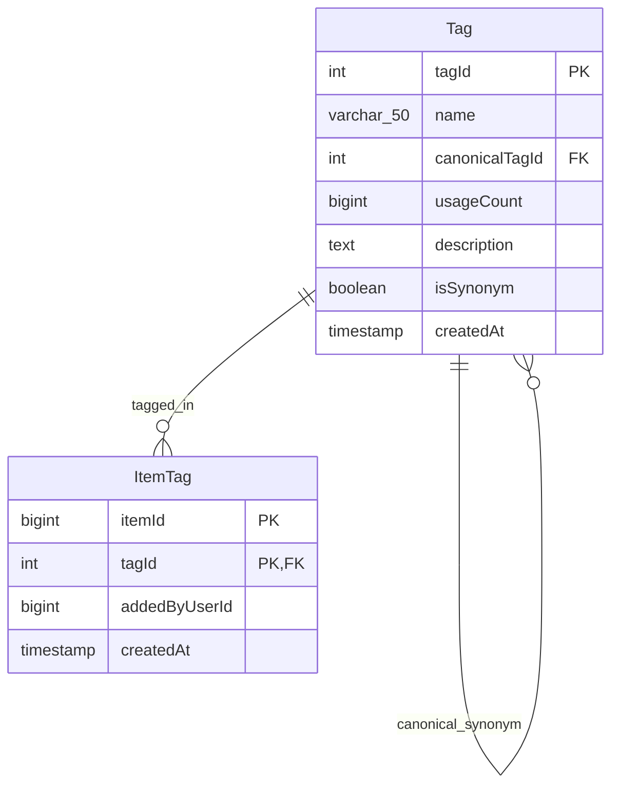

# Tag Service System Design

[← Back to System Design](system-design.md)

> **Core Building Blocks Used**: [Chapter 3 — Read-Through Redis Set Caching (`SMEMBERS` / `SINTER`)](fundamentals/03-caching-and-scaling.md#1-caching-deep-dive) · [Chapter 4 — Inverted Index (Elasticsearch) & Wide-Column Bi-Directional Tables](fundamentals/04-databases-sql-vs-nosql.md#full-text-search--inverted-index-elasticsearch--lucene) · [Chapter 7 — Count-Min Sketch (Trending Tags) & HyperLogLog Cardinality](fundamentals/07-probabilistic-structures-and-stream-processing.md#count-min-sketch--the-top-k-heavy-hitters-problem)

## Overview

A distributed Tag Service provides scalable metadata classification, discovery, and filtering for large-scale content platforms such as Stack Overflow, YouTube, GitHub, or Instagram. The system allows users to tag arbitrary entities (questions, videos, repositories, posts), perform sub-millisecond autocompletion, query complex boolean tag expressions (`[python] AND [concurrency] NOT [threading]`), and track real-time trending topics.

Designing a modern Tag Service requires solving key distributed systems challenges:

1. **Low-Latency Inverted Indexing**: Evaluating multi-tag boolean intersections across billions of items within $< 20\text{ ms}$.
2. **Sub-10ms Prefix Autocompletion**: Providing real-time, frequency-weighted tag suggestions as a user types into a search bar.
3. **Real-Time Trending Aggregation**: Detecting sudden velocity spikes for breaking hashtags without scanning massive relational tables.
4. **Tag Governance & Synonyms**: Handling tag merging, alias canonicalization (`js` $\to$ `javascript`), and hierarchical taxonomy mapping.

---

## Functional Requirements

* **Tag Association & Ingestion**: Add, update, and remove tags on content entities (posts, articles, videos, issues).
* **Tag Autocomplete & Suggestion**: Return top-K most relevant tags based on prefix input (e.g., typing `re` returns `react`, `redis`, `regex`).
* **Boolean Tag Filtering**: Search items matching complex boolean criteria:
  * Single tag: `tag = "system-design"`
  * Intersection (AND): `tag = "java" AND tag = "spring"`
  * Union (OR): `tag = "aws" OR tag = "gcp"`
  * Negation (NOT): `tag = "database" NOT tag = "nosql"`
* **Tag Synonyms & Canonicalization**: Map synonyms and colloquial abbreviations to an official canonical tag.
* **Trending & Popular Tags**: Provide real-time hourly and daily trending tag leaderboards.

---

## Non-Functional Requirements

* **Ultra-Low Latency**:
  * Autocomplete prefix queries: **$< 10\text{ ms}$**.
  * Multi-tag boolean searches: **$< 30\text{ ms}$** P95.
* **High Availability**: $99.99\%$ read availability for tag search and autocompletion.
* **Massive Scale**: Capable of indexing $500\text{ Million items}$, $50\text{ Million tags}$, and handling $50,000\text{ Query QPS}$.
* **Eventual Consistency for Indexes**: When a tag is added to a post, it must be queryable in the inverted index within $< 1\text{ second}$.

---

## Back of the Envelope Estimations

### Scale & Traffic

* **Total Indexed Items**: $500\text{ Million items}$ (e.g., questions, articles).
* **Total Unique Tags**: $2\text{ Million tags}$.
* **Average Tags per Item**: $4\text{ tags}$.
* **Total Tag-Item Associations**:
  $$500,000,000\text{ items} \times 4\text{ tags} = 2\text{ Billion associations}$$
* **Read / Search Traffic**: $50,000\text{ QPS}$ (Peak: $150,000\text{ QPS}$).
* **Tag Modification / Write Traffic**: $2,000\text{ writes/sec}$.

### Storage Calculations

* **Tag Metadata**: $2,000,000\text{ tags} \times 200\text{ bytes} \approx 400\text{ Megabytes}$ (easily stored in memory).
* **Association Table (item_id, tag_id)**:
  * 8 bytes `item_id` + 4 bytes `tag_id` = 12 bytes.
  * 2 Billion rows $\times 12\text{ bytes} \approx 24\text{ Gigabytes}$ (stored in PostgreSQL / Aurora).
* **Inverted Index Size**:
  * Postings list: 2 Billion document IDs (integer compressed using Roaring Bitmaps or Elias-Fano encoding).
  * Storage $\approx 15 - 20\text{ Gigabytes}$ RAM in an Elasticsearch / Lucene cluster.

---

## High-Level System Architecture

```mermaid
%%{init: {'flowchart': {'nodeSpacing': 25, 'rankSpacing': 45, 'padding': 10}}}%%
flowchart LR
    Clients["Client Apps (Web / Mobile Search)"]
    subgraph EdgeTier["Edge & Gateway"]
        Gateway["API Gateway / Envoy Proxy"]
    end
    subgraph AppTier["Tag Services & Streaming"]
        AutoSvc["Autocomplete Svc (Prefix Trie)"]
        CoreSvc["Tag Core Svc (Boolean Solver)"]
        TrendSvc["Trending Svc (Count-Min + Flink)"]
    end
    subgraph DataTier["Index, Cache & Storage"]
        Redis[("Redis Cache Cluster")]
        InvertedIdx[("Elasticsearch / Lucene")]
        RelDB[("PostgreSQL / Aurora")]
    end
    Clients e1@-->|"1. GET /suggest"| Gateway
    Clients e2@-->|"2. GET /items"| Gateway
    Gateway e3@-->|"Autocomplete"| AutoSvc
    Gateway e4@-->|"Boolean Search"| CoreSvc
    Gateway e5@-->|"Trending"| TrendSvc
    AutoSvc e6@-->|"Trie Snapshot"| Redis
    CoreSvc e7@-->|"Bitmap Intersect"| InvertedIdx
    CoreSvc e8@-->|"Hot Sets"| Redis
    CoreSvc e9@-->|"ACID Write"| RelDB
    TrendSvc e10@-->|"Top-K ZSet"| Redis
    RelDB e11@-.->|"CDC Stream"| InvertedIdx

    e1@{ animate: true }
    e2@{ animate: true }
    e3@{ animate: true }
    e4@{ animate: true }
    e5@{ animate: true }
    e6@{ animate: true }
    e7@{ animate: true }
    e8@{ animate: true }
    e9@{ animate: true }
    e10@{ animate: true }
    e11@{ animate: true }

    classDef client fill:#1d4ed8,stroke:#60a5fa,stroke-width:2px,color:#ffffff
    classDef edge fill:#6d28d9,stroke:#a78bfa,stroke-width:2px,color:#ffffff
    classDef service fill:#047857,stroke:#34d399,stroke-width:2px,color:#ffffff
    classDef worker fill:#0e7490,stroke:#22d3ee,stroke-width:2px,color:#ffffff
    classDef cache fill:#be123c,stroke:#fb7185,stroke-width:2px,color:#ffffff
    classDef storage fill:#b45309,stroke:#fbbf24,stroke-width:2px,color:#ffffff

    class Clients client
    class Gateway edge
    class AutoSvc,CoreSvc service
    class TrendSvc worker
    class Redis cache
    class InvertedIdx,RelDB storage

    style EdgeTier fill:transparent,stroke:#a78bfa,stroke-width:1.5px,stroke-dasharray: 5 5
    style AppTier fill:transparent,stroke:#34d399,stroke-width:1.5px,stroke-dasharray: 5 5
    style DataTier fill:transparent,stroke:#fbbf24,stroke-width:1.5px,stroke-dasharray: 5 5
```



---

## Core Algorithms & Indexing

### 1. Inverted Index & Fast Boolean Set Operations

To evaluate `tag:java AND tag:spring`:

* An Inverted Index stores a postings list for each tag sorted by `item_id`:
  * `java` $\implies [12, 45, 89, 102, 340, \dots]$
  * `spring` $\implies [45, 102, 501, \dots]$
* **Roaring Bitmap Intersections**:
  * Instead of scanning raw tables, the engine performs bitwise `AND` on compressed bitmap vectors.
  * Intersection between two 100,000-item sets completes in $< 1\text{ millisecond}$.

### 2. Tag Autocompletion with In-Memory Trie

* Tag dictionaries ($2\text{M}$ tags) fit easily in $< 1\text{ GB}$ of RAM.
* **Prefix Trie Node**:

  ```text
  Node {
      char: 'r',
      children: Map<char, Node>,
      topK: [
          {"tag": "reactjs", "usage": 450000},
          {"tag": "redis",   "usage": 280000},
          {"tag": "regex",   "usage": 190000}
      ]
  }
  ```

* Precomputing the top 5 most popular tags at every Trie node enables $O(L)$ lookup time, where $L$ is the length of the query prefix (e.g. 2–5 characters), delivering **sub-millisecond** autocomplete latency.

---

## API Specifications

### 1. Tag Autocomplete

```http
GET /api/v1/tags/suggest?prefix=py&limit=5
Accept: application/json
```

```json
// Response: 200 OK
{
  "prefix": "py",
  "suggestions": [
    {"tag": "python", "usageCount": 2100000, "isCanonical": true},
    {"tag": "python-3.x", "usageCount": 850000, "isCanonical": true},
    {"tag": "pyspark", "usageCount": 120000, "isCanonical": true},
    {"tag": "pytest", "usageCount": 95000, "isCanonical": true},
    {"tag": "pytorch", "usageCount": 92000, "isCanonical": true}
  ]
}
```

### 2. Filter Items by Boolean Tag Expression

```http
POST /api/v1/items/search-by-tags
Content-Type: application/json
```

```json
// Request
{
  "expression": {
    "and": ["python", "machine-learning"],
    "not": ["tensorflow"]
  },
  "page": 1,
  "pageSize": 20
}

// Response: 200 OK
{
  "totalMatches": 4120,
  "items": [
    {"itemId": "post_99182", "title": "PyTorch Attention Mechanism Guide"}
  ]
}
```

---

## Object Model & Database Schema

### Database Selection & Rationale

| Workload / Subsystem | Database Choice | Data Model & CAP Profile | Why This Database? (Justification & Trade-offs) |
| :--- | :--- | :--- | :--- |
| **Authoritative Tags, Synonyms & Item Associations (`Tag`, `ItemTag`)** | **Amazon Aurora PostgreSQL** | Relational (ACID, **CP / PC-EC**) | **Why:** Tag governance (merging synonyms via `canonicalTagId`, enforcing unique `(itemId, tagId)` composite primary keys, and maintaining referential integrity) requires ACID transactions. At $2\text{ Billion}$ rows ($\sim 24\text{ GB}$ of compact integer pairs), the entire association table fits comfortably in a single Aurora instance's buffer pool with read replicas. |
| **Multi-Tag Boolean Search (`AND` / `OR` / `NOT`)** | **Elasticsearch / Apache Lucene (Roaring Bitmaps)** | Inverted Index (**AP / Near Real-Time**) | **Why:** Evaluating `tag = "python" AND tag = "machine-learning" NOT tag = "tensorflow"` in SQL requires expensive multi-way self-joins (`JOIN item_tags t1 ... JOIN item_tags t2`) that degrade at $150,000\text{ Peak QPS}$. Elasticsearch stores each tag's postings list as a compressed **Roaring Bitmap**, executing bitwise `AND`/`OR`/`ANDNOT` intersections across millions of item IDs in $< 1\text{ ms}$ (synced from PostgreSQL via Debezium CDC). |
| **Sub-10ms Prefix Autocomplete & Trending Leaderboards** | **Redis Cluster + In-Memory Prefix Trie** | In-Memory Key-Value / ZSet (**AP / Sub-ms**) | **Why:** All 2M unique tag names ($\sim 400\text{ MB}$) fit in process memory as a Prefix Trie with precomputed Top-5 tags per node ($O(L)$ lookup in $< 1\text{ ms}$). Redis Sorted Sets (`ZSET`) store real-time hourly/daily trending tag leaderboards updated by Apache Flink + Count-Min Sketch stream processors. |



---

## System Design Diagram

```mermaid
%%{init: {'flowchart': {'nodeSpacing': 20, 'rankSpacing': 40, 'padding': 10}}}%%
flowchart LR
    subgraph ClientTier["Clients"]
        Clients["Clients & Apps (Web, Mobile, CMS)"]
    end
    subgraph EdgeTier["Edge & API Gateway"]
        Gateway{"API Gateway / Envoy (Auth & Route)"}
    end
    subgraph ServiceTier["Tag Services & Streaming"]
        AutoSvc["Autocomplete Svc (In-Memory Trie)"]
        TagSvc["Tag Core Svc (Synonyms & Solver)"]
        TrendSvc["Trending Aggregator (Flink + CMS)"]
    end
    subgraph StorageIndexTier["Indexes, Caches & Persistence"]
        Redis[("Redis Cluster (ZSets & Trie Sync)")]
        InvertedIdx[("Elasticsearch (Roaring Bitmaps)")]
        RelDB[("PostgreSQL / Aurora (ACID Tags)")]
    end
    Clients e1@-->|"REST / GraphQL"| Gateway
    Gateway e2@-->|"GET /suggest"| AutoSvc
    Gateway e3@-->|"CRUD & Search"| TagSvc
    Gateway e4@-->|"GET /trending"| TrendSvc
    AutoSvc e5@-->|"Sync Snapshot"| Redis
    TagSvc e6@-->|"Bitmap AND/OR"| InvertedIdx
    TagSvc e7@-->|"Commit Links"| RelDB
    TagSvc e8@-->|"Hot Postings"| Redis
    RelDB e9@-.->|"CDC (Debezium)"| InvertedIdx
    RelDB e10@-.->|"Tag Events"| TrendSvc
    TrendSvc e11@-->|"Top-50 ZSet"| Redis

    e1@{ animate: true }
    e2@{ animate: true }
    e3@{ animate: true }
    e4@{ animate: true }
    e5@{ animate: true }
    e6@{ animate: true }
    e7@{ animate: true }
    e8@{ animate: true }
    e9@{ animate: true }
    e10@{ animate: true }
    e11@{ animate: true }

    classDef client fill:#1d4ed8,stroke:#60a5fa,stroke-width:2px,color:#ffffff
    classDef edge fill:#6d28d9,stroke:#a78bfa,stroke-width:2px,color:#ffffff
    classDef service fill:#047857,stroke:#34d399,stroke-width:2px,color:#ffffff
    classDef worker fill:#0e7490,stroke:#22d3ee,stroke-width:2px,color:#ffffff
    classDef cache fill:#be123c,stroke:#fb7185,stroke-width:2px,color:#ffffff
    classDef storage fill:#b45309,stroke:#fbbf24,stroke-width:2px,color:#ffffff

    class Clients client
    class Gateway edge
    class AutoSvc,TagSvc service
    class TrendSvc worker
    class Redis cache
    class InvertedIdx,RelDB storage

    style ClientTier fill:transparent,stroke:#60a5fa,stroke-width:1.5px,stroke-dasharray: 5 5
    style EdgeTier fill:transparent,stroke:#a78bfa,stroke-width:1.5px,stroke-dasharray: 5 5
    style ServiceTier fill:transparent,stroke:#34d399,stroke-width:1.5px,stroke-dasharray: 5 5
    style StorageIndexTier fill:transparent,stroke:#fbbf24,stroke-width:1.5px,stroke-dasharray: 5 5
```



---

## Deep Dive & Key Technical Challenges

### 1. Handling Tag Renames and Merges

* In a system with 50 million tagged questions, merging `js` into `javascript` would require updating millions of database rows, locking tables.
* **Canonical Pointer Indirection**:
  * Instead of updating millions of `item_tags` rows, update the single tag record:

    ```sql
    UPDATE tags SET canonical_tag_id = (SELECT tag_id FROM tags WHERE name = 'javascript'), is_synonym = TRUE WHERE name = 'js';
    ```

  * The query compiler automatically rewrites any query for `js` into `javascript` before executing the search, providing instantaneous merge with zero table locks.

### 2. Real-Time Trending Tag Detection (Count-Min Sketch)

* Detecting viral tags during a global news event requires tracking frequency velocity without writing every tag view to a database.
* **Count-Min Sketch & Sliding Window**:
  * A streaming Flink pipeline passes tag mentions through a Count-Min Sketch (probabilistic frequency matrix).
  * Compute the **Z-score velocity**:
    $$\text{Velocity} = \frac{\text{Count}(\text{current hour}) - \mu(\text{historical})}{\sigma(\text{historical})}$$
  * Tags with the highest velocity score populate the Redis `trending_tags` sorted set in real time.

---

## Additional Notes

### Video References

* [](https://www.youtube.com/watch?v=WNIR7eiv0Hk)
* [](https://www.youtube.com/watch?v=BHCSL_ZifI0)
