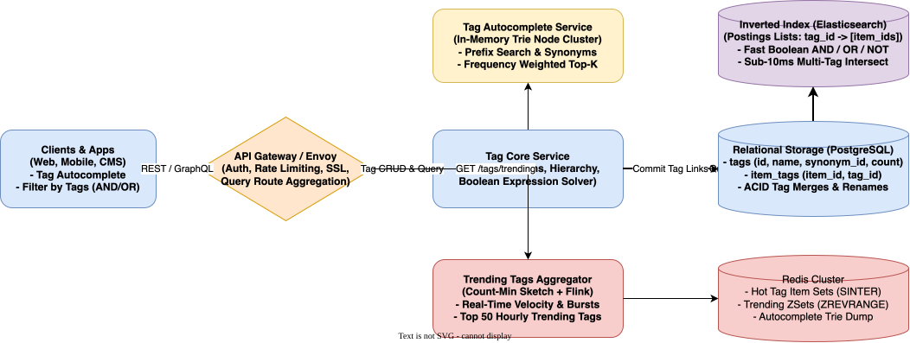

# Tag Service System Design

[← Back to System Design](../system-design.md)

## Overview

A distributed Tag Service provides scalable metadata classification, discovery, and filtering for large-scale content platforms such as Stack Overflow, YouTube, GitHub, or Instagram. The system allows users to tag arbitrary entities (questions, videos, repositories, posts), perform sub-millisecond autocompletion, query complex boolean tag expressions (`[python] AND [concurrency] NOT [threading]`), and track real-time trending topics.

Designing a modern Tag Service requires solving key distributed systems challenges:

1. **Low-Latency Inverted Indexing**: Evaluating multi-tag boolean intersections across billions of items within $< 20\text{ ms}$.
2. **Sub-10ms Prefix Autocompletion**: Providing real-time, frequency-weighted tag suggestions as a user types into a search bar.
3. **Real-Time Trending Aggregation**: Detecting sudden velocity spikes for breaking hashtags without scanning massive relational tables.
4. **Tag Governance & Synonyms**: Handling tag merging, alias canonicalization (`js` $\to$ `javascript`), and hierarchical taxonomy mapping.

---

## Functional Requirements

* **Tag Association & Ingestion**: Add, update, and remove tags on content entities (posts, articles, videos, issues).
* **Tag Autocomplete & Suggestion**: Return top-K most relevant tags based on prefix input (e.g., typing `re` returns `react`, `redis`, `regex`).
* **Boolean Tag Filtering**: Search items matching complex boolean criteria:
  * Single tag: `tag = "system-design"`
  * Intersection (AND): `tag = "java" AND tag = "spring"`
  * Union (OR): `tag = "aws" OR tag = "gcp"`
  * Negation (NOT): `tag = "database" NOT tag = "nosql"`
* **Tag Synonyms & Canonicalization**: Map synonyms and colloquial abbreviations to an official canonical tag.
* **Trending & Popular Tags**: Provide real-time hourly and daily trending tag leaderboards.

---

## Non-Functional Requirements

* **Ultra-Low Latency**:
  * Autocomplete prefix queries: **$< 10\text{ ms}$**.
  * Multi-tag boolean searches: **$< 30\text{ ms}$** P95.
* **High Availability**: $99.99\%$ read availability for tag search and autocompletion.
* **Massive Scale**: Capable of indexing $500\text{ Million items}$, $50\text{ Million tags}$, and handling $50,000\text{ Query QPS}$.
* **Eventual Consistency for Indexes**: When a tag is added to a post, it must be queryable in the inverted index within $< 1\text{ second}$.

---

## Back of the Envelope Estimations

### Scale & Traffic

* **Total Indexed Items**: $500\text{ Million items}$ (e.g., questions, articles).
* **Total Unique Tags**: $2\text{ Million tags}$.
* **Average Tags per Item**: $4\text{ tags}$.
* **Total Tag-Item Associations**:
  $$500,000,000\text{ items} \times 4\text{ tags} = 2\text{ Billion associations}$$
* **Read / Search Traffic**: $50,000\text{ QPS}$ (Peak: $150,000\text{ QPS}$).
* **Tag Modification / Write Traffic**: $2,000\text{ writes/sec}$.

### Storage Calculations

* **Tag Metadata**: $2,000,000\text{ tags} \times 200\text{ bytes} \approx 400\text{ Megabytes}$ (easily stored in memory).
* **Association Table (item_id, tag_id)**:
  * 8 bytes `item_id` + 4 bytes `tag_id` = 12 bytes.
  * 2 Billion rows $\times 12\text{ bytes} \approx 24\text{ Gigabytes}$ (stored in PostgreSQL / Aurora).
* **Inverted Index Size**:
  * Postings list: 2 Billion document IDs (integer compressed using Roaring Bitmaps or Elias-Fano encoding).
  * Storage $\approx 15 - 20\text{ Gigabytes}$ RAM in an Elasticsearch / Lucene cluster.

---

## High-Level System Architecture

```text
                                  ┌────────────────────────┐
                                  │      Client Apps       │
                                  │ (Web / Mobile Search)  │
                                  └────┬──────────────┬────┘
                                       │              │
             1. GET /tags/suggest?q=re │              │ 2. GET /items?tags=py+ml
                (Autocomplete)         │              │    (Boolean Search)
                                       ▼              ▼
┌─────────────────────────────────────────────────────────────────────────────┐
│                           API GATEWAY / ENVOY PROXY                         │
│  - Authentication, Rate Limiting, Request Decompression                     │
└──────────────────────────────────────┬──────────────────────────────────────┘
                                       │
        ┌──────────────────────────────┼──────────────────────────────┐
        │ Autocomplete                 │ Search Query                 │ Trending
        ▼                              ▼                              ▼
┌─────────────────────────────┐ ┌─────────────────────────────┐ ┌─────────────────────────────┐
│  TAG AUTOCOMPLETE SERVICE   │ │      TAG CORE SERVICE       │ │   TRENDING AGGREGATOR       │
│  (In-Memory Prefix Trie)    │ │  (Boolean Expression Solver)│ │   (Count-Min Sketch + Flink)│
│  - Weighted by usage count  │ │  - Resolves Synonyms/Aliases│ │   - Sliding window velocity │
└─────────────────────────────┘ └──────────────┬──────────────┘ └──────────────┬──────────────┘
                                               │                               │
                                               ├───────────────────────────────┤
                                               │                               │
                                               ▼                               ▼
                                ┌─────────────────────────────┐ ┌─────────────────────────────┐
                                │   INVERTED INDEX CLUSTER    │ │     REDIS CACHE CLUSTER     │
                                │   (Elasticsearch / Lucene)  │ │  - Hot Postings Lists       │
                                │   Postings: tag -> [items]  │ │  - Trending Leaderboard ZSet│
                                └──────────────┬──────────────┘ └─────────────────────────────┘
                                               │
                                               ▼ Change Data Capture (CDC)
                                ┌─────────────────────────────┐
                                │   PRIMARY RELATIONAL DB     │
                                │   (PostgreSQL / Aurora)     │
                                │   - tags (PK, canonical_id) │
                                │   - item_tags (item_id, tag)│
                                └─────────────────────────────┘
```

---

## Core Algorithms & Indexing

### 1. Inverted Index & Fast Boolean Set Operations

To evaluate `tag:java AND tag:spring`:

* An Inverted Index stores a postings list for each tag sorted by `item_id`:
  * `java` $\implies [12, 45, 89, 102, 340, \dots]$
  * `spring` $\implies [45, 102, 501, \dots]$
* **Roaring Bitmap Intersections**:
  * Instead of scanning raw tables, the engine performs bitwise `AND` on compressed bitmap vectors.
  * Intersection between two 100,000-item sets completes in $< 1\text{ millisecond}$.

### 2. Tag Autocompletion with In-Memory Trie

* Tag dictionaries ($2\text{M}$ tags) fit easily in $< 1\text{ GB}$ of RAM.
* **Prefix Trie Node**:

  ```text
  Node {
      char: 'r',
      children: Map<char, Node>,
      topK: [
          {"tag": "reactjs", "usage": 450000},
          {"tag": "redis",   "usage": 280000},
          {"tag": "regex",   "usage": 190000}
      ]
  }
  ```

* Precomputing the top 5 most popular tags at every Trie node enables $O(L)$ lookup time, where $L$ is the length of the query prefix (e.g. 2–5 characters), delivering **sub-millisecond** autocomplete latency.

---

## API Specifications

### 1. Tag Autocomplete

```http
GET /api/v1/tags/suggest?prefix=py&limit=5
Accept: application/json
```

```json
// Response: 200 OK
{
  "prefix": "py",
  "suggestions": [
    {"tag": "python", "usageCount": 2100000, "isCanonical": true},
    {"tag": "python-3.x", "usageCount": 850000, "isCanonical": true},
    {"tag": "pyspark", "usageCount": 120000, "isCanonical": true},
    {"tag": "pytest", "usageCount": 95000, "isCanonical": true},
    {"tag": "pytorch", "usageCount": 92000, "isCanonical": true}
  ]
}
```

### 2. Filter Items by Boolean Tag Expression

```http
POST /api/v1/items/search-by-tags
Content-Type: application/json
```

```json
// Request
{
  "expression": {
    "and": ["python", "machine-learning"],
    "not": ["tensorflow"]
  },
  "page": 1,
  "pageSize": 20
}

// Response: 200 OK
{
  "totalMatches": 4120,
  "items": [
    {"itemId": "post_99182", "title": "PyTorch Attention Mechanism Guide"}
  ]
}
```

---

## Object Model & Database Schema

```text
┌───────────────────────┐          ┌───────────────────────┐
│         Tag           │1        *│        ItemTag        │
├───────────────────────┤──────────├───────────────────────┤
│ tagId: PK (Int)       │          │ itemId: PK (BigInt)   │
│ name: Varchar(50) (UQ)│          │ tagId: PK, FK (Tag)   │
│ canonicalTagId: FK    │          │ addedByUserId: BigInt │
│ usageCount: BigInt    │          │ createdAt: Timestamp  │
│ description: Text     │          └───────────────────────┘
│ isSynonym: Boolean    │
│ createdAt: Timestamp  │
└───────────────────────┘
```

---

## System Design Diagram



[Download Draw.io File](tag-service.drawio)

---

## Deep Dive & Key Technical Challenges

### 1. Handling Tag Renames and Merges

* In a system with 50 million tagged questions, merging `js` into `javascript` would require updating millions of database rows, locking tables.
* **Canonical Pointer Indirection**:
  * Instead of updating millions of `item_tags` rows, update the single tag record:

    ```sql
    UPDATE tags SET canonical_tag_id = (SELECT tag_id FROM tags WHERE name = 'javascript'), is_synonym = TRUE WHERE name = 'js';
    ```

  * The query compiler automatically rewrites any query for `js` into `javascript` before executing the search, providing instantaneous merge with zero table locks.

### 2. Real-Time Trending Tag Detection (Count-Min Sketch)

* Detecting viral tags during a global news event requires tracking frequency velocity without writing every tag view to a database.
* **Count-Min Sketch & Sliding Window**:
  * A streaming Flink pipeline passes tag mentions through a Count-Min Sketch (probabilistic frequency matrix).
  * Compute the **Z-score velocity**:
    $$\text{Velocity} = \frac{\text{Count}(\text{current hour}) - \mu(\text{historical})}{\sigma(\text{historical})}$$
  * Tags with the highest velocity score populate the Redis `trending_tags` sorted set in real time.

---

## Additional Notes
