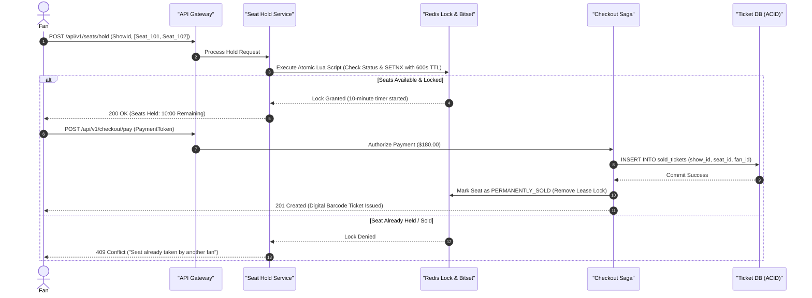
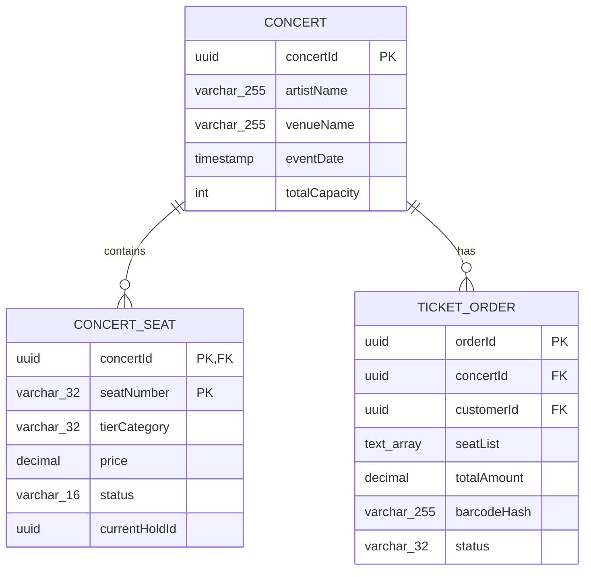

# TicketMaster System Design

[← Back to System Design](system-design.md)

> **Core Building Blocks Used**: [Chapter 1 — SSE / WebSockets Real-Time Seat Map Updates](fundamentals/01-networking-and-api-paradigms.md#3-real-time-protocols-polling-vs-sse-vs-websockets-vs-webrtc) · [Chapter 3 — Edge Virtual Waiting Room Queue & Redis Seat Hold TTL](fundamentals/03-caching-and-scaling.md#caching-failure-modes--interview-mitigations) · [Chapter 4 — Pessimistic (`FOR UPDATE`) vs. Optimistic Concurrency Control](fundamentals/04-databases-sql-vs-nosql.md#3-pessimistic-vs-optimistic-concurrency-control-preventing-double-booking) · [Chapter 5 — Distributed Locks with Fencing Tokens](fundamentals/05-distributed-systems-and-messaging.md#3-distributed-locks--fencing-tokens)

## Overview

TicketMaster is the global market leader in ticketing and live entertainment event reservations, selling hundreds of millions of tickets annually. The platform faces extreme, spiky demand: when mega-concerts (e.g., stadium tours) go on sale, **millions of concurrent fans arrive in the exact same second** competing for tens of thousands of fixed seats.

Designing TicketMaster requires solving critical distributed systems challenges:

1. **Virtual Waiting Room & Traffic Smoothing**: Protecting backend transactional databases from millions of simultaneous checkout hits.
2. **Interactive Seat Map Availability**: Sub-second rendering of tens of thousands of seats across multiple tiers.
3. **Zero Double-Selling Guarantee (ACID)**: Granting exclusive, temporary 10-minute seat holds during payment while preventing deadlocks and overselling.
4. **Anti-Bot & Anti-Scalper Protections**: Enforcing rate limits, CAPTCHA, and verified fan tokens.

---

## Functional Requirements

* **Event & Venue Search**: Search live events by artist, tour, city, venue, and date.
* **Interactive Seating Chart**: View stadium seating maps with real-time seat availability color-coded by tier (Available, Held/In-Cart, Sold).
* **Virtual Waiting Room (Queue)**: Ingress queue that admits fans at a controlled, metered rate into the booking funnel.
* **Temporary Seat Hold (10-Minute Lease)**: Fans select specific seats and place a temporary 10-minute hold while entering payment details.
* **Checkout & Payment**: Securely charge credit cards, issue digital mobile tickets with rotating dynamic barcodes, and email confirmations.
* **Ticket Transfer & Resale**: Securely transfer tickets between fan accounts or list tickets on an official fan-to-fan resale marketplace.

---

## Non-Functional Requirements

* **Zero Double-Selling (Strict ACID Consistency)**: Under no circumstances should two fans purchase the exact same seat.
* **Extreme Burst Resilience**: Sustain **$100\times$ traffic surges** at 10:00 AM on ticket launch day without system collapse.
* **Fairness & Anti-Bot Defense**: Ensure queue positions are enforced deterministically and cannot be bypassed via script tampering.
* **Low Latency for Seating Map**: Seating availability lookups must complete within **$< 100\text{ ms}$**.
* **Financial Durability**: 100% auditability for payment settlements, refunds, and ticket ownership transfers.

---

## Back of the Envelope Estimations

### Scale & Spike Traffic

* **Stadium Concert Capacity**: 60,000 seats.
* **Peak Concurrent Fans at On-Sale**: $1,000,000\text{ users competing for 60,000 tickets}$.
* **Waiting Room Ingress Rate**:
  * Admitting $500\text{ users/second}$ into the booking checkout pipeline ensures the database handles transactions comfortably without connection starvation.
* **Seat Hold QPS**:
  * 500 users/sec choosing 2 seats $= 1,000\text{ seat locks/sec}$ (effortlessly handled by Redis Redlock).
* **Daily Average System Scale**:
  * 100,000 events listed globally; 500,000 tickets sold/day on normal days.

---

## High-Level System Architecture

```mermaid
%%{init: {'flowchart': {'nodeSpacing': 25, 'rankSpacing': 45, 'padding': 10}}}%%
flowchart LR
    Clients["Fan Clients (1M+ Users)"]
    subgraph EdgeTier["Edge & Ingress"]
        WaitingRoom["Virtual Waiting Room (Edge)"]
        Gateway["API Gateway / Envoy"]
    end
    subgraph AppBackend["Application Services"]
        SeatMapSvc["Seat Map Service (SVG)"]
        SeatHoldSvc["Seat Hold Svc (10m Lease)"]
        CheckoutSaga["Checkout Saga Orchestrator"]
    end
    subgraph DataLayer["Storage & Caching"]
        RedisBitset[("Redis Seat Bitsets")]
        RedisLock[("Redis Redlock (Lua)")]
        TicketDB[("CockroachDB / Aurora")]
    end
    Clients e1@-->|"1. Ingress"| WaitingRoom
    WaitingRoom e2@-->|"2. Signed JWT"| Gateway
    Gateway e3@-->|"Map Query"| SeatMapSvc
    Gateway e4@-->|"Hold Seats"| SeatHoldSvc
    Gateway e5@-->|"Checkout"| CheckoutSaga
    SeatMapSvc e6@-->|"Read Bits"| RedisBitset
    SeatHoldSvc e7@-->|"10m Lock"| RedisLock
    CheckoutSaga e8@-->|"ACID Tx"| TicketDB

    e1@{ animate: true }
    e2@{ animate: true }
    e3@{ animate: true }
    e4@{ animate: true }
    e5@{ animate: true }
    e6@{ animate: true }
    e7@{ animate: true }
    e8@{ animate: true }

    classDef client fill:#1d4ed8,stroke:#60a5fa,stroke-width:2px,color:#ffffff
    classDef edge fill:#6d28d9,stroke:#a78bfa,stroke-width:2px,color:#ffffff
    classDef service fill:#047857,stroke:#34d399,stroke-width:2px,color:#ffffff
    classDef cache fill:#be123c,stroke:#fb7185,stroke-width:2px,color:#ffffff
    classDef storage fill:#b45309,stroke:#fbbf24,stroke-width:2px,color:#ffffff

    class Clients client
    class WaitingRoom,Gateway edge
    class SeatMapSvc,SeatHoldSvc,CheckoutSaga service
    class RedisBitset,RedisLock cache
    class TicketDB storage

    style EdgeTier fill:transparent,stroke:#a78bfa,stroke-width:1.5px,stroke-dasharray: 5 5
    style AppBackend fill:transparent,stroke:#34d399,stroke-width:1.5px,stroke-dasharray: 5 5
    style DataLayer fill:transparent,stroke:#fbbf24,stroke-width:1.5px,stroke-dasharray: 5 5
```



---

## Core Components & Workflows

### 1. Virtual Waiting Room (Traffic Throttling)

Allowing 1 million fans to hit database transactions simultaneously causes server crashes.

* **How the Virtual Queue Works**:
  1. Fans arrive before 10:00 AM and enter a pre-queue holding page hosted on a CDN edge.
  2. At 10:00 AM sharp, the queue randomizes arrivals to prevent bot head-starts and assigns sequential FIFO numbers.
  3. A rate-limiter periodically admits a batch of $N$ users (e.g., 500 users/second) by issuing a cryptographically signed, short-lived HMAC / JWT token.
  4. Only requests presenting this valid admission token are accepted by the backend API Gateway.

### 2. The 10-Minute Seat Hold Mechanism



* **Relational Unique Key Guarantee**:

  ```sql
  CREATE TABLE concert_seats (
      concert_id BIGINT NOT NULL,
      seat_number VARCHAR(32) NOT NULL,
      status VARCHAR(16) NOT NULL, -- AVAILABLE, HELD, SOLD
      holder_id BIGINT,
      hold_expires_at TIMESTAMP,
      PRIMARY KEY (concert_id, seat_number)
  );
  ```

---

## API Specifications

### 1. Hold Seats (10-Minute Countdown)

```http
POST /api/v1/concerts/{concertId}/seats/hold
Authorization: Bearer <admission_jwt_token>
Content-Type: application/json
```

```json
// Request
{
  "seatNumbers": ["SEC102-ROW12-S1", "SEC102-ROW12-S2"],
  "idempotencyKey": "idem_hold_8912401"
}

// Response: 200 OK
{
  "holdId": "hld_981240a",
  "heldUntilTimestamp": 1730006600,
  "seats": ["SEC102-ROW12-S1", "SEC102-ROW12-S2"],
  "pricePerTicket": 125.00,
  "serviceFee": 22.50,
  "totalDue": 295.00
}
```

---

## Object Model & Database Schema

### Database Selection & Rationale

| Workload / Subsystem | Database Choice | Data Model & CAP Profile | Why This Database? (Justification & Trade-offs) |
| :--- | :--- | :--- | :--- |
| **Seats, Ticket Orders & Ownership Ledger (`CONCERT_SEAT`, `TICKET_ORDER`)** | **CockroachDB / Amazon Aurora PostgreSQL** | Distributed Relational SQL (Serializable ACID, **CP / PC-EC**) | **Why:** Zero double-selling is the #1 invariant of TicketMaster. The database enforces a composite primary key `(concertId, seatNumber)` and executes checkout state transitions (`HELD` $\to$ `SOLD`) inside `SERIALIZABLE` / optimistic-locking ACID transactions. Eventual consistency (AP NoSQL) is unusable here because two fans could purchase the same stadium seat during a partition. |
| **10-Minute Temporary Seat Locks & Live Seat Map Bitsets** | **Redis Cluster (Atomic Lua & Bitfields)** | In-Memory Key-Value (**CP on Primary Shard**) | **Why:** When 1M fans hit on-sale at 10:00 AM, rendering interactive venue SVG seat maps ($< 100\text{ ms}$) and acquiring 10-minute seat holds ($1,000\text{ locks/sec}$) directly on the RDBMS would cause lock-wait collapse. Redis represents 60,000 stadium seats as a compact bitset ($\sim 15\text{ KB}$ per concert) for instant map rendering and uses atomic Lua scripts (`SETNX` with `600s` TTL) to grant exclusive 10-minute checkout leases. |
| **Event, Artist & Venue Discovery Search** | **Elasticsearch / OpenSearch** | Inverted Index (**AP / PA-EL**) | **Why:** Offloads high-volume browse and search queries (by artist, city, date range, venue coordinates) from the transactional booking database. |
| **Virtual Waiting Room Queue State** | **Cloudflare Edge Workers + Durable Objects / Redis** | Edge State Store (**High-Throughput FIFO**) | **Why:** Absorbs $1\text{M+}$ concurrent fans at the CDN edge before they reach the origin API Gateway, assigning randomized FIFO queue positions and minting cryptographically signed admission JWTs at a metered rate (e.g., $500\text{ fans/sec}$). |



---

## System Design Diagram

```mermaid
%%{init: {'flowchart': {'nodeSpacing': 20, 'rankSpacing': 40, 'padding': 10}}}%%
flowchart LR
    subgraph ClientTier["Clients"]
        Client["Fan Clients (Web & Mobile)"]
        WaitingRoom{"Virtual Waiting Room (FIFO)"}
    end
    subgraph EdgeTier["Edge & API Gateway"]
        Gateway{"API Gateway (JWT & Rate Limit)"}
    end
    subgraph CoreServices["Core Microservices & Workers"]
        SeatMapSvc["Seat Map Svc (Venue Status)"]
        HoldSvc["Seat Hold Svc (10m Lease Lock)"]
        CheckoutSaga["Checkout Saga Orchestrator"]
        BarcodeSvc["Dynamic Barcode Svc (15s TOTP)"]
    end
    subgraph DataAndEventTier["Data Stores, Caches & Gateways"]
        SeatCache[("Redis Seat Cache & Redlock")]
        PaymentGW["Payment Gateway (Stripe / Adyen)"]
        TicketDB[("Ticket DB (CockroachDB ACID)")]
    end
    Client e1@-->|"1. Flash Ingress"| WaitingRoom
    WaitingRoom e2@-->|"2. Admit (500/s)"| Gateway
    Gateway e3@-->|"GET /seats"| SeatMapSvc
    Gateway e4@-->|"POST /hold"| HoldSvc
    Gateway e5@-->|"POST /checkout"| CheckoutSaga
    Gateway e6@-->|"Verify Ticket"| BarcodeSvc
    SeatMapSvc e7@-->|"Bitset Query"| SeatCache
    HoldSvc e8@-->|"Lua SETNX (10m)"| SeatCache
    CheckoutSaga e9@-->|"1. Auth & Capture"| PaymentGW
    CheckoutSaga e10@-->|"2. Commit Order"| TicketDB
    CheckoutSaga e11@-->|"3. Mark Sold"| SeatCache
    BarcodeSvc e12@-->|"Read TOTP Secret"| TicketDB

    e1@{ animate: true }
    e2@{ animate: true }
    e3@{ animate: true }
    e4@{ animate: true }
    e5@{ animate: true }
    e6@{ animate: true }
    e7@{ animate: true }
    e8@{ animate: true }
    e9@{ animate: true }
    e10@{ animate: true }
    e11@{ animate: true }
    e12@{ animate: true }

    classDef client fill:#1d4ed8,stroke:#60a5fa,stroke-width:2px,color:#ffffff
    classDef edge fill:#6d28d9,stroke:#a78bfa,stroke-width:2px,color:#ffffff
    classDef service fill:#047857,stroke:#34d399,stroke-width:2px,color:#ffffff
    classDef worker fill:#0e7490,stroke:#22d3ee,stroke-width:2px,color:#ffffff
    classDef cache fill:#be123c,stroke:#fb7185,stroke-width:2px,color:#ffffff
    classDef storage fill:#b45309,stroke:#fbbf24,stroke-width:2px,color:#ffffff
    classDef queue fill:#3730a3,stroke:#818cf8,stroke-width:2px,color:#ffffff

    class Client client
    class WaitingRoom,Gateway edge
    class SeatMapSvc,HoldSvc,CheckoutSaga,BarcodeSvc service
    class PaymentGW worker
    class SeatCache cache
    class TicketDB storage

    style ClientTier fill:transparent,stroke:#60a5fa,stroke-width:1.5px,stroke-dasharray: 5 5
    style EdgeTier fill:transparent,stroke:#a78bfa,stroke-width:1.5px,stroke-dasharray: 5 5
    style CoreServices fill:transparent,stroke:#34d399,stroke-width:1.5px,stroke-dasharray: 5 5
    style DataAndEventTier fill:transparent,stroke:#fbbf24,stroke-width:1.5px,stroke-dasharray: 5 5
```



---

## Deep Dive & Key Technical Challenges

### 1. Dynamic Barcodes (Anti-Counterfeiting)

* Static PDF tickets or printed QR codes are easily screenshotted and scalped multiple times.
* **Rotating TOTP Dynamic Barcodes**: The mobile ticket barcode regenerates every 15 seconds using a Time-based One-Time Password (TOTP) algorithm anchored to a shared cryptographic secret. Offline turnstile scanners at the venue validate the token cryptographically even during local network dropouts.

---

## Additional Notes

### Video References

* [](https://www.youtube.com/watch?v=fhdPyoO6aXI)
* [](https://www.youtube.com/watch?v=sMgxHf9AU_U)
