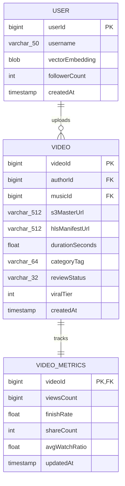
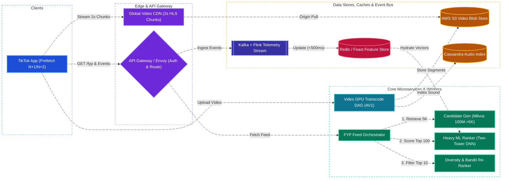

# TikTok System Design

[← Back to System Design](system-design.md)

> **Core Building Blocks Used**: [Chapter 1 — HTTP/3 QUIC Video Delivery](fundamentals/01-networking-and-api-paradigms.md#http-evolution-http11-vs-http2-vs-http3) · [Chapter 2 — Global Pull/Push Edge CDN](fundamentals/02-edge-load-balancing-and-cdn.md#4-content-delivery-network-cdn) · [Chapter 7 — Flink Real-Time Engagement Stream & Bloom Filter Seen-Video Dedupe](fundamentals/07-probabilistic-structures-and-stream-processing.md#bloom-filter--cuckoo-filter-set-membership) · [Chapter 9 — 4-Stage Recommendation Funnel (Two-Tower ANN + MMoE Ranking) & Feature Store](fundamentals/09-genai-llm-and-ml-system-design.md#4-classic-real-time-ml-system-design-building-blocks)

## Overview

TikTok is a global short-form vertical video platform with over 1 billion monthly active users consuming over 1 billion videos daily. Unlike traditional social media platforms driven by explicit friend/follower social graphs, TikTok's engagement is powered almost entirely by its hyper-personalized AI recommendation engine (the **"For You" Page - FYP**) and a playback experience optimized for instantaneous swipe response ($< 50\text{ ms}$).

Designing TikTok requires solving complex multimodal machine learning and multimedia systems challenges:

1. **Instant Vertical Video Playback**: Delivering sub-50ms swipe transitions using predictive rolling client prefetch buffers and short 2-second media chunks.
2. **The "For You" Recommendation Engine**: A three-stage ML pipeline (Candidate Generation $\to$ Heavy Neural Ranking $\to$ Diversity Re-Ranking) scoring millions of candidate videos in real time.
3. **Sub-Second Real-Time Telemetry Feedback**: Ingesting watch-time duration, re-loops, and quick-swipes ($< 1\text{s}$) to adjust the user's FYP vector embeddings in $< 500\text{ ms}$.
4. **Massive-Scale GPU Video Transcoding**: Transcoding millions of daily uploads into adaptive vertical (9:16) HLS/DASH streams across AV1, HEVC, and H.264 codecs.

---

## Functional Requirements

* **Instant Video Playback**: Full-screen, autoplaying vertical video feed (9:16 aspect ratio) that switches instantaneously upon swiping.
* **Hyper-Personalized FYP Feed**: Continuous, infinite stream of recommended videos tailored to real-time interest shifts.
* **Video Creation & Ingestion**: Users can record/upload 15-second to 10-minute videos, apply filters, audio tracks, and auto-generated captions.
* **Social Engagement**: Likes, comments, shares, video stitching/duets, and profile following.
* **Audio Track Attribution**: Videos link to an underlying audio/music track; clicking the audio displays all videos using that sound.

---

## Non-Functional Requirements

* **Zero-Lag Swipe Latency**: Video playback must start in **$< 50\text{ ms}$** after a swipe gesture (P95).
* **Low Latency Recommendation**: Generating a batch of 10 personalized candidate videos in **$< 150\text{ ms}$**.
* **Real-Time Model Responsiveness**: User engagement signals (e.g. watching a video 3 times) must influence subsequent feed items within **$< 1\text{ second}$**.
* **High Availability**: $99.99\%$ uptime for video streaming and recommendation generation.
* **Massive Throughput**: Serving over $100,000,000\text{ concurrent viewers}$ during peak global traffic hours.

---

## Back of the Envelope Estimations

### Scale & Traffic

* **Daily Active Users (DAU)**: $500\text{ Million}$.
* **Average Videos Viewed per User / Day**: $100\text{ videos/day}$.
* **Daily Video Views**:
  $$500,000,000\text{ users} \times 100\text{ videos} = 50,000,000,000\text{ views/day}$$
* **Average Video Consumption QPS**:
  $$\text{View QPS} = \frac{50,000,000,000}{86,400} \approx 578,700\text{ views/sec} \quad (\text{Peak: } \approx 1,500,000\text{ QPS})$$
* **Video Upload Traffic**:
  * $5\%$ of DAU upload 1 video/day $= 25\text{ Million new videos/day}$.
  * Ingestion QPS $\approx 290\text{ uploads/sec}$.

### Storage Footprint

* **Average Video Duration**: 30 seconds.
* **Average Transcoded Video Size (Multi-bitrate)**: $10\text{ MB}$.
* **Daily Ingested Storage**:
  $$25,000,000\text{ uploads} \times 10\text{ MB} = 250\text{ Terabytes/day}$$
* **Annual Storage Footprint**:
  $$250\text{ TB} \times 365 \approx 91\text{ Petabytes/year}$$ (stored in AWS S3 / HDFS with regional CDN edge replication).

---

## High-Level System Architecture

```mermaid
%%{init: {'flowchart': {'nodeSpacing': 25, 'rankSpacing': 45, 'padding': 10}}}%%
flowchart LR
    App["TikTok Mobile App (Prefetch)"]
    subgraph EdgeTier["Edge & Ingress"]
        CDN["Global Video CDN (2s Chunks)"]
        Gateway["API Gateway & Load Balancer"]
    end
    subgraph AppBackend["Recommendation & Stream Services"]
        CandRetrieval["1. Candidate Retrieval (Milvus)"]
        HeavyRank["2. Heavy ML Ranking (DNN)"]
        ReRank["3. Re-Ranking & Diversity"]
        FlinkEngine["Apache Flink Stream Engine"]
    end
    subgraph DataLayer["Storage, Cache & Event Bus"]
        KafkaTelem[["Kafka Telemetry Topic"]]
        FeatureStore[("Redis / Feast Feature Store")]
    end
    App e1@-->|"1. Stream Chunks"| CDN
    App e2@-->|"2. FYP & Events"| Gateway
    Gateway e3@-->|"Retrieve 5K"| CandRetrieval
    Gateway e4@-->|"Watch Events"| KafkaTelem
    CandRetrieval e5@-->|"Score Top 100"| HeavyRank
    HeavyRank e6@-->|"Filter Top 10"| ReRank
    KafkaTelem e7@-->|"Stream"| FlinkEngine
    FlinkEngine e8@-->|"Update Vectors"| FeatureStore
    FeatureStore e9@-->|"User Features"| HeavyRank

    e1@{ animate: true }
    e2@{ animate: true }
    e3@{ animate: true }
    e4@{ animate: true }
    e5@{ animate: true }
    e6@{ animate: true }
    e7@{ animate: true }
    e8@{ animate: true }
    e9@{ animate: true }

    classDef client fill:#1d4ed8,stroke:#60a5fa,stroke-width:2px,color:#ffffff
    classDef edge fill:#6d28d9,stroke:#a78bfa,stroke-width:2px,color:#ffffff
    classDef service fill:#047857,stroke:#34d399,stroke-width:2px,color:#ffffff
    classDef worker fill:#0e7490,stroke:#22d3ee,stroke-width:2px,color:#ffffff
    classDef cache fill:#be123c,stroke:#fb7185,stroke-width:2px,color:#ffffff
    classDef queue fill:#3730a3,stroke:#818cf8,stroke-width:2px,color:#ffffff

    class App client
    class CDN,Gateway edge
    class CandRetrieval,HeavyRank,ReRank service
    class FlinkEngine worker
    class FeatureStore cache
    class KafkaTelem queue

    style EdgeTier fill:transparent,stroke:#a78bfa,stroke-width:1.5px,stroke-dasharray: 5 5
    style AppBackend fill:transparent,stroke:#34d399,stroke-width:1.5px,stroke-dasharray: 5 5
    style DataLayer fill:transparent,stroke:#fbbf24,stroke-width:1.5px,stroke-dasharray: 5 5
```



---

## The Recommendation Engine Architecture (FYP)

The "For You" Page relies on a 3-stage funnel:

```mermaid
%%{init: {'flowchart': {'nodeSpacing': 20, 'rankSpacing': 40, 'padding': 10}}}%%
flowchart LR
    All["All Videos (100M+ Pool)"]
    subgraph Stage1["Stage 1: Candidate Generation (5K)"]
        V1["Milvus Vector Search"]
        V2["Collaborative Filtering"]
        V3["Trending Audio & Hashtags"]
    end
    subgraph Stage2["Stage 2: Heavy Neural Net (Top 100)"]
        M1["Predict P_Finish & P_Watch"]
        M2["Predict P_Like & P_Share"]
        Score["Weighted Multi-Task Score"]
    end
    subgraph Stage3["Stage 3: Re-Ranking & Diversity"]
        D1["Creator & Audio Dedupe"]
        D2["10% Exploration Bandit"]
    end
    Final["Top 10 FYP Videos"]

    All e1@-->|"Retrieve"| V1
    All e2@-->|"Retrieve"| V2
    All e3@-->|"Retrieve"| V3
    V1 e4@-->|"5K Pool"| M1
    V2 e5@-->|"5K Pool"| M2
    V3 e6@-->|"5K Pool"| Score
    M1 e7@-->|"Top 100"| D1
    M2 e8@-->|"Top 100"| D1
    Score e9@-->|"Top 100"| D2
    D1 e10@-->|"Emit"| Final
    D2 e11@-->|"Emit"| Final

    e1@{ animate: true }
    e2@{ animate: true }
    e3@{ animate: true }
    e4@{ animate: true }
    e5@{ animate: true }
    e6@{ animate: true }
    e7@{ animate: true }
    e8@{ animate: true }
    e9@{ animate: true }
    e10@{ animate: true }
    e11@{ animate: true }

    classDef client fill:#1d4ed8,stroke:#60a5fa,stroke-width:2px,color:#ffffff
    classDef edge fill:#6d28d9,stroke:#a78bfa,stroke-width:2px,color:#ffffff
    classDef service fill:#047857,stroke:#34d399,stroke-width:2px,color:#ffffff
    classDef worker fill:#0e7490,stroke:#22d3ee,stroke-width:2px,color:#ffffff
    classDef storage fill:#b45309,stroke:#fbbf24,stroke-width:2px,color:#ffffff

    class All storage
    class V1,V2,V3 worker
    class M1,M2,Score service
    class D1,D2 edge
    class Final client

    style Stage1 fill:transparent,stroke:#22d3ee,stroke-width:1.5px,stroke-dasharray: 5 5
    style Stage2 fill:transparent,stroke:#34d399,stroke-width:1.5px,stroke-dasharray: 5 5
    style Stage3 fill:transparent,stroke:#a78bfa,stroke-width:1.5px,stroke-dasharray: 5 5
```



### Multi-Task Scoring Formulation

The ranking engine uses a unified scoring function combining multiple predicted engagement probabilities:
$$\text{Score} = w_1 \cdot P(\text{finish}) + w_2 \cdot P(\text{re-watch}) + w_3 \cdot P(\text{share}) + w_4 \cdot P(\text{like}) - w_5 \cdot P(\text{skip} < 2\text{s})$$

* Because $P(\text{share})$ and $P(\text{re-watch})$ indicate exceptionally high content affinity, their model weights ($w_2, w_3$) are significantly higher than passive $P(\text{like})$.

---

## Instant Playback & Client Prefetching

Achieving $< 50\text{ ms}$ video transitions requires cooperation between the mobile client and CDN:

* **The Sliding Window Prefetch Engine**:
  * While the user is viewing Video $N$:
    * Video $N$: Playing in hardware video decoder.
    * Video $N+1$: The client has already downloaded the first 2 seconds (init segment + first media segment) and initialized a background decoder surface.
    * Video $N+2$: Metadata and manifest pre-fetched.
* **Instant Gesture Transition**:
  * The moment the swipe threshold ($> 30\text{ px}$) is crossed, the UI thread immediately swaps the rendering surface to the pre-buffered Video $N+1$.
  * Playback begins in **0 milliseconds** of perceived network latency.

---

## API Specifications

### 1. Fetch For You Feed Batch

```http
GET /api/v2/feed/fyp?count=10&cursor=cur_88192a
Authorization: Bearer <user_token>
```

```json
// Response: 200 OK
{
  "videos": [
    {
      "videoId": "vid_9918231a",
      "author": {
        "userId": "usr_4412",
        "username": "chef_alex",
        "avatarUrl": "https://cdn.tiktok.com/avatars/4412.webp"
      },
      "videoUrl": "https://v16-cdn.tiktok.com/hls/vid_9918231a/master.m3u8",
      "coverUrl": "https://cdn.tiktok.com/covers/vid_9918231a.webp",
      "music": {
        "musicId": "mus_7718",
        "title": "Viral Lo-Fi Beats",
        "authorName": "ChillHop"
      },
      "durationSeconds": 24.5,
      "stats": {
        "likes": 842000,
        "comments": 14200,
        "shares": 52100
      }
    }
  ],
  "nextCursor": "cur_88192b"
}
```

### 2. Ingest Video Playback Telemetry

```http
POST /api/v2/telemetry/playback
Authorization: Bearer <user_token>
Content-Type: application/json
```

```json
// Request
{
  "videoId": "vid_9918231a",
  "watchTimeMs": 24500,
  "videoDurationMs": 24500,
  "completed": true,
  "loopCount": 2,
  "action": "SHARED",
  "shareChannel": "WHATSAPP",
  "clientTimestamp": 1730007800
}

// Response: 204 No Content
```

---

## Object Model & Database Schema

### Database Selection & Rationale

| Workload / Subsystem | Database Choice | Data Model & CAP Profile | Why This Database? (Justification & Trade-offs) |
| :--- | :--- | :--- | :--- |
| **Stage-1 Candidate Retrieval (Embedding Similarity)** | **Milvus / FAISS (Vector Database)** | Approximate Nearest Neighbor Vector Index (**AP / HNSW & IVF-PQ**) | **Why:** Unlike follower-graph networks, TikTok's FYP must match a user's real-time interest embedding vector (`USER.vectorEmbedding`) against $100\text{ Million+}$ candidate video vectors in $< 30\text{ ms}$. Relational and standard NoSQL databases cannot perform high-dimensional cosine/inner-product similarity search; Milvus uses HNSW/IVF indexes in RAM/NVMe to retrieve the top 5,000 semantic candidates in milliseconds. |
| **Real-Time User & Video ML Features (<500ms Feedback)** | **Redis Cluster / Feast Online Feature Store** | In-Memory Key-Value (**AP / Sub-ms**) | **Why:** When a user loops a video twice or swipes away in $< 1\text{ s}$, Apache Flink updates `VIDEO_METRICS` (`finishRate`, `avgWatchRatio`) and user short-term interest vectors in Redis within $< 500\text{ ms}$ so the Heavy Neural Ranker can score the very next batch of 10 FYP videos using fresh signals. |
| **Video Metadata, Audio Track Index & User Graph** | **Apache Cassandra / ScyllaDB (+ Sharded MySQL)** | Wide-Column Store (**AP / PA-EL**) | **Why:** Sustaining $1.5\text{M Peak View QPS}$ and indexing millions of videos per viral sound (`PRIMARY KEY (music_id, view_count DESC, video_id)`) requires horizontal wide-column partitioning with pre-sorted clustering keys so clicking a viral audio track returns top videos in $< 10\text{ ms}$. |
| **Transcoded 2-Second Video Chunks (AV1 / HEVC)** | **AWS S3 + Global Multi-CDN** | Object Storage + Edge Cache (**11 9s Durability**) | **Why:** Stores $250\text{ TB/day}$ ($91\text{ PB/year}$) of multi-bitrate vertical video segments, with the first 2-second init chunk of hot videos pinned in edge CDN RAM to enable $< 50\text{ ms}$ zero-lag swipe transitions. |



---

## System Design Diagram



---

## Deep Dive & Key Technical Challenges

### 1. The Cold-Start Traffic Evaluation Funnel

New videos cannot be ranked by historical watch time because they have zero views.

* **Tiered Exposure Funnel**:
  * **Stage 1 (Initial Pool)**: New video is immediately routed to an exploration cohort of $100 - 300\text{ active users}$.
  * **Stage 2 (Viral Evaluation)**: Flink tracks the completion rate and share rate in real time. If $\text{Finish Rate} > 60\%$ and $\text{Like Rate} > 15\%$, the video is automatically promoted to **Tier 2 ($10,000\text{ users})$**.
  * **Stage 3 (Breakout Global FYP)**: If performance metrics remain in the top 99th percentile, the recommendation engine opens the floodgates to global distribution ($1\text{M} - 50\text{M+}\text{ users}$).

### 2. Fast Audio Track Aggregation

* Audio is a primary viral vector on TikTok.
* When a sound goes viral, millions of videos are created with that sound ID.
* **Cassandra Sharded by `music_id`**:

  ```sql
  CREATE TABLE videos_by_music (
      music_id BIGINT,
      created_at TIMESTAMP,
      video_id BIGINT,
      view_count BIGINT,
      PRIMARY KEY (music_id, view_count, video_id)
  ) WITH CLUSTERING ORDER BY (view_count DESC);
  ```

  * Allows querying the most popular videos for any sound in $< 10\text{ ms}$.

---

## Additional Notes

### Video References

* [](https://www.youtube.com/watch?v=Z-0g_aJL5Fw)
* [](https://www.youtube.com/watch?v=c_oEJ14jW8A)
