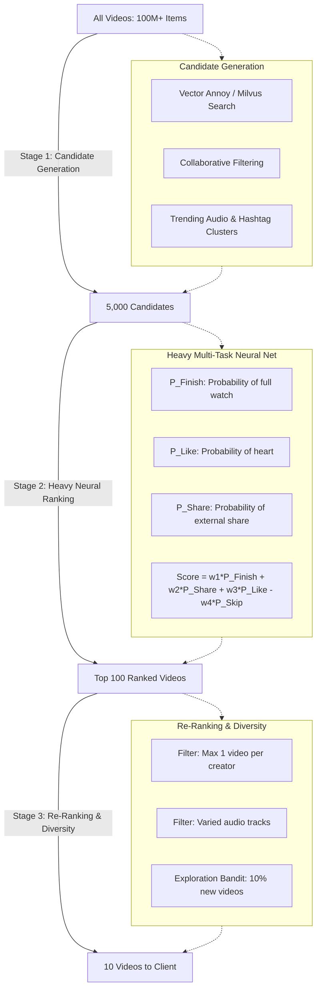
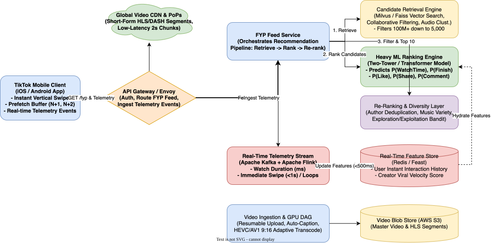

# TikTok System Design

[← Back to System Design](../system-design.md)

## Overview

TikTok is a global short-form vertical video platform with over 1 billion monthly active users consuming over 1 billion videos daily. Unlike traditional social media platforms driven by explicit friend/follower social graphs, TikTok's engagement is powered almost entirely by its hyper-personalized AI recommendation engine (the **"For You" Page - FYP**) and a playback experience optimized for instantaneous swipe response ($< 50\text{ ms}$).

Designing TikTok requires solving complex multimodal machine learning and multimedia systems challenges:

1. **Instant Vertical Video Playback**: Delivering sub-50ms swipe transitions using predictive rolling client prefetch buffers and short 2-second media chunks.
2. **The "For You" Recommendation Engine**: A three-stage ML pipeline (Candidate Generation $\to$ Heavy Neural Ranking $\to$ Diversity Re-Ranking) scoring millions of candidate videos in real time.
3. **Sub-Second Real-Time Telemetry Feedback**: Ingesting watch-time duration, re-loops, and quick-swipes ($< 1\text{s}$) to adjust the user's FYP vector embeddings in $< 500\text{ ms}$.
4. **Massive-Scale GPU Video Transcoding**: Transcoding millions of daily uploads into adaptive vertical (9:16) HLS/DASH streams across AV1, HEVC, and H.264 codecs.

---

## Functional Requirements

* **Instant Video Playback**: Full-screen, autoplaying vertical video feed (9:16 aspect ratio) that switches instantaneously upon swiping.
* **Hyper-Personalized FYP Feed**: Continuous, infinite stream of recommended videos tailored to real-time interest shifts.
* **Video Creation & Ingestion**: Users can record/upload 15-second to 10-minute videos, apply filters, audio tracks, and auto-generated captions.
* **Social Engagement**: Likes, comments, shares, video stitching/duets, and profile following.
* **Audio Track Attribution**: Videos link to an underlying audio/music track; clicking the audio displays all videos using that sound.

---

## Non-Functional Requirements

* **Zero-Lag Swipe Latency**: Video playback must start in **$< 50\text{ ms}$** after a swipe gesture (P95).
* **Low Latency Recommendation**: Generating a batch of 10 personalized candidate videos in **$< 150\text{ ms}$**.
* **Real-Time Model Responsiveness**: User engagement signals (e.g. watching a video 3 times) must influence subsequent feed items within **$< 1\text{ second}$**.
* **High Availability**: $99.99\%$ uptime for video streaming and recommendation generation.
* **Massive Throughput**: Serving over $100,000,000\text{ concurrent viewers}$ during peak global traffic hours.

---

## Back of the Envelope Estimations

### Scale & Traffic

* **Daily Active Users (DAU)**: $500\text{ Million}$.
* **Average Videos Viewed per User / Day**: $100\text{ videos/day}$.
* **Daily Video Views**:
  $$500,000,000\text{ users} \times 100\text{ videos} = 50,000,000,000\text{ views/day}$$
* **Average Video Consumption QPS**:
  $$\text{View QPS} = \frac{50,000,000,000}{86,400} \approx 578,700\text{ views/sec} \quad (\text{Peak: } \approx 1,500,000\text{ QPS})$$
* **Video Upload Traffic**:
  * $5\%$ of DAU upload 1 video/day $= 25\text{ Million new videos/day}$.
  * Ingestion QPS $\approx 290\text{ uploads/sec}$.

### Storage Footprint

* **Average Video Duration**: 30 seconds.
* **Average Transcoded Video Size (Multi-bitrate)**: $10\text{ MB}$.
* **Daily Ingested Storage**:
  $$25,000,000\text{ uploads} \times 10\text{ MB} = 250\text{ Terabytes/day}$$
* **Annual Storage Footprint**:
  $$250\text{ TB} \times 365 \approx 91\text{ Petabytes/year}$$ (stored in AWS S3 / HDFS with regional CDN edge replication).

---

## High-Level System Architecture

```text
                                  ┌────────────────────────┐
                                  │   TikTok Mobile App    │
                                  │ (Client Prefetch Buf)  │
                                  └────┬──────────────┬────┘
                                       │              │
                   1. Stream 2s Chunks │              │ 2. GET /fyp & Telemetry
                      (Edge CDN)       │              │    (gRPC / HTTP3)
                                       ▼              ▼
┌─────────────────────────────────────────────┐    ┌─────────────────────────────────────────┐
│              GLOBAL VIDEO CDN               │    │         API GATEWAY & LOAD BALANCER     │
│  - Edge PoPs caching top viral videos       │    │  - OAuth, Telemetry Ingestion, Routing  │
└─────────────────────────────────────────────┘    └────────────────────┬────────────────────┘
                                                                        │
                                       ┌────────────────────────────────┴───────────────────┐
                                       │                                                    │
                                       ▼                                                    ▼
┌─────────────────────────────────────────────────────────────┐  ┌─────────────────────────────────────────────────────────────┐
│                 RECOMMENDATION ENGINE (FYP)                 │  │             REAL-TIME TELEMETRY & FEATURE PIPELINE          │
│                                                             │  │                                                             │
│  ┌───────────────────────────────────────────────────────┐  │  │  ┌───────────────────────┐   ┌───────────────────────────┐  │
│  │ 1. Candidate Retrieval (Milvus / Faiss Vector DB)     │  │  │  │ Kafka Telemetry Topic │──▶│ Apache Flink Stream Engine│  │
│  │    (Filters 100M+ down to 5,000 candidates)           │  │  │  │ (Watch time ms, loops)│   │ (Computes User Vectors)   │  │
│  └──────────────────────────┬────────────────────────────┘  │  │  └───────────────────────┘   └─────────────┬─────────────┘  │
│                             ▼                               │  │                                            │                │
│  ┌───────────────────────────────────────────────────────┐  │  │                                            ▼                │
│  │ 2. Heavy ML Scoring & Ranking (Deep Neural Net)       │◀─┼──┼────────────────────────────────────────────┘                │
│  │    Predicts: P(Watch), P(Finish), P(Like), P(Share)   │  │  │    Real-Time Features (Redis / Feast Feature Store)         │
│  └──────────────────────────┬────────────────────────────┘  │  └─────────────────────────────────────────────────────────────┘
│                             ▼                               │
│  ┌───────────────────────────────────────────────────────┐  │
│  │ 3. Re-Ranking & Diversity Layer                       │  │
│  │    (Author Deduplication, Music Variety, Exploration) │  │
│  └──────────────────────────┬────────────────────────────┘  │
│                             ▼                               │
│                  Returns Top 10 Video Batch                 │
└─────────────────────────────────────────────────────────────┘
```

---

## The Recommendation Engine Architecture (FYP)

The "For You" Page relies on a 3-stage funnel:



### Multi-Task Scoring Formulation

The ranking engine uses a unified scoring function combining multiple predicted engagement probabilities:
$$\text{Score} = w_1 \cdot P(\text{finish}) + w_2 \cdot P(\text{re-watch}) + w_3 \cdot P(\text{share}) + w_4 \cdot P(\text{like}) - w_5 \cdot P(\text{skip} < 2\text{s})$$

* Because $P(\text{share})$ and $P(\text{re-watch})$ indicate exceptionally high content affinity, their model weights ($w_2, w_3$) are significantly higher than passive $P(\text{like})$.

---

## Instant Playback & Client Prefetching

Achieving $< 50\text{ ms}$ video transitions requires cooperation between the mobile client and CDN:

* **The Sliding Window Prefetch Engine**:
  * While the user is viewing Video $N$:
    * Video $N$: Playing in hardware video decoder.
    * Video $N+1$: The client has already downloaded the first 2 seconds (init segment + first media segment) and initialized a background decoder surface.
    * Video $N+2$: Metadata and manifest pre-fetched.
* **Instant Gesture Transition**:
  * The moment the swipe threshold ($> 30\text{ px}$) is crossed, the UI thread immediately swaps the rendering surface to the pre-buffered Video $N+1$.
  * Playback begins in **0 milliseconds** of perceived network latency.

---

## API Specifications

### 1. Fetch For You Feed Batch

```http
GET /api/v2/feed/fyp?count=10&cursor=cur_88192a
Authorization: Bearer <user_token>
```

```json
// Response: 200 OK
{
  "videos": [
    {
      "videoId": "vid_9918231a",
      "author": {
        "userId": "usr_4412",
        "username": "chef_alex",
        "avatarUrl": "https://cdn.tiktok.com/avatars/4412.webp"
      },
      "videoUrl": "https://v16-cdn.tiktok.com/hls/vid_9918231a/master.m3u8",
      "coverUrl": "https://cdn.tiktok.com/covers/vid_9918231a.webp",
      "music": {
        "musicId": "mus_7718",
        "title": "Viral Lo-Fi Beats",
        "authorName": "ChillHop"
      },
      "durationSeconds": 24.5,
      "stats": {
        "likes": 842000,
        "comments": 14200,
        "shares": 52100
      }
    }
  ],
  "nextCursor": "cur_88192b"
}
```

### 2. Ingest Video Playback Telemetry

```http
POST /api/v2/telemetry/playback
Authorization: Bearer <user_token>
Content-Type: application/json
```

```json
// Request
{
  "videoId": "vid_9918231a",
  "watchTimeMs": 24500,
  "videoDurationMs": 24500,
  "completed": true,
  "loopCount": 2,
  "action": "SHARED",
  "shareChannel": "WHATSAPP",
  "clientTimestamp": 1730007800
}

// Response: 204 No Content
```

---

## Object Model & Database Schema

```text
┌───────────────────────┐          ┌───────────────────────┐
│         User          │1        *│         Video         │
├───────────────────────┤──────────├───────────────────────┤
│ userId: PK (BigInt)   │          │ videoId: PK (BigInt)  │
│ username: Varchar(50) │          │ authorId: FK (User)   │
│ vectorEmbedding: Blob │          │ musicId: FK (Music)   │
│ followerCount: Int    │          │ s3MasterUrl: String   │
│ createdAt: Timestamp  │          │ hlsManifestUrl: String│
└───────────────────────┘          │ durationSeconds: Float│
                                   │ categoryTag: Varchar  │
                                   │ reviewStatus: Enum    │
                                   │ viralTier: Int        │
                                   │ createdAt: Timestamp  │
                                   └───────────┬───────────┘
                                               │1
                                               │*
                                   ┌───────────▼───────────┐
                                   │      VideoMetrics     │
                                   ├───────────────────────┤
                                   │ videoId: PK, FK       │
                                   │ viewsCount: BigInt    │
                                   │ finishRate: Float     │
                                   │ shareCount: Int       │
                                   │ avgWatchRatio: Float  │
                                   │ updatedAt: Timestamp  │
                                   └───────────────────────┘
```

---

## System Design Diagram



[Download Draw.io File](tiktok.drawio)

---

## Deep Dive & Key Technical Challenges

### 1. The Cold-Start Traffic Evaluation Funnel

New videos cannot be ranked by historical watch time because they have zero views.

* **Tiered Exposure Funnel**:
  * **Stage 1 (Initial Pool)**: New video is immediately routed to an exploration cohort of $100 - 300\text{ active users}$.
  * **Stage 2 (Viral Evaluation)**: Flink tracks the completion rate and share rate in real time. If $\text{Finish Rate} > 60\%$ and $\text{Like Rate} > 15\%$, the video is automatically promoted to **Tier 2 ($10,000\text{ users})$**.
  * **Stage 3 (Breakout Global FYP)**: If performance metrics remain in the top 99th percentile, the recommendation engine opens the floodgates to global distribution ($1\text{M} - 50\text{M+}\text{ users}$).

### 2. Fast Audio Track Aggregation

* Audio is a primary viral vector on TikTok.
* When a sound goes viral, millions of videos are created with that sound ID.
* **Cassandra Sharded by `music_id`**:

  ```sql
  CREATE TABLE videos_by_music (
      music_id BIGINT,
      created_at TIMESTAMP,
      video_id BIGINT,
      view_count BIGINT,
      PRIMARY KEY (music_id, view_count, video_id)
  ) WITH CLUSTERING ORDER BY (view_count DESC);
  ```

  * Allows querying the most popular videos for any sound in $< 10\text{ ms}$.

---

## Additional Notes

### Video References

* [](https://www.youtube.com/watch?v=07wvffvyc10)
