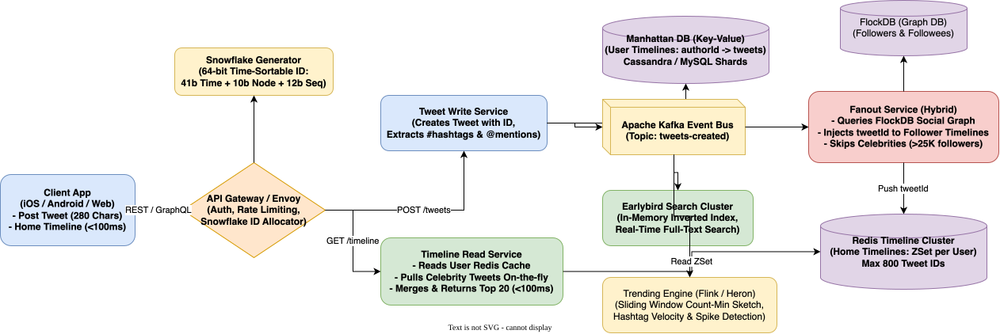

# Twitter System Design

[← Back to System Design](../system-design.md)

## Overview

Twitter (now X) is a real-time microblogging and social broadcast platform where users post short messages (tweets up to 280 characters), follow other users, interact via retweets, likes, and replies, and discover real-time breaking news through trending topics and full-text search.

The system is famously known for pioneering large-scale real-time timeline fan-out architectures, the **Snowflake** distributed unique ID generation system, real-time search indexing (**Earlybird**), and sliding-window trending topic algorithms.

---

## Functional Requirements

* **Post Tweet**: Users can publish short text updates (up to 280 characters), optionally attaching photos, video clips, mentions (`@username`), and hashtags (`#topic`).
* **Home Timeline**: Users view an aggregated, real-time feed of tweets from accounts they follow.
* **User Timeline**: Users can view their own past tweets and retweets in reverse chronological order.
* **Social Graph**: Users can follow, unfollow, and block other accounts.
* **Retweet & Quote Tweet**: Re-broadcast another user's tweet to one's own followers, optionally adding commentary.
* **Likes & Replies**: Like tweets and participate in threaded reply conversations.
* **Search & Trends**: Search tweets by keyword/hashtag; display real-time trending topics computed across geographic regions.

---

## Non-Functional Requirements

* **Ultra-Low Read Latency**: Home timeline retrieval must return within **$< 100\text{ ms}$** (P95).
* **Extreme Read-Heavy Scalability**: System must support a **$50:1$ to $100:1$ read-to-write ratio**.
* **High Availability (99.99%)**: Timeline reads must remain available; degraded recommendations or stale timelines are preferred over outages.
* **Eventual Consistency**: A new tweet should appear in followers' home timelines within **$< 3–5\text{ seconds}$**.
* **Unique & Monotonically Increasing IDs**: Every tweet must have a time-sortable 64-bit identifier to avoid cross-shard sorting bottlenecks.

---

## Back of the Envelope Estimations

### Scale & Traffic

* **Daily Active Users (DAU)**: $250\text{ Million}$.
* **New Tweets per Day**: $500\text{ Million tweets/day}$ (average 2 tweets/user/day).
* **Average Tweet Write QPS**:
  $$\text{Write QPS} = \frac{500,000,000}{86,400} \approx 5,800\text{ writes/sec} \quad (\text{Peak: } \approx 15,000\text{ QPS})$$
* **Timeline Reads per User**: $20\text{ timeline views/day}$.
* **Total Daily Timeline Views**:
  $$250,000,000 \times 20 = 5,000,000,000\text{ views/day}$$
* **Average Timeline Read QPS**:
  $$\text{Read QPS} = \frac{5,000,000,000}{86,400} \approx 58,000\text{ QPS} \quad (\text{Peak: } \approx 150,000\text{ QPS})$$

### Storage Requirements

* **Tweet Text & Metadata**: $\approx 300\text{ bytes}$ per tweet.
  $$500,000,000 \times 300\text{ bytes} \approx 150\text{ GB/day} \implies \approx 55\text{ TB/year}$$
* **Media Storage**:
  * $20\%$ of tweets include an image ($\approx 1\text{ MB}$).
  * $500\text{M} \times 0.20 \times 1\text{ MB} = 100\text{ TB/day} \implies \approx 36.5\text{ PB/year}$.
* **Redis Timeline Cache**:
  * Cache top 800 tweet IDs for all 250M active users:
  $$250,000,000 \times 800 \times 8\text{ bytes} \approx 1.6\text{ Terabytes of RAM}$$
  *(Distributed across a cluster of Redis / Memcached instances).*

---

## System Architecture

```text
                                  ┌────────────────────────┐
                                  │      Client App        │
                                  └────┬──────────────┬────┘
                                       │              │
                   1. POST /api/tweets │              │ 2. GET /api/timeline/home
                                       ▼              ▼
┌──────────────────────────────────────────────┐   ┌────────────────────────────────┐
│           TWEET INGESTION & FANOUT           │   │      TIMELINE SERVING LAYER    │
│                                              │   │                                │
│          ┌────────────────────────┐          │   │  ┌──────────────────────────┐  │
│          │  API Gateway / Envoy   │          │   │  │    Timeline Service      │  │
│          └───────────┬────────────┘          │   │  └───────────▲──────────────┘  │
│                      │                       │   │              │                 │
│                      ▼                       │   │              │ Reads ZSet      │
│          ┌────────────────────────┐          │   │  ┌───────────┴──────────────┐  │
│          │   Tweet Write Service  │          │   │  │   Redis Timeline Cluster │  │
│          └─────┬────────────┬─────┘          │   │  │   (List of Tweet IDs)    │  │
│                │            │                │   │  └───────────▲──────────────┘  │
│         Saves  │            │ Publishes      │   │              │                 │
│                ▼            ▼                │   │              │                 │
│        ┌─────────────┐┌─────────────┐        │   │              │ Writes to       │
│        │  Manhattan  ││ Kafka Event │        │   │              │ Followers       │
│        │  (Key-Value)││ Bus         │        │   │              │                 │
│        └─────────────┘└──────┬──────┘        │   │              │                 │
│                              │               │   │              │                 │
│                              ▼               │   │              │                 │
│                     ┌─────────────────┐      │   │              │                 │
│                     │ Fanout Workers  │──────┼───┼──────────────┘                 │
│                     │ (Hybrid Model)  │      │   │                                │
│                     └────────┬────────┘      │   └────────────────────────────────┘
│                              │               │
│                              ▼               │
│                     ┌─────────────────┐      │
│                     │ Earlybird Index │      │
│                     │ (Real-Time Srch)│      │
│                     └─────────────────┘      │
└──────────────────────────────────────────────┴────────────────────────────────────┘
```

---

## Core Components & Deep Dives

### 1. The Timeline Fanout Architecture

* **User Timeline**: All tweets authored by a specific user. Fast and simple: stored in a key-value store (Twitter's Manhattan / Cassandra) keyed by `user_id`.
* **Home Timeline**: Aggregated feed of tweets from everyone a user follows.
  * Stored as a **Redis Sorted Set (ZSet)** for each active user, containing up to 800 recent tweet IDs.
* **Hybrid Fan-Out Pipeline**:
  * **Regular Users**: When user posts, fan-out workers query the follower graph (FlockDB) and append the `tweet_id` to each follower's Redis timeline list.
  * **Celebrities / High-Follower Accounts ($> 25,000$ followers)**: Do NOT fan-out on write. When a follower queries their home timeline, the Timeline Service performs an on-the-fly multi-get from the followed celebrities' user timelines and merges them with the follower's Redis cache.

### 2. Distributed Unique ID Generation: Twitter Snowflake

Database auto-increment IDs fail in distributed systems because they require a centralized coordination lock. Twitter designed **Snowflake** to generate 64-bit, time-sortable unique IDs across hundreds of distributed machines without coordination.

```text
 1 bit   41 bits: Timestamp in ms       10 bits: Machine ID   12 bits: Sequence
┌──────┬───────────────────────────────┬────────────────────┬───────────────────┐
│  0   │ Milliseconds since custom epoch│ Datacenter + Worker│ Per-worker counter│
└──────┴───────────────────────────────┴────────────────────┴───────────────────┘
```

* **Sign bit (1 bit)**: Always 0 (keeps integer positive).
* **Timestamp (41 bits)**: Milliseconds since a custom epoch (e.g., Nov 4, 2010). Gives $2^{41} \approx 69\text{ years}$ of unique timestamps.
* **Machine ID (10 bits)**: 5 bits Datacenter ID + 5 bits Worker ID ($2^{10} = 1,024\text{ distinct worker nodes}$).
* **Sequence Number (12 bits)**: Allows $2^{12} = 4,096\text{ unique IDs per millisecond per machine}$.
* **Key Advantage**: IDs are naturally sorted chronologically, allowing pagination queries (`WHERE id < :cursor LIMIT 20`) without secondary index sorting!

### 3. Real-Time Search Indexing (Earlybird)

* Unlike Google Web Search where batch indexes are built over hours, Twitter search must surface breaking news **seconds** after publication.
* **Earlybird Architecture**: Inverted index held entirely in RAM.
  * Incoming tweets flow from Kafka into Earlybird worker memory.
  * Earlybird creates an append-only in-memory posting list without locks.
  * A search query broadcasts to all Earlybird shards; results are scored, merged, and returned in $< 50\text{ ms}$.

### 4. Real-Time Trending Topics

* **Sliding Window Counting**: Streaming processors (Apache Flink / Heron) compute word frequencies over sliding time windows (e.g., 30 minutes).
* **Count-Min Sketch**: Space-efficient probabilistic data structure that tracks frequencies of millions of hashtags with sublinear memory.
* **Z-Score Spike Detection**: Identifies sudden surges in hashtag velocity compared to normal baseline traffic, filtering out bot spam and recurring words.

---

## API Endpoints

### 1. Post a Tweet

```http
POST /api/v1/tweets
Authorization: Bearer <user_token>
Content-Type: application/json
```

```json
// Request
{
  "text": "Excited to launch our distributed timeline engine! #systems #tech",
  "mediaIds": ["med_10284019"]
}

// Response: 201 Created
{
  "tweetId": 1490284729102840832,
  "authorId": 50129,
  "text": "Excited to launch our distributed timeline engine! #systems #tech",
  "createdAt": 1730005200,
  "likeCount": 0,
  "retweetCount": 0
}
```

### 2. Get Home Timeline

```http
GET /api/v1/timeline/home?count=20&max_id=1490284729102840000
Authorization: Bearer <user_token>
```

```json
// Response: 200 OK
{
  "tweets": [
    {
      "tweetId": 1490284729102840832,
      "author": {
        "userId": 50129,
        "screenName": "tarunbatta",
        "verified": true
      },
      "text": "Excited to launch our distributed timeline engine! #systems #tech",
      "likeCount": 420,
      "retweetCount": 85,
      "createdAt": 1730005200
    }
  ],
  "nextCursor": 1490284729102830000
}
```

---

## Object Model & Database Schema

```text
┌───────────────────────┐          ┌───────────────────────┐
│         User          │1        *│         Tweet         │
├───────────────────────┤──────────├───────────────────────┤
│ userId: PK (BigInt)   │          │ tweetId: PK (Snowflake│
│ username: Varchar(50) │          │ authorId: FK (BigInt) │
│ screenName: Varchar   │          │ text: Varchar(280)    │
│ followerCount: Int    │          │ inReplyToTweetId: FK  │
│ followingCount: Int   │          │ retweetCount: Int     │
│ isCelebrity: Boolean  │          │ likeCount: Int        │
└──────────┬────────────┘          │ createdAt: Timestamp  │
           │1                      └───────────────────────┘
           │*
┌──────────▼────────────┐
│      Follower         │
├───────────────────────┤
│ followeeId: PK, FK    │
│ followerId: PK, FK    │
│ createdAt: Timestamp  │
└───────────────────────┘
```

---

## System Design Diagram



[Download Draw.io File](twitter.drawio)

---

## Additional Notes

### Video References

* [](https://www.youtube.com/watch?v=Nfa-uUHuFHg)
* [](https://www.youtube.com/watch?v=Fy_Vo45P9xM)
* [](https://www.youtube.com/watch?v=gbysuvl2TZo)
