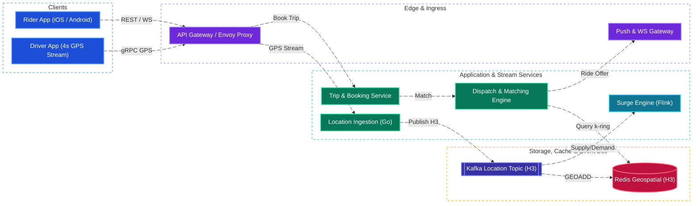
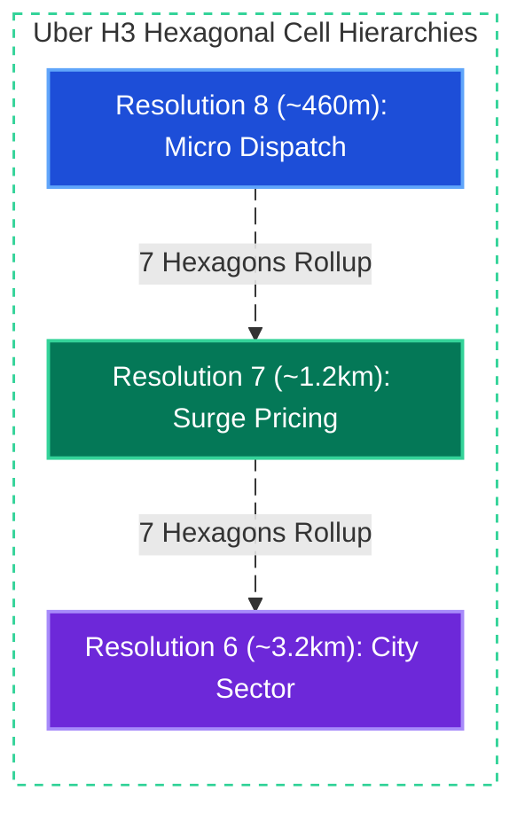
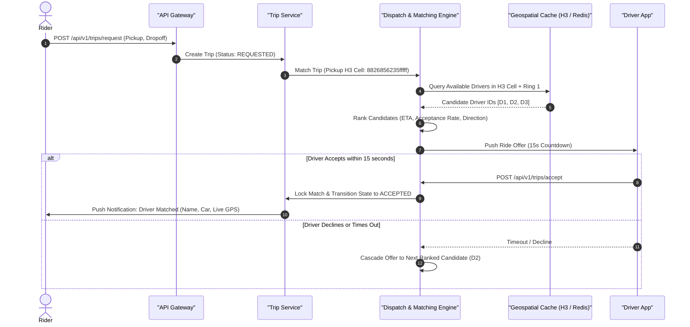
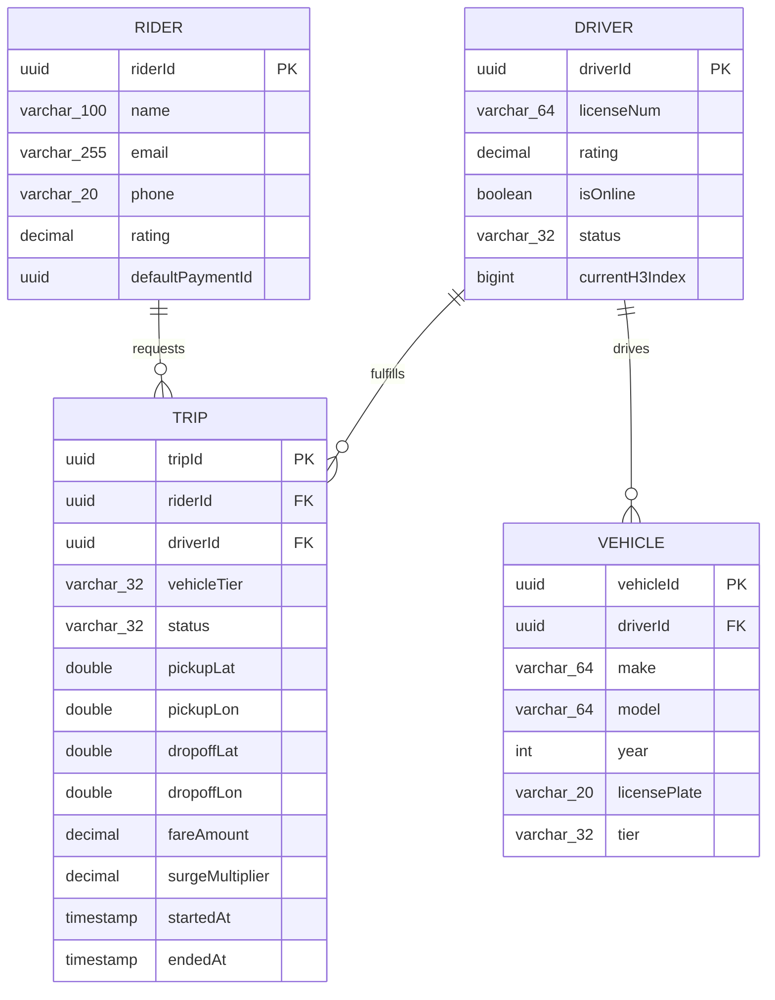

# Uber System Design

[← Back to System Design](system-design.md)

## Overview

Uber is a real-time, two-sided mobility marketplace connecting riders with drivers. The platform handles real-time driver GPS tracking, dynamic dispatch and matching algorithms, route navigation, dynamic pricing (surge), payment settlement, and two-way rating systems.

At its core, the architecture solves a massive distributed geospatial coordination problem: processing millions of real-time location pings every second, querying proximity within sub-millisecond latencies, dynamically balancing supply and demand across localized geographic partitions, and maintaining strict consistency across trip lifecycles.

---

## Functional Requirements

* **Rider Ride Request**: Riders can enter pickup and dropoff destinations, view estimated fares and pickup ETAs across vehicle categories (UberX, Comfort, Black, XL), and request a trip.
* **Driver Location Ingestion**: Active drivers broadcast continuous GPS coordinates every 3–4 seconds.
* **Driver Dispatch & Matching**: Find, rank, and notify the optimal available driver within a target geographic radius; allow driver 15 seconds to accept or decline.
* **Real-Time Trip Tracking**: Riders track the matched driver's real-time vehicle movement, orientation, and updated ETA on a live map via WebSockets.
* **Trip Lifecycle State Machine**: Manage deterministic states: `REQUESTED` $\to$ `DISPATCHED` $\to$ `ACCEPTED` $\to$ `ARRIVED` $\to$ `IN_PROGRESS` $\to$ `COMPLETED` $\to$ `PAID`.
* **Dynamic Surge Pricing**: Automatically adjust fare multipliers in real-time when ride demand outstrips available driver supply in a localized area.
* **Payments & Split Fares**: Automatically charge rider credit card / digital wallet upon dropoff; calculate driver earnings and platform commissions.
* **Mutual Ratings & Reviews**: 1-to-5 star ratings and reviews submitted by both rider and driver post-trip.

---

## Non-Functional Requirements

* **Sub-Second Matching Latency**: Finding and alerting matching drivers must complete within **< 1.0–2.0 seconds** of trip request.
* **Low-Latency GPS Streaming**: Driver location updates must appear on rider maps within **< 2–3 seconds** end-to-end.
* **High Availability (99.99%)**: Core trip booking, active ride tracking, and driver safety services must remain resilient across regional cloud outages.
* **Geospatial Write Scalability**: The location ingestion tier must seamlessly handle **hundreds of thousands of writes per second** without database contention.
* **Consistency Isolation**:
  * **Eventual Consistency** for location tracking: Dropping an isolated driver location ping is acceptable.
  * **Strict Consistency** for dispatch matching and billing: Two drivers must **never** be assigned the same rider, and a driver cannot be double-booked.
* **Data Durability**: Trip paths, financial transactions, and billing ledgers must have zero data loss.

---

## Back of the Envelope Estimations

### Scale & Concurrency

* **Global Active Riders**: $150\text{ Million MAU}$.
* **Global Active Drivers**: $6\text{ Million drivers}$.
* **Peak Concurrent Active Drivers**: $1,200,000\text{ drivers}$ online simultaneously.
* **GPS Broadcast Interval**: Every $4\text{ seconds}$ per active driver.
* **Location Ingestion QPS**:
  $$\text{Average Ingestion QPS} = \frac{1,200,000\text{ drivers}}{4\text{ seconds}} = 300,000\text{ writes/sec (300K QPS)}$$
* **Peak Ingestion QPS** (New Year's Eve / Bad weather, $2\times$):
  $$\text{Peak QPS} = 600,000\text{ writes/sec}$$

### Network & Storage Sizing

* **Location Ping Payload**: $\approx 128\text{ bytes}$ (`driverId`, `lat`, `lon`, `heading`, `speed`, `timestamp`, `status`).
* **Ingestion Network Bandwidth**:
  $$300,000\text{ req/sec} \times 128\text{ bytes} \approx 38.4\text{ MB/sec} \approx 307\text{ Mbps}$$
* **Daily Ingestion Storage (Raw Telemetry)**:
  $$300,000 \times 86,400\text{ seconds} \times 128\text{ bytes} \approx 3.3\text{ Terabytes/day}$$
* **In-Memory Active Driver Cache Size**:
  $$1,200,000\text{ drivers} \times 256\text{ bytes in-memory index} \approx 307\text{ Megabytes}$$
  *(Fits easily within an in-memory Redis cluster or memory-mapped Ringpop cluster).*
* **Completed Daily Trips**: $\approx 25\text{ Million trips/day}$.
* **Daily Trip Database Storage**:
  $$25,000,000 \times 2\text{ KB} \approx 50\text{ GB/day} \implies \approx 18.25\text{ TB/year}$$

---

## System Architecture



---

## Core Components & Data Flows

### 1. Geospatial Partitioning: Why Uber Built H3

Traditional SQL indexing (`B-Trees`) cannot efficiently query two-dimensional coordinates. Naive radial queries require scanning huge bounding boxes.

* **Geohash & Google S2 (Squares / Rectangles)**:
  * Rectangular cells suffer from **boundary distortion**: adjacent cells across diagonal corners are $\sqrt{2} \approx 1.414\times$ further apart than orthogonal neighbors.
  * Complicates continuous radius search and supply/demand heat smoothing.
* **Uber H3 (Hexagonal Hierarchical Spatial Index)**:
  * Hexagons have exactly **one uniform neighbor distance**: all 6 adjacent neighbors are equidistant from the center.
  * Minimizes quantization error when smoothing spatial demand curves.
  * Hierarchical: 16 resolution levels (Resolution 7 $\approx 1.2\text{ km}$ edge length; Resolution 8 $\approx 460\text{ meters}$, ideal for neighborhood dispatch).



### 2. Location Ingestion Pipeline

1. **Driver GPS Ping**: Driver client emits `(driverId, lat, lon, heading, timestamp)` over a persistent bidirectional WebSocket or gRPC channel.
2. **H3 Cell Resolution**: The Location Ingestion worker translates `(lat, lon)` into an `H3Index` integer (64-bit uint).
3. **Kafka Partitioning**: The message is published to Kafka partitioned by `H3Index`, guaranteeing that all driver events in the same geographic locality flow into the same stream processor.
4. **In-Memory Store Update**:
   * Redis `GEOADD` / sorted sets: Stores current active drivers per H3 cell with an expiry TTL of 15 seconds. If a driver drops connection, their presence automatically expires from search results.
   * Telemetry writes to cold storage (Cassandra / S3) asynchronously for historical auditing and route reconstruction.

### 3. Dispatch & Matching Engine (Batched Matching vs Greedy)

* **Naive Greedy Matching**: Assigns the first nearest driver to a requesting rider immediately.
  * *Flaw*: Causes local sub-optimal outcomes (e.g., Driver A gets matched to Rider 1 who is 2 minutes away, leaving Rider 2 waiting 15 minutes for a distant driver).
* **Batched Bipartite Matching**:
  * Collects ride requests and available drivers over a **3-to-5 second rolling batch window**.
  * Constructs a bipartite graph where edge weights represent estimated pickup ETA calculated via routing graphs.
  * Solves using the **Hungarian Algorithm / Minimum-Cost Maximum-Flow (MCMF)** to minimize aggregate customer wait times across the city sector.



### 4. Dynamic Surge Pricing Engine

* **Calculation Window**: Runs every 15–30 seconds via Apache Flink.
* **Supply vs Demand Ratio**:
  $$\text{Surge Factor} = f\left(\frac{\text{Unmatched Ride Requests in Cell } H_i}{\text{Available Drivers in Cell } H_i}\right)$$
* **Spatial Smoothing**: If cell $A$ has surge $2.0\times$ and adjacent cell $B$ has $1.0\times$, drivers would unbalance the system by flocking across borders. H3 neighbor smoothing averages the multiplier across $k$-rings ($R=1$ neighbors) using Gaussian weights to create gradual geographic transitions.

---

## API Endpoints

### 1. Request a Ride

```http
POST /api/v1/trips/request
Authorization: Bearer <rider_token>
Content-Type: application/json
```

```json
// Request
{
  "pickupLocation": {"lat": 37.7749, "lon": -122.4194},
  "dropoffLocation": {"lat": 37.7891, "lon": -122.4014},
  "vehicleTier": "UBERX",
  "quoteId": "qte_998124ab"
}

// Response: 201 Created
{
  "tripId": "trip_88102a7b",
  "status": "SEARCHING_FOR_DRIVER",
  "estimatedPickupMinutes": 4,
  "fareAmount": 24.50,
  "currency": "USD"
}
```

### 2. Driver Location Ping (WebSocket / gRPC Stream)

```protobuf
message DriverLocationPing {
  string driver_id = 1;
  double latitude = 2;
  double longitude = 3;
  float heading = 4;
  float speed_mps = 5;
  int64 timestamp = 6;
  enum DriverStatus status = 7; // AVAILABLE, EN_ROUTE_PICKUP, ON_TRIP
}
```

### 3. Accept Ride Offer

```http
POST /api/v1/trips/{tripId}/accept
Authorization: Bearer <driver_token>
Content-Type: application/json
```

```json
// Request
{
  "driverId": "drv_5512",
  "currentLocation": {"lat": 37.7755, "lon": -122.4180}
}

// Response: 200 OK
{
  "tripId": "trip_88102a7b",
  "status": "ACCEPTED",
  "rider": {
    "firstName": "Alex",
    "rating": 4.92,
    "pickupAddress": "550 Market St"
  }
}
```

---

## Object Model & Database Schema

### Database Selection & Rationale

| Workload / Subsystem | Database Choice | Data Model & CAP Profile | Why This Database? (Justification & Trade-offs) |
| :--- | :--- | :--- | :--- |
| **Live Driver Geospatial Index (`currentH3Index`)** | **Redis Cluster / Ringpop In-Memory Actor Mesh** | In-Memory Geospatial Index (**AP / Ephemeral 15s TTL**) | **Why:** Active drivers emit $300,000\text{--}600,000\text{ GPS pings/sec}$. Disk-backed SQL `B-Trees` or PostGIS R-Trees would melt under this continuous overwrite rate. Holding all 1.2M active drivers in memory ($\sim 307\text{ MB}$ total) indexed by **Uber H3** hexagonal cell IDs (`Resolution 8`) enables sub-millisecond $k$-ring neighbor queries and automatic 15-second TTL eviction when a driver goes offline. |
| **Active Trip State Machine, Dispatch Locks & Billing** | **Sharded PostgreSQL / MySQL (Schemaless / DocStore) or CockroachDB** | Transactional Relational / NewSQL (ACID, **CP / PC-EC**) | **Why:** Assigning a driver to a trip (`SEARCHING_FOR_DRIVER` $\to$ `ACCEPTED`), preventing double-dispatch race conditions (`WHERE status = 'SEARCHING_FOR_DRIVER'`), and settling driver/rider financial ledgers require strict ACID consistency and optimistic concurrency control. |
| **Historical Trip Trajectories & Completed Trips** | **Apache Cassandra + AWS S3 (Parquet)** | Wide-Column Store + Cold Object Lake (**AP / PA-EL**) | **Why:** Storing $3.3\text{ TB/day}$ of raw GPS bread-crumb pings and $25\text{M completed trips/day}$ requires high-throughput append-only LSM-Tree writes partitioned by `tripId` / `riderId` / `driverId`, with older trip history tiered to S3 for ML ETA training and dispute auditing. |



---

## System Design Diagram

```mermaid
%%{init: {'flowchart': {'nodeSpacing': 20, 'rankSpacing': 40, 'padding': 10}}}%%
flowchart LR
    subgraph ClientTier["Clients"]
        RiderApp["Rider App (Request & Live Map)"]
        DriverApp["Driver App (4s GPS & Offers)"]
    end
    subgraph EdgeTier["Edge & API Gateway"]
        Gateway{"API Gateway / Envoy (WS Pool)"}
        NotifSvc["Push Notification Svc (APNs/FCM)"]
    end
    subgraph CoreServices["Core Microservices & Workers"]
        LocIngest["Location Ingestion (Go + HMM)"]
        TripSvc["Trip & Booking Svc (State Machine)"]
        DispatchEngine["Dispatch Engine (Hungarian MCMF)"]
        SurgeEngine["Dynamic Surge Engine (Flink H3)"]
    end
    subgraph DataAndEventTier["Data Stores, Caches & Event Bus"]
        Kafka[["Kafka Bus (driver-locations)"]]
        GeoCache[("Redis Geospatial (H3 15s TTL)")]
        ColdTelemetry[("Cassandra / S3 Trajectory Store")]
        TripDB[("PostgreSQL Trip DB (ACID)")]
    end
    RiderApp e1@-->|"REST / WS"| Gateway
    DriverApp e2@-->|"4s GPS Pings"| Gateway
    Gateway e3@-->|"GPS Stream"| LocIngest
    Gateway e4@-->|"Book / Accept"| TripSvc
    LocIngest e5@-->|"By H3Index"| Kafka
    Kafka e6@-->|"GEOADD"| GeoCache
    Kafka e7@-->|"Archive Route"| ColdTelemetry
    Kafka e8@-->|"Supply/Demand"| SurgeEngine
    SurgeEngine e9@-.->|"Multiplier"| TripSvc
    TripSvc e10@-->|"Optimistic Lock"| TripDB
    TripSvc e11@-->|"Match Request"| DispatchEngine
    DispatchEngine e12@-->|"Query H3 k-ring"| GeoCache
    DispatchEngine e13@-->|"15s Offer"| NotifSvc
    NotifSvc e14@-->|"Push / WS"| DriverApp

    e1@{ animate: true }
    e2@{ animate: true }
    e3@{ animate: true }
    e4@{ animate: true }
    e5@{ animate: true }
    e6@{ animate: true }
    e7@{ animate: true }
    e8@{ animate: true }
    e9@{ animate: true }
    e10@{ animate: true }
    e11@{ animate: true }
    e12@{ animate: true }
    e13@{ animate: true }
    e14@{ animate: true }

    classDef client fill:#1d4ed8,stroke:#60a5fa,stroke-width:2px,color:#ffffff
    classDef edge fill:#6d28d9,stroke:#a78bfa,stroke-width:2px,color:#ffffff
    classDef service fill:#047857,stroke:#34d399,stroke-width:2px,color:#ffffff
    classDef worker fill:#0e7490,stroke:#22d3ee,stroke-width:2px,color:#ffffff
    classDef cache fill:#be123c,stroke:#fb7185,stroke-width:2px,color:#ffffff
    classDef storage fill:#b45309,stroke:#fbbf24,stroke-width:2px,color:#ffffff
    classDef queue fill:#3730a3,stroke:#818cf8,stroke-width:2px,color:#ffffff

    class RiderApp,DriverApp client
    class Gateway,NotifSvc edge
    class LocIngest,TripSvc,DispatchEngine service
    class SurgeEngine worker
    class GeoCache cache
    class ColdTelemetry,TripDB storage
    class Kafka queue

    style ClientTier fill:transparent,stroke:#60a5fa,stroke-width:1.5px,stroke-dasharray: 5 5
    style EdgeTier fill:transparent,stroke:#a78bfa,stroke-width:1.5px,stroke-dasharray: 5 5
    style CoreServices fill:transparent,stroke:#34d399,stroke-width:1.5px,stroke-dasharray: 5 5
    style DataAndEventTier fill:transparent,stroke:#fbbf24,stroke-width:1.5px,stroke-dasharray: 5 5
```



---

## Deep Dive & Key Technical Challenges

### 1. Preventing Double-Dispatch Race Conditions

If two drivers accept the same ride offer simultaneously, only one must succeed:

* **Distributed Locking (Redis Redlock / DB Versioning)**:

  ```sql
  UPDATE trips 
  SET driver_id = 'drv_5512', status = 'ACCEPTED', version = version + 1
  WHERE trip_id = 'trip_88102a7b' AND status = 'SEARCHING_FOR_DRIVER';
  ```

* If row count returned is `0`, another driver won the race. The loser receives an immediate `409 Conflict` and is placed back into the available pool.

### 2. Live Map Smoothing & Map Matching

Raw mobile GPS chips provide jittery, inaccurate points with up to 10-meter errors.

* **Map Matching (Hidden Markov Models - HMM)**: Snaps noisy raw coordinates to the underlying road network graph, taking one-way streets, turn restrictions, and legal speed limits into account.
* **Dead Reckoning & Kalman Filters**: On the rider's frontend client, vehicle motion between 4-second GPS ticks is animated smoothly using linear velocity interpolation and bearing dead reckoning.

### 3. Driver Disconnection & Reconnection Resilience

* **Heartbeat Timeout**: If no location ping is received from an active driver for 15 seconds, the system marks the driver as `DISCONNECTED` and removes them from the geospatial index.
* **Mid-Trip Disconnect**: If a driver loses cellular connection while an active trip is in progress, the driver app records the trip route offline in local storage. Once cellular signal returns, the app syncs the completed GPS trajectory and the backend computes the final fare accurately based on actual odometer distance.

---

## Additional Notes

### Video References

* [](https://www.youtube.com/watch?v=lsKU38RKQSo)
* [](https://www.youtube.com/watch?v=umWABit-wbk)
